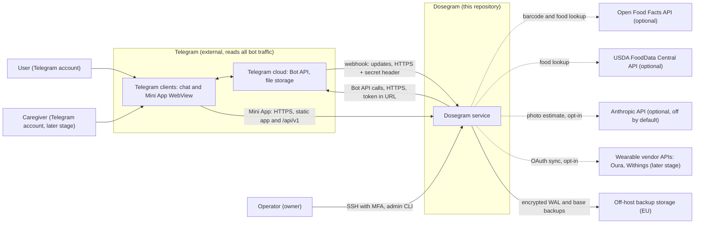
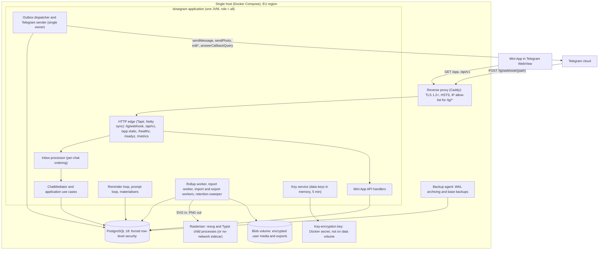
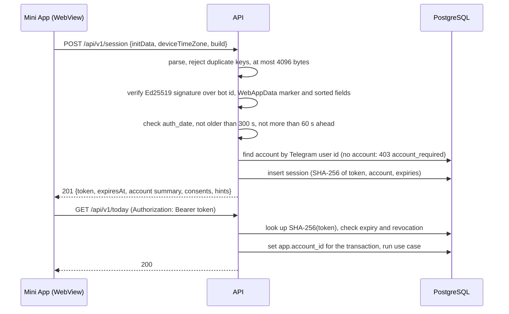
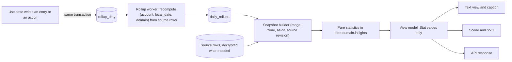

# Dosegram target architecture

Status: In force since 2026-11-13: the owner approved the plan and roadmap slice G0.2 promoted this document from `docs/dosegram/` to `docs/` ([ADR-014](adr/ADR-014.md)). Where the text below says "proposal" or "proposed", read it as the adopted specification; an open question keeps the status its own section gives it. Dosecord documents named as inputs (`docs/DESIGN.md`, the old `docs/ROADMAP.md`, `docs/BOT_UX_PLAN.md`) are now under `docs/archive/`. Prepared 2026-11-12; no product code was written for this document.
Scope: the target architecture of the repository after the pivot from `dosecord` (Discord) to `dosegram` (Telegram bot plus Telegram Mini App).
Inputs: `docs/DESIGN.md`, `docs/adr/ADR-001` to `ADR-013`, and the six research briefs in `docs/research/`.
Sibling documents: `PRODUCT_SPEC.md` (what the product does), `BOT_UX.md` (chat surface), `MINI_APP.md` (web surface), `VISUALS_AND_ANALYTICS.md` (cards, charts, metric definitions), `ROADMAP.md` (delivery order and status). Where this document and a sibling disagree, the sibling wins on product behaviour and screen design, and this document wins on module boundaries, data model, protocols and operational properties.

## 0. How to read this document

### 0.1 Evidence labels

Every statement about an external platform carries one of these labels.

| Label | Meaning |
|---|---|
| `V[Sn]` | VERIFIED. The statement was read in primary source `Sn` (section 0.3) by a research brief on 2026-11-12. This document did not fetch the source again; it relies on the brief named in the source table. |
| `A` | ASSUMPTION. Common knowledge, inference or secondary information. A spike in section 24 must confirm it before code depends on it. |
| `M` | MEASURED by research brief 04 on a developer desktop, not on the production container. |

Statements about the repository come from research brief 01 (commit `88772f0`) and from direct reading of `docs/DESIGN.md`, `core/src/dosecord/core/chat/CallbackCodec.scala` and the Flyway baseline. No build or test was run for this document.

### 0.2 Requirement identifiers

Normative requirements carry an identifier (`TG-07`, `REM-03`, `API-12`). Each has a named test or gate. Two prefixes of this document also existed in sibling documents with another meaning and were renamed there: MINI_APP platform facts are now `TGF-nn` (they were `TG-nn`), and VISUALS insight rules are now `IR-nn` (they were `INS-nn`). In this document `TG-nn` is always an adapter requirement and `INS-nn` always a computation rule of section 11. A citation from another document names the document with the id (ROADMAP section 0.1). A requirement without an identifier is explanatory text. "Must" is binding. "Should" is the default that a slice may change with a recorded reason.

### 0.3 Source table

| Key | Source | Date checked | Checked by |
|---|---|---|---|
| S1 | Bot API reference, https://core.telegram.org/bots/api | 2026-11-12 | briefs 01, 02, 04 |
| S2 | Bot API changelog, https://core.telegram.org/bots/api-changelog | 2026-11-12 | brief 02 |
| S3 | Bot API per-method and per-type pages, https://core.telegram.org/bots/api/methods/ and /types/ | 2026-11-12 | brief 02 |
| S4 | Bot features guide, https://core.telegram.org/bots/features | 2026-11-12 | brief 02 |
| S5 | Bots FAQ, https://core.telegram.org/bots/faq | 2026-11-12 | briefs 01, 02 |
| S6 | Mini Apps guide, https://core.telegram.org/bots/webapps | 2026-11-12 | briefs 02, 06 |
| S7 | Webhook guide, https://core.telegram.org/bots/webhooks | 2026-11-12 | brief 02 |
| S8 | Widgets guide, https://core.telegram.org/bots/widgets | 2026-11-12 | brief 02 |
| S9 | Bots introduction, https://core.telegram.org/bots | 2026-11-12 | brief 02 |
| S10 | Payments for digital goods, https://core.telegram.org/bots/payments-stars | 2026-11-12 | brief 02 |
| S11 | Bot Platform Developer Terms, https://telegram.org/tos/bot-developers | 2026-11-12 | briefs 02, 05, 06 |
| S12 | Open Food Facts API and licence pages, https://world.openfoodfacts.org | 2026-11-12 | brief 03 |
| S13 | USDA FoodData Central API guide, https://fdc.nal.usda.gov | 2026-11-12 | brief 03 (secondary reading) |
| S14 | Anthropic model and price table, cached reference dated 2026-11-03 in the local `claude-api` skill | 2026-11-12 | this document; confirm on the live pricing page before build |

### 0.4 Module identifiers

The capability map uses these module identifiers. They are the names of data-model groups, core packages and API resource groups: `identity-and-consent`, `medication-registry`, `schedule-and-reminders`, `intake-log`, `hydration`, `nutrition`, `mood`, `sleep`, `vitals-and-symptoms`, `insights-and-correlations`, `visual-reports`, `sharing-and-caregivers`, `import-export`, `billing`, `admin-and-ops`.

## 1. Architecture in one page

Dosegram stays a single Scala 3 direct-style process, splittable by role, on JDK 25 virtual threads under Ox structured concurrency, on PostgreSQL 18. The medication engine of the existing repository (pure occurrence state machine, DST-safe materialiser, reminder loop, outbox dispatcher, catch-up) is kept unchanged. Discord, Zulip and Matrix leave. Telegram becomes the only chat platform, through an in-repository thin Bot API client in a new `adapter-telegram` module. A second ingress, the Mini App HTTP API, calls the same application use cases as the bot. A new `report-renderer` module turns pure view models into SVG, and a native child process rasterises SVG to PNG.

| # | Decision | Rationale | Rejected alternative |
|---|---|---|---|
| D1 | Keep Scala 3.8.4, Mill 1.1.9, Ox 1.0.6, PostgreSQL 18, hand-written SQL, Flyway. | 35,374 lines and 1,074 recorded tests exist; about 85 percent of main code has no Discord symbol; no measured defect is caused by the stack. | A rewrite in TypeScript or Kotlin to share a language with the Mini App. It discards the tested engine to save one build tool. |
| D2 | Keep the `ChatAdapter` and `ChatMediator` boundary with exactly two adapters: Telegram and console. Telegram-native concepts enter `contracts` with a defined console fallback. | The console adapter is the transport of the 30-day simulation and of most flow transcripts. | Fold the mediator into a Telegram-specific bot. It removes the test transport. |
| D3 | Webhook ingestion in production, long polling in development, both writing a durable inbox keyed by `update_id`. | The Mini App already requires public HTTPS; a webhook has no single-consumer limit; the inbox makes retry schedule and arrival order irrelevant. | Local Bot API server; Telegram Serverless (brief 02, section 4.5). |
| D4 | Own thin Telegram client (JDK `HttpClient`, uPickle, tolerant decoding). | Narrow API slice, newest features on our schedule, full control of logging because the bot token is in every URL `V[S1]`. | `pengrad/java-telegram-bot-api` (runner-up), TelegramBots, telegramium (brief 02, section 22). |
| D5 | One sender owns all outbound Bot API calls that count as messages, with a global and a per-chat token bucket, priorities and `retry_after` handling. | About 30 messages per second per bot and 1 per second per chat `V[S5]`; circumvention is forbidden `V[S11]`. | Per-instance buckets. Two instances would exceed the budget together. |
| D6 | Mini App authenticates once with `initData` validated by Telegram's Ed25519 signature, then uses an opaque server session in `Authorization: Bearer`. | A stolen bot token cannot forge a login; the API code path needs no bot token; sessions are revocable. | HMAC-SHA-256 with the bot token as the primary path (brief 02 decision). Research brief 06 supersedes it; HMAC stays as a disabled fallback inside `adapter-telegram`. |
| D7 | Both ingresses (bot and API) call the same `core.application` use cases inside one `UnitOfWork` transaction. The API does not pass through `ChatMediator`. | One write path, one set of invariants, one audit point. | A separate API service with its own repository layer. |
| D8 | All tracked records are one sensitivity class. Free text and names are encrypted per account (AES-256-GCM, per-account data key, key-encryption key outside the database). Tenant isolation is enforced by PostgreSQL row-level security and by the data key. | Telegram terms require encryption at rest with separately stored keys `V[S11]`; hard delete becomes key destruction. | Volume encryption only; one application-wide key (brief 06, section 8). |
| D9 | Dose reminders keep the existing `dose_occurrences` engine. All other scheduled messages (water nudges, mood check-ins, sleep prompts, summaries) use a second, simpler `prompt_occurrences` table driven by the same loop pattern and the same outbox. | The dose lifecycle has eight states and nine CHECK constraints that non-dose prompts do not need. | One `reminder_occurrences` table or view with a `kind` column (DESIGN section 7.7, roadmap M3.5). It couples simple nudges to the dose state machine. |
| D10 | Tracking entries outside medication are rows that are never updated in place: a correction voids the row and inserts a successor. Daily rollups are derived, rebuildable tables. | History is preserved, sync is simple, rollups can always be recomputed. | Full event sourcing per domain. Too heavy for single-row facts. |
| D11 | Images: view model, scene tree, SVG in "Dosegram SVG profile 1", rasterised by resvg as a child process; PDF by Typst. Charts are in-repository primitives. | Correct complex text and colour emoji; memory outside the 256 MB heap; a native fault cannot stop reminders (brief 04). | JSVG, Java2D, XChart, headless Chromium, in-process binding. |
| D12 | Sleep never uses Telegram presence. Explicit check-ins are primary; an opt-in "quiet window" estimate from the user's own bot interactions is a proposal the user confirms. | The Bot API exposes no last-seen or online field (verified by absence `V[S3]`). | MTProto observer or user session (brief 05, section 4). |
| D13 | Food is a meal journal. Packaged-food lookup by barcode (Open Food Facts) and generic food lookup (USDA FoodData Central) are deferred behind the `FoodCatalogue` port. No model estimates anything from a photo or from text in any wave (ROADMAP conflict X-10; PRODUCT_SPEC Q-21, N10). | A 2026 NIH test found about 33 percent mean underestimate for photo calorie apps (brief 03, conference abstract); sending user photos to a third party is processing of health data. | Calorie counter with authoritative numbers; an optional LLM estimate behind a port, which the first draft of this document proposed. |
| D14 | Single small host first (Compose: reverse proxy, application, PostgreSQL, backup agent). Scale-out is by role split, managed PostgreSQL and an object store, with no code redesign. | One operator; the engine already supports role split and vendor ownership locks. | Kubernetes from day one. |

## 2. Where the owner's wishes meet verified constraints

| Owner's wish | Constraint | Consequence in this architecture |
|---|---|---|
| Sleep tracker "based on the last seen of the user" | The Bot API and Mini App expose no presence, verified by absence `V[S3][S6]`. Reading it through a user-account client needs a full-account credential and conflicts with the minimisation clause `V[S11]`. | Not buildable as asked. The best alternative is section 14: one-tap check-ins, plus an opt-in estimate bounded by the user's own interactions with Dosegram, worded "at most N hours" and confirmed by the user. |
| "The bot should do everything", including reliable reminders | A bot cannot start a conversation `V[S9]`. A reminder is an ordinary message; mute and focus modes are invisible to the bot `A`. No alarm-grade delivery exists (verified by absence `V[S3]`). | The reminder engine guarantees that the message reaches the Bot API on time (section 8.6). It cannot guarantee that the phone alerts. The product must say "best effort". |
| Images for every status | Free sending capacity is about 30 messages per second per bot `V[S5]`. A photo is one message. | Dose reminders are text with an inline keyboard, one message each. Images are sent on demand and for scheduled reports, in a lower priority class (section 7.6). |
| Enterprise grade | One operator and one host cannot credibly meet 99.9 percent availability and a 1-hour recovery time (brief 06, section 15). | Beta targets are set for the single host (section 18.4). General-availability targets require managed PostgreSQL with failover and a second on-call person. |
| Food tracking with calories from photos | Measured accuracy is poor (brief 03). Sending user photos to a third party is processing of health data that needs explicit consent. | Journal only. No model-based estimate is built in any wave (ROADMAP conflict X-10); section 13.3 is kept as a record of the withdrawn design. |
| Reverse-engineered health-app features (vitals alerts, scores, fertility) | EU and US guidance treat dose advice, diagnostic thresholds and fertility status as medical-device functions (brief 03, section 8; secondary reading). | The data model stores what the user recorded. It has no threshold, alert, composite score or advice field (section 10.10). |

## 3. System context



Trust statement. Telegram is an independent party that can read every message, image, caption, button label and `callback_data` value that passes through the bot; bot chats are not end-to-end encrypted (brief 06, H1). The Dosegram database is the only system of record; the chat history is never one, because Telegram "may delete or make inaccessible" chats and files at any time `V[S11]`.

## 4. Containers and processes



### 4.1 Process roles

The executable keeps the command shape `dosegram run [--role gateway|worker|all]` and `dosegram migrate`, and gains `dosegram admin`. One Ox `supervised` scope owns all forks. Any fork failure fails the scope and the process restarts; supervision is the recovery model (unchanged from DESIGN section 3).

| Fork | Role | Purpose | Exists today |
|---|---|---|---|
| HTTP edge | gateway | Webhook, Mini App API, static app, health, metrics | `/healthz` only |
| Long-poll reader | gateway (development) | `getUpdates` into the same inbox | no |
| Inbox processor | gateway | Ordered hand-off of updates to the mediator | no (Discord used a channel) |
| Reminder loop | worker | Dose occurrences | code exists, not started (roadmap M2.2b) |
| Prompt loop | worker | Non-dose scheduled prompts | no |
| Materialisers | worker | Dose and prompt occurrences, 48-hour horizon | dose exists, not started |
| Outbox dispatcher and sender | worker | All sends and edits, flood control | dispatcher exists, not started |
| Session sweeper | worker | Expired wizard sessions, Mini App sessions, step-up actions | wizard sweeper exists, not started |
| Rollup worker | worker | Daily rollups | no |
| Report worker | worker | Snapshot, view model, SVG, rasterise, publish | no |
| Import and export workers | worker | Asynchronous jobs | no |
| Retention sweeper | worker | Timed deletion (section 15.6) | no |
| LISTEN connection | all | Wake-ups on `dosegram_wake` | exists |

ARCH-01. The first engineering change after the mechanical rename must start the existing reminder loop, materialiser, outbox dispatcher and sweeper from the executable (roadmap M2.2b), before any Telegram code. Test: a launch-path test starts `run --role all` against Testcontainers PostgreSQL with the console adapter and observes one reminder dispatched for a seeded due occurrence.

## 5. Monorepo layout after the rename

### 5.1 Modules

```
build.mill
contracts/            dosegram.contracts          pure data, uPickle only
core/                 dosegram.core               depends on contracts, Ox
  domain/             pure models: medication (existing), hydration, nutrition, mood, sleep, vitals, insights
  domain/copy/        copy catalogue and forbidden-phrase list, per locale
  application/        use cases per module id, policy function, consent checks
  chat/               ChatMediator, renderer, CallbackCodec, wizard engine, form runner, keyed executor
  scheduling/         ReminderLoop, PromptLoop, materialisers, OutboxDispatcher, TokenBuckets
  ports/              Clock, UnitOfWork, repository groups, KeyService, BlobStore, FoodCatalogue, MealEstimator, InboundInbox
  telemetry/          LogContext
report-renderer/      dosegram.render             depends on contracts only: scene tree, layout, chart primitives, SVG emitter, profile linter, ports TextMeasurer and Rasteriser
api/                  dosegram.api                depends on core, contracts, Tapir: endpoint definitions, DTOs, handlers, OpenAPI generation
adapter-telegram/     dosegram.adapter.telegram   depends on core (chat traits), contracts: thin client, codecs, transport, webhook decoder, sender, initData verifier
adapter-console/      dosegram.adapter.console    unchanged
infra/                dosegram.infra              depends on core, contracts, report-renderer: PostgreSQL repositories, Flyway, crypto providers, blob stores, resvg and Typst process adapters, Settings, telemetry
integrations/         dosegram.integrations       depends on core (ports), contracts: Open Food Facts, FoodData Central, Anthropic, later Oura and Withings clients
app/                  dosegram.app                composition root, CLI, role wiring, static asset serving
webapp/               Mini App frontend           TypeScript; built by a Mill task that runs the package manager with a frozen lockfile; output embedded in the app assembly
tests/conformance/    fake-wire scenario runner and scenarios
tests/simulation/     30-day simulation
tests/e2e/            browser tests of the Mini App against the app and the fake Telegram wire
```

`adapter-discord` is deleted with its tests, the JDA dependency and the Discord, Zulip and Matrix profiles, markup branches, settings and 24 renderer goldens. The order is fixed by research brief 01, section 9: delete first, then one mechanical `dosecord` to `dosegram` rename with no behaviour change, then feature work. The callback wire prefix `dc:` is kept (open question Q1).

### 5.2 Dependency rules

| Rule | Statement | Gate |
|---|---|---|
| DEP-01 | `contracts` depends on uPickle only. | Mill module graph; `scripts/check-vendor-symbols.sh` |
| DEP-02 | `core` depends on `contracts` and Ox only. No JDBC, HTTP client, Tapir, AWT or vendor SDK type appears under `core/` or `contracts/`. | Vendor-symbol gate, extended list in DEP-08 |
| DEP-03 | `report-renderer` depends on `contracts` only. It performs no input or output. | Mill module graph; a test that the module has no `java.io`, `java.nio.file`, `java.net` or `java.awt` import |
| DEP-04 | An adapter depends on `contracts` and on `core` chat traits and ports. It never depends on `infra`, `api`, `integrations` or another adapter. | Mill module graph |
| DEP-05 | `api` depends on `core` and `contracts`. It never depends on an adapter or on `infra`. It never receives the bot token. | Mill module graph; a wiring test asserts no `Settings.telegramToken` reaches an `api` constructor |
| DEP-06 | `infra` and `integrations` implement ports declared in `core.ports` or `report-renderer`. Nothing depends on them except `app` and tests. | Mill module graph |
| DEP-07 | `app` is the only module that knows every other module. | Mill module graph |
| DEP-08 | Forbidden strings under `core/` and `contracts/`: `org.telegram`, `java.net.http`, `sttp`, `com.anthropic`, `software.amazon`, `java.sql`, `java.awt`, `javax.imageio`, `io.netty`. | `scripts/check-vendor-symbols.sh` in CI. It is a release gate, as required by `AGENTS.md`. |
| DEP-09 | `webapp` talks to the backend only through the generated client of the committed OpenAPI document. | CI regenerates the client and fails on a diff |

`java.sql` in DEP-08 is new. Today `ChatMediator.scala` and `WizardEngine.scala` import `java.sql.SQLException` (brief 01, finding 18). A port-level `StorageError` replaces it before the API is built, so the second ingress does not copy the leak.

### 5.3 Repository port groups

Today one `Tx` trait exposes 19 repositories and four in-memory doubles implement it (brief 01, finding 19). New domains would widen every double.

DEP-10. `Tx` exposes one group per module id (`tx.medication`, `tx.hydration`, `tx.nutrition`, `tx.mood`, `tx.sleep`, `tx.vitals`, `tx.insights`, `tx.reports`, `tx.sharing`, `tx.identity`, `tx.ops`). A test double implements only the groups its suite uses; an unused group fails loudly on first call. Rejected alternative: one flat trait per repository passed as separate parameters; it loses the single transaction handle that the loop and the mediator rely on.

### 5.4 Mini App frontend technology

Decision: TypeScript in strict mode, a small component library with a virtual DOM (Preact) and a standard bundler, styled only from the `--tg-theme-*` CSS variables `V[S6]`. Rationale: the Telegram Web App script, its typings and every client debugging guide assume JavaScript; the bundle stays small for low-end Android WebViews; the content security policy in section 15.5 can require Trusted Types. Rejected alternative: Scala.js with Laminar, which would share DTO types with the backend but brings a larger runtime, fewer people and tools that know it, and no evidence that it passes the Trusted Types policy. The framework choice belongs to `MINI_APP.md`; if that document names a different framework, it wins. The constraints this document fixes are: static bundle, single origin, no third-party origin, generated API client, bundle size budget of 200 kB compressed for the first screen.

## 6. Contract revision

`core` and `contracts` are symbol-neutral but encode Discord concepts (brief 01, section 4, twenty findings). The revision below is recorded in ADR-015. Delivery order is owned by ROADMAP, which after the review of 2026-11-12 does not make it one change set before the adapter: the removals (C3 to C6 and the removals of C10 and C11) are made after the first live reminder on the existing Telegram profile, and each addition (C7 to C12) is made in the slice of its first consumer (ROADMAP section 3.2, G0.6 and G0.7). `fetchMedia` in C10 has no consumer before meal photos (ROADMAP G12.6) and is not added until then.

| # | Contract element | Change |
|---|---|---|
| C1 | `Markup` | Reduce to `TelegramHtml` and `Plain`. |
| C2 | `DmInitiation` | Remove `SharedGuildOrInstall` and `Invite`. Keep "user must start". |
| C3 | `ChoiceSet`, `Form`, `Choice` limits | Replace Discord caps (25 choices, 45-character title, 5 fields, 80-character label) with product limits: at most 8 buttons per row, at most 24 buttons per message, label at most 32 characters. The platform maxima are undocumented `A`; these are our own bounds. |
| C4 | `InteractionHandle` | Shrink to `answer(text, alert)` (single shot) and `editSource(message)`. Remove `deferUpdate`, `deferReply`, `openForm`, `modalAvailable`. |
| C5 | `Visibility.Ephemeral`, `CommandSpec.visibility`, `CommandSpec.opensForm` | Remove. Bot API ephemeral messages exist since 10.2 `V[S2]` but delivery is "not guaranteed" `V[S1]`; they are not a contract concept. |
| C6 | `CommandArg.choices`, `CommandArg.autocomplete` | Remove. Bot commands carry free text only. Pickers are inline keyboards or Mini App screens. |
| C7 | `OutboundMessage` | Add optional `attachment: AttachmentRef` (opaque asset id, MIME type, size, dimensions, hash, bounded alternative text), `protectContent: Boolean`, `spoiler: Boolean`. `RenderedMessage` may have an empty text when an attachment is present. |
| C8 | `Choice` | Becomes a sum: `Callback(token)`, `OpenApp(route: AppRoute)`, `OpenUrl(url)`, `CopyText(text)`. `AppRoute` is a closed enum of Mini App screens plus an opaque parameter; the adapter turns it into an inline `web_app` button `V[S3]`. |
| C9 | `Inbound` | Add `ConversationStarted(payload: Option[StartPayload])` for `/start <param>` `V[S4]`, `MediaReceived(kind, mediaRef, caption)`, `ReachabilityChanged(reachable: Boolean)` for `my_chat_member` `V[S3]`, `PaymentEvent` (reserved, section 10.14). |
| C10 | `VendorOp` and `ChatAdapter` | Add `sendMedia`, `editMedia`, `setMenu(commands, appButton)`, `fetchMedia(mediaRef): bytes`. Remove reaction operations. |
| C11 | Renderer rungs | Remove native select, numbered reactions and modal rungs. Add `toggleKeyboard` (a multi-select is one message whose keyboard is edited in place on each tap) and `media` (photo with caption, text fallback). |
| C12 | `CapabilityProfile` | Two profiles: `Telegram` and `Console`. Add `media`, `appButton`, `editMedia`, `startPayload`. |
| C13 | Event and command type strings | `dosegram.<domain>.<verb>.v1`; `Source` pattern `^dosegram\.[a-z]+$`. No data exists to migrate (brief 01, section 7, assumption 6; open question Q2). |
| C14 | `MoodLevel` (1 to 10) | Replaced by `Valence` (1 to 5) and optional `Energy` (1 to 5) (PRODUCT_SPEC R-MOO-1 and R-MOO-2; ROADMAP conflict X-01). The mood image keeps a seven-column geometry and draws the five captured steps in columns 1, 2, 4, 6 and 7 (VISUALS section 4.2). |

CON-01. Every type that crosses `ChatAdapter` remains serialisable; the existing round-trip property test covers the new types. CON-02. Every new `Outbound` shape has a console rendering, so the simulation and transcripts keep working: an attachment renders as `[image: <alternative text>]`, an `OpenApp` choice as `[app: <route>]`.

### 6.1 Contract as frozen on 2026-11-13

ADR-015 is written and holds the exact surface; this section is the index that other slices cite. The removals of rows C3 to C6, C10 and C11 are made. The additions that the transport, rendering, media and Mini App tracks consume were made together, ahead of the per-slice plan above, because those tracks run in parallel and need one contract.

| Row | State in `contracts` | Element to cite |
|---|---|---|
| C3 | Done | `ControlLimits`: label at most 32 characters, row at most 8 buttons, message at most 24 buttons |
| C4 | Done, without the alert | `InteractionHandle.answer(toast)`, `editSource`, `acked` |
| C5, C6 | Done | No visibility, no typed command options |
| C7 | Attachment done; `protectContent` and `spoiler` wait for G4.6 | `AttachmentRef` on `OutboundMessage` and `RenderedMessage`; the text may be empty beside an attachment |
| C8 | Done, without `CopyText` | `Choice` with `ChoiceAction.Callback`, `OpenApp(AppRoute)`, `OpenUrl` |
| C9 | Start payload and media done; `ReachabilityChanged` waits for G2.15 | `Inbound.ConversationStarted(payload)`, `Inbound.MediaReceived(kind, media, caption)` |
| C10 | Reactions removed; media travels in `send`; `setMenu` waits for G1.13, an edit with an attachment for G6.2, `fetchMedia` for G12.6 | `ChatAdapter.send`, `edit`, `delete` |
| C11 | Done: select, reaction and modal rungs removed; `media` and `toggleKeyboard` rungs added | Rungs `attachment.media`, `attachment.text`, `choices.toggleKeyboard` (ADR-015 addendum 1) |
| C12 | `media` done; no other flag has a reader | `CapabilityProfile.media` |

The idempotency key of every send, with or without an attachment, is `OutboundMessage.dedupeKey` in the core and `sendKey` at the adapter. A message with an attachment is always a new message, never an edit. Each difference from the table of section 6 is listed with its reason in ADR-015, section "Deviations from ARCHITECTURE section 6".

## 7. Telegram adapter

### 7.1 Structure

The adapter copies the proven structure of the retired Discord adapter (brief 01, section 5): a transport seam, one file that touches the network, and a fake transport for tests.

| File (indicative) | Content |
|---|---|
| `TelegramTransport.scala` | Trait: `call(method, params): Either[TelegramError, Json]`, `upload(method, params, file)`, `download(filePath): bytes`; normalised update enum |
| `HttpTelegramTransport.scala` | The only file that imports `java.net.http`. Builds URLs, never logs them, applies per-call timeouts |
| `TelegramModels.scala` | Hand-written uPickle codecs for the methods and types in use (about forty methods). Unknown fields are ignored; unknown update kinds and unknown enum values decode to `Unknown` |
| `TelegramAdapter.scala` | `ChatAdapter` implementation: update mapping, acknowledgement watchdog, send and edit operations |
| `TelegramSender.scala` | Flood-control gate used by every outbound call (section 7.6) |
| `WebhookDecoder.scala` | Secret check, size limit, minimal envelope extraction for the inbox |
| `LongPollReader.scala` | `getUpdates` loop for development |
| `TelegramErrorMapper.scala` | Closed mapping to `ChatError` (section 7.10) |
| `InitDataVerifier.scala` | Ed25519 verification and the disabled HMAC fallback (section 9.2) |
| `BotConfigSync.scala` | `setWebhook`, `setMyCommands`, `setChatMenuButton`, drift detection |
| `CallbackPeek.scala` | Moved from the Discord package unchanged: reads the clear-text token fields without keys |

TG-01. The adapter decodes every update fixture in `tests/conformance` that contains fields and update kinds unknown to the codecs, without error and without logging the body. Test: codec property test with injected unknown fields; conformance scenario `unknown-update-kind`.

TG-02. No log line, exception message, span attribute or metric label produced by the adapter contains the bot token, a request URL, a file URL, message text, a caption or `callback_data` contents. Test: the log-hygiene canary scenario (existing conformance case 13) extended with a token canary and a URL canary.

### 7.2 Receiving updates

#### 7.2.1 Webhook endpoint

`POST /tg/webhook/{path_secret}` on the HTTP edge. Registration uses `setWebhook` with `url`, `secret_token`, `allowed_updates` and `max_connections` `V[S3]`.

| Step | Action | Failure response |
|---|---|---|
| 1 | The reverse proxy accepts the path only from `149.154.160.0/20` and `91.108.4.0/22` `V[S7]`. The ranges are configuration. | 403 at the proxy |
| 2 | Compare `{path_secret}` and the header `X-Telegram-Bot-Api-Secret-Token` `V[S3]` with the configured values in constant time. During rotation two header values are valid for 10 minutes. | 404, audit event `webhook.rejected`, no body read |
| 3 | Reject bodies over 1 MiB. The maximum size of an update is undocumented `A`; the limit is configuration. | 413 |
| 4 | Decode only the envelope: `update_id`, update kind, chat id, sender id, and for messages `date`. | Undecodable envelope: store as kind `unknown`, return 200 |
| 5 | Insert one row into `inbound_inbox` with primary key `(vendor, vendor_event_id)` where `vendor_event_id = "telegram:update:<update_id>"`, using `ON CONFLICT DO NOTHING`. The body is stored encrypted (section 15.2). | Database unavailable: 503, so Telegram retries `V[S3]` |
| 6 | Notify the inbox processor (in-process signal and `NOTIFY dosegram_wake`). | none |
| 7 | Return 200 with an empty body. The reply-in-response feature `V[S1]` is not used, because its result cannot be observed. | none |

TG-03. The endpoint returns 200 only after the inbox row is committed. Test: crash injection between receipt and commit yields a non-2xx response or a dropped connection, never a lost update.

TG-04. A duplicate delivery of the same `update_id` creates no second row and no second effect. Test: conformance scenario `duplicate-update`.

TG-05. p99 time from request receipt to 200 is at most 250 ms at 50 updates per second on the reference host. The webhook response deadline is undocumented `A`; this budget is our own. Test: load test in CI against Testcontainers PostgreSQL.

`allowed_updates` is exactly: `message`, `edited_message`, `callback_query`, `my_chat_member`. `pre_checkout_query` and `subscription` are added by the billing slice, `widget_query` by a widget experiment. Every other kind is excluded `V[S3]`.

`max_connections` is 8. Rationale: the durable write is fast, and a low number reduces out-of-order arrival. Telegram keeps undelivered updates for at most 24 hours `V[S1]`; that is the hard ceiling for inbound recovery and the reason for alert OPS-A4 on `getWebhookInfo.pending_update_count` `V[S3]`.

#### 7.2.2 Long polling

In development `LongPollReader` calls `getUpdates` with `timeout = 50` and the same `allowed_updates`, writes each update to the same inbox, and only then advances `offset` `V[S3]`. Webhook and long polling are mutually exclusive `V[S1]`; the reader calls `deleteWebhook` on start only when `TELEGRAM_UPDATES_MODE=poll` is set explicitly.

#### 7.2.3 Inbox processor and per-chat ordering

`update_id` increases sequentially and exists to restore order `V[S3]`. Parallel webhook deliveries can arrive out of order `A`.

| Rule | Statement |
|---|---|
| TG-06 | Updates of one chat are processed one at a time in `update_id` order. Updates of different chats are processed concurrently. Mechanism: the existing `KeyedExecutor` keyed by chat id, fed by a claim query that returns, per chat, the lowest unprocessed `update_id`. |
| TG-07 | Reorder window: an update is eligible when every lower `update_id` since the last processed one has been received, or when 300 ms have passed since its receipt. Whether identifiers are gap-free is `A`; the timeout bounds the wait either way. |
| TG-08 | Processing one update is one mediator call. The mediator's existing idempotency (`inbound_events` primary key, stored reply) makes re-processing after a crash harmless. The inbox row is marked `processed` after the mediator commits; its encrypted body is deleted in the same statement. |
| TG-09 | An update that fails three times is marked `quarantined`, counted in `dosegram_inbox_quarantined_total`, and skipped, so one poison update cannot block a chat. |
| TG-10 | Any update whose chat type is not `private` is acknowledged and dropped. Group membership is disabled for the bot. |
| TG-11 | Every private message receives a response, and every callback query is answered while it is still answerable, including on error paths, because BotFather alerts on unanswered ones `V[S4]`. A callback query whose update was received by the inbox more than `CALLBACK_ANSWER_MAX_AGE` ago (configuration, start value 30 seconds, tuned from spike A5) is not answered at all: Telegram rejects a late `answerCallbackQuery` with a 400 (the widely reported description is "query is too old and response timeout expired or query ID is invalid"; `A`, not in the reference, deadline undocumented). The action of such a late callback is still applied under the stale-button rules of BOT_UX BUX-FSM-06, and the user sees the result as an edit of the message. |

Tests: interleaved-concurrency test with shuffled arrival order asserts per-chat order (TG-06, TG-07); crash injection between mediator commit and inbox mark asserts exactly one state change (TG-08); poison fixture (TG-09); group update fixture (TG-10).

#### 7.2.4 Acknowledgement policy

ADR-013 survives as "acknowledge before database work". Telegram shows a progress indicator until `answerCallbackQuery` is called `V[S3]`. The deadline is undocumented `A`.

TG-12. For a callback query the adapter starts a watchdog at receipt. If the mediator has not answered within 1.5 seconds, the watchdog sends a neutral answer. The first answer wins under one lock. The callback toast text, when the mediator supplies one, is at most 200 characters `V[S3]`. Test: fake clock scenario `deadline-auto-ack`; metric `dosegram_interaction_ack_latency_seconds`.

Mini App requests have no chat acknowledgement; their latency budget is in section 9.9.

### 7.3 Update mapping

| Telegram update | `Inbound` case | Notes |
|---|---|---|
| `message` with text starting `/start` | `ConversationStarted(payload)` | The payload is at most 64 characters of `A-Z a-z 0-9 _ -` `V[S4]`. It is attacker-controlled: it selects a screen or carries an opaque single-use token, never an identifier that grants access. |
| `message` with other command | `CommandInvoked` | Commands are validated against the registry; unknown commands get the help reply `V[S4]`. |
| `message` with text | `MessageReceived` | Feeds the form runner when a session is waiting for input. |
| `message` with photo | `MediaReceived(Photo, ...)` | The adapter records the `file_id` of the `PhotoSize` whose long side is nearest to 1280 px. |
| `message` with document | `MediaReceived(Document, ...)` | Only accepted inside an import flow; otherwise a polite refusal. |
| `message.web_app_data` | dropped with a reply | The reply-keyboard Mini App path is not used because its data is unauthenticated `V[S3]`. |
| `edited_message` | `MessageEdited` | Used only to correct the latest free-text answer of a form. |
| `callback_query` | `ChoiceSelected(token)` | `data` is untrusted `V[S3]`; the mediator verifies the MAC and ownership. |
| `my_chat_member` (private chat) | `ReachabilityChanged` | Delivered when the user blocks or unblocks the bot `V[S3]`. |

Identity. The principal is `PlatformIdentity("telegram", from.id)`. Identifiers need a signed 64-bit integer `V[S3]`. That the private chat id equals the user id is `A`; the adapter stores `chat.id` as the delivery address and never derives one from the other.

### 7.4 Callback token scheme

The existing format (ADR-006, `core/chat/CallbackCodec.scala`) is kept byte for byte. It was sized for Telegram's limit of 1 to 64 bytes `V[S3]`.

```
raw 34 bytes -> base64url without padding = 46 characters; wire = "dc:" + 46 = 49 bytes
byte 0      version (4 bits) | key id (4 bits)
byte 1      mode: 0 direct, 1 slot
bytes 2-3   action id (UInt16, registry)
bytes 4-19  subject (UUID: occurrence id in direct mode, callback_slots.id in slot mode)
bytes 20-25 value (6 bytes)
bytes 26-33 HMAC-SHA256(key[key id], bytes 0..25) truncated to 8 bytes
```

| Rule | Statement | Test |
|---|---|---|
| TG-13 | Every token matches `^dc:[A-Za-z0-9_-]{46}$` and is 49 bytes. | Existing property test |
| TG-14 | A token carries no medication name, no Telegram identifier and no account identifier. | Codec test: payload fields are an action id, a UUID and 6 value bytes only |
| TG-15 | The mediator verifies the MAC, then checks that the subject belongs to the account resolved from `from.id`, then applies the action idempotently. A bad MAC yields a toast and audit event `callback.rejected`. | Existing mediator tests plus a cross-account test |
| TG-16 | New action id ranges: 100 to 149 hydration, 150 to 199 mood, 200 to 249 sleep, 250 to 299 nutrition, 300 to 349 vitals and symptoms, 350 to 399 reports, 400 to 449 consent and privacy, 450 to 499 sharing, 500 to 549 prompts. Existing ids 1 to 40 are unchanged. | Registry uniqueness test |
| TG-17 | Two keys verify during rotation; one signs. Dose tokens never expire, so a retired key stays verify-only for as long as messages signed with it can still be tapped (default 400 days). A key id is a 4-bit nibble, so at most 16 keys exist at once. | Rotation test with three generations |
| TG-18 | Single-use intents (manual log, quick-add water) use slot mode with a `consumed_at` column, so a double tap or a replay adds one entry. | Double-tap test per action |

### 7.5 Outbox and idempotent sends

The outbox protocol of ADR-009 is kept: state change, action row and outbox row commit in one transaction; the dispatcher claims rows with a lease and calls the vendor outside any transaction; `send_key` is unique and contains the epoch.

Telegram offers no server-side idempotency key for `sendMessage` `A` (recorded in DESIGN section 7.6; not found in the reference by brief 01). The rule for a vendor without one therefore becomes the whole rule:

| Rule | Statement | Test |
|---|---|---|
| TG-19 | `attempted_at` is written before the Bot API call. A lease-expired retry of a `send` whose `attempted_at` is older than 2 minutes sends once more and sets `possible_duplicate`. At most one duplicate per process crash. | Existing crash-injection suite, with the Telegram fake |
| TG-20 | Both copies of a duplicate carry the same token, so either can be tapped, and the `finalize` operation edits every recorded message of the occurrence. | Existing recovery suite (M2.2a) |
| TG-21 | The state of a dose or an entry changes exactly once per user action. Three layers enforce it: inbox primary key, `inbound_events` primary key with stored reply, and the semantic no-op in `decide` or the entry's `client_key` uniqueness. | Property test: any interleaving of duplicate deliveries yields one action row |
| TG-22 | `edit`, `finalize` and `delete` are idempotent by content. The error `Bad Request: message is not modified` `V[S8]` is success. | Conformance scenario `not-modified-success` |
| TG-23 | A multi-part render (text split at 4096 characters `V[S3]`, or image plus overflow text) uses one `send_key` per part (`<key>:chunk:<n>`) and resumes from the `ops_done` bitmap. | Existing resume scenario |

"Exactly once" is defined precisely in section 8.7.

### 7.6 Flood-control sender

Limits: about 30 messages per second across all chats and about 1 per second in one chat, then HTTP 429 `V[S5]`, with `parameters.retry_after` in seconds `V[S3]`. Limits for edits, `answerCallbackQuery`, `sendChatAction` and `getFile` are undocumented `A`. The test environment may be stricter `V[S4]`. All numbers below are configuration.

```mermaid
flowchart LR
  outbox[("outbox_messages")] --> claim["Claim by priority, then next_attempt_at"]
  claim --> chat{"Per-chat bucket: 1/s, burst 3"}
  chat -- "empty" --> deferc["Reschedule row at bucket refill time"]
  chat -- "token" --> global{"Global bucket: 25/s, burst 25"}
  global -- "empty" --> deferg["Wait; interactive class may use reserve"]
  global -- "token" --> call["Bot API call with timeout"]
  call -- "ok" --> done["markSent, store handle and file_id"]
  call -- "429 retry_after" --> pause["Pause chat until now + retry_after, then check the global slow-down rule"]
  call -- "403 blocked" --> unreach["Unreachable: section 7.10"]
  call -- "5xx or timeout" --> retry["Backoff 5 s to 30 min, 8 attempts, then dead"]
```

| Rule | Statement |
|---|---|
| TG-24 | Exactly one process owns Telegram sends. Ownership is the existing advisory lock on `hashtext('vendor:telegram')`. In-memory buckets are therefore correct. A standby process blocks on the lock and takes over when the owner dies. |
| TG-25 | Every call that produces or changes a message (`sendMessage`, `sendPhoto`, `sendDocument`, `sendSticker`, `editMessage*`, `deleteMessage`) passes the per-chat bucket and the global bucket. `answerCallbackQuery` and `sendChatAction` pass only a separate bucket of 20 per second, because whether they share the message budget is `A`. |
| TG-26 | Global rate 25 per second, burst 25. Per-chat rate 1 per second, burst 3. Twenty percent of the global rate (5 per second) is reserved for the two highest classes. |
| TG-27 | The sender's priority classes implement the notification classes of PRODUCT_SPEC section 3.2, which owns the order, the budget and the quiet-hours handling. Sender classes, highest first, with the product class each one carries: `ack` (Outcome: callback answers), `interactive` (Outcome: the reply to a user action, including the edit of the tapped message), `reminder` (Reminder: dose reminders, repeats, the notice that a dose was not confirmed, the catch-up digest), `caregiver` (Caregiver alert, V2), `refresh` (edits of the Today card and of other standing messages that are caused by an action elsewhere; coalesced per message, so only the latest pending edit is sent), `prompt` (Nudge: water, mood, sleep and meal prompts and the touchpoints), `report` (Report: scheduled weekly and monthly reports; also the image part of a card the user requested, whose text acknowledgement went out as `interactive`), `service` (Service notice). Within a class the order is `next_attempt_at`, oldest first. The first draft named the last two classes `report` and `bulk` and had no `caregiver`, `refresh` or `service` class. Only the classes that have a consumer are built in a slice: `ack`, `interactive` and `reminder` first, the others when their first message kind arrives (ROADMAP G2.7, G5.1). |
| TG-28 | On 429 the affected chat is paused until `now + retry_after + jitter(0 to 500 ms)`. Whether a 429 distinguishes the per-chat from the global limit is `A`; therefore, if three or more distinct chats receive 429 within one second, the global rate is halved for 5 minutes and then raised by 1 per second every 30 seconds back to the configured rate. |
| TG-29 | A 429 never consumes an attempt and never marks a row dead. |
| TG-30 | A dose reminder is exactly one message: text plus inline keyboard. No image is attached to a reminder. |
| TG-31 | Scheduled `report` rows are spread: a scheduled report is assigned a deterministic offset of 0 to 600 seconds from the hash of the account id (the jitter value of PRODUCT_SPEC section 3.2), so one local time does not create a burst. Dose reminders are never offset. |
| TG-32 | Paid broadcasts are not used. Eligibility thresholds differ between sources `V[S1][S5]`. |
| TG-33 | Rate limits are never circumvented by a second token `V[S11]`. |

Capacity, stated plainly. The budget is one of message-changing calls, not of reminders, because edits pass the same global bucket (TG-25) and `interactive` edits outrank `reminder` sends (TG-27). At 25 calls per second the sender makes 1,500 calls per minute. One answered reminder costs about three calls: the reminder send, the edit of the reminder message after the tap (`interactive`), and the edit of the Today card (`refresh`, which ranks below `reminder` and is coalesced so that it cannot delay a reminder). The planning figure is therefore about 500 reminders per minute when every reminder is answered within the same minute, and at most 1,200 per minute when none is (the reserve of TG-26 withheld). Both figures are `A` until spike A6 has shown whether edits count against the bulk limit at all. PRODUCT_SPEC section 9.3 and BOT_UX BUX-PACE-03 quote the 500 figure and no other. If more reminders than that fall due in the same minute, the punctuality objective of section 8.6 cannot be met on the free limit. Alert OPS-A6 fires when the due count of any minute in the next 24 hours exceeds 70 percent of the 500 figure, that is 350 reminders.

Tests: a virtual-time sender test with a fake wire that enforces 30 per second and 1 per second per chat asserts zero 429 responses in steady state and correct priority order (TG-25 to TG-27); a fake wire that returns 429 with `retry_after` asserts pause, no attempt consumed and the slow-down rule (TG-28, TG-29); a property test asserts that for any outbox content no chat receives more than `burst + rate * t` messages in any window.

### 7.7 Message edit strategy

A bot can edit its own messages `V[S3]`; that they stay editable indefinitely is `A` (spike 11 of brief 02). Deletion works only within 48 hours `V[S3]`. Only messages without markup or with an inline keyboard are editable `V[S1]`.

| Situation | Strategy |
|---|---|
| Dose reminder resolved (taken, skipped, missed) | Edit the reminder into its final state and remove the action buttons, leaving at most an "Undo" button for the undo window. Never delete. |
| Reminder repeat | Finalise the previous reminder by edit (controls removed, short text), then send the repeat as a new message so it notifies. An edit does not notify `A`. |
| Multi-select and wizard steps | One message per step; each tap edits the keyboard in place (`toggleKeyboard` rung). |
| "Today" card | One long-lived message per local day, updated by `editMessageText` or `editMessageMedia` `V[S3]` after each change, debounced to at most one edit per 3 seconds per chat. Pinning is a product choice for `BOT_UX.md`. |
| Report navigation (week, month) | `editMessageMedia` with a cached `file_id` when one exists, otherwise upload. |
| Edit target missing or not editable | Mapped to `Permanent(MissingTarget)`; the M2.2a recovery protocol sends a replacement message and records it. |
| Chat clean-up | Offered only for bot messages younger than 48 hours; older messages are edited down to a one-line stub. |
| Cards that change | Always use inline keyboards. Reply keyboards are for stable navigation only. |

TG-34. After an occurrence reaches a terminal state, no message of that occurrence still shows a state-changing button other than "Undo" inside its window. Test: simulation transcript assertion over all personas.

### 7.8 Media sending and the `file_id` cache

A `file_id` is persistent, bound to one bot, and cannot change media type; resending by `file_id` is recommended `V[S1][S5]`. Photo limits: 10 MB, width plus height at most 10,000, aspect ratio at most 20, caption at most 1,024 characters `V[S3]`.

| Rule | Statement |
|---|---|
| TG-35 | Upload is multipart PNG. The adapter stores the `file_id` of the largest returned `PhotoSize`, keyed by `(asset_key, bot_id, media_kind)` (table `telegram_file_cache`, section 10.11). |
| TG-36 | Before an upload the adapter looks up the key. A hit sends by `file_id`. A Bot API rejection of a cached `file_id` deletes the row and falls back to one upload. |
| TG-37 | Global assets (mood states, empty-state art) are keyed by SHA-256 of canonical inputs and never expire until the template, renderer or font revision changes. Their `file_id` is obtained by lazy upload: the Bot API cannot upload a photo without sending it to a chat (VISUALS VA-BL-11), so the first send of each asset per bot is a multipart upload to the requesting user's chat and the returned `file_id` is cached. Nothing is uploaded at start-up and there is no asset-sink chat. Personal assets are keyed by HMAC-SHA-256 with a server key, and their cache rows are deleted after 48 hours. |
| TG-38 | Personal images are sent with `protect_content = true` by default and `has_spoiler = true` in discreet mode `V[S3]`. Both are account settings. |
| TG-39 | When a caption would exceed 1,024 characters, the caption is one short line and the text equivalent follows as a text message. |
| TG-40 | `sendChatAction(upload_photo)` `V[S3]` is sent when a render is expected to take longer than 500 ms. |
| TG-41 | User media is fetched by the backend with `getFile` (20 MB limit `V[S3]`); the Telegram file URL contains the bot token and never reaches the Mini App or a log line. |

How Telegram recompresses uploaded PNG photos is `A` (spike S4 of brief 04). The canvas rules in section 12.4 assume a long side of at most 1,280 px.

### 7.9 Bot configuration as code

`BotConfigSync` runs at start-up in the sender-owning process. Before anything else it calls `getMe` and refuses to continue unless the returned bot id equals `TELEGRAM_BOT_ID` and that id is the one configured for the current `ENVIRONMENT`; `deleteWebhook` (used by long polling, section 7.2.2) is permitted only for a bot id marked as a development bot. It then compares the desired configuration with `getWebhookInfo`, `getMyCommands` and `getChatMenuButton` (the default button), applies differences that this deployment caused (a changed desired state), and records a hash in `bot_config_state`.

| Item | Desired state |
|---|---|
| Webhook | URL, secret, `allowed_updates`, `max_connections` as configured |
| Commands | Per locale, scope `all_private_chats`: the list defined by `BOT_UX.md`; always includes `/start`, `/help`, `/settings` `V[S4]` and `/privacy` |
| Menu button | Default for all private chats: `MenuButtonCommands`. Per chat, after onboarding completes: `MenuButtonWebApp` with the text "App" pointing at the Mini App `V[S3]`, set by `setChatMenuButton` with the chat id and reset on account deletion (BOT_UX BUX-MENU-01 to BUX-MENU-03; ROADMAP conflict X-28). The per-chat state is recorded as `accounts.menu_button_version`; when the desired label or URL changes, a reconciliation job re-sends `setChatMenuButton` for each account in the `service` class. Drift detection covers the default button only, because `getChatMenuButton` without a chat id returns only the default |
| Inline mode, group joins, bot-to-bot | Off (BotFather settings; checked through `getMe` flags where exposed) |

TG-42. A difference between desired and actual webhook configuration that the process did not cause raises audit event `webhook.config.drift` and alert OPS-A5. It can indicate a stolen token. Such drift is not corrected automatically: the process keeps running on the configuration it finds, readiness reports the drift, and the desired state is written only by the explicit operator command `dosegram admin bot-config apply`.

### 7.10 Error mapping and reachability

Bot API error codes are "subject to change" `V[S1]`, and most description strings are not in the reference. The mapping is a closed table driven by fixtures; every string match is `A` until a live spike records the real responses.

| Bot API response | `ChatError` | Effect |
|---|---|---|
| 429 with `retry_after` `V[S3]` | `RateLimited(after)` | Section 7.6 |
| 403 with a description indicating the user blocked the bot or the account is deactivated `A` | `Unreachable(channelFatal = true)` | See TG-43 |
| 400 `message is not modified` `V[S8]` | success | none |
| 400 for a missing or non-editable edit target `A` | `Permanent(MissingTarget)` | Replacement send (M2.2a) |
| 400 for a delete outside 48 hours `A` | `Permanent(TooOld)` | No retry, no channel action |
| 400 for an invalid `file_id` `A` | `Permanent(BadMedia)` | Cache row deleted, one upload |
| 400 on `answerCallbackQuery` for an expired or unknown query id `A` | `CallbackExpired` | Treated as success: no retry, no alert, no dead row; counted in `dosegram_callback_expired_total`. The fixture comes from ROADMAP spike G1.1 |
| 400 other | `Permanent(BadRequest)` | Row dead, alert; this is a bug in our request |
| 401 or 404 on every method | `Fatal(TokenInvalid)` | Sender stops, readiness fails, page the operator |
| 409 on `getUpdates` `A` | `Fatal(Conflict)` | A second consumer exists; stop polling |
| 5xx, timeout, connection error | `Retryable` | Backoff |

TG-43. Reachability state machine on `platform_identities.reachability`: `reachable`, `unreachable`. A `my_chat_member` update that reports a block, or the first 403 "blocked" on a send, sets `unreachable` in one transaction that also (a) stops materialising new occurrences for the account, (b) cancels queued outbox rows for the chat, (c) lets open occurrences resolve as `unknown(undelivered)`, never `missed`, (d) revokes Mini App sessions, and (e) starts the 90-day unreachable retention timer (section 15.6). A `my_chat_member` update that reports an unblock, or any inbound message, sets `reachable`, restarts materialisation from now, replays no reminder, and sends exactly one catch-up digest that lists the occurrences that passed while the account was unreachable and carries a "Pause reminders" button (PRODUCT_SPEC R-IDC-18, BOT_UX BUX-BLOCK-02; ROADMAP conflict X-29). Resumption does not wait for a tap. Tests: conformance scenarios `blocked-403-unreachable` and `unblock-resumes`; simulation persona that blocks the bot on day 9 and returns on day 14.

## 8. Reminder engine

### 8.1 What is kept

The Dosecord design is archived as [`docs/archive/DESIGN-dosecord.md`](archive/DESIGN-dosecord.md). Its sections 7 to 9 and 11 (engine, time, persistence, tests) remain the detailed reference for the kept engine; "DESIGN section N" in this document refers to that file.

Everything in DESIGN section 7 stays: schedule rules as a compiler-exhaustive `enum Rule`, append-only schedule revisions, materialised `dose_occurrences` with one `next_action_at` column, `FOR UPDATE SKIP LOCKED` claims, per-row savepoints, epoch fencing, the pure `decide` function, catch-up by collapse, and the digest. ADR-003, ADR-004, ADR-011 and ADR-012 stand unchanged.

### 8.2 Durable scheduling

| Rule | Statement | Test |
|---|---|---|
| REM-01 | The database is the schedule. No in-memory timer holds a reminder; a restart loses nothing. | Kill the process at a random point in the simulation; the final state equals the uninterrupted run except for flagged duplicates |
| REM-02 | The materialiser keeps a 48-hour horizon, runs every 15 minutes and on demand, and inserts with `ON CONFLICT DO NOTHING`. `min(materialized_through) < now` is an alert. | Existing infra suites |
| REM-03 | The loop wakes on `NOTIFY dosegram_wake` or after the tick interval. The tick interval is at most 5 seconds (configuration; the current value was not read for this document). | Launch-path test |
| REM-04 | No network call happens inside a tick transaction. | Code review rule plus the existing loop tests on a fake that fails on any adapter call |
| REM-05 | All queries bind `now` from the injected `Clock`; SQL `now()` appears only in `DEFAULT` clauses. | `scripts/check-sql-now.sh` |

### 8.3 Time zones and daylight saving time

The Bot API exposes no time zone (verified by absence `V[S3][S6]`).

| Rule | Statement |
|---|---|
| REM-06 | Each account has one IANA zone. It is captured in onboarding: from the Mini App through `Intl.DateTimeFormat().resolvedOptions().timeZone` (a web platform feature; that it works in every Telegram WebView is `A`), or from a chat picker. Until a zone is set, no schedule can be created. |
| REM-07 | Each schedule stores its own zone and `tz_follows_account`. An account zone change creates revisions only for following schedules and asks about the others (unchanged). |
| REM-08 | A wall-clock time in a DST gap fires at the instant shifted forward by the gap length; a time in a fold fires at the earlier instant. `dst_kind`, `local_date`, `local_time` and `tz` are stored on the row (ADR-011). |
| REM-09 | On every Mini App launch the client sends its device zone. If it differs from the stored zone, the API returns a `timezone_mismatch` hint and the app asks the user; nothing changes silently. |
| REM-10 | Displayed instants in chat use `date_time` entities with a fallback text in the account zone `V[S3]`. That clients render the entity in the device zone is `A`; the fallback text is always correct for the stored zone. |
| REM-11 | The JDK tz database version is exported as a metric; a nightly pass recomputes pending rows and rewrites drift as `system:tz_rules_changed` (unchanged). |

Tests: the existing 335 DST golden rows and the seven-zone materialiser goldens; a new test for REM-09.

### 8.4 Prompt occurrences (non-dose reminders)

Water nudges, mood check-in prompts, bedtime and morning sleep prompts, daily summaries and weekly reports are prompts. A prompt has no "taken late" or "missed" semantics; it is sent, then answered or it expires.

```
pending --due--> sent --user answered--> answered
   |               \--expiry time-----> expired
   \--suppressed (quiet hours, goal already met, user active elsewhere, unreachable)--> suppressed
any open state --schedule changed or disabled--> cancelled
```

| Rule | Statement |
|---|---|
| REM-12 | `prompt_occurrences` has the same natural key shape as doses, `(schedule_id, local_date, slot_key)`, the same `next_action_at`, `epoch`, `version` and `error_count` columns, and is claimed by a `PromptLoop` that reuses the loop skeleton (claim, savepoint per row, pure `decidePrompt`, outbox enqueue). |
| REM-13 | `decidePrompt` is a pure, exhaustive function with a table test per cell, like `decide`. |
| REM-14 | Suppression is decided at due time from current data: a water nudge is suppressed when today's total already meets the goal; a mood prompt when a check-in exists in the last 3 hours; any prompt inside quiet hours, which becomes `suppressed` with the reason `quiet_hours` and is not deferred to the end of quiet hours (PRODUCT_SPEC section 3.2 and R-SCH-23; a report, in contrast, is held until quiet hours end). A suppressed prompt sends nothing. |
| REM-15 | At most one prompt-class message per chat per 20 minutes (configuration). A prompt that would violate this is deferred, never dropped silently; a deferral beyond its expiry becomes `suppressed` with reason `crowded`. Dose reminders are never deferred by this rule. |
| REM-16 | Catch-up after downtime sends no stale prompt: a prompt whose expiry passed becomes `expired` without a message; summaries are folded into the next one. |
| REM-17 | Prompts are sent with `disable_notification = true` `V[S3]` unless the account chose otherwise per prompt kind. Dose reminders notify unless quiet-hours mode is `silent`. |

### 8.5 Catch-up after downtime

Unchanged from DESIGN section 7.5: materialise first; collapse to the target state instead of replaying ticks; a window that passed without delivery evidence becomes `unknown(outage)`, with evidence `missed`; anything more than 10 minutes late is folded into one digest per account per 15-minute bucket; the digest re-reads rows before rendering and is skipped when nothing remains. Catch-up sends use the `reminder` class and the normal buckets.

REM-18. Service outage intervals longer than 60 seconds are recorded in `heartbeat_gaps` at start-up from the last heartbeat. They are an input to the sleep estimate (section 14) and to the `unknown(outage)` reason.

Inbound side. Telegram keeps undelivered updates for at most 24 hours `V[S1]`, which is an upper bound. With webhook delivery the retry schedule is undocumented: the `setWebhook` reference says a failed delivery is retried and that Telegram gives up "after a reasonable amount of attempts" (VERIFIED, https://core.telegram.org/bots/api#setwebhook, checked 2026-11-12 by the review of this document set). That an outage shorter than 24 hours loses no tap is therefore `A` until ROADMAP spike G1.1 has measured redelivery against an endpoint that fails for 10 minutes, 1 hour and 6 hours. Updates that are redelivered pass the inbox in order; a tap that arrives hours late is applied with the existing late-log rules, and its callback query is not answered once it is too old (TG-11). Until the horizon is measured, the status page and the first message after any recorded outage (`heartbeat_gaps`) say that taps made during the outage may not have arrived. For planned maintenance the same spike evaluates switching to `getUpdates` for the maintenance window, where retention until fetch is the documented behaviour.

### 8.6 Punctuality objectives

"Sent" means the Bot API accepted the message. Whether the device alerted cannot be observed (verified by absence `V[S3]`).

| Objective | Target (beta) | Measurement |
|---|---|---|
| REM-S1 Timeliness | 99.5 percent of due dose reminders accepted by the Bot API within 60 seconds of `due_window_start`, over 30 days. Excluded: unreachable accounts and quiet-hours deferrals. Service outages are not excluded. | Histogram `dosegram_reminder_delivery_delay_seconds` from `scheduled instant` to `sent_at` |
| REM-S2 Lateness bound | 99.9 percent within 5 minutes | Same histogram |
| REM-S3 Completeness | 100 percent of due occurrences reach an explained terminal state (`taken`, `skipped`, `missed`, `unknown` with reason, `cancelled`) | Nightly fold-versus-projection check; open rows older than their miss deadline plus 10 minutes is an alert |
| REM-S4 Internal budget | p99 from `due_window_start` to outbox enqueue at most 10 seconds; p99 from enqueue to accepted at most 20 seconds at up to 500 reminders per minute (the planning figure of section 7.6) | Two histograms; load test in CI on virtual time |
| REM-S5 Wrong recipient | Zero. Any occurrence is a severity-1 incident. | REM-19 |

REM-19. The dispatcher resolves the destination chat from `delivery_channels` by account id at send time and asserts that the outbox row's account id equals the occurrence's account id and the channel's account id. A mismatch blocks the send, writes audit event `wrong_recipient.blocked` and pages the operator. Test: a corrupted-row fixture.

### 8.7 Exactly-once effect on the user

Exactly-once delivery over HTTP does not exist. The engine provides the following, and nothing stronger is claimed:

| Property | Guarantee | Mechanism |
|---|---|---|
| A reminder is scheduled once | Exactly once | Unique natural key and the live-slot partial index |
| A reminder decision is enqueued once | Exactly once | Unique `send_key` containing the epoch |
| A reminder message is delivered | At least once; at most one extra copy per process crash, flagged `possible_duplicate` | TG-19 |
| A user action changes state | Exactly once | TG-21 |
| The user sees one live control set | Yes, after `finalize` | TG-20, TG-34 |

REM-20. The metric `dosegram_possible_duplicates_total` is zero in normal operation; any increase is reviewed.

## 9. HTTP API for the Mini App

### 9.1 Shape

The Mini App is the bot's Main Mini App, also opened from the menu button and from inline `web_app` buttons; all three deliver signed `initData` `V[S6]`. Since 2026-07-20 Mini App methods work only from the registered origin `V[S2]`, so the static app and the API share one origin:

| Path | Content |
|---|---|
| `/app/` | Static frontend. `index.html` is served with `Cache-Control: no-store`; assets have content-hashed names and are immutable. |
| `/api/v1/` | JSON API. `Cache-Control: no-store` on every response. |
| `/tg/webhook/{path_secret}` | Telegram webhook (section 7.2). Not reachable from the Mini App. |
| `/healthz`, `/readyz`, `/metrics` | Operations. Bound to the internal interface, not routed by the proxy. |

Endpoints are Tapir definitions in the `api` module. The OpenAPI document is generated from them, committed, and diffed in CI; the frontend client is generated from it (DEP-09).

API-01. The static app and the API are served by the same build artefact, so a deployed API never runs with a frontend of another build. A WebView that stayed open across a deploy sends its build id in `X-Dosegram-Build`; when the server's minimum supported build is newer it answers 409 with code `client_outdated` and the app reloads. Test: e2e test with an old build id.

### 9.2 Authentication

Decision D6. The flow follows research brief 06, section 4.



| Rule | Statement | Test |
|---|---|---|
| API-02 | `initData` is validated with the Ed25519 `signature` field against Telegram's public key `V[S6]`. The production key is a compiled constant; a different key is accepted only when `ENVIRONMENT` is not `production`, so tests can sign their own data. | Unit vectors: valid, tampered field, wrong bot id, missing signature, stale and future `auth_date`, duplicate key |
| API-03 | A request without `signature` (a client older than Bot API 8.0) is refused with code `client_too_old`. An HMAC-SHA-256 fallback `V[S6]` exists in `adapter-telegram`, the only module that holds the bot token, behind `MINIAPP_HMAC_FALLBACK=false`. Whether `signature` is part of the HMAC data-check string is `A`. | Unit test for both settings |
| API-04 | The Mini App never creates an account. Accounts are created in chat by `/start`, the adult attestation and the terms consent. | API test: unknown user gets 403 `account_required` |
| API-05 | The session token is 256 random bits, returned once, held by the client in memory only. The server stores its SHA-256. No cookie is set. `initData` is not sent again and is not stored; only its SHA-256 is kept for replay detection. | API test; e2e assertion that no cookie and no storage key holds the token |
| API-06 | Idle timeout 15 minutes sliding; absolute lifetime 12 hours; at most 5 sessions per account, oldest evicted. `last_used_at` is written at most once per minute. `POST /session/keepalive` extends the idle timer while the WebView is in the foreground. Decision rule tied to spike MA-SPK-1 (ROADMAP G1.3): the token is held in memory only, `initData` is accepted for 300 seconds after `auth_date` and may not refresh while the app stays open, so a return after 15 idle minutes or an operating-system reload ends on "This session has ended" unless a relaunch delivers fresh `initData`. If the spike shows that the one-tap relaunch is not seamless on every tested client, the idle timeout of a session bound to a live WebView is set equal to the absolute lifetime (12 hours), and the privacy curtain (MINI_APP MA-SEC-7) is the control against an onlooker. | Fake-clock tests; the per-client measurements of G1.3 |
| API-07 | Presenting the same `initData` again inside its 300-second window returns a new session, revokes the earlier one for that hash and writes audit event `initdata.reused`. | API test |
| API-08 | Sessions are revoked on account deletion, on withdrawal of the terms consent, on "sign out everywhere", when the account becomes unreachable, and by the operator on suspected compromise. | API tests per trigger |
| API-09 | Sensitive operations need a step-up: the API creates a `stepup_actions` row and the bot sends a confirmation message with a signed button to the private chat; the operation runs only when that callback arrives through the webhook. Operations: full export, account deletion, creating or widening a caregiver grant, changing the consent set, connecting an external integration. Pending step-ups expire after 10 minutes; at most 5 are pending per account. | e2e test through the fake wire |

Residual risk, stated: both channels depend on the same Telegram account; a full Telegram account takeover defeats the step-up. No password or second credential is built (ADR-007 is superseded; `AGENTS.md` forbids collecting passwords in chat).

### 9.3 Authorisation

One policy function in `core.application`, `authorise(principal, operation, resourceOwner, grants): Decision`, is called by the mediator and by every API handler. Roles: owner, caregiver-notified, caregiver-viewer, operator, system (brief 06, section 5).

| Rule | Statement | Test |
|---|---|---|
| API-10 | Every SQL statement on account-scoped data runs inside a transaction whose `app.account_id` setting was set from the authenticated principal by the unit-of-work helper. Row-level security rejects everything else (section 15.3). | Cross-tenant suite: every route and every repository method is called as account A with identifiers of account B and must return not-found |
| API-11 | A resource that belongs to another account answers 404, never 403, so identifiers cannot be probed. | Same suite |
| API-12 | A caregiver session carries the grant id. It can only call `GET` routes under `/api/v1/shared/{grantId}/`. Every such read writes audit event `data.read.caregiver`. | API tests |

### 9.4 Conventions

| Topic | Rule |
|---|---|
| Versioning | API-13. The major version is in the path. Within `v1` changes are additive: new optional fields, new resources, new enum values that clients must tolerate. A breaking change needs `v2` and a period in which both are served. |
| Media type | `application/json; charset=utf-8`. Field names are camelCase. Instants are RFC 3339 UTC. Local dates are `YYYY-MM-DD`. Zones are IANA identifiers. Quantities carry the unit in the field name (`amountMl`, `energyKcal`). |
| Identifiers | UUID strings. Never a Telegram identifier. |
| Errors | API-14. RFC 9457 `application/problem+json` with `type`, `title`, `status`, `code` (closed enum), `requestId`, and for validation errors `errors: [{field, code}]`. No message echoes user input. No stack trace. |
| Pagination | API-15. Cursor based: `?limit=` (default 50, maximum 100) and `?cursor=`. The response has `items` and `nextCursor` (absent on the last page). A cursor is an opaque, MAC-protected encoding of the keyset `(occurredAt, id)`; it is valid only for the same route and account. |
| Ranges | `?from=YYYY-MM-DD&to=YYYY-MM-DD` on local dates, at most 366 days per request. |
| Idempotency | API-16. Every `POST` that creates a record requires an `Idempotency-Key` header (UUID). The server stores the key, a hash of the request and the response for 24 hours per account. A repeat with the same key and body returns the stored response; the same key with a different body returns 422 `idempotency_key_reuse`. |
| Concurrency | API-17. Mutable resources (medication, schedule, settings, goals, grants) return `ETag: "v<version>"`. `PUT`, `PATCH` and `DELETE` on them require `If-Match`; a missing header is 428, a stale one 412 with the current representation. The same `version` column guards bot-side edits, so a chat edit and a Mini App edit cannot overwrite each other. |
| Entries | Tracking entries are not updated. `DELETE /…/{id}` voids an entry; a correction is `POST` with `supersedes`. Both are idempotent. |
| Rate limits | API-18. Per session 120 reads per minute; per account 60 writes per minute; `POST /session` 10 per minute per IP prefix and 6 per minute per Telegram user. Breach returns 429 with `Retry-After`. Buckets are in memory while one process serves the API and move to PostgreSQL when a second one does. |
| Consent | API-19. A write or read in a domain without an active consent returns 403 `consent_required` with the domain. Consent is granted only in chat, by the two-step tap of PRODUCT_SPEC R-IDC-7; the app never records a consent (MINI_APP MA-ROLE-2). The app starts the flow with `POST /consents/{purpose}/requests`, which sends the consent message to the chat, and withdraws through a step-up. Purposes are those of PRODUCT_SPEC R-IDC-6. |
| Body limits | 64 kB for JSON; photo upload 5 MB; normalised import batches 2 MB each. |

Error codes (closed list, extended only additively): `validation_failed`, `unauthenticated`, `session_expired`, `client_too_old`, `client_outdated`, `account_required`, `consent_required`, `not_found`, `precondition_required`, `version_conflict`, `idempotency_key_reuse`, `rate_limited`, `quota_exceeded`, `stepup_required`, `stepup_pending`, `feature_disabled`, `payload_too_large`, `upstream_unavailable`, `internal`.

### 9.5 Resource list

This table is the single list of API resources (ROADMAP conflict X-25). ARCHITECTURE owns the names and the conventions; MINI_APP section 15.2 maps each screen to these names and adds no name of its own. The first drafts of the two documents listed different resources and different names for the same resource; the table below is the reconciled result, and the mapping from the retired names follows it. All paths are under `/api/v1`. "E" marks routes that need `If-Match`; "I" marks routes that need `Idempotency-Key`; "S" marks routes that need a step-up. A resource without a wave note is MVP. A change to a tracking entry is a `POST` with `supersedes` (section 9.4), never an update in place.

| Module | Routes |
|---|---|
| identity-and-consent | `POST /session` (returns the token and the bootstrap document, which includes reachability and the limits the client shows) · `DELETE /session` · `DELETE /sessions` (sign out everywhere) · `POST /session/keepalive` · `GET /settings` · `PATCH /settings` (E: locale, units, clock, week start, time zone, day rollover, image theme, names in images, image protection, privacy curtain, reduced motion, gamification switch) · `GET /time-zones` · `POST /time-zone-previews` (pure: effect of a zone change on schedules) · `POST /time-zone-prompts` (a device zone was declined) · `GET /consents` · `POST /consents/{purpose}/requests` (starts the two-step consent flow in the chat; the app never records a consent) · `POST /consents/{purpose}/withdrawals` (S) · `POST /pending-actions` · `GET /pending-actions/{id}` · `DELETE /pending-actions/{id}` (the step-up of section 9.3) · `POST /account/deletion` (S) · `DELETE /account/deletion` (cancel during an optional delay) · `DELETE /domains/{domain}/data` (S: per-domain deletion, SEC-17) · `GET /drafts/{kind}` · `PUT /drafts/{kind}` · `DELETE /drafts/{kind}` · `POST /client-errors` (class, component, build and route template only) · V1: `GET /access-history` · `POST /support-codes` · V2: `PUT /app-lock` · `DELETE /app-lock` (S) · Later: `GET /changes?cursor=` (the change feed, deferred with ROADMAP section 9.1; the MVP client refetches on focus) |
| medication-registry | `GET /medication-options` (forms, units, limits) · `GET /medications` · `POST /medications` (I) · `GET /medications/{id}` · `PATCH /medications/{id}` (E) · `POST /medications/{id}/state-changes` (E: pause, resume, archive, restore) · V1: `GET /medications/{id}/inventory` · `PUT /medications/{id}/inventory` (E) · `GET /medications/{id}/refills` · `POST /medications/{id}/refills` (I) · `DELETE /medications/{id}` (S: permanent deletion, R-REG-7) |
| schedule-and-reminders | `GET /schedule-options` · `POST /schedule-previews` (pure evaluation of an unsaved draft: next days, summary sentence, warnings; no write) · `GET /medications/{id}/schedules` · `POST /medications/{id}/schedules` (I) · `GET /schedules/{id}` · `GET /schedules/{id}/revisions` · `POST /schedules/{id}/revisions` (E: a new revision on a base revision) · `POST /schedules/{id}/state-changes` (E: pause, resume, end) · `GET /notification-settings` · `PATCH /notification-settings` (E: quiet hours, daily budget, touchpoint times, per-domain nudge plans, discreet mode, account-wide pause) · `GET /notification-options` |
| intake-log | `GET /occurrences?from&to` · `GET /occurrences/{id}` (with its action history) · `POST /occurrences/{id}/actions` (I: taken, skipped, snoozed, corrected, undo, note) · `GET /intakes` · `POST /intakes` (I: manual or as-needed dose) |
| daily-overview | `GET /today` · `GET /days/{date}` (every entry of one local day across domains) |
| hydration | `GET /hydration/entries?from&to` · `POST /hydration/entries` (I; with `supersedes` for a change) · `DELETE /hydration/entries/{id}` (void) · `GET /hydration/settings` · `PATCH /hydration/settings` (E: goal, unit, presets, nudge plan) · `GET /hydration/summary?from&to` |
| nutrition (V1) | `GET /meals?from&to` · `POST /meals` (I; with `supersedes` for a change) · `GET /meals/{id}` · `DELETE /meals/{id}` · `GET /meals/recent` · `GET /nutrition/summary?from&to` · V2: `GET /meals/{id}/photo?size=` (authenticated, streamed, decrypted) · `PUT /meals/{id}/photo` (multipart) · `DELETE /meals/{id}/photo`. There is no food-catalogue, barcode or estimate route (ROADMAP conflict X-10) |
| mood | `GET /mood/scale` (steps, labels, default tags, blob revision) · `GET /mood/blob-states?revision=` (the global blob geometry) · `GET /mood/checkins?from&to` · `POST /mood/checkins` (I; with `supersedes` for a change) · `DELETE /mood/checkins/{id}` · `GET /mood/summary?from&to` · V1: `GET /mood/tags` · `PUT /mood/tags` (E) |
| sleep (V1) | `GET /sleep/episodes?from&to` · `POST /sleep/episodes` (I: retrospective entry, or a correction with `supersedes`) · `DELETE /sleep/episodes/{id}` · `POST /sleep/checkins` (I: going to sleep, awake, nap start, nap end) · `GET /sleep/estimates/{sleepDay}` · `POST /sleep/estimates/{sleepDay}/resolution` (I: confirm, adjust, not sleep, stop asking) · `GET /sleep/settings` · `PATCH /sleep/settings` (E: goal, typical times, irregular schedule, work days, prompts) · `GET /sleep/summary?window=` · V2: `POST /sleep/activity-signals` (only with consent `sleep_passive_estimate`) |
| vitals-and-symptoms (V2; surfaces specified at ROADMAP checkpoint CP9-d) | `GET /measurements?kind&from&to` · `POST /measurements` (I) · `DELETE /measurements/{id}` · `GET /symptoms?from&to` · `POST /symptoms` (I) · `DELETE /symptoms/{id}` |
| insights-and-correlations | `GET /insights/calendar` (per-day cell values for a domain and month) · V1: `GET /insights/overview?range=` · `GET /insights/series/{metric}?from&to` (returns a scene as JSON and its text summary; section 9.5.1) · V2: `GET /insights/correlations` · `GET /insights/correlations/{id}/explanation` |
| visual-reports (V1) | `GET /report-cards` (kinds, available periods, progress to minimum data) · `POST /report-cards/{kind}/renders` (I) · `GET /renders/{id}` (job state and text equivalent) · `GET /renders/{id}/image` (the PNG that the chat would receive) · `POST /report-cards/{kind}/deliveries` (I: send the card to the user's chat) · `GET /report-schedule` · `PUT /report-schedule` (E) |
| import-export | `POST /exports` (S, I) · `GET /exports` · `GET /exports/{id}` · `POST /exports/{id}/download-tickets` · `GET /downloads/{ticket}` (the only route that is fetched by the Telegram client instead of the WebView; section 9.7) · V1: `POST /exports/{id}/chat-deliveries` (S; needs consent `export_to_chat`) · V2: `GET /import-templates/{kind}` · `POST /imports` (I) · `POST /imports/{id}/batches` (I) · `GET /imports/{id}` · `POST /imports/{id}/commit` (I) · `DELETE /imports/{id}` (undo) |
| sharing-and-caregivers (V2) | `GET /grants` · `POST /grants` (S) · `GET /grants/{id}` · `DELETE /grants/{id}` (E) · `POST /grants/{id}/invitations` (the single-use deep link; PRODUCT_SPEC R-SHR-1) · `GET /shared-with-me` · `GET /shared-with-me/{grantId}` |
| billing | `GET /entitlements` (reserved; returns the default set until billing exists) |
| admin-and-ops | none. The operator uses the CLI, never the public API. |

Names retired by the reconciliation:

| Retired name (first drafts) | Adopted name | Reason |
|---|---|---|
| `/me`, `/me/settings`, `/me/timezone` | `/settings` (the time zone is a setting; previews are `/time-zone-previews`) | One settings resource |
| `/me/consents/{domain}` with `POST` and `DELETE` | `/consents/{purpose}/requests` and `/consents/{purpose}/withdrawals` | The key is a purpose of PRODUCT_SPEC R-IDC-6, not a domain; granting happens in chat only (API-19) |
| `/me/access-log` | `/access-history` | One name |
| `/me/deletion` | `/account/deletion` | One name |
| `/medications/{id}/stock` | `/medications/{id}/inventory` | PRODUCT_SPEC R-REG-11 says inventory |
| `/medications/{id}/archive`, `/schedules/{id}/pause`, `/schedules/{id}/resume` | `/medications/{id}/state-changes`, `/schedules/{id}/state-changes` | Pause, resume, archive, restore and end are one command shape |
| `GET /schedules/{id}/preview` | `POST /schedule-previews` | A preview is needed for a draft that has no id yet |
| `PUT /schedules/{id}` | `POST /schedules/{id}/revisions` | An edit creates a revision |
| `/prompts`, `/prompts/{kind}` | `/notification-settings` | Nudge plans are settings (section 10.4) |
| `POST /doses` | `POST /intakes` | PRODUCT_SPEC says intake |
| `/hydration/goal`, `/hydration/presets`, `/sleep/goal` | `/hydration/settings`, `/sleep/settings` | One settings resource per domain |
| `/sleep/estimates/{id}/resolution` | `/sleep/estimates/{sleepDay}/resolution` | At most one estimate per sleep day |
| `/activity/heartbeat` | `/sleep/activity-signals` | The signal exists only for the sleep estimate |
| `/insights/summary`, `/insights/adherence`, `/insights/trends/{metric}` | `/insights/overview`, `/insights/series/{metric}` | One series resource for every metric |
| `/reports`, `/reports/{id}`, `/reports/{id}/svg` | `/report-cards/...`, `/renders/{id}`, `/renders/{id}/image` | No route returns an SVG string (section 9.5.1) |
| `/exports/{id}/download` | `/exports/{id}/download-tickets` and `/downloads/{ticket}` | Section 9.7 |
| `/shared`, `/grants/invites` | `/shared-with-me`, `/grants/{id}/invitations` | One name |
| `/foods/barcode/{code}`, `/foods/search`, `/meals/{id}/estimate`, `/media/{id}`, `/integrations/...` | none | Not built (X-10); meal photos are `/meals/{id}/photo`; wearable connections are deferred |
| error code `no_account` (MINI_APP gate G-3) | `account_required` | One code; the closed list of section 9.4 |

#### 9.5.1 Charts in the Mini App

One mechanism (ROADMAP conflict X-30, recorded in ADR-020 and ADR-022): the server lays out a chart as a scene tree, the same one that the image pipeline rasterises, and `GET /insights/series/{metric}` returns that scene as JSON with its text summary. A small scene painter in the Mini App creates SVG DOM nodes from it. No SVG or HTML string is ever sent for insertion, which keeps the Trusted Types policy of section 9.8, and the client has no layout engine of its own. A scene has at most 400 nodes (MINI_APP MA-INS-5). Report cards on the Reports screen are different: they are the PNG that the chat would receive, from `/renders/{id}/image`. Rejected alternatives: an inline-SVG route (`/reports/{id}/svg`, first draft of this document) and client-side chart components fed by data series (first draft of MINI_APP).

### 9.6 Requests that also change the chat

A Mini App write can make a chat message stale (for example, a dose marked taken in the app while its reminder is still open in the chat). The use case enqueues the same `finalize` or `edit` outbox rows as the bot path, in the same transaction. The API never calls the Bot API directly (DEP-05). `answerWebAppQuery` is not used.

### 9.7 Exports and downloads

Exports are downloaded inside the Mini App through the authenticated API, using `Telegram.WebApp.downloadFile` `V[S6]` with a download ticket. `POST /exports/{id}/download-tickets` returns a URL of the form `/downloads/{ticket}`. That URL is fetched by the Telegram client's download manager, not by the WebView, so it carries no session token and the ticket is its only credential. Whether a client issues exactly one `GET` for it, or also a `HEAD`, a range request or a retry, is `A` on every client family. The ticket is therefore valid for 15 minutes, bound to one export id, and usable for at most 5 requests from the IP prefix of the first request; it is not single use. It becomes single use only if spike MA-SPK-2 records exactly one request per client family. The route answers with `Content-Disposition: attachment; filename=...` and `Access-Control-Allow-Origin: https://web.telegram.org`, which the `downloadFile` documentation asks for (VERIFIED, https://core.telegram.org/bots/webapps, DownloadFileParams, checked 2026-11-12 by the review of this document set), and allows no credentials. Sending the export into the chat would copy the complete health history to Telegram; it is offered only as an explicit, warned choice.

### 9.8 Web hardening

The headers of research brief 06, section 12.4, are the starting point and are served by the application, not the proxy, so tests cover them: a content security policy with `default-src 'none'`, `script-src 'self' https://telegram.org`, `connect-src 'self'`, `frame-ancestors https://web.telegram.org`, `require-trusted-types-for 'script'`; HSTS; `nosniff`; `Referrer-Policy: no-referrer`; a deny-all `Permissions-Policy`. The exact `frame-ancestors` list is `A` and is confirmed per client in a spike. No third-party origin appears anywhere. No CORS header is sent, with one exception: the download-ticket route `/downloads/{ticket}` sends `Access-Control-Allow-Origin: https://web.telegram.org` without credentials (section 9.7), because Telegram Web fetches the file from its own origin.

API-20. A header test asserts the full set on `/app/` and `/api/v1/`, asserts that `/downloads/{ticket}` alone carries the CORS header and `Content-Disposition: attachment`, and asserts that no other route carries any CORS header. An e2e test asserts that the app issues no request to any origin except its own and `telegram.org`.

### 9.9 Latency objectives

| Objective | Target |
|---|---|
| API-S1 | p95 of read routes at most 300 ms, p99 at most 800 ms, measured at the edge |
| API-S2 | p95 of write routes at most 500 ms |
| API-S3 | `POST /session` p95 at most 400 ms |
| API-S4 | First screen interactive within 2 seconds on a mid-range Android device over 4G (`MINI_APP.md` owns the measurement) |

## 10. Relational data model

### 10.1 Conventions

| Topic | Convention |
|---|---|
| Engine | PostgreSQL 18, extension `citext` no longer needed once `handle` is removed. |
| Migrations | Flyway, plain SQL. No Git tag exists, so the baseline `V1__baseline.sql` is still edited in place (roadmap rule; brief 01, section 7). The pivot reshapes `V1` once: renames, removals, encryption columns and row-level security. From tag `0.1.0` every change is a new versioned migration in expand-and-contract form. DATA-01: `scripts/flyway-validate.sh` passes on an empty database and the migration is idempotent under the session advisory lock. |
| Roles | `dosegram_migrator` (owner, migrations only), `dosegram_app` (no ownership, no `BYPASSRLS`), `dosegram_worker` (same plus `EXECUTE` on the claim functions), `dosegram_erasure` (may delete from append-only tables while the session setting `dosegram.erasure = 'on'` is set). |
| Account key | Every account-scoped table has `account_id uuid NOT NULL`. The existing mix of `user_id` and `account_id` is unified to `account_id`; the table `users` becomes `accounts`. |
| Row-level security | DATA-02. Every account-scoped table has `ENABLE` and `FORCE ROW LEVEL SECURITY` and a policy `USING (account_id = current_setting('app.account_id')::uuid)` with the same `WITH CHECK`. A schema test lists every table with an `account_id` column and fails if one lacks the policy. |
| Identifiers | `uuid`. New tables use time-ordered UUID version 7 values generated in the application from the injected clock, so tests are deterministic and indexes stay local. Existing tables keep their identifiers. |
| Time | Instants are `timestamptz`. Every entry also stores `local_date date` and `tz text` (the account zone in force), so "the user's day" never depends on a later zone change. |
| Encrypted columns | Suffix `_enc`, type `bytea`, format `version(1) ‖ key_version(2) ‖ nonce(12) ‖ ciphertext ‖ tag(16)`, AES-256-GCM, associated data `account_id ‖ table ‖ column ‖ row_id ‖ key_version` (section 15.2). Class A data (names, strengths, forms, notes, free text, images, vitals values) is always in an `_enc` column. |
| Lookup over encrypted names | A column `*_hmac bytea` holds HMAC-SHA-256 of the normalised name under a key derived from the account data key. Equality leaks only inside one account. It replaces the generated column `name_norm` and its unique index. |
| Entries | Tracking entries are immutable. Common columns: `id`, `account_id`, `occurred_at`, `local_date`, `tz`, `source` (`bot`, `miniapp`, `import`, `integration`, `system`), `client_key` (unique per account when not null; the idempotency key of the creating request or the callback slot id), `import_job_id`, `external_ref_hmac`, `supersedes_id`, `created_at`, `voided_at`, `void_reason`. Below these are written "entry columns". |
| Mutable resources | Carry `version int NOT NULL DEFAULT 1` (optimistic concurrency), `created_at`, `updated_at`. |
| Deletion | No `ON DELETE CASCADE` on account-scoped tables. The erasure job deletes in dependency order under the erasure role (section 15.6). |
| JSON | `jsonb` only for closed, validated structures (rules, policies, scope sets). Never for Class A content in plaintext. |
| Quotas | Per account: 200 medications, 400 schedules, 500 entries per day across domains, 500 characters per note, 100 MB of blobs (brief 06, proposed). Enforced in use cases, returned as `quota_exceeded`. |

Index naming: `ix_<table>_<columns>`, unique `uq_<table>_<columns>`. Every account-scoped table has at least one index that starts with `account_id`.

### 10.2 identity-and-consent

| Table | Columns | Keys and indexes |
|---|---|---|
| `accounts` | `id`, `status` (`onboarding`, `active`, `deleting`), `locale`, `timezone`, `timezone_set_at`, `unit_volume` (`ml`, `floz`), `unit_energy` (`kcal`, `kj`), `unit_mass` (`kg`, `lb`), `unit_temperature` (`c`, `f`), `unit_glucose` (`mmol_l`, `mg_dl`) (R-LOC-6), `week_start smallint`, `time_format` (`h24`, `h12`), `day_rollover time DEFAULT '00:00'` (R-IDC-24), `quiet_hours jsonb`, `nudge_budget smallint DEFAULT 4 CHECK (nudge_budget BETWEEN 0 AND 12)` (R-SCH-22), `touchpoint_morning time NULL`, `touchpoint_midday time NULL`, `touchpoint_evening time NULL` (R-DAY-8), `paused_until date NULL` ("Pause everything until", R-SCH-19), `gamification_enabled bool DEFAULT true` (R-GAM-5), `reduce_motion bool`, `tidy_chat bool`, `menu_button_version smallint NULL` (section 7.9), `delivery_policy`, `discreet_default bool`, `image_names_visible bool DEFAULT false`, `image_theme` (`auto`, `light`, `dark`), `protect_content bool DEFAULT true`, `irregular_schedule bool`, `adult_attested_at`, `country_code char(2) NULL`, `last_interaction_at`, `delete_after timestamptz NULL`, `version`, `created_at`, `updated_at` | PK `id`. `ix_accounts_delete_after` partial where not null |
| `account_domains` | `account_id`, `domain`, `enabled bool`, `paused_until date NULL`, `updated_at` | PK `(account_id, domain)`. The per-domain enabled and paused state that defines a "tracked day" (VISUALS section 7.1) and the domain switches of BOT_UX BUX-SET-04. A domain is usable only when it is enabled here and its consent is active in `consent_state` |
| `platform_identities` | `id`, `account_id`, `vendor`, `vendor_user_id`, `chat_id`, `reachability` (`reachable`, `unreachable`), `reachability_changed_at`, `language_hint`, `linked_at`, `unlinked_at` | `uq (vendor, vendor_user_id) WHERE unlinked_at IS NULL`; `uq (account_id, vendor) WHERE unlinked_at IS NULL` |
| `account_keys` | `account_id`, `key_version smallint`, `wrapped_dek bytea`, `kek_id text`, `created_at`, `destroyed_at` | PK `(account_id, key_version)` |
| `consent_events` | `id`, `account_id`, `purpose` (exactly the identifiers of PRODUCT_SPEC R-IDC-6: `medication`, `hydration`, `mood`, `sleep`, `nutrition`, `vitals`, `images_in_chat`, `sleep_passive_estimate`, `export_to_chat`, `photo_storage`, `cross_domain_patterns`, `caregiver_sharing`, `import`; plus the non-revocable ledger kind `attestation` for the adult attestation and the acceptance of the terms), `action` (`granted`, `withdrawn`, `attested`), `policy_version`, `notice_hash bytea`, `channel` (`bot`; the Mini App never records a consent, API-19), `subject_ref uuid NULL` (the grant id for `caregiver_sharing`, the source for `import`, the export id for `export_to_chat`), `occurred_at` | Append-only (trigger). `ix (account_id, purpose, occurred_at)`. The first draft keyed this table by `domain` with a different list (`terms`, `nutrition_llm`, `sleep_passive`, `symptoms`, `caregiver_share`, `integration:<provider>`); those names are retired (ROADMAP conflict X-26) |
| `consent_state` | `account_id`, `purpose`, `granted bool`, `policy_version`, `updated_at` | PK `(account_id, purpose)`. Projection of `consent_events`, written in the same transaction |
| `miniapp_sessions` | `id`, `account_id`, `token_hash bytea`, `initdata_hash bytea`, `grant_id uuid NULL`, `platform text`, `ua_family text`, `created_at`, `last_used_at`, `idle_expires_at`, `absolute_expires_at`, `revoked_at`, `revoke_reason` | `uq (token_hash)`; `ix (account_id, revoked_at)`; `ix (initdata_hash)` |
| `stepup_actions` | `id`, `account_id`, `session_id`, `kind`, `params_enc`, `status` (`pending`, `confirmed`, `executed`, `expired`, `cancelled`), `created_at`, `expires_at`, `confirmed_at` | `ix (account_id, status)` |
| `audit_log` | Fields of brief 06, section 10.2: `id`, `occurred_at`, `event_type`, `actor_type`, `actor_ref`, `subject_ref`, `object_type`, `object_id`, `action`, `outcome`, `reason_code`, `channel`, `request_id`, `session_id`, `ip_hash`, `policy_version`, `changed_fields text[]`, `prev_hash`, `hash` | Append-only (trigger, grant). Partitioned by month. `ix (subject_ref, occurred_at)`. Not under the account policy: actor and subject are per-account pseudonyms, readable by the owner through a function |
| `audit_chain_heads` | `day date`, `head_hash`, `row_count`, `exported_at` | PK `day` |
| `deletion_receipts` | `tombstone_id`, `deleted_at`, `row_counts jsonb` | PK `tombstone_id`. No account id |
| `support_codes` | `code_hash`, `account_id`, `expires_at` | PK `code_hash` |

Removed: `user_credentials`, `auth_challenges`, `recovery_codes`, `auth_audit_log` (ADR-007 superseded), and `accounts.handle` unless `BOT_UX.md` keeps a handle step. The Telegram first name, last name, username, photo and premium flag are not stored (brief 06, section 7.1).

### 10.3 medication-registry

| Table | Columns | Keys and indexes |
|---|---|---|
| `medications` | `id`, `account_id`, `name_enc`, `name_hmac`, `details_enc` (strength, unit, form, instructions, note), `discreet_label_enc NULL`, `icon_code smallint`, `as_needed bool`, `discreet bool`, `status` (`active`, `paused`, `archived`), `sort_order`, `version`, `created_at`, `updated_at`, `archived_at` | `uq (account_id, name_hmac) WHERE status <> 'archived'`; `ix (account_id, status, sort_order)` |
| `medication_stock` | `medication_id`, `account_id`, `units_remaining numeric`, `units_per_dose numeric`, `low_threshold numeric NULL`, `version`, `updated_at` | PK `medication_id` |
| `stock_events` | `id`, `account_id`, `medication_id`, `delta numeric`, `reason` (`dose`, `refill`, `correction`), `occurrence_id NULL`, `occurred_at` | Append-only. `ix (account_id, medication_id, occurred_at)` |

The registry has no field for diagnosis, condition, prescriber or pharmacy. Autocomplete decrypts the account's registry (tens of rows) in memory and filters there (brief 06, section 8.2).

### 10.4 schedule-and-reminders

| Table | Columns | Keys and indexes |
|---|---|---|
| `medication_schedules` | Existing: `id`, `account_id`, `medication_id`, `tz`, `tz_follows_account`, `start_date`, `end_date`, `materialized_through`, `current_revision`; plus `version` | `ix (account_id, medication_id)`; `ix (materialized_through)` |
| `schedule_revisions` | Existing: `id`, `account_id`, `schedule_id`, `revision`, `rule jsonb`, `reminder_policy jsonb`, `effective_from`, `created_at`; `dose_snapshot jsonb` becomes `dose_snapshot_enc` | Append-only by convention. `uq (schedule_id, revision)` |
| `prompt_schedules` | `id`, `account_id`, `kind` (`hydration_nudge`, `mood_checkin`, `meal_nudge`, `sleep_bedtime`, `touchpoint_morning`, `touchpoint_midday`, `evening_wrapup`, `weekly_report`, `monthly_report`, `refill_low`, `sleep_estimate_review`), `variant text DEFAULT ''` (the meal type for `meal_nudge`, the medication id for `refill_low`, empty otherwise), `rule jsonb` (subset of `Rule`: fixed times, or an interval inside a waking window), `policy jsonb` (expiry minutes, silent flag, suppression switches), `tz`, `tz_follows_account`, `enabled bool`, `materialized_through`, `version`, `created_at`, `updated_at` | `uq (account_id, kind, variant)`; `ix (enabled, materialized_through)` |
| `prompt_occurrences` | `id`, `account_id`, `schedule_id`, `kind`, `local_date`, `local_time`, `slot_key`, `tz`, `dst_kind`, `scheduled_for`, `expires_at`, `status` (`pending`, `sent`, `answered`, `expired`, `suppressed`, `cancelled`), `suppress_reason`, `next_action_at`, `epoch`, `error_count`, `version`, `answered_at`, `created_at` | `uq (schedule_id, local_date, slot_key) WHERE status <> 'cancelled'`; `ix (next_action_at) WHERE next_action_at IS NOT NULL`; `ix (account_id, local_date)` |
| `delivery_channels` | Existing; one row per account | unchanged |

Glossary note. PRODUCT_SPEC section 7.3 and R-SCH-21 call the configuration of an optional prompt a "nudge plan" and say it is "never a schedule". That is a rule about user-facing words. In the data model a nudge plan is one `prompt_schedules` row and a nudge is one `prompt_occurrences` row; the table names are kept because the same two tables also carry touchpoints and reports, which are not nudges. No user-visible string uses the word "schedule" for them.

The unused tables `habits`, `habit_checkins`, `reminders` and the view `reminder_occurrences` are removed from `V1`. Habits return, if `PRODUCT_SPEC.md` keeps them, as their own slice.

### 10.5 intake-log

| Table | Columns | Keys and indexes |
|---|---|---|
| `dose_occurrences` | Existing, unchanged: status enum of 8 values, `origin`, `local_date`, `local_time`, `slot_key`, `tz`, `dst_kind`, windows, `epoch`, `reminder_seq`, `snooze_count`, `next_action_at`, `error_count`, `version` | Existing: `uq_occ_live_slot (schedule_id, local_date, slot_key) WHERE status <> 'cancelled'`; `ix_occ_next_action`; plus `ix (account_id, local_date)` |
| `dose_actions` | Existing, append-only by trigger and grant: action enum of 13 values, `idempotency_key UNIQUE`, `(occurrence_id, seq)` unique; `note` becomes `note_enc` | unchanged |

`dose_actions` is the system of record for intake; the occurrence row is its projection. The nightly fold-versus-projection check stays.

### 10.6 hydration

| Table | Columns | Keys and indexes |
|---|---|---|
| `hydration_entries` | Entry columns, `amount_ml int CHECK (amount_ml BETWEEN 1 AND 5000)`, `entered_value numeric(8,3)`, `entered_unit` (`ml`, `l`, `floz`, `glass`) (the value and unit as the user gave them, R-HYD-1 and AC-HYD-3), `beverage_code smallint` (closed catalogue of R-HYD-11: water, tea, coffee, juice, milk, soft drink, other; only water before V1) | `uq (account_id, client_key)`; `ix (account_id, local_date)`; `ix (account_id, occurred_at, id)` |
| `hydration_goals` | `account_id`, `effective_from date`, `target_ml int CHECK (target_ml BETWEEN 100 AND 10000)` (the bounds of PRODUCT_SPEC R-HYD-2), `created_at` | PK `(account_id, effective_from)` |
| `hydration_presets` | `account_id`, `slot smallint`, `amount_ml`, `beverage_code` | PK `(account_id, slot)`; at most 4 slots |

Decision: hydration is its own domain, not a row in a generic habit table. Rationale: quantities, units, goals and beverage type have fixed semantics that rollups and images depend on. Rejected alternative: the unused `habits` table with type `count` or `measurement`. The goal is set by the user; the product shows no recommended intake.

### 10.7 nutrition

| Table | Columns | Keys and indexes |
|---|---|---|
| `meals` | Entry columns, `meal_type` (`breakfast`, `lunch`, `dinner`, `snack`; the four types of PRODUCT_SPEC R-NUT-1, drinks belong to `hydration`), `description_enc`, `photo_media_id NULL` (V2; one photo per entry), `energy_kcal numeric NULL`, `protein_g`, `fat_g`, `carb_g`, `fibre_g` (all nullable; typed by the user, V2), `nutrient_source` (`none`, `manual`) | `uq (account_id, client_key)`; `ix (account_id, local_date)` |
| `meal_items` (not in the V1 or V2 model; returns only with the deferred packaged-food lookup, ROADMAP section 9.1) | `id`, `account_id`, `meal_id`, `position`, `label_enc`, `product_id NULL`, `quantity numeric`, `unit` (`g`, `ml`, `serving`), `energy_kcal`, `protein_g`, `fat_g`, `carb_g` | `ix (account_id, meal_id, position)` |
| `food_products` (not in the V1 or V2 model; deferred with the packaged-food lookup) | `id`, `source` (`off`, `fdc`), `source_ref` (barcode or FDC id), `name`, `brand`, `energy_kcal_100`, `protein_g_100`, `fat_g_100`, `carb_g_100`, `fibre_g_100`, `serving_size`, `serving_unit`, `licence_code`, `fetched_at`, `stale_after` | Global cache, not account-scoped, no health data. `uq (source, source_ref)` |
| `custom_foods` (not in the V1 or V2 model; deferred with the packaged-food lookup) | `id`, `account_id`, `name_enc`, `name_hmac`, nutrient columns per serving, `version` | `uq (account_id, name_hmac)` |
| `user_media` | `id`, `account_id`, `kind` (`meal_photo`, `import_file`), `blob_key`, `mime`, `byte_size`, `width`, `height`, `content_hmac`, `telegram_file_id_enc NULL`, `created_at`, `delete_after NULL` | `ix (account_id, kind, created_at)` |

A diary entry is the user's data. There is no `meal_estimates` table and no `llm_estimate` source: no model processes user content in any wave (ROADMAP conflict X-10, PRODUCT_SPEC Q-21). `food_products`, if the deferred lookup is ever adopted, is a cache of public data and keeps the source and licence per row (section 13).

### 10.8 mood

| Table | Columns | Keys and indexes |
|---|---|---|
| `mood_checkins` | Entry columns, `valence smallint CHECK (valence BETWEEN 1 AND 5)` (ROADMAP conflict X-01), `energy smallint NULL CHECK (energy BETWEEN 1 AND 5)`, `tag_ids uuid[] CHECK (cardinality(tag_ids) <= 5)` (rows of `account_tags`; the default list of R-MOO-3 is seeded per account and is editable, there is no closed catalogue), `note_enc NULL`, `prompt_occurrence_id NULL` | `uq (account_id, client_key)`; `ix (account_id, local_date)`; `ix (account_id, occurred_at, id)` |
| `account_tags` | `id`, `account_id`, `domain` (`mood`, `symptom`, `meal`), `label_enc`, `label_hmac`, `archived_at` | `uq (account_id, domain, label_hmac)` |

The existing `mood_checkins` table (`mood_level` 1 to 10) is replaced. No questionnaire score (PHQ-9, GAD-7) and no interpretation column exists.

### 10.9 sleep

| Table | Columns | Keys and indexes |
|---|---|---|
| `sleep_checkins` | Entry columns, `kind` (`going_to_sleep`, `im_up`, `nap_start`, `nap_end`) | `uq (account_id, client_key)`; `ix (account_id, occurred_at)` |
| `sleep_episodes` | Entry columns (`occurred_at` equals `wake_at`; `local_date` is the sleep day), `kind` (`main`, `second_main`, `nap`), `onset_at`, `wake_at`, `tz_onset`, `tz_wake`, `tier smallint` (1 passive, 2 explicit or confirmed, 3 sensor), `origin` (`checkin`, `retrospective`, `passive_confirmed`, `self_report_corrected`, `import_file`), `onset_source` and `wake_source` (each `checkin`, `retrospective`, `passive`, `sensor`; one source per edge, which R-SLP-1 and the confidence formula of R-SLP-12 need), `confidence numeric(3,2)`, `interrupted bool`, `awake_intervals jsonb` (a list of start and end instants, so that the timeline card IMG-12 can draw each interval at its time; total awake minutes are derived), `quality smallint NULL CHECK (quality BETWEEN 1 AND 5)`, `tz_shift bool`, `dst_kind`, `estimate_id NULL`, `device_ref_enc NULL`, `vendor_metrics_enc NULL` (stages and vendor score, tier 3 only, stored verbatim) | `uq (account_id, local_date, kind) WHERE voided_at IS NULL AND kind = 'main'`; `ix (account_id, local_date)`; CHECK `wake_at > onset_at`; CHECK duration at most 24 hours |
| `sleep_estimates` | `id`, `account_id`, `sleep_day`, `window_start`, `window_end`, `upper_bound_minutes`, `interrupted`, `confidence`, `evidence_kinds smallint[]`, `algorithm_version`, `status` (`proposed`, `confirmed`, `adjusted`, `rejected`, `expired`, `not_shown`), `prompt_occurrence_id`, `created_at`, `resolved_at` | `uq (account_id, sleep_day, algorithm_version)`; `ix (account_id, status)` |
| `activity_events` | `account_id`, `occurred_at`, `kind smallint` (message, callback, dose acknowledgement, Mini App launch, Mini App heartbeat) | PK `(account_id, occurred_at, kind)`. Written only while consent `sleep_passive_estimate` is active. Deleted after 48 hours and at once on withdrawal (PRODUCT_SPEC R-SLP-16; ROADMAP conflict X-08) |
| `sleep_activity_profile` | `account_id`, `local_date`, `hour_counts smallint[24]` (the number of user-originated events per local hour, no content and no instants), `updated_at` | PK `(account_id, local_date)`. Written only while the same consent is active. Deleted after 14 days and at once on withdrawal. It replaces long retention of raw instants as the input for the least-active hours |
| `sleep_goals` | `account_id`, `effective_from`, `target_minutes`, `typical_bedtime time NULL`, `typical_wake time NULL` | PK `(account_id, effective_from)` |
| `work_calendar` | `account_id`, `local_date`, `day_type` (`work`, `free`, `shift`) | PK `(account_id, local_date)`. Needed only for social jet lag |

### 10.10 vitals-and-symptoms

| Table | Columns | Keys and indexes |
|---|---|---|
| `measurements` | Entry columns, `type_code smallint` (the five kinds of PRODUCT_SPEC R-VIT-1: weight, blood pressure with optional pulse, blood glucose, body temperature, pulse; no oxygen saturation, waist or custom kind), `value_enc` (one or two numbers and the unit), `context_code smallint NULL` (for example fasting, after meal, resting), `note_enc NULL` | `uq (account_id, client_key)`; `ix (account_id, type_code, occurred_at)` |
| `symptom_entries` | Entry columns, `symptom_tag_id uuid` (a row of `account_tags` with domain `symptom`: a name the user created, at most 40 characters and at most 20 per account; the product offers no symptom catalogue, R-VIT-6), `severity smallint CHECK (severity BETWEEN 1 AND 5)` (the user's own rating), `note_enc NULL` | `uq (account_id, client_key)`; `ix (account_id, local_date)` |

Deliberately absent: reference ranges, thresholds, alert rules, risk flags, scores. DATA-03: a schema test fails if a column named like `threshold`, `range_low`, `range_high`, `risk`, `score` or `advice` is added to these tables. Values are encrypted, so trends are computed in the application after decryption (a few thousand points per account per year).

### 10.11 insights-and-correlations and visual-reports

| Table | Columns | Keys and indexes |
|---|---|---|
| `daily_rollups` | `account_id`, `local_date`, `domain` (`medication`, `hydration`, `nutrition`, `mood`, `sleep`, `symptoms`), `metrics jsonb` (closed schema per domain, numbers only), `rollup_version smallint`, `computed_at` | PK `(account_id, local_date, domain)` |
| `rollup_dirty` | `account_id`, `local_date`, `domain`, `marked_at` | PK `(account_id, local_date, domain)`. Work queue |
| `insight_results` | `id`, `account_id`, `kind`, `window_start`, `window_end`, `n int`, `required_n int`, `status` (`shown`, `insufficient_data`, `no_variation`), `statistic jsonb`, `algorithm_version`, `computed_at`, `expires_at` | `uq (account_id, kind, window_end, algorithm_version)` |
| `stats_snapshots` | `id`, `account_id`, `kind`, `range_start`, `range_end`, `tz`, `as_of`, `source_revision`, `payload_enc`, `created_at`, `expires_at` | `ix (account_id, kind, created_at)`. The single source for image, caption and text view |
| `report_requests` | `id`, `account_id`, `card_kind`, `params jsonb`, `snapshot_id`, `delivery` (`chat_photo`, `chat_document`, `download`), `priority`, `status` (`queued`, `rendering`, `ready`, `sent`, `text_fallback`, `failed`, `expired`), `deadline_at`, `attempts`, `error_class`, `render_ms`, `created_at`, `finished_at` | `ix (status, priority, created_at)`; `ix (account_id, created_at)` |
| `render_assets` | `id`, `account_id NULL` (null for global assets), `asset_key bytea`, `class` (`global`, `personal`), `template_id`, `template_rev`, `mime`, `width`, `height`, `byte_size`, `bytes bytea` (encrypted with the account key for personal assets), `text_equivalent_enc`, `created_at`, `purge_after` | `uq (asset_key)`. Personal bytes are purged within 1 hour of the terminal state |
| `telegram_file_cache` | `asset_key`, `bot_id`, `media_kind` (`photo`, `document`, `animation`, `sticker`), `file_id` (global) or `file_id_enc` (personal), `file_unique_id`, `width`, `height`, `byte_size`, `created_at`, `last_used_at`, `expires_at NULL` | PK `(asset_key, bot_id, media_kind)` |

### 10.12 sharing-and-caregivers

| Table | Columns | Keys and indexes |
|---|---|---|
| `care_invites` | `id`, `account_id` (owner), `code_hash`, `level` (`notified`, `viewer`), `domains text[]`, `item_ids uuid[] NULL`, `created_at`, `expires_at` (24 hours), `used_at`, `used_by_account_id` | `uq (code_hash)` |
| `care_grants` | `id`, `account_id` (owner), `grantee_account_id`, `level`, `domains`, `item_ids`, `alert_rules jsonb` (kind, delay minutes), `accepted_at`, `expires_at` (at most 12 months), `revoked_at`, `revoke_reason`, `version` | `ix (account_id, revoked_at)`; `ix (grantee_account_id, revoked_at)`. A second policy lets the grantee read the grant row |
| `care_alerts` | `id`, `account_id`, `grant_id`, `kind` (`missed_dose`, `no_checkin`), `subject_id`, `outbox_id`, `created_at` | `uq (grant_id, kind, subject_id)` so one event alerts once |

The invite code is 128 random bits, hashed, single use, and fits the 64-character start parameter `V[S4]`. The grantee is always reached by the invite deep link, which the owner sends to them. `KeyboardButtonRequestUsers` `V[S3]` is not an alternative: the picker returns only an identifier that the bot may be unable to use unless the user is already known to it (the `SharedUser` type, VERIFIED, https://core.telegram.org/bots/api#shareduser, checked 2026-11-12 by the review), and a bot cannot message a user who has not started it. The picker is not used in V2 (PRODUCT_SPEC R-SHR-1). Caregivers have no write access. The whole module is a later stage; the tables are specified now so that row-level security and the audit catalogue account for a second reader.

### 10.13 import-export

| Table | Columns | Keys and indexes |
|---|---|---|
| `export_jobs` | `id`, `account_id`, `kind` (`full_zip`, `record_summary_pdf`, `domain_csv`), `params jsonb`, `stepup_id`, `status` (`queued`, `running`, `ready`, `downloaded`, `expired`, `failed`), `blob_key`, `byte_size`, `download_token_hash`, `ready_at`, `expires_at`, `downloaded_at` | `ix (account_id, created_at)`. At most 3 per 24 hours |
| `import_jobs` | `id`, `account_id`, `source` (`dosegram_csv`, `apple_health`, `samsung_health`, `google_health`, `competitor_csv`), `status` (`open`, `validating`, `preview`, `committed`, `failed`, `cancelled`), `counts jsonb`, `error_report_enc`, `created_at`, `committed_at` | `ix (account_id, created_at)` |
| `import_staging` | `id`, `account_id`, `import_job_id`, `domain`, `payload_enc`, `external_ref_hmac`, `state` (`new`, `duplicate`, `invalid`) | `ix (import_job_id, state)`. Deleted at commit or cancel |
| `integration_connections` | `id`, `account_id`, `provider` (`oura`, `withings`, `google_health`, `garmin`), `status`, `scopes text[]`, `access_token_enc`, `refresh_token_enc`, `token_expires_at`, `external_user_ref_enc`, `sync_cursor`, `last_sync_at`, `revoked_at`, `version` | `uq (account_id, provider) WHERE revoked_at IS NULL` |
| `integration_sync_runs` | `id`, `account_id`, `connection_id`, `started_at`, `finished_at`, `outcome`, `records_added`, `error_class` | `ix (connection_id, started_at)` |

Import rule. Large exports do not travel through the chat: the bot download limit is 20 MB `V[S3]` and an Apple Health export is often larger (brief 03). The Mini App parses the file in the browser, keeps only the requested types (sleep, body mass, water), and uploads normalised batches. Every imported row carries `import_job_id` and `external_ref_hmac`; `uq (account_id, source, external_ref_hmac)` on each entry table makes a repeated import a no-op. Imported rows are never edited in place; a user correction supersedes them.

### 10.14 billing

No payment is taken at launch. Digital goods must be sold in Telegram Stars with currency `XTR`, subscriptions are 30 days only, and the pre-checkout query must be answered within 10 seconds `V[S10][S3]`. The entitlement boundary exists from the start so that a paid tier never requires a schema redesign.

| Table | Columns | Keys and indexes | Created |
|---|---|---|---|
| `entitlements` | `account_id`, `feature_code`, `source` (`default`, `operator_grant`, `stars`), `valid_from`, `valid_until NULL` | PK `(account_id, feature_code, valid_from)` | With the first slice that gates a feature |
| `star_payments` | `id`, `account_id`, `telegram_payment_charge_id`, `invoice_payload`, `amount_xtr`, `is_recurring`, `subscription_expires_at`, `status`, `created_at`, `refunded_at` | `uq (telegram_payment_charge_id)` | Billing slice only |

BIL-01. Reminders, logging, export and deletion never check an entitlement.

### 10.15 admin-and-ops

| Table | Columns | Notes |
|---|---|---|
| `inbound_inbox` | `vendor`, `vendor_event_id`, `cursor bigint` (`update_id`), `chat_key`, `kind`, `received_at`, `body_enc` (service key), `status` (`received`, `processed`, `quarantined`), `attempts`, `processed_at` | PK `(vendor, vendor_event_id)`; `ix (status, chat_key, cursor)`. Body deleted at processing, at most 24 hours; row kept 7 days for de-duplication |
| `inbound_events` | Existing mediator idempotency record; `reply jsonb` becomes `reply_enc` | Rows are deleted after 7 days (today nothing prunes them) |
| `outbox_messages` | Existing; add `priority smallint`, `account_id` | Payloads hold identifiers and codes only; text is rendered at dispatch time from current data. `ix (status, priority, next_attempt_at)` |
| `rendered_messages` | Existing; `choice_map` removed with the reaction tier | `uq (vendor, chat_id, message_id)` |
| `callback_slots` | Existing; add `consumed_at`; `payload jsonb` becomes `payload_enc` when it can hold user text | |
| `conversation_sessions`, `form_runs` | Existing; documents and answers become `_enc` columns (a wizard draft holds a medication name) | |
| `domain_events` | Existing append-only log; payloads hold identifiers only | Retention 90 days |
| `event_consumers` | `name`, `last_seq`, `updated_at` | Cursor per in-process subscriber (rollups, caregiver alerts, stock) |
| `worker_heartbeat` | Existing | |
| `heartbeat_gaps` | `id`, `started_at`, `ended_at`, `detected_by` | REM-18 |
| `idempotency_keys` | `account_id`, `key`, `route`, `request_hash`, `response_status`, `response_enc`, `created_at`, `expires_at` | PK `(account_id, key)` |
| `rate_buckets` | `scope`, `key`, `tokens`, `refilled_at` | Used only when more than one process serves the API |
| `bot_config_state` | `bot_id`, `webhook_hash`, `commands_hash`, `menu_hash`, `synced_at` | TG-42 |
| `feature_flags` | `key`, `scope` (`global`, `account`), `account_id NULL`, `value jsonb`, `updated_at` | Widgets, LLM estimation, new card kinds |

### 10.16 Event log and append-only choices

| Data | Choice | Reason |
|---|---|---|
| Dose intake | Append-only action log (`dose_actions`) with a projected occurrence row; database trigger and grants forbid update and delete | Existing, tested; an action is evidence |
| Schedule changes | Append-only revisions | Existing; old occurrences keep living under old revisions |
| Consent | Append-only ledger plus projection | Consent must be provable after the fact |
| Audit | Append-only, hash-chained, identifiers and outcomes only | Tamper evidence without health content |
| Stock | Append-only events plus current row | Stock is a sum |
| Tracking entries (water, meals, mood, sleep, vitals, symptoms) | Immutable rows with void and supersede | Corrections stay visible; no general event store is needed |
| Settings, goals, registry attributes | Mutable rows with `version`; changes are audited by field name, not value | History has no user value |
| Cross-module triggers | `domain_events` consumed by cursor, payloads with identifiers only | Keeps modules decoupled without a broker (ADR-003) |

### 10.17 Schema areas present in the baseline, and how a track adds its own

State of `V1__baseline.sql` on 2026-11-13. The baseline is one file that is edited in place until checkpoint CP2-f (ROADMAP section 3, "Order inside G2"). It is laid out in areas, each under its own banner comment, and the rules below let parallel tracks add tables without touching the area of another track.

| Area (banner in the file) | Tables | Owner module and code | Reached through |
|---|---|---|---|
| Identity | `users`, `platform_identities`, `user_credentials`, `auth_challenges`, `recovery_codes`, `auth_audit_log` | identity-and-consent; `PgAccountRepository`, `PgIdentityRepository`, `PgAuditRepository` | `Tx.accounts`, `Tx.identities`, `Tx.audit` |
| Medications, schedules, occurrences | `medications`, `medication_schedules`, `schedule_revisions`, `dose_occurrences`, `dose_actions` | medication-registry, schedule-and-reminders, intake-log | `Tx.medications`, `Tx.schedules`, `Tx.revisions`, `Tx.occurrences`, `Tx.doseActions`, `Tx.policies` |
| Async edges | `outbox_messages`, `rendered_messages`, `inbound_events`, `domain_events`, `worker_heartbeat` | the chat kernel and the workers | `Tx.outbox`, `Tx.renderedMessages`, `Tx.inboundEvents`, `Tx.domainEvents`, `Tx.heartbeat` |
| Conversation state | `callback_slots`, `conversation_sessions`, `form_runs`, `delivery_channels` | the chat kernel | `Tx.slots`, `Tx.sessions`, `Tx.formRuns`, `Tx.channels` |
| Satellites | `reminders`, view `reminder_occurrences` | not used by any code yet | none |
| Tracking entries | `hydration_entries`, `hydration_goals`, `hydration_presets`, `account_tags`, `mood_checkins` | hydration, mood | `Tx.tracking.hydration`, `Tx.tracking.mood` |
| Daily rollups | `daily_rollups`, `rollup_dirty` and the triggers that fill the queue | insights-and-correlations; drained by the rollup worker of `app` | `Tx.tracking.rollups`, `Tx.tracking.doseHistory` |
| Consent ledger | `consent_events`, `consent_state` | identity-and-consent; `PgConsentLedger` | `Tx.consents` |
| Stores of the edges | `render_assets`, `telegram_file_cache`, `miniapp_sessions`, `idempotency_keys` | visual-reports, the Telegram adapter, the API; `PgRenderAssets`, `PgTelegramFileCache`, `PgMiniAppSessions`, `PgIdempotencyKeys` | their own short statements on the pool, never the transaction of a chat event |
| Grants | the role grants of every table above | the track that owns the table | n/a |

Differences from the tables of sections 10.2 and 10.11 that this state has, each to be closed by the named slice:

- `consent_events` has `locale` and `agreed_at` (the first of the two taps; `occurred_at` is the confirming one), which PRODUCT_SPEC R-IDC-8 and BOT_UX section 5.3 require and section 10.2 did not list. A grant without them is refused by a check constraint. `region` of R-IDC-8 is not stored: no region step exists (G2.8).
- `dose_occurrences.cancel_reason` has the value `consent_withdrawn` for the doses a withdrawal of the `medication` consent cancels.
- `render_assets` holds `asset_key` (text, primary key), `mime`, `byte_size`, `bytes`, `created_at`, `purge_after`; a check constraint caps the life of a row at one hour. It has no `account_id`, `class`, template columns or text equivalent, and the bytes are not encrypted (G2.4b, G4.3).
- `telegram_file_cache` holds `file_id` for every asset; the encrypted column for personal images arrives with the account keys (G2.4b). A row not used for 30 days is deleted.
- `miniapp_sessions` holds the hashes as hexadecimal text and no expiry or revocation columns: the session policy computes expiry from `created_at` and `last_used_at`.
- `idempotency_keys` holds `request_hash`, `response_json` (not encrypted, G2.4b) and `created_at`; a row without a response is a request in flight.

Rules for a track that adds tables:

1. Add a new banner section for the area immediately above the `Grants` banner. Do not insert into, reorder or reformat the section of another area.
2. Every table that holds a record of a user has `account_id uuid NOT NULL REFERENCES users`. An entry table follows the shape of section 10.1 and gets the two triggers of the tracking area (immutable rows, and the rollup queue when the domain has a rollup).
3. Append the grants of the new tables at the end of the `Grants` section, in one block with a comment that names the area. The blanket `GRANT SELECT, INSERT, UPDATE ON ALL TABLES` covers a new table; `DELETE` is granted per table and only where a job or a replacement needs it.
4. A new value of a `CHECK` list or of an enum in the area of another track (a new `domain` of `daily_rollups`, a new consent purpose, a new `cancel_reason`) is a one-line edit of that line and nothing else in that section.
5. Repositories of a new area join `Tx` as one repository group (one member, like `tracking`), implemented in `PgUnitOfWork`. An in-memory double that does not use the group answers it with a failure that names the group.
6. `MigrationSuite` lists the tables of the baseline: add the new ones there. Run `scripts/flyway-validate.sh` against a throwaway database, and recreate any local database: an edited baseline changes its checksum.

## 11. Analytics and insights computation

Metric definitions and card designs belong to `VISUALS_AND_ANALYTICS.md`. This section fixes how numbers are computed and how honesty is enforced in code.

### 11.1 Computation path



| Rule | Statement | Test |
|---|---|---|
| INS-01 | A rollup is a pure function of the source rows of one account, one local date and one domain. It is recomputed in full, never incremented, so it is idempotent and repairable. | Property: recomputing twice gives equal rows; rebuild-from-scratch equals incremental result over a generated history |
| INS-02 | A write marks `(account, local_date, domain)` dirty in its own transaction. A void, a correction, an import and a zone change mark the affected dates. The worker claims dirty keys with `FOR UPDATE SKIP LOCKED`. | Crash injection between write and recompute leaves the key dirty |
| INS-03 | Rollup freshness: p95 of dirty-to-computed at most 5 seconds. A read that finds a dirty key for a requested date recomputes that key inline before answering, so a card never shows a stale day. | Infra test |
| INS-04 | `dosegram admin rollups rebuild --account <uuid> [--from --to]` truncates and recomputes. A nightly job recomputes yesterday and today for accounts with activity and reports any difference as `dosegram_rollup_drift_total`. | Admin test |
| INS-05 | Rollup metrics are numbers and counts only. No name, note or free text enters `daily_rollups`. | Schema test on the closed `metrics` shape per domain |
| INS-06 | Vitals are not rolled up, because their values are encrypted; their trends are computed from decrypted rows inside the snapshot builder. | Review rule |
| INS-07 | All statistics run per account on that account's rows. No query aggregates health values across accounts, and no model is trained on user data `V[S11]`. Operational metrics count events, never values. | Review rule; cross-tenant suite |

Rollup `metrics` per domain: medication `{scheduled, takenOnTime, takenLate, skipped, missed, unknown, asNeeded}`; hydration `{totalMl, entries, goalMl}`; nutrition `{meals, mealsWithEnergy, energyKcal}`; mood `{n, valenceMean, valenceMin, valenceMax, energyMean}`; sleep `{mainMinutes, tier, onsetLocalMinute, wakeLocalMinute, napMinutes, quality, tzShift}`; symptoms `{entries, maxSeverity}`.

### 11.2 Adherence and consistency counts

Adherence keeps the existing definition (DESIGN section 7.3): `(takenOnTime + takenLate) / (takenOnTime + takenLate + skipped + missed)` on `effective_at`. `unknown`, `cancelled`, open states and manual as-needed logs are outside the denominator. A zero denominator is "No data", never 0 percent. The pure functions in `core.domain` (`Adherence.scala`) are reused unchanged.

Consistency is a weekly count per non-medication domain ("5 of 7 days"), defined in VISUALS section 7.3 and owned by PRODUCT_SPEC section 8.14. It is derived at read time from the daily rollups; no counter is stored, there is no `streaks` table, and there is no consecutive-day run of any kind (ROADMAP conflict X-24). Decision: no counter, run, milestone, badge or reward is attached to medication intake, adherence or dose answers. Rationale: a reward for tapping an answer pays for false records (brief 03, section 6). Rejected alternatives: an adherence streak; a stored `streaks` table with `current_length` and `best_length`, which the first draft of this document had.

### 11.3 Honest statistics, enforced in types

The view model cannot hold a bare number for a derived statistic. It holds:

```scala
enum Stat[+A]:
  case Shown(value: A, n: Int, window: DateRange, basis: Basis)   // basis: Recorded | SelfReported | Estimated | Device
  case Insufficient(n: Int, required: Int, window: DateRange)
  case NoVariation(n: Int, window: DateRange)
```

Constructors of `Shown` are private to `core.domain.insights`; the only way to obtain one is through a function that checks the minimum sample. Renderers, captions and API encoders pattern-match on all three cases, so "not enough data" is a designed state on every surface.

| Statistic | Minimum sample (initial values, configuration) |
|---|---|
| Adherence percentage; weekly and monthly means; own-baseline comparison | VISUALS section 7.1 (denominator at least 5 for a percentage; at least 3 recorded days for a weekly mean and 10 for a monthly mean). This document states no numbers of its own for these |
| Bedtime and wake consistency | VISUALS section 7.7 and PRODUCT_SPEC R-SLP-20: 5 of 7, 10 of 14 or 20 of 28 sleep days |
| Sleep Regularity Index; social jet lag | VISUALS section 7.7. The index formula must be checked against the original paper before implementation (brief 05 quotes it from memory) |
| Cross-domain comparison | VISUALS section 8.5: difference of group means, at least 14 paired days and 5 in each group, two stability checks, at most one comparison per weekly report |

Per ROADMAP section 0.1, VISUALS_AND_ANALYTICS owns metric and insight definitions. The first draft of this table carried its own thresholds (4 of 7 days, 15 of 30 days) and a second method for comparisons (Spearman rank correlation with a bootstrap interval, a Theil-Sen trend direction, at most two associations per report). Those are withdrawn (ROADMAP conflict X-23): there is one insight engine, the one of VISUALS section 8, and no trend-direction statistic is computed. The `Stat` type and its goldens take every number from VISUALS.

| Rule | Statement | Test |
|---|---|---|
| INS-08 | For every statistic and every generated dataset below the minimum, the result is `Insufficient`. | Property test per statistic |
| INS-09 | The comparison rules are the closed registry of VISUALS section 8.4 (rule ids `IR-nn`), declared in code. The system never searches for the strongest association. No rule has a medication measure on either side, except the single-domain timing statement IR-07 (VISUALS VA-IN-13, PRODUCT_SPEC R-INS-9). | Registry test |
| INS-10 | A comparison is shown only when it passes the procedure of VISUALS section 8.5, and then with both group sizes, the window and descriptive wording. Otherwise it is omitted, not shown as "no link". | Copy test; golden text |
| INS-11 | Copy for insights passes the forbidden-phrase list extended with causal and clinical wording ("causes", "because of", "improves", "you should", "normal range", disease names). | Existing copy catalogue test, extended |
| INS-12 | Every value carries its `basis`. A sleep value from tier 1 is never rendered as a duration (brief 05); there is no model-estimated nutrition value (X-10). | Renderer lint; golden text |
| INS-13 | Missing days are gaps. No interpolation, no carry-forward, no imputed zero. | Chart primitive test: a gap in data yields a gap in the path |
| INS-14 | No composite health score exists in any module. | Schema test DATA-03; review rule |
| INS-15 | Image, caption, text view and API response for the same request derive from one `stats_snapshots` row. | Text-equivalent golden next to each SVG golden |

### 11.4 Read API as built on 2026-11-13

[ADR-024](adr/ADR-024.md) records the decisions and each difference from sections 10.6, 11.1 and 11.3. This section is the index that the chat flows, the report renderer and the Mini App API cite. Everything named here is in `core`; nothing in it knows a vendor.

One class answers every statistics request: `core.application.insights.StatsQueryService`. It takes an account id and a period, refreshes the dirty rollup days of that range inside its own transaction (INS-03), reads `daily_rollups` and passes the rows to the pure functions of `core.domain.insights`. A caller never computes a figure and never reads a rollup table itself.

| Call | Answer | Consent it needs |
|---|---|---|
| `medication(accountId, period)` | `MedicationPeriodView`: the pooled figures, the same figures per medication id, the per-day rollups for a calendar, the delay statistics, the as-needed counts | `medication` |
| `hydration(accountId, period)` | `HydrationPeriodView`: goal days, mean volume, coverage, and the recorded days | `hydration` |
| `mood(accountId, period)` | `MoodPeriodView`: average, range, distribution, the two variability figures, energy, and the check-in days | `mood` |
| `summary(accountId, period)` | `PeriodSummary`: the lines of the text view of BOT_UX section 12.5. A domain without consent or without data is left out | none for the call; each domain block needs its own |
| `waterGoalAndMood(accountId, window)` | `Comparison` for rule IR-04 over 28, 56 or 84 local days | `cross_domain_patterns`, `hydration` and `mood` |

`period` is `StatsPeriod.Today`, `Last7Days` or `Last30Days`, ending on the account's current local day. A refusal is `StatsRefusal.UnknownAccount` or `StatsRefusal.ConsentMissing(purpose)`. Consent is asked through the port `ConsentCheck`; the ledger behind it is ROADMAP slice G2.8.

| Type | What a caller does with it |
|---|---|
| `Stat[A]` | Match on `Shown(value, n, window, basis)`, `Insufficient(n, required, window)` and `NoVariation(n, window)`. `Shown` cannot be built outside `core.domain.insights` |
| `Ratio` | Print both counts; `percent` is the displayed whole percentage of VISUALS section 7.1 |
| `Comparison` | `Shown(rule, first, second, window)` with both group sizes and means; `TooFewDays` and `TooFewInGroup` with the count and the requirement; `NoVariation` and `Withheld` are omitted from every surface |
| `MedicationFigures` | The buckets of VISUALS section 7.2 with adherence, on-time rate and recorded rate, each a `Stat[Ratio]` |
| `StatsCopy` | The English text of every figure and of the comparison sentence. A surface that needs words takes them from here, so image captions and the text view cannot differ |

A medication is identified by id in every answer. The caller resolves the name, or "Item 1" in discreet mode, for its own surface.

The write side of the two new domains has the same shape: `core.application.hydration.HydrationService` (`log`, `undo`, `delete`, `setGoal`, `day`, `presets`, `setPresets`) and `core.application.mood.MoodService` (`checkIn`, `setEnergy`, `undo`, `day`). Each takes a client key and records at most once per key. Free text for water is parsed by `core.domain.hydration.WaterTextParser`. `RollupService.drain(limit)` is the worker step; no loop calls it from the executable yet, and reads do not depend on it.

Rollup `metrics` as stored, replacing the shapes of section 11.1 for these three domains: medication `{perMedication: [{medicationId, takenOnTime, takenLate, skipped, missed, unknown, open, asNeeded}]}`; hydration `{totalMl, entries, goalMl}` with `goalMl` null on a day without a goal; mood `{n, valenceSum, valenceMin, valenceMax, energyN, energySum}`.

The repositories are reached through `Tx.tracking`, a repository group on the one transaction handle (DEP-10; the fold of ROADMAP G2.1 was made on 2026-11-13). The use cases take the `Tx` of their caller: a chat handler passes the transaction of the inbound event, the API opens one per request. The consent ledger is `Tx.consents` on the same handle.

## 12. Image render service

Research brief 04 is adopted as written. This section fixes the boundary.

### 12.1 Pipeline and ownership

| Stage | Module | Purity |
|---|---|---|
| 1. Snapshot (account-scoped query, decrypt) | `core.application` with `infra` repositories | Query |
| 2. View model (`CardSpec`: display-ready, localised values and the text equivalent) | `core.domain` per module | Pure |
| 3. Layout (scene tree; text extents from the `TextMeasurer` port) | `report-renderer` | Pure given extents |
| 4. Emit SVG in "Dosegram SVG profile 1"; XML-escape all user text here and nowhere else | `report-renderer` | Pure |
| 5. Rasterise (SVG to PNG) through the `Rasteriser` port | `infra` adapter around resvg | Port |
| 6. Publish (asset row and outbox row in one transaction) | `core.application` | Transaction |
| 7. Deliver (`sendPhoto`, store `file_id`) | `adapter-telegram` | Network |

| Rule | Statement | Test |
|---|---|---|
| RND-01 | Stages 2 to 4 perform no input or output and are deterministic: equal view models give equal SVG bytes. | SVG text goldens on any machine |
| RND-02 | A profile linter rejects any SVG outside profile 1 (no `image`, no external reference, no `foreignObject`, no `script`, no `style` element, no filter, no generic font family). It runs in tests and before every rasterisation. | Linter tests with one violating fixture per rule |
| RND-03 | Every text run carries an explicit font family from the pinned font pack; a `FontItemiser` splits runs by Unicode script and emoji, because resvg's own fallback chose an emoji font for digits `M`. | Property test over mixed-script strings |
| RND-04 | User text is sanitised before layout: control characters and bidirectional override and isolate controls are removed. | Property test with hostile strings |
| RND-05 | Rendering starts after the interaction is acknowledged and runs outside any database transaction. | Ordering test with a fake clock |
| RND-06 | A render failure, a timeout (5 seconds per raster, 30 seconds per PDF) or a full queue delivers the text equivalent at once. It never changes intake state, never marks a channel dead and never delays a dose reminder. | Fault-injection test on the port |
| RND-07 | Budgets: 2 concurrent raster processes, queue of 32, PNG at most 2 MB, warm p95 at most 2 seconds from tap to image accepted by the Bot API on the production container, idle resident memory under 200 MB and peak under 300 MB for the JVM. | Spike S3 of brief 04, then a CI job on the production image |
| RND-08 | The rasteriser's standard error is never logged; the adapter logs exit code, duration, byte counts and warning-line count. | Log-hygiene canary through the renderer |
| RND-09 | Medication names appear in images only when the account enabled `image_names_visible`; discreet mode removes names from image, caption, alternative text and file name alike. | Golden fixtures with discreet on and off |
| RND-10 | PNG output carries no text metadata and no timestamp. | Test on decoded chunks (spike S10) |

### 12.2 Rasteriser deployment

| Binding | Description | Use |
|---|---|---|
| `ChildProcessRasteriser` | `resvg --skip-system-fonts --use-fonts-dir /opt/dosegram/fonts --resources-dir /var/empty - -c`; SVG on standard input, PNG on standard output; empty environment; dedicated pool of two platform threads; `destroyForcibly` at the timeout | Single-host default |
| `SocketRasteriser` | The same binaries in a sidecar container with `network_mode: none`, reached over a Unix domain socket on a shared directory | Hardening before public beta, and the scale-out form |

Stated limit. Brief 06 asks for a renderer with no network egress and no database credentials. The child process holds no credentials and profile 1 forbids every external reference, but it shares the network namespace of the application. Only the sidecar binding removes egress. That resvg fetches nothing by itself is `A`.

The published resvg binary links against glibc `M` and Alpine has no package, so the image build compiles the pinned source for musl in a dedicated stage; whether that yields a static binary is `A` (spike S1). A no-go on spikes S1 to S3 switches to the fallback of brief 04: a Java2D painter over the same scene tree, without colour emoji.

### 12.3 PDF, animation, widgets

PDF reports use the Typst command-line compiler with a template, a JSON data file on a memory-backed directory and the same SVG charts; delivery is `sendDocument` or an in-app download. The fallback is Apache PDFBox. The animated mood image is a later stage (TGS sticker generated by the backend, spike S5); the static PNG is the baseline. In-message widgets (Bot API 10.4 `V[S8]`) are an optional enhancement behind a feature flag with the image as fallback; they are private-chat only in production, limited to 4,096 bytes compressed, and three days old at the time of writing. The SVG profile was chosen so the same emitter can feed them.

### 12.4 Card constraints that the architecture depends on

Long side at most 1,280 px; opaque background; minimum text size 40 px on a 1,080 px canvas; minimum stroke 4 px; light and dark token sets; contrast linted at 4.5:1 for text and 3:1 for graphics; default theme dark until the Mini App reports the client scheme. The card catalogue is in `VISUALS_AND_ANALYTICS.md`.

## 13. Nutrition data sources and food recognition

Status after ROADMAP conflict X-10: nutrition is a meal journal (PRODUCT_SPEC section 8.12). The `MealEstimator` port, the estimation rules NUT-01 to NUT-06 of section 13.3, the `nutrition_llm` consent and the Anthropic client are not built in any wave, and no consent purpose exists for them (PRODUCT_SPEC R-IDC-6). The `FoodCatalogue` port and the options of section 13.2 are deferred with the packaged-food lookup (ROADMAP section 9.1). Sections 13.1 to 13.3 are kept as the record of what was considered and of the conditions an owner reversal would have to meet; they are not part of the V1 or V2 contract. Section 13.4 (meal photos, V2) stands.

### 13.1 Ports

```scala
trait FoodCatalogue:                      // core.ports
  def byBarcode(code: Barcode): Either[CatalogueError, Option[FoodProduct]]
  def search(query: FoodQuery, locale: Locale): Either[CatalogueError, List[FoodProduct]]

trait MealEstimator:                      // core.ports
  def estimate(photo: MediaBytes, hint: Option[String], locale: Locale): Either[EstimateError, MealEstimate]
```

Both are implemented in `integrations`. A use case works when either port is absent: the journal accepts a photo and a free-text description with no nutrient values.

### 13.2 Options, cost and licence

| Option | What it gives | Cost | Licence and terms | Decision |
|---|---|---|---|---|
| Manual journal (photo, text, meal type, optional numbers typed by the user) | The record itself | None | The user's own data | Build first |
| Open Food Facts | Packaged products by barcode; more than 3 million products (brief 03, secondary) | Free. Limits: 15 product reads per minute per IP and 10 searches per minute per IP `V[S12]` | Database under the Open Database License, contents under the Database Contents License, images under CC BY-SA `V[S12]`. A descriptive User-Agent with a contact address is requested `V[S12]` | Adopt for barcode lookup. Cache each product in `food_products` for 30 days with source and licence; show attribution; do not copy product images; keep diary entries in separate tables. A short licence review on the share-alike reach of the cache is needed before build (open question Q9) |
| USDA FoodData Central | Generic foods and US branded foods | Free with a registered key; default 1,000 requests per hour per IP (brief 03, secondary reading of S13) | Public domain, CC0 1.0, credit requested (same source) | Adopt for generic food search, behind the same port. Cache as above |
| Barcode capture | The barcode value | None | Not applicable | The Mini App QR popup returns text `V[S6]`; whether it reads one-dimensional retail barcodes is `A` (spike). Fallbacks: typed digits; a browser-side barcode decoder in the Mini App, which needs camera permission on that route only |
| Commercial nutrition APIs | Larger curated databases | Paid, per call or per user | Proprietary; redistribution limits | Rejected: cost and lock-in for a feature that is not the core loop |
| LLM photo estimation | A rough list of items with an energy range | Per call, section 13.3 | Third-party processing of a health-related photo | Optional, off by default, later stage |
| On-device or self-hosted vision model | The same without a third party | Hardware and operations | Model licences vary | Rejected for now: the single small host cannot run it |

### 13.3 LLM estimation behind the port

The implementation uses Anthropic Claude models through the official Anthropic Java SDK, called from Scala in `integrations`. No other provider is integrated.

| Rule | Statement |
|---|---|
| NUT-01 | The feature is off unless the operator enabled the flag and the account granted consent `nutrition_llm` in a two-step action whose text names the recipient (Anthropic), the data sent (the photo and an optional hint) and the fact that the result is an estimate. |
| NUT-02 | The request contains the photo and a fixed instruction. It contains no account identifier, no Telegram identifier, no medication data and no history. |
| NUT-03 | The model id is configuration (`MEAL_ESTIMATOR_MODEL`). The default is `claude-opus-5-5`, with adaptive thinking and structured output for the item list. A cheaper model is the owner's decision (open question Q8). |
| NUT-04 | The result is stored as `nutrient_source = 'llm_estimate'` with a low and a high energy value. Every surface shows the word "estimate" and the range; the value is excluded from any statistic that is labelled "recorded". The user can edit the numbers, which changes the source to `manual`. |
| NUT-05 | A `stop_reason` of `refusal`, a timeout (20 seconds), a rate limit or an error stores status `refused` or `failed` and leaves the meal as a plain journal entry. Nothing retries automatically more than once. |
| NUT-06 | Limits: 10 estimates per account per day; a global daily budget in currency units after which the feature answers `feature_disabled`. Token counts are recorded per call in `meal_estimates`. |
| NUT-07 | No prompt, photo or response body is logged. The photo is downscaled by the client or taken from the Telegram `PhotoSize` nearest 1,280 px before it is sent. |
| NUT-08 | The estimate never produces advice, a diet target or a judgement of the meal. The copy lint covers the estimator's fixed instruction and the rendered result. |

Cost. Prices from the cached reference `S14` (confirm before build): `claude-opus-5-5` 4.00 USD per million input tokens and 20.00 USD per million output tokens; `claude-sonnet-5-5` 2.00 and 10.00; `claude-haiku-5-5` 0.10 and 0.50. The token cost of one image depends on its resolution and was not established for this document `A`; it must be measured with the token-counting endpoint on real photos. Thinking tokens are billed as output tokens and cannot be switched off on the default model, so the output side can be larger than the visible answer. As an order-of-magnitude assumption of 2,000 input and 500 output tokens per estimate, one call costs about 0.018 USD on the default model, about 0.009 USD on the Sonnet model and about 0.0005 USD on the Haiku model. Data-retention terms and the available inference regions for the chosen model were not verified `A` and belong to the legal review, together with a data processing agreement.

Accuracy warning that the product must carry: a 2026 NIH test of photo calorie applications found mean underestimates of about 250 to 345 kcal per meal (brief 03, conference abstract, secondary). This is why D13 makes the journal the product and the estimate an optional label.

### 13.4 Food photos

A photo sent to the bot is fetched once by the backend (TG-41), stored encrypted in the blob store under the account prefix, and referenced from `user_media`. The Telegram `file_id` is kept encrypted as a secondary reference. The Mini App displays photos only through `GET /api/v1/media/{id}`. Whether Telegram strips location metadata from photos is `A`; the backend stores the `PhotoSize` variant Telegram produced, never the original document, and refuses photos sent as files.

## 14. Sleep architecture

Decision D12, from research brief 05. The Bot API exposes no presence; the owner's "last seen" idea is replaced by three tiers.

| Tier | Input | Stored as | Shown as |
|---|---|---|---|
| 2, primary | "Going to sleep" and "I'm up" taps, nap check-ins, retrospective entry, confirmed or adjusted estimate | `sleep_checkins`, `sleep_episodes` | Bedtime, wake time and duration, labelled "self-reported" |
| 1, opt-in assistant | The user's own interactions with the bot and Mini App | `activity_events` (48 hours), `sleep_activity_profile` (14 days), `sleep_estimates` | A "quiet window", worded "at most N hours", never a duration, never above confidence 0.49 (ROADMAP conflict X-09) |
| 3, later | File import parsed in the Mini App (wearable connections are deferred) | `sleep_episodes` with `tier = 3` and vendor metrics verbatim | The device's own numbers, attributed to the device |

| Rule | Statement | Test |
|---|---|---|
| SLP-01 | No component reads, requests or infers Telegram presence. No MTProto client, user session, observer account or Business connection exists in the code base. | Dependency gate: no TDLib or MTProto artifact in the build |
| SLP-02 | `activity_events` and `sleep_activity_profile` rows are written only while consent `sleep_passive_estimate` is active, only for user-originated events (never for messages the bot sent), and hold a kind and an instant, no content. Withdrawal deletes them in the same transaction. | Consent tests; schema test |
| SLP-03 | The estimator is a pure function `estimate(events, explicit, zoneHistory, profile, outages, config): Option[SleepEstimate]` in `core.domain.sleep`, implementing brief 05, section 7: sleep-day frame from 18:00 to 18:00 local, minimum gap 3 hours, night-waking merge, rest-phase prior, plausibility cap 14 hours, confidence formula. All thresholds are configuration with an `algorithm_version`. | Table tests for each step and each failure mode of brief 05, section 7.9; property: passive-only confidence never exceeds 0.49. `profile` is the 14-day hourly activity profile, not raw instants |
| SLP-04 | A day that overlaps a `heartbeat_gaps` interval longer than 30 minutes yields no passive estimate. | Fixture test |
| SLP-05 | An estimate becomes an episode only through the user's "Yes" or "Adjust". The estimator is evaluated only when a wake edge exists, and no earlier than 60 minutes after it or at the next user interaction after those 60 minutes (PRODUCT_SPEC R-SLP-13); the morning touchpoint carries the question only when that condition is met. At most one sleep prompt per sleep day, never in quiet hours, paused for 7 days after three unanswered prompts. Expected coverage is low for users who interact rarely (R-SLP-13); ROADMAP replays the owner's real interaction times through the estimator before the capture and confirmation slices are built. | Simulation persona |
| SLP-06 | Durations are differences of instants; clock times are shown in the zone in force; days with a zone-offset change are flagged `tz_shift` and excluded from regularity for that day and the next. | DST goldens for sleep |
| SLP-07 | A daytime gap is never classified as a nap. Naps come only from explicit entries or sensors. | Estimator test |
| SLP-08 | Mini App heartbeats count as activity only when they follow user input in the preceding interval. The Mini App has `activated` and `deactivated` events but no "closed" event `V[S6]`. | API test |
| SLP-09 | No Dosegram sleep score exists. Vendor scores are stored and shown verbatim with attribution. | Schema test |

The retention of raw activity timestamps was contested between briefs: brief 05 proposes 35 days (a 28-day prior), brief 06 proposes 48 hours. PRODUCT_SPEC R-SLP-16 decides it (ROADMAP conflict X-08): raw instants are kept 48 hours, and the 14 days of history that step 6 of the algorithm needs come from the hourly profile `sleep_activity_profile`, which holds counts and no instants. The first draft of this document adopted 35 days of raw instants; that is withdrawn.

## 15. Security and data protection architecture

Research brief 06 is the detailed reference. This section states what the architecture commits to.

### 15.1 Classification

| Class | Content | Handling |
|---|---|---|
| A | Names, strengths, forms, notes, free text, photos, rendered images, exports, vitals values, wearable tokens | Field-level encryption with the account data key. Never in logs, metrics, traces, audit rows or error reports |
| B | Times, schedules, quantities, scores chosen by the user, sleep intervals, adherence aggregates, consent set | Health data. Plain columns so the scheduler and rollups run in SQL. Protected by row-level security, volume encryption and encrypted backups. Never in logs or metric labels |
| C | Telegram user id, chat id, locale, zone, session records | Personal data. Logs identify an account only by its internal UUID |
| D | Outbox states, timings, counters, flags | Operational |
| S | Bot token, webhook secret, callback keys, key-encryption key, database and API credentials | Section 16.2 |

Classes A and B together are "health data" for every purpose, including water, food and sleep (brief 06, section 6). A schedule's timing alone is Class B.

### 15.2 Encryption and keys

| Rule | Statement | Test |
|---|---|---|
| SEC-01 | Each account has one active 256-bit data key, stored wrapped by the key-encryption key in `account_keys`. Class A values are encrypted with AES-256-GCM, a random 96-bit nonce per value, and associated data that binds account, table, column, row and key version. | Round-trip, tamper and swap tests: a ciphertext moved to another row or account fails to decrypt |
| SEC-02 | The key-encryption key is never in the database, its volume or its backups. Single host: a 256-bit key file delivered as a Docker secret from a separate store, with two offline copies held by the owner. Scale-out: a KMS or Vault Transit key behind the same `KeyService` port. This is what satisfies "stored separately from its encryption key" `V[S11]`. | Start-up check refuses a key file located under the data directory; restore drill decrypts a canary account |
| SEC-03 | Unwrapped data keys live in process memory for at most 5 minutes, in a bounded cache keyed by account, and are never logged or serialised. | Cache test with a fake clock |
| SEC-04 | Rows that exist before an account does (inbox bodies) are encrypted with a service data key that is wrapped by the same key-encryption key and rotated every 30 days. Every other store that can hold Class A content is encrypted with the account data key before real data enters: stored replies (`inbound_events.reply_enc`), conversation sessions and form runs (a wizard draft holds a medication name), callback slot payloads (`callback_slots.payload_enc`), render bytes and text equivalents (`render_assets`), personal file ids (`telegram_file_cache.file_id_enc`), step-up parameters, and mood notes. | Rotation test; the end-to-end dump test of ROADMAP G2.4b: canary strings driven through onboarding, the add-medication wizard (including an abandoned draft and a quarantined update), a reminder, Taken and a card appear nowhere in a dump of the whole database or in the WAL segment |
| SEC-05 | Blobs are encrypted with the account data key using a chunked AEAD construction before they reach the blob store. | Round-trip test with truncated and reordered chunks |
| SEC-06 | Hard delete destroys the wrapped data key first (crypto-shredding), then deletes rows and blobs. From that moment Class A data is unreadable in live storage. It is not yet unreadable in backups: `account_keys.wrapped_dek` is a table of the same PostgreSQL cluster, so every base backup and WAL segment of the retention period (35 days) still contains the wrapped key, and the key-encryption key still exists. Anyone who holds such a backup and the key-encryption key can decrypt the deleted account until the backup expires. The design answer is the purge list: account deletion appends the account to a purge list stored outside the database, and the restore procedure replays that list before the restored system serves traffic (SEC-16). The claim made to users is therefore "unreadable in live storage at once; gone from backups within 35 days" (PRODUCT_SPEC R-IDC-19). Alternative for ADR-021, open question Q17: keep wrapped data keys in a separate small key store that is outside the database backup and has its own short retention, so that destroying a key removes its only copy. | Erasure test: after shredding no live row can be decrypted; a restore of an older backup followed by the purge-list replay leaves the account absent. The test does not claim that the older backup alone is undecryptable |
| SEC-07 | Key-encryption key rotation every 12 months rewraps all data keys; data key rotation is on demand with lazy re-encryption; every ciphertext carries its key version. | Rotation tests |

Stated risk: losing the key-encryption key loses every user's Class A data permanently. The offline copies and a quarterly restore drill are the only mitigation.

### 15.3 Tenant isolation

Row-level security (DATA-02) plus the per-account key. The unit-of-work helper is the only way to obtain a connection and sets `app.account_id` with `set_config(..., true)` at the start of each transaction.

The reminder loop, the prompt loop, the outbox dispatcher and the rollup worker scan across accounts. They run as `dosegram_worker` and obtain work only through narrow `SECURITY DEFINER` functions (`claim_due_doses`, `claim_due_prompts`, `claim_outbox`, `claim_dirty_rollups`, `claim_inbox`) that lock rows and return identifiers, account ids and due times, nothing else. The worker then sets `app.account_id` inside each per-row savepoint before it reads or writes that row.

SEC-08. The cross-tenant suite is a release gate: for every repository method and every API route, a call as account A with identifiers of account B returns not-found, and a direct SQL statement without the setting returns zero rows. SEC-09. No application role has `BYPASSRLS`; a schema test asserts it.

### 15.4 Audit, logging and telemetry

| Rule | Statement | Test |
|---|---|---|
| SEC-10 | `audit_log` is append-only and hash-chained per day; a daily job exports the chain head off the host and a verification job recomputes it. It holds identifiers, codes and outcomes, never health content. Caregiver reads, operator reads, exports, deletions, consent changes, grant changes, session events, key events and admin commands are always audited; owner reads of own data are not. | Chain test; audit-coverage test per event of brief 06, section 10.3 |
| SEC-11 | Audit rows that record a state change commit with that change. Denials are written on a separate connection so they survive the rollback. | Rollback test |
| SEC-12 | Logging is by allowlist: a log statement may carry only fields from an approved set (`request_id`, `account_id` as UUID, `occurrence_id`, `send_key`, `handler`, method names, outcome classes, durations, counts). Exception messages pass a redactor that strips string literals. This removes the current behaviour in which masking allows sensitive values at DEBUG (brief 01, M0.11). | Canary gate SEC-13 |
| SEC-13 | Log-hygiene gate: the test suite drives the bot, the API, the renderer and the importers with canary strings in every user-supplied field, the bot token and the session token, and fails if a canary appears in logs, metrics, traces, audit rows or `domain_events`. | CI job; a seeded failure proves it fails closed |
| SEC-14 | Metric labels come from closed enumerations. No account id, object id or free text is a label. | Registry test |

### 15.5 Abuse limits and hardening

Limits of brief 06, section 12.3, are configuration with these defaults: 30 updates per minute per Telegram user (excess is acknowledged to Telegram and dropped with one throttled notice per 10 minutes); the API limits of API-18; 1 concurrent render and 20 renders per day per account; 3 exports per 24 hours; 5 caregiver invites per day. The container runs as a non-root user with a read-only root filesystem, pinned by digest; heap and crash dumps are disabled in production. Dependency controls: exact versions, the existing licence gate extended by a third-party notices file for resvg, Typst and fonts, a vulnerability scan on every pull request, a frozen lockfile and disabled lifecycle scripts for the frontend, and CI actions pinned by commit.

### 15.6 Retention, export and deletion

| Data | Retention |
|---|---|
| Health records | While the account is active; optional user-set auto-delete window |
| Inbox bodies | Until processed, at most 24 hours |
| `inbound_events`, inbox rows without body | 7 days |
| Render bytes | 1 hour after the terminal state; personal `file_id` rows 48 hours |
| Exports | 15 minutes after ready (the download ticket rules of section 9.7) |
| `activity_events`; `sleep_activity_profile`; unconfirmed estimates | 48 hours; 14 days; 14 days (PRODUCT_SPEC R-SLP-16) |
| Sessions | Expiry plus 30 days of metadata |
| Outbox and delivery states, `domain_events` | 90 days |
| Application logs | 30 days |
| Audit log | 13 months; pseudonymised on account deletion |
| Consent ledger | Life of the account plus 3 years (period to be confirmed by counsel) |
| Backups | 35 days |
| Inactive accounts | Notice at 23 months, deletion at 24 months |
| Unreachable accounts | Deletion 90 days after the first permanent delivery failure |

SEC-15. Each row above is enforced by a named deleting job with a fake-clock test. A short-lived store ships its deletion in the slice that creates the store (inbox bodies, `inbound_events`, render bytes, sessions, idempotency records, abandoned onboarding records); the retention sweeper of ROADMAP G11.8 holds only the long periods and audits that every row of this table names its job. Automatic deletion of whole accounts (inactive, unreachable) is a separate, owner-gated job with a dry-run mode, a per-run cap and a timer that pauses while a `heartbeat_gaps` interval or a restore is recorded (ROADMAP G11.8b). SEC-16. Account deletion follows brief 06, section 9.3: step-up; stop reminders; revoke sessions and grants; cancel outbox and render jobs; destroy the data key; delete rows in dependency order under the erasure role and blobs by prefix; pseudonymise audit rows; write a deletion receipt; append the account to a purge list stored outside the database so a restored backup re-applies the deletion before serving traffic; send one confirmation; attempt `deleteMessage` for bot messages younger than 48 hours `V[S3]`. The confirmation states that messages and images already delivered remain in the user's Telegram chat. Targets: Class A unreadable immediately, live rows removed within 24 hours, backups expired within 35 days. SEC-17. Per-domain deletion removes that domain's rows and rollups and withdraws its consent.

## 16. Configuration and secrets

### 16.1 Configuration

Configuration stays in the environment, parsed once into the `Settings` case class, which also generates `.env.example` so the two cannot drift (existing mechanism, checked in CI). `HEALTH_PORT` moves into `Settings` (it is read directly today). Discord, Zulip and Matrix variables are removed.

| Group | Variables (indicative names) |
|---|---|
| Core | `ENVIRONMENT` (`development`, `test`, `production`), `ROLE`, `INSTANCE_ID`, `PUBLIC_BASE_URL`, `LOG_FORMAT`, `HTTP_PORT`, `HEALTH_PORT` |
| Database | `DATABASE_URL`, `DATABASE_USER_APP`, `DATABASE_USER_WORKER`, `DATABASE_USER_MIGRATOR`, pool sizes |
| Telegram | `TELEGRAM_BOT_ID`, `TELEGRAM_UPDATES_MODE` (`webhook`, `poll`), `TELEGRAM_API_BASE` (the test environment uses the `/test/` path `V[S4]`), `TELEGRAM_WEBHOOK_MAX_CONNECTIONS`, `TELEGRAM_SOURCE_RANGES`, `TELEGRAM_GLOBAL_RATE`, `TELEGRAM_CHAT_RATE`, `TELEGRAM_CHAT_BURST`, `TELEGRAM_INTERACTIVE_RESERVE` |
| Mini App | `MINIAPP_SHORT_NAME`, `MINIAPP_INITDATA_MAX_AGE_SECONDS`, `MINIAPP_SESSION_IDLE_MINUTES`, `MINIAPP_SESSION_MAX_HOURS`, `MINIAPP_HMAC_FALLBACK`, `MINIAPP_MIN_BUILD` |
| Engine | `REMINDER_TICK_MS`, `MATERIALISE_HORIZON_HOURS`, `PROMPT_MIN_SPACING_MINUTES` |
| Rendering | `RASTERISER` (`process`, `socket`), `RASTERISER_SOCKET`, `RENDER_CONCURRENCY`, `RENDER_QUEUE`, `FONT_PACK_REVISION` |
| Storage | `BLOB_STORE` (`fs`, `s3`), `BLOB_FS_ROOT`, `BLOB_S3_*`, `KEK_PROVIDER` (`file`, `vault`, `kms`), `KEK_FILE` |
| Integrations | `FOOD_OFF_ENABLED`, `FOOD_OFF_USER_AGENT`, `FOOD_FDC_ENABLED`, `MEAL_ESTIMATOR_ENABLED`, `MEAL_ESTIMATOR_MODEL`, `MEAL_ESTIMATOR_DAILY_BUDGET` |
| Telemetry | `OTEL_EXPORTER_OTLP_ENDPOINT`, `OTEL_SERVICE_NAME`, sampling ratio |

CFG-01. Start-up validates presence and shape of every setting and secret without printing values, and refuses to start in `production` with `MINIAPP_HMAC_FALLBACK=true` unless an explicit override is set, with a non-official initData key, or with `TELEGRAM_UPDATES_MODE=poll`. Test: `SettingsSuite` cases.

### 16.2 Secrets

Secrets are files (Docker secrets or mounted secret-manager files), never environment values that appear in process listings, never in the repository or an image.

| Secret | Held by | Rotation |
|---|---|---|
| Bot token | Sender-owning process and `adapter-telegram` only | On suspicion at once (target 1 hour); otherwise yearly, through BotFather |
| Webhook secret and path secret | Gateway | Every 90 days by `setWebhook`; old and new accepted for 10 minutes |
| Callback HMAC keys | Mediator | Every 90 days; verify-only keys kept for the token lifetime (TG-17) |
| Cursor and asset-key MAC keys | API, renderer | Yearly |
| Key-encryption key | `KeyService` | Yearly, with rewrap |
| Backup encryption key | Backup agent | Yearly; separate from the key-encryption key |
| Database credentials (three roles) | Application, worker, migrator | Every 90 days |
| Open Food Facts contact, FDC key, Anthropic API key, wearable client secrets | `integrations` | Per provider; every 90 days where the provider allows |

The gitignored `.env` that held Discord credentials must be revoked when Discord is removed (brief 06). The Telegram account that owns the bot has two-step verification and is not used for daily chatting.

## 17. Deployment topology

### 17.1 Single small host (first stage)

One virtual machine in an EU region. Sizing of 2 virtual CPUs and 4 GB of memory is an assumption to be confirmed by the load tests; the JVM keeps `-XX:+UseSerialGC -Xms32m -Xmx256m`.

| Container | Image | Notes |
|---|---|---|
| `proxy` | Caddy | TLS from a public certificate authority with automatic renewal; listens on 443, one of the ports Telegram accepts for webhooks `V[S7]`; IPv4 `V[S7]`; routes `/tg/*` only from Telegram's ranges; routes `/app/*` and `/api/*` to the application; logs method, route template, status, size and duration only |
| `app` | `eclipse-temurin:25-jre-alpine` plus the assembly, the resvg and Typst binaries and the font pack | `dosegram run --role all`; non-root; read-only root filesystem; secrets as files |
| `postgres` | `postgres:18-alpine` | Named volume on an encrypted disk; healthcheck; WAL archiving enabled |
| `backup` | WAL archiving and base-backup agent | Client-side encryption; ships to object storage with a second provider or site in the same legal region |
| `observability` (optional profile) | Metrics, logs and traces stack | Local dashboards; Class D data only |

Start-up order (unchanged idea): migrate under the advisory lock; take the Telegram ownership lock; `BotConfigSync`; materialiser catch-up; loops and dispatcher; then the HTTP edge opens and readiness turns true. On SIGTERM: readiness false; stop accepting webhooks (Telegram retries); stop claiming; finish in-flight sends within 20 seconds; close the pool.

Deploy procedure: pull the image by digest; `dosegram migrate`; restart. Migrations are expand-and-contract, so the previous image runs against the new schema and a rollback is a restart with the previous digest. Downtime per deploy is a few seconds; Telegram stores updates meanwhile `V[S1]` and the loop catches up.

### 17.2 Scale-out path

Each step is independent and needs configuration, not a redesign.

| Step | Trigger | Change |
|---|---|---|
| 1. Managed PostgreSQL with point-in-time recovery and automatic failover | Before general availability, or when recovery objectives tighten | `DATABASE_URL` only; TLS to the database |
| 2. Rasteriser sidecar | Before public beta | `RASTERISER=socket` |
| 3. Role split | CPU or memory pressure, or the need to deploy without pausing reminders | N `gateway` processes (webhook, API, static; stateless) and one active `worker` (loops, sender) with a standby blocked on the ownership lock. Gateways enqueue interactive replies to the outbox with class `interactive` and wake the sender through `NOTIFY`; `answerCallbackQuery` is the only Bot API call a gateway makes directly, through its own small bucket |
| 4. Object store | Blob volume above about 20 GB, or a second host | `BLOB_STORE=s3` |
| 5. Shared rate buckets | Second gateway | API buckets move to `rate_buckets` |
| 6. KMS or Vault Transit | Second operator, or audit requirement | `KEK_PROVIDER` |
| 7. Read replica for insights and exports | Report queries slow the primary | A read-only `UnitOfWork` for snapshot builders |

What does not scale by adding processes: the Telegram send budget of about 30 messages per second `V[S5]`. It is a platform limit on the bot, not on the host.

### 17.3 Backups and restore

| Item | Decision |
|---|---|
| Method | Target: continuous WAL archiving with point-in-time recovery plus a daily base backup. Staging in ROADMAP: before owner use, an encrypted nightly dump to off-host storage with one restore drill (G2.19; recovery point up to 24 hours, which is stated to the owner); WAL archiving and the 15-minute recovery point arrive with the recovery exercise before public beta (G11.9), where research brief 06 places them (PB-04). |
| Recovery objectives (beta, single host) | Recovery point 15 minutes; recovery time 4 hours |
| Retention | 35 days |
| Blob store | Daily incremental copy to the same off-host location; no versioning beyond 35 days, so deletions take effect |
| Keys | Key-encryption key and backup key are backed up separately, offline, never with the data |
| Restore test | Automated weekly restore into an isolated environment: migration validate, row counts, audit chain verification, decryption of a canary account, fold-versus-projection check. A full exercise each quarter with the time recorded |
| Restore-time rules | Before a restored system serves traffic it applies the purge list (SEC-16), reconciles uncertain outbox rows so old reminders are not replayed (the M2.2a pattern), and re-runs `BotConfigSync` |

OPS-01. A restore to a point 6 hours in the past sends no reminder whose miss deadline has passed and no duplicate of a message recorded as sent. Test: infra test with a clock jump over a restored snapshot.

## 18. Observability and service objectives

### 18.1 Logs

Structured JSON through scribe with context bound per fork (`request_id`, `vendor_event_id`, `account_id` as UUID, `handler`, `occurrence_id`, `send_key`). Rules SEC-12 to SEC-14 apply. Outbound Bot API calls are logged as method name, outcome class, latency and `retry_after`; the URL is never logged.

### 18.2 Metrics

Prometheus exposition on `/metrics` through the existing micrometer registry. The prefix changes to `dosegram_`. Fifteen names exist in documents and seven in code (brief 01); the target set is:

| Area | Metrics |
|---|---|
| Ingestion | `dosegram_updates_received_total{kind}`, `dosegram_inbox_depth{status}`, `dosegram_inbox_lag_seconds`, `dosegram_inbox_quarantined_total`, `dosegram_webhook_rejected_total{reason}`, `dosegram_webhook_pending_updates` (from `getWebhookInfo`) |
| Interaction | `dosegram_interaction_ack_latency_seconds`, `dosegram_mediator_duration_seconds{handler}` |
| Engine | `dosegram_reminders_due_total`, `dosegram_reminder_delivery_delay_seconds`, `dosegram_scheduler_tick_age_seconds{instance}`, `dosegram_materialized_lag_seconds`, `dosegram_occurrence_quarantined_total`, `dosegram_unknown_total{reason}`, `dosegram_prompts_total{kind,outcome}`, `dosegram_due_per_minute_forecast_max` |
| Sending | `dosegram_outbox_depth{status,priority}`, `dosegram_outbox_dead_total`, `dosegram_possible_duplicates_total`, `dosegram_telegram_calls_total{method,outcome}`, `dosegram_telegram_call_duration_seconds{method}`, `dosegram_ratelimit_hits_total{scope}`, `dosegram_sender_global_rate`, `dosegram_unreachable_total` |
| API | `dosegram_http_requests_total{route,status_class}`, `dosegram_http_request_duration_seconds{route}`, `dosegram_sessions_created_total{outcome}`, `dosegram_stepup_total{kind,outcome}` |
| Rendering | `dosegram_render_duration_seconds{card,stage}`, `dosegram_render_outcome_total{card,outcome}`, `dosegram_render_queue_depth`, `dosegram_file_cache_hits_total{class}` |
| Insights | `dosegram_rollup_lag_seconds`, `dosegram_rollup_drift_total`, `dosegram_insufficient_data_total{statistic}` |
| Security | `dosegram_callback_rejected_total{reason}`, `dosegram_access_denied_total{surface}`, `dosegram_audit_chain_verified`, `dosegram_key_cache_size` |
| Platform | `dosegram_tzdb_info{version}`, `dosegram_build_info{version,digest}`, JVM and pool metrics |

### 18.3 Traces

Manual spans through the OpenTelemetry API, exported over OTLP when an endpoint is configured: `webhook.receive`, `inbox.process`, `mediator.handle`, `api.request`, `reminder.tick`, `prompt.tick`, `outbox.dispatch`, `telegram.call`, `render.card`, `rollup.compute`. `traceparent` is stored on outbox rows (existing column), so one trace spans tick, enqueue and send. Spans carry names, enumerated attributes and the account UUID; never bodies, SQL parameters or URLs. Decision: no Java agent by default. Rationale: memory against the 256 MB heap, and automatic HTTP client instrumentation would record Bot API URLs that contain the token. Rejected alternative: the OpenTelemetry Java agent named in DESIGN section 2, which was never added to the build.

### 18.4 Service objectives and alerts

| Objective | Beta target | General-availability target |
|---|---|---|
| Availability of bot and API (successful responses, 30 days, at the edge) | 99.5 percent | 99.9 percent; needs managed PostgreSQL with failover and a second on-call person |
| Reminder timeliness (REM-S1) | 99.5 percent within 60 seconds | 99.9 percent |
| Reminder completeness (REM-S3) | 100 percent | 100 percent |
| Callback acknowledgement | p99 at most 2 seconds | same |
| API latency (API-S1) | p95 300 ms | same |
| Recovery point and time | 15 minutes; 4 hours | 5 minutes; 1 hour |
| Wrong-recipient sends | 0 | 0 |
| Export ready | 10 minutes | 10 minutes |
| Canary strings in logs | 0 (CI gate) | 0 |

| Alert | Condition |
|---|---|
| OPS-A1 | Tick age above 60 seconds |
| OPS-A2 | Dead outbox rows above 0; quarantined occurrences or inbox rows above 0 |
| OPS-A3 | Materialised lag above 0; open occurrences past miss deadline plus 10 minutes |
| OPS-A4 | `pending_update_count` above 100 for 2 minutes, or `last_error_date` within 5 minutes |
| OPS-A5 | Webhook configuration drift (TG-42); `Fatal(TokenInvalid)` |
| OPS-A6 | Forecast due count per minute above 70 percent of sender capacity |
| OPS-A7 | 429 responses above 1 per minute for 5 minutes; global slow-down active |
| OPS-A8 | Timeliness burn rate: 2 percent of the monthly error budget in 1 hour, or 5 percent in 6 hours |
| OPS-A9 | Audit chain verification failed; backup or restore test failed; WAL archive older than 10 minutes |
| OPS-A10 | Rollup drift above 0; render fallback rate above 5 percent in 15 minutes |
| OPS-A11 | Image digest of the running container differs from the released digest |

Alerts reach the operator through an external channel first and through the bot second, because the bot may be the thing that is down. `/readyz` is true when the database answers, Flyway is at head, the tick age is under 30 seconds and, in the sender-owning process, the last Bot API call did not end in `Fatal`.

## 19. Test strategy

The existing shape stays: most tests are pure, and every external system has a fake at a seam. Counts today: 1,074 executed tests in 86 suites (recorded 2026-10-15; not re-run for this document).

| Layer | Scope | Tools | Gate |
|---|---|---|---|
| Unit and table | `decide`, `decidePrompt`, the sleep estimator, statistics, rollup functions, policy function, codecs, initData verifier, token codec, layout | munit; one named test per state-machine cell | Every run |
| Property | Determinism and invariants: schedule evaluation, one live slot per key, loop equivalence, projection equals fold, rollup idempotence, `Insufficient` below minimum sample, sender budget never exceeded, encryption round trip and misuse, SVG stays in profile for hostile strings, tolerant decoding of unknown fields | munit-scalacheck | Every run |
| Contract, chat | Every type across `ChatAdapter` round-trips; renderer goldens for the Telegram and console profiles | Existing golden helper | Every run |
| Contract, API | The committed OpenAPI document equals the one generated from the Tapir endpoints; every route has a request and response example that validates; the generated frontend client compiles; error bodies match the problem schema | CI diff and schema validation | Every run |
| Fake Telegram wire | The adapter against `FakeTelegramTransport` and, for the HTTP client itself, a local HTTP server that speaks Bot API shapes from recorded fixtures: update mapping, duplicate update, out-of-order arrival, deadline auto-acknowledgement, 429 with `retry_after`, "not modified" as success, blocked 403 to `Unreachable`, edit target missing, delete outside the window, multipart upload fixture with exact bytes, `file_id` reuse and invalidation, resume without replay, log hygiene with token and URL canaries, unknown update kind | `tests/conformance` scenario runner (14 scenarios today; 9 carry over, `14-raw-modal-payload` and `07-duplicate-reaction-success` are removed) | Release gate |
| Infrastructure | Flyway migrate and validate; constraints; row-level security and the cross-tenant suite; concurrent loops and dispatchers; crash injection; lease expiry; catch-up and digest; inbox ordering; retention sweeper; erasure with crypto-shredding; audit chain; restore rules | Testcontainers PostgreSQL 18 through the existing `PgSuite` | Every run; cross-tenant suite is a release gate |
| Golden image | SVG text goldens, scene lints, text-equivalent goldens on every run; pixel goldens (SHA-256 of decoded RGBA) only in the CI job that uses the production image; a contact sheet of all fixtures attached to the pull request; one seeded failure proves the gate fails closed | Brief 04, section 12 | Every run; pixel job on the image |
| Simulation | 30 virtual days through the console adapter, extended with personas for water, mood, sleep check-ins, a blocked bot and a zone change; transcript and statistics are golden files | `tests/simulation` | Review artefact for any loop change |
| End to end | Browser tests of the Mini App against the real application, Testcontainers PostgreSQL and the fake wire, with a stub `Telegram.WebApp` that supplies `initData` signed by a test key: session, registry and schedule editing, optimistic-concurrency conflict, step-up through the fake chat, export download, consent refusal, content-security-policy violations counted as failures | `tests/e2e` | Before each release |
| Load | Webhook at 50 updates per second; 500 reminders due in one minute on virtual time (section 7.6); render queue saturation | CI job on the production image | Before each release |
| Live smoke | Against a separate bot in Telegram's test environment `V[S4]`: webhook registration, one reminder round trip, one photo upload and re-send by `file_id`, one Mini App launch per client family | Manual checklist with a recorded transcript | Before each release; it also closes spikes in section 24 |
| Security | Log-hygiene canary gate; header test; dependency and image scan; secret scan; forged-callback and forged-initData tests | CI | Every run |

TEST-01. Coverage gate of 85 percent on `core.domain` and `core.chat` is armed (it reports only today) and extended to `core.domain.insights` and `core.domain.sleep`. TEST-02. A change to the resvg version or the font pack regenerates pixel goldens in the same change. TEST-03. Executed test counts are checked per module, because a multi-selector Mill invocation once ran zero tests (brief 01, section 8).

## 20. Sequencing constraints for the roadmap

`ROADMAP.md` owns order and status. These are the dependencies the architecture imposes.

1. Delete Discord, Zulip and Matrix; then the mechanical rename; then start the workers from the executable (ARCH-01).
2. The Telegram adapter is first written on the existing Telegram capability profile (text and callbacks; brief 01, section 4). The contract removals of section 6 follow the first live reminder, and each contract addition is made in its first consumer. Contract freeze 1 is declared at the end of the walking skeleton (ROADMAP CP1-e).
3. `adapter-telegram` on the fake wire, then long polling against a real bot, then the webhook with the inbox. No Mini App is needed for the first usable medication bot.
4. Reshape `V1` once (accounts, removals, `_enc` columns on every Class A store of section 15.2, row-level security, key service) before the first real user's data exists. Until then an owner allowlist restricts who may create an account (ROADMAP G1.6). After the first tag this becomes a migration chain and costs far more.
5. Consent ledger and `/privacy` (export, delete) before any new tracking domain stores data.
6. The API skeleton (session, error model, idempotency, concurrency, cross-tenant suite) before any Mini App screen.
7. `prompt_occurrences` before water, mood and sleep prompts.
8. Rollups and `Stat` before any card; the render pipeline spikes S1 to S4 of brief 04 before any image work.
9. Each tracking domain is a vertical slice: use cases, tables, bot flow, API routes, rollup, text view, then card.
10. Later stages, each independent: passive sleep estimate; imports; caregivers; wearable integrations; widgets; billing. A model-based estimate is not a later stage; it is not built (ROADMAP conflict X-10).

## 21. Architecture decision records

### 21.1 Existing records

| ADR | Subject | Status after the pivot |
|---|---|---|
| ADR-001 | Scala 3, JDK 25, Mill, Ox, modular monolith | Stands. An addendum removes the "Discord-first library quality" lens and the `USER_INSTALL` addendum, and points to ADR-014 |
| ADR-002 | PostgreSQL 18, pgjdbc, HikariCP, hand-written SQL, Flyway | Stands. Amended by ADR-021 (roles, row-level security, encrypted columns) |
| ADR-003 | No broker; PostgreSQL tables as asynchronous edges | Stands |
| ADR-004 | Materialised occurrences, `next_action_at`, epoch fencing, revisions | Stands. Extended by ADR-023 |
| ADR-005 | Mediator with capability-driven renderer for many vendors | Superseded in part by ADR-015; its media addendum is replaced by ADR-022 |
| ADR-006 | 34-byte HMAC callback tokens, `dc:` prefix | Stands. Addendum: wording for Telegram only; key lifetime rule TG-17 |
| ADR-007 | Identity, HTTPS link challenge, Argon2id | Superseded by ADR-016. "The core resolves identity; no account id from the wire" is carried over |
| ADR-008 | In-repository rewrite from Python | Stands as history |
| ADR-009 | At-least-once outbox, vendor-owned dispatch, bounded flagged duplicate | Stands. Amended by ADR-018 |
| ADR-010 | Matrix end-to-end encryption through Trixnity | Withdrawn by ADR-014 |
| ADR-011 | Per-schedule IANA zone, gap and fold policy, injected clock | Stands |
| ADR-012 | Dose lifecycle semantics | Stands |
| ADR-013 | Acknowledgement policy | Superseded by ADR-017 |

Mechanics: the ADR README forbids editing accepted text, so each affected record receives a one-line "Superseded by" or "Amended by" addendum, and the roadmap, `AGENTS.md` and the ADR index change in the same pull request (brief 01, open question 8).

### 21.2 New records to write

**ADR-014, Dosegram pivot.** Telegram is the only chat platform. The product and repository are renamed to Dosegram. `adapter-discord`, the JDA dependency and the Zulip and Matrix profiles, settings and plans are deleted; ADR-010 is withdrawn. The language, build and database decisions stand. Rejected alternative: keeping Discord as a second adapter, which doubles conformance work for a platform the owner no longer wants.

**ADR-015, Chat boundary for a Telegram-native product.** `ChatAdapter` and `ChatMediator` stay with two adapters, Telegram and console. Telegram-native concepts (media attachments, Mini App buttons, start payloads, reachability events, toggle keyboards) enter `contracts`, each with a console rendering. Multi-vendor ladders, the reaction tier, modals, declared visibility and typed command options are removed. Rejected alternative: a Telegram-specific bot without a mediator, which removes the console transport under the simulation.

**ADR-016, Identity and Mini App authentication.** The Telegram identity is the account. The Mini App presents `initData` once; the server verifies Telegram's Ed25519 signature and a 300-second freshness window, then issues an opaque, revocable session held in memory by the client. Sensitive operations need a step-up confirmed in the chat. No password, recovery code or link challenge is built. Rejected alternatives: HMAC validation with the bot token as the primary path, `initData` on every request, cookies, self-contained tokens.

**ADR-017, Telegram ingestion and acknowledgement.** Webhook in production with a secret header and path, long polling in development, both into a durable inbox keyed by `update_id`; 200 only after commit; per-chat ordered processing with a bounded reorder wait; a 1.5-second acknowledgement watchdog for callbacks; "acknowledge before database work" is kept. Rejected alternatives: processing inside the webhook request, a local Bot API server, Telegram Serverless.

**ADR-018, Outbound delivery on Telegram.** One process owns all sends through an advisory lock. A global and a per-chat token bucket, six priority classes and `retry_after` handling pace every call. Without a vendor idempotency key, a lease-expired retry after 2 minutes sends once more and is flagged; duplicates are bounded to one per crash and made harmless by shared tokens and the finalize operation. Stable `file_id` values are cached and reused, which reverses the earlier rule against persisting provider identifiers. Dose reminders are single text messages. Rejected alternatives: per-instance buckets, paid broadcasts, a second bot token.

**ADR-019, Own thin Telegram client.** A hand-written client over the JDK HTTP client with uPickle codecs for the methods in use, tolerant decoding, and one place for rate limiting and redaction. Rejected alternatives: `pengrad/java-telegram-bot-api` (runner-up; kept as the fallback behind the same transport trait), TelegramBots, telegramium, TDLib.

**ADR-020, Mini App API and frontend.** A versioned JSON API under `/api/v1` defined with Tapir, served from the same origin and the same build artefact as the static frontend; problem-details errors, cursor pagination, idempotency keys and `ETag` concurrency; the frontend is TypeScript with a generated client. The API shares use cases and the unit of work with the bot and never holds the bot token. Rejected alternatives: a separate backend-for-frontend service, GraphQL, Scala.js.

**ADR-021, Data protection architecture.** One sensitivity class for all tracked records; per-account envelope encryption of names, free text, images and vitals values; the key-encryption key outside the database and its backups; forced row-level security with narrow claim functions for workers; crypto-shredding as hard delete; an append-only, hash-chained audit log without health content; logging by allowlist with a canary gate. Rejected alternatives: volume encryption only, one application-wide key, client-side end-to-end encryption, schema per tenant.

**ADR-022, Render pipeline.** View model, scene tree, SVG in a restricted profile, resvg as a child process (sidecar before public beta), Typst for PDF, in-repository chart primitives, text measured by the rasteriser. This replaces the "XChart 4.0.4 plus Java2D" candidate of DESIGN section 15. Fallback: a Java2D painter over the same scene tree. Rejected alternatives: JSVG, Batik, Skia bindings, headless Chromium, an in-process native binding.

**ADR-023, Prompt occurrences.** Non-dose scheduled messages use `prompt_schedules` and `prompt_occurrences` with a small pure state machine and the shared loop skeleton and outbox. The dose tables and `decide` are untouched. Rejected alternative: one occurrence table or view with a `kind` column (roadmap M3.5 as written).

**ADR-024, Tracking entries, rollups and honest statistics.** Entries are immutable with void and supersede; each stores its local date and zone; daily rollups are derived and rebuildable; derived statistics exist only as `Stat` values with minimum samples; the association catalogue is closed; no composite score and no streak on medication intake. Rejected alternatives: event sourcing for every domain, mutable entries, a generic habit table.

**ADR-025, Sleep without presence.** No Telegram presence in any form. Explicit check-ins are primary; an opt-in quiet-window estimate from the user's own interactions is an upper bound that the user confirms; sensor data arrives only through imports and vendor APIs; no Dosegram sleep score. Rejected alternatives: an MTProto observer, a user-authorised session, a Business connection, passive-only tracking.

**ADR-026, Nutrition data (journal first; no model-based estimate, X-10).** Meal journal first; Open Food Facts for barcodes and FoodData Central for generic foods behind `FoodCatalogue`, with a licence-tagged cache; photo estimation behind `MealEstimator`, implemented with Anthropic Claude, off by default, consented per account and always labelled as an estimate. Rejected alternatives: a calorie counter as the core loop, a commercial nutrition API, a self-hosted vision model.

**ADR-027, Blob storage and user media.** A `BlobStore` port with a filesystem implementation on a dedicated encrypted volume and an S3 implementation; blobs are encrypted per account before storage; render assets stay in PostgreSQL for at most an hour; the Telegram file URL never leaves the backend. Rejected alternative: PostgreSQL `bytea` for photos, which inflates WAL and backups.

**ADR-028, Deployment, backup and key custody.** A single EU host with Compose first; WAL archiving with point-in-time recovery; weekly automated restore tests; the key-encryption key as a file secret with offline copies; a documented scale-out path by role split. Rejected alternatives: Kubernetes from the start, nightly dumps only.

**ADR-029, Entitlements and Telegram Stars.** An entitlement check is the only gate for paid features; reminders, logging, export and deletion are never gated; payment, if ever added, uses Stars with 30-day subscriptions, `/paysupport` and refunds. No payment code is written until the owner decides. Rejected alternative: an external payment provider, which the platform terms forbid for digital goods `V[S10][S11]`.

The non-clinical boundary (record and remind only; no dose calculation, interaction check, interpretation or missed-dose advice) is a product rule owned by `PRODUCT_SPEC.md`. The architecture enforces it through DATA-03, INS-11, INS-14 and NUT-08.

## 22. Risks and mitigations

| # | Risk | Likelihood | Impact | Mitigation |
|---|---|---|---|---|
| R1 | Telegram changes or removes a capability the design uses (the API is unversioned and gains fields monthly `V[S2]`) | High | Medium | Tolerant decoding (TG-01); narrow own client; a scheduled check of the machine-readable changelog; live smoke before each release |
| R2 | Reminder bursts exceed the free send budget | Medium once users number in the thousands | High: late reminders | Single-message reminders; priority classes; forecast alert OPS-A6; spreading of scheduled `report` rows; honest capacity statement |
| R3 | Loss of the key-encryption key | Low | Total loss of Class A data | Two offline copies; quarterly restore drill that decrypts a canary account; start-up check |
| R4 | Bot token theft | Low | Phishing through the bot; with HMAC validation also Mini App impersonation | Ed25519 validation (API-02); token only in the sender process; drift alert TG-42; rotation within 1 hour |
| R5 | Row-level security and encryption slow the reminder loop or break the 21 existing infrastructure suites | Medium | Schedule slip | Do it once in the `V1` reshape before feature work; claim functions keep the hot query unchanged; measure tick duration before and after |
| R6 | resvg musl build, pixel stability or budgets fail their spikes | Medium | Images degrade | Scene tree seam and the Java2D fallback; text view always works (RND-06) |
| R7 | Contract revision ripples through 10,051 lines of `core` and the goldens | Medium | Schedule slip | One change set; console fallback for every new shape (CON-02); the simulation transcript is the regression net |
| R8 | Undocumented Telegram behaviour differs from the assumptions (error strings, edit window, webhook deadline, reorder, recompression) | High for at least one item | Low to medium each | Every such item is labelled `A` and listed in section 24; fixtures drive the error mapper; nothing depends on an exact string without a fixture from a live spike |
| R9 | Single host and single operator: an outage loses user taps once Telegram stops retrying the webhook, at the latest after 24 hours `V[S1]` and possibly much earlier (retry horizon undocumented, `A`, measured in ROADMAP G1.1) | Low | High | External uptime check; OPS-A4; documented restore; recovery time 4 hours; move to managed PostgreSQL before general availability |
| R10 | Wrong-recipient message | Very low | Severe privacy breach | REM-19 assertion at send time; account id on every outbox row; severity-1 runbook |
| R11 | A health claim or advice enters copy or a feature and moves the product toward medical-device scope | Medium over time | Legal exposure | Copy lint (INS-11), schema tests (DATA-03), no thresholds or scores, legal review before public beta |
| R12 | The optional LLM estimate leaks more than intended or misleads | Low if kept optional | Medium | Off by default; explicit consent; photo only; range and "estimate" label; daily budget; removable without touching the journal |
| R13 | Passive sleep estimates are wrong often enough to erode trust | High for sparse users | Low | Upper-bound wording; confidence cap 0.5; nothing shown below 0.25; confirmation required |
| R14 | Scope: fifteen modules for one developer | High | Schedule | Vertical slices; each later stage in section 20 is independent; the medication bot ships before any new domain |
| R15 | Open Food Facts share-alike terms reach further than assumed | Low | Feature rework | Licence review before build; products cached by barcode with attribution, diary kept separate |
| R16 | Mini App WebView differences (content security policy, frame ancestors, storage, biometrics) | Medium | Low to medium | Per-client spike; feature detection with `isVersionAtLeast` `V[S6]`; no cookie or storage dependency |

## 23. Open questions

Each entry needs the owner's decision. The recommendation is what this document assumes.

| # | Question | Recommendation |
|---|---|---|
| Q1 | Keep the callback wire prefix `dc:` after the rename? | Keep. It is invisible, and changing it touches 13 source files and 39 golden files for no behavioural gain |
| Q2 | Is there any database that must be preserved, or may `V1` be reshaped in place and event types renamed? | Reshape in place; no production data is believed to exist (brief 01). The owner confirms |
| Q3 | Accept sleep without "last seen": check-ins plus an opt-in, confirmed quiet-window estimate? | Accept. The platform does not offer the alternative |
| Q4 | Accept a native child process (resvg, Typst) in a service that so far is JVM-only, and replace the XChart candidate? | Accept both |
| Q5 | Reject Mini App clients that send no Ed25519 signature (older than Bot API 8.0), or enable the HMAC fallback? | Reject with an "update Telegram" message; measure how many users are affected before reconsidering |
| Q6 | Retention of raw activity timestamps for the passive sleep estimate: 35 days or 48 hours? | Settled by the review (ROADMAP conflict X-08): 48 hours of raw instants and a 14-day hourly profile, as PRODUCT_SPEC R-SLP-16 requires |
| Q7 | Where does the key-encryption key live on the single host, and who holds the offline copies? | A file secret outside the data volume; two sealed offline copies in separate places |
| Q8 | LLM photo estimation: build at all? | No, in no wave (ROADMAP conflict X-10; PRODUCT_SPEC Q-21). Re-entry needs an explicit owner reversal recorded as an ADR |
| Q9 | Open Food Facts licence review and a project contact mailbox for the User-Agent | Do both before the barcode slice |
| Q10 | Hosting region, controller identity and launch geography | EU hosting; invite-only adults; EU, EEA and Ukraine first; no US targeting until the US items of brief 06 are closed |
| Q11 | Mini App frontend framework | Svelte 5 with TypeScript, as MINI_APP section 12 decides (ROADMAP conflict X-02), confirmed or reversed by the budget measurement |
| Q12 | Remove `accounts.handle` and the password, recovery and link-challenge tables? | Remove; the Telegram identity is the account |
| Q13 | Remove the unused `habits`, `habit_checkins` and `reminders` tables? | Remove now; reintroduce with a slice if habits stay in the product |
| Q14 | Field-encrypt vitals values (trends computed in the application) or keep them as plain Class B numbers (rollups in SQL)? | Encrypt, as brief 06 proposes; the volume is small |
| Q15 | Beta service objectives of section 18.4 and the statement that general-availability targets need managed PostgreSQL and a second on-call person | Accept the beta targets; decide on general availability later |
| Q16 | New bot identity (BotFather bot, username, Main Mini App, test-environment bot) | Create when the first Telegram slice is scheduled |
| Q17 | Deletion and backups (SEC-06): accept "unreadable in live storage at once, gone from backups within 35 days", or keep wrapped data keys in a separate key store outside the database backup? | Accept the 35-day statement for the invite-only phase; record the decision in ADR-021 and revisit before public beta (PRODUCT_SPEC Q-25) |
| Q18 | Menu button: per-chat `MenuButtonWebApp` after onboarding (section 7.9, BOT_UX BUX-MENU-02), or one default-level `MenuButtonWebApp` for every chat, which needs a single call and full drift detection but shows a gate screen to users who have not finished onboarding? | Per chat, as BOT_UX specifies, with `menu_button_version` and the reconciliation job (ROADMAP conflict X-28) |

## 24. Assumptions that need a spike

Nothing below may be relied on by code until the named check has been recorded in `docs/spikes/`.

| # | Assumption | Check |
|---|---|---|
| A1 | `sendMessage` has no idempotency key | Re-read the method page; ask in the live smoke |
| A2 | HTTP status and description for a blocked bot, a missing edit target, a late delete and an invalid `file_id` | Provoke each against a test bot and store the responses as fixtures |
| A3 | Own messages stay editable after 48 hours | Edit a message older than two days |
| A4 | Webhook response deadline, retry schedule, and whether parallel deliveries arrive out of order; whether `update_id` values are gap-free | Slow and failing endpoint on the test environment |
| A5 | Callback answer deadline | Delay `answerCallbackQuery` in steps |
| A6 | A 429 does not distinguish per-chat from global limits; `answerCallbackQuery` and edits share the message budget | Controlled burst against a test bot |
| A7 | Private chat id equals user id | Observe; the design does not depend on it |
| A8 | `Intl` time zone is available in every Telegram WebView | Test Mini App on each client |
| A9 | Clients render `date_time` entities in the device zone | Two devices in two zones |
| A10 | `signature` is present in `initData` on all current clients; `frame-ancestors` list; behaviour of memory-only tokens on reload | Test Mini App on iOS, Android, Desktop and Web |
| A11 | Photo recompression and legibility at 1,080 by 1,350 and 1,280 by 720; EXIF handling of received photos | Brief 04, spike S4 |
| A12 | resvg musl build, pixel identity across hosts, budgets on one CPU, pipes on virtual threads, tabular numerals, PNG metadata | Brief 04, spikes S1 to S3, S6, S7, S10 |
| A13 | Typst with pinned fonts, reproducible tagged output | Brief 04, spike S8 |
| A14 | The Mini App QR popup reads retail barcodes | Scan a medicine pack and a food pack |
| A15 | PostgreSQL 18 row-level security with `SECURITY DEFINER` claim functions keeps the claim query on its index | `EXPLAIN` on a seeded database |
| A16 | Image token cost, data-retention terms and EU inference availability for the chosen Claude model | Token-counting call on sample photos; the provider's current terms |
| A17 | Maximum update body size | Observe; the 1 MiB limit is configuration |
| A18 | The Sleep Regularity Index formula as quoted in brief 05 | Read the original paper |

## 25. What was not checked

1. No build, test or container was run. Test counts, coverage and memory figures are those recorded in the repository on 2026-10-15.
2. No Telegram source was fetched for this document; every `V` label relies on the research briefs of the same day.
3. Research briefs 01 and 02 were read in full. Briefs 03, 04, 05 and 06 were read in the sections that bear on architecture (summaries, decisions, data sources, pipeline, algorithm, authentication, encryption, retention, audit, limits, service objectives); their per-application teardowns, candidate comparisons, threat tables, legal sections and source lists were not read line by line. A constraint stated only there may be missing here.
4. `docs/DESIGN.md` was read in sections 1 to 3, 4.4, 7 and 9 to 12; `docs/ROADMAP.md`, `docs/BOT_UX_PLAN.md`, `docs/MEDICATION_REMINDER_UX.md` and the ADR texts were not re-read and are represented through brief 01.
5. The sibling documents did not exist when this was written. Names of screens, cards, commands, the mood scale and the frontend framework may differ and must be reconciled.
6. Prices for Claude models come from a cached table dated 2026-11-03, not from the live pricing page.
7. Legal statements are engineering constraints derived from the briefs, not legal advice. A review by counsel is needed before the first external user for the consent wording and the notice (ROADMAP G11.6c) and before a public beta for the rest (G11.17).
8. After the cross-document review of 2026-11-12 this document was amended in place (REVIEW.md lists every change): one API resource table (section 9.5), the consent purposes of PRODUCT_SPEC R-IDC-6, the data-model additions of section 10, the corrected deletion-and-backups claim (SEC-06), the expired-callback mapping (section 7.10), lazy upload of global assets (TG-37), the capacity figure of section 7.6, and the removal of the `streaks` table, the second insight method and the model-based meal estimate. The amendments were targeted edits; the document was not re-read from start to end afterwards, and ROADMAP slice G0.1 is the control.
