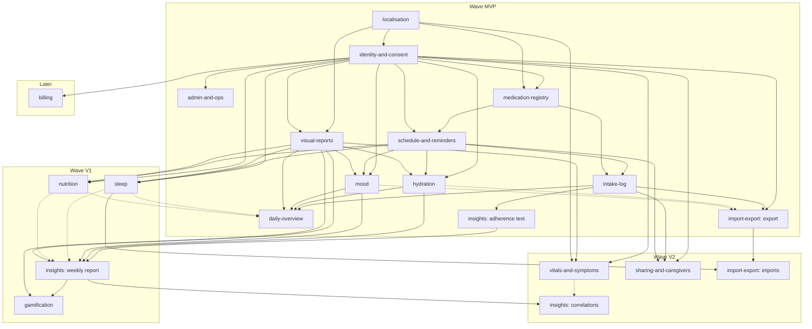
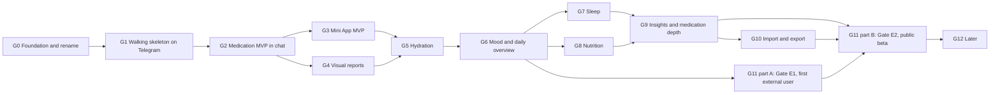

# Dosegram ROADMAP

Status: in force since 2026-11-13. The owner approved the plan and treats every recommendation in it as adopted; slice G0.2 promoted this file from `docs/dosegram/ROADMAP.md` to `docs/ROADMAP.md` ([ADR-014](adr/ADR-014.md)). It is the only source of delivery order and slice status, as [`AGENTS.md`](../AGENTS.md) requires; Appendix B is the only status table. The Dosecord roadmap it replaces is [`archive/ROADMAP-dosecord.md`](archive/ROADMAP-dosecord.md). The text was prepared on 2026-11-12 as a proposal: where it says "proposed" or "after approval", read it as adopted, and where it says "today" about the repository, read it as commit `88772f0`.

This document plans the change of direction from Dosecord (a Scala rewrite of a Discord medication-reminder bot) to Dosegram (a Telegram-native health record keeper with a bot and a Mini App). It is the delivery plan for the document set in this directory: [`PRODUCT_SPEC.md`](PRODUCT_SPEC.md), [`BOT_UX.md`](BOT_UX.md), [`MINI_APP.md`](MINI_APP.md), [`ARCHITECTURE.md`](ARCHITECTURE.md), [`VISUALS_AND_ANALYTICS.md`](VISUALS_AND_ANALYTICS.md) and the six research briefs under [`research/`](research/).

## 0. How to read this roadmap

### 0.1 What this document owns

This roadmap owns delivery order, slice boundaries, slice status, checkpoints, the migration from the old repository shape, and the definition of done. It does not restate product behaviour, architecture, screens or visual rules; each slice names the requirement ids of the document that owns them. Where two documents of the set disagree, section 1.9 lists the conflict and slice G0.1 settles it before any code depends on it. A cross-document review on 2026-11-12 raised 64 findings (5 blockers, 33 major, 26 minor); their dispositions are in [`REVIEW.md`](REVIEW.md), the resulting conflicts are rows X-23 to X-39 of section 1.9, and the design documents were amended in place for them. [`README.md`](README.md) is the entry point for the owner's review.

Precedence (adopted; `AGENTS.md` carries the same table since slice G0.2):

| Topic | Winning document |
|---|---|
| Delivery order, slice status | ROADMAP |
| Product behaviour, defaults, wave and tier of a capability | PRODUCT_SPEC |
| Module structure, data model, API conventions, security architecture | ARCHITECTURE |
| Chat flows, copy keys, message operations | BOT_UX |
| Mini App screens, frontend stack, client budgets | MINI_APP |
| Visual identity, image catalogue, metric and insight definitions | VISUALS_AND_ANALYTICS |
| A recorded decision | The ADR. An accepted ADR is amended by an addendum, never rewritten |

Three tables are owned by one document and only referenced by the others: the notification policy (PRODUCT_SPEC section 3.2), the consent purposes (PRODUCT_SPEC R-IDC-6) and the API resource list (ARCHITECTURE section 9.5). The command registry is BOT_UX section 6.1 and the user-facing status vocabulary is BOT_UX section 22.4.

Citation rule. Requirement prefixes are not unique across the set by construction, so every id cited in this roadmap is read with its document: `TG-`, `REM-`, `API-`, `SEC-`, `SLP-`, `INS-`, `DEP-`, `CON-`, `CFG-`, `OPS-`, `DATA-`, `TEST-` and `ARCH-` are ARCHITECTURE ids; `R-`, `AC-`, `US-`, `X-REM`, `X-REL`, `X-LAT`, `X-TAP`, `M-`, `N`, `Q-` and `A-` are PRODUCT_SPEC ids; `BUX-`, `SP-` and `OQ-` are BOT_UX ids; `MA-` and `TGF-` are MINI_APP ids; `VA-`, `IMG-`, `DOC-` and `IR-` are VISUALS_AND_ANALYTICS ids; `LB-` and `PB-` are controls of research brief 06. Two collisions were removed by the review: MINI_APP platform facts are `TGF-nn` (they were `TG-nn`), and VISUALS insight rules are `IR-nn` (they were `INS-nn`). A new id in any document must not reuse a prefix of another document.

### 0.2 Evidence labels

Every statement about an external platform carries one of these labels.

| Label | Meaning |
|---|---|
| `V-R02[Sn]` | Verified by research brief 02 against Telegram source `Sn` on 2026-11-12. This run did not fetch the Telegram source again; the label is only as good as the brief. |
| `V-RUN[Gn]` | Verified in this run against source `Gn` on 2026-11-12. |
| `A` | Assumption. Nothing may depend on it until the named spike or check has recorded a verdict. |
| `REPO` | A fact read from the repository, either in this run or in research brief 01 (commit `88772f0`). |

| Key | Source | URL |
|---|---|---|
| S1 | Telegram Bot API reference | https://core.telegram.org/bots/api |
| S3 | Bot API per-method and per-type pages | https://core.telegram.org/bots/api (method and type sections) |
| S4 | Bot features guide | https://core.telegram.org/bots/features |
| S5 | Bots FAQ | https://core.telegram.org/bots/faq |
| S6 | Mini Apps guide | https://core.telegram.org/bots/webapps |
| S7 | Webhook guide | https://core.telegram.org/bots/webhooks |
| S10 | Bot Payments API for digital goods and services | https://core.telegram.org/bots/payments-stars |
| S11 | Bot Platform Developer Terms of Service | https://telegram.org/tos/bot-developers |
| G1 | GitHub Docs, "Renaming a repository" | https://docs.github.com/en/repositories/creating-and-managing-repositories/renaming-a-repository |

### 0.3 Slice identifiers

New slices use the prefix `G` (`G0.1` to `G12.11`). The old roadmap's `M` and `UX` identifiers are kept only as names of inherited evidence (section 1.6). Rationale: the old identifiers appear in commit messages, spike notes and verification files; reusing a number with a new meaning would make that evidence ambiguous. Rejected alternative: continuing the `M` series from `M8`, which would suggest that `M2` to `M7` are still planned.

### 0.4 Status vocabulary

The vocabulary of the current roadmap is kept, with two additions for the migration.

| Status | Meaning |
|---|---|
| `todo` | Not started |
| `building` | A branch exists |
| `green` | Merged to `main`; CI green under `-Werror`; every acceptance criterion is an automated test or a recorded smoke transcript; documents updated |
| `in-use` | `green`, and the owner has used it on real data for seven consecutive days with no P1 defect. Required only for slices marked with an asterisk in Appendix B |
| `blocked` | Waiting on a named spike verdict or a named owner action |
| `deferred` | Not scheduled; has a re-entry condition (section 9) |
| `dropped` | Will not be built; no re-entry condition |
| `inherited` | New. `green` under the Dosecord roadmap, kept as the baseline, re-verified by the full test run of slice G0.4 |
| `voided` | New. Was `green` or `in-progress` under the Dosecord roadmap; its artefact is deleted or its acceptance no longer applies |

### 0.5 Sizes

S is one sitting and one pull request. M is a few sittings and one pull request. No slice in this file is larger than M; work that would be L in the old vocabulary is cut into two slices with an intermediate green state between them. One exception is stated where it occurs: slice G0.4 touches about 290 files but is a scripted, behaviour-free rename.

No calendar dates and no day estimates appear anywhere, as in the current roadmap. Order is strict, and it has two parts.

1. Slice dependencies. A slice does not start until every dependency it lists is `green`, or `inherited` and re-verified.
2. Milestone entry. A slice of milestone Gn is eligible only when the gate checkpoint that closes each predecessor milestone in the graph of section 2.2 is closed. The per-slice dependency lists do not encode that graph by themselves, so the gate is named in the "Depends on" column of Appendix B.

| Milestone | Entry gate |
|---|---|
| G1 (other than the spikes G1.1 to G1.3) | CP0-b |
| G2 | CP1-e |
| G3, G4 | CP2-h |
| G5 | CP3-d and CP4-b |
| G6 | CP5-a |
| G7, G8, G11 part A | CP6-c |
| G9 | CP7-b, and every slice of G8 `green` |
| G10, G11 part B | CP9-d, and for part B the owner's decision to attempt a public beta |

Deliberate pull-forwards, the only slices that may start before their milestone's entry gate:

| Slice | May start after | Reason |
|---|---|---|
| G1.1, G1.2, G1.3 (spikes) | G0.2 | They write only spike notes and can invalidate design decisions |
| G0.8 (secret scanning) | G0.4 | Real tokens enter the owner's environment at OA-4 |
| G2.5 (log allowlist and canary gate) | G1.5 | It protects the skeleton's logs |
| G2.6 (English catalogue) | G0.4 | It owns only `core/domain/copy/` |
| G5.1 (prompt occurrences) | CP2-h | Engine work with no user-visible surface; its migration is a versioned migration after the baseline freeze |
| G9.8 (further schedule patterns in the engine) | CP2-h | Pure engine work covered by the simulation |
| G11.4 (rasteriser isolation) | G1.9 | A container change that is cheaper early |
| G10.4 (export as a file in the chat) | CP6-c | A V1 capability that needs only G3.10 |

No versioned migration other than `V1__baseline.sql` may merge before checkpoint CP2-f. A slice that needs a new migration (G4.4, G5.1 and every domain slice) therefore cannot merge before the baseline freeze, whatever its dependency list says.

### 0.6 Commands used for verification

All commands below exist in the repository today (`REPO`, research brief 01 section 8), with `dosecord` replaced by `dosegram` after slice G0.4. Commands that do not exist yet are marked `[new]` and name the slice that creates them.

**Standard gate (SG).** Every slice runs it before review. Run the commands separately: a multi-selector Mill invocation once applied a filter and executed zero tests (`REPO`), so the executed test count per module is recorded and compared with the previous run.

```
./mill __.checkFormat
./mill __.fix --check
./mill __.compile
./mill __.test
./mill app.test.runMain dosegram.app.envExampleCheck .env.example
scripts/flyway-validate.sh
scripts/check-vendor-symbols.sh
scripts/check-sql-now.sh
scripts/doc-lint.sh
scripts/license-gate.sh
git diff --check
```

**Image gate (IG).** Required when the slice changes the Dockerfile, the compose file, start-up, settings or memory use.

```
docker build -f docker/Dockerfile -t dosegram:ci .
docker compose -f docker/compose.yml up -d --build --wait
curl -fsS http://localhost:28080/healthz
scripts/rss-check.sh 200
docker compose -f docker/compose.yml down -v
```

**Focused test.** `./mill --no-server -j 1 <module>.test`, where `<module>` is one of `contracts`, `core`, `infra`, `adapter-console`, `app`, `tests.conformance`, `tests.simulation`, and after their creating slices `adapter-telegram` (G1.4), `report-renderer` (G1.9), `api` (G1.12).

**Frontend gate (FG)** `[new, G3.2]`. Proposed names; MINI_APP section 13 fixes the tool (`pnpm`, frozen lockfile).

```
pnpm --dir miniapp install --frozen-lockfile
pnpm --dir miniapp run check        # type check, lint, token lint, licence rule
pnpm --dir miniapp run test         # component tests against the fake TelegramPort
pnpm --dir miniapp run build        # also checks the bundle budget
pnpm --dir miniapp run api:check    # regenerates types from the committed OpenAPI document and fails on a diff
pnpm --dir miniapp run e2e          # browser tests (G3.12)
```

**Live smoke.** A numbered manual checklist run against the staging bot with synthetic data, recorded as a transcript under `docs/verification/`. A live smoke is never replaced by a forged provider event (`docs/AGENTIC_DEVELOPMENT.md`). Live sends, secret access and deployments need the owner's separate authorisation, as today.

## 1. Migration from Dosecord to Dosegram

### 1.1 Decision

The repository is migrated in place. The medication engine, the mediator, the outbox and the console adapter stay; Discord, Zulip and Matrix leave; the product, packages, artefacts and repository are renamed; then Telegram work starts. Rationale: 256 Scala files and 1,074 recorded tests exist, about 85 percent of main code has no Discord symbol, and no measured defect is caused by the stack (`REPO`, brief 01 section 1). Rejected alternative: a new repository named `dosegram` that copies the kept modules. It would lose the Git history that explains the engine's invariants, and it would leave two repositories to maintain during the transition.

The deprecation is compulsory, not advisory: Discord is removed in one step with no period of coexistence. Rationale: the owner-use week on Discord never completed, no user depends on the Discord bot, and no production data exists (`REPO`, brief 01 section 7; the owner confirms this in question RQ-2). Rejected alternative: keeping `adapter-discord` compiling until Telegram reaches parity, which keeps a JDA dependency, eight source files and a conformance profile alive for a platform the owner has dropped.

### 1.2 Ordered steps

Each step names the slice that performs it or the owner action it needs. Steps are strictly ordered unless a row says otherwise.

| # | Step | Performed by | Result |
|---|---|---|---|
| 1 | The owner reviews the document set and answers the blocking questions of section 10.1. | Owner (OA-1) | Approval recorded in an issue |
| 2 | Reconcile the document set: apply the resolutions of section 1.9 so the five design documents agree. | G0.1 | One agreed specification |
| 3 | Governance cut-over: write ADR-014 (pivot), add supersession addenda, promote the document set to `docs/`, archive the Dosecord roadmap and design, rewrite the entry point of `AGENTS.md`. | G0.2 | The new roadmap is in force; product slices may be claimed |
| 4 | Revoke the Discord bot token and remove Discord secrets from every environment. | Owner (OA-2) | Launch-blocking control LB-25 of brief 06 is closed |
| 5 | Delete `adapter-discord`, the JDA dependency, and the Zulip and Matrix profiles, settings, markup branches and golden files. | G0.3 | No retired vendor is named in code |
| 6 | Mechanical rename `dosecord` to `dosegram` in packages, build, container, CI, scripts, schema object names, metric names and event type strings. No behaviour change. | G0.4 | One product name in code |
| 7 | Rename the GitHub repository and update remotes, local directories and worktrees. | Owner (OA-3), after step 6 merges | `w0rxbend/dosegram` |
| 8 | Start the reminder loop, materialiser, outbox dispatcher and sweeper from the executable (inherited slice M2.2b). | G0.5 | The engine runs outside tests |
| 9 | Revise the chat contract: remove Discord-shaped concepts, add Telegram-native ones with console renderings. | G0.6, G0.7 | Contract freeze 1 |
| 10 | Provision the Telegram identity and the public origin. May start at step 3 and must finish before the slices that name it. | Owner (OA-4 to OA-7) | Bots, tokens, domain, TLS, host |
| 11 | Build the walking skeleton on Telegram. | G1.1 to G1.14 | Webhook to reminder to image to Mini App, proven on a real client |

Why the delete comes before the rename: renaming first would rewrite 553 Discord-module occurrences and 24 golden files that the next change deletes (`REPO`, brief 01 section 9). Why the GitHub rename comes after the code rename: the repository name then never disagrees with a merged `main` for longer than one owner action, and every open pull request of steps 5 and 6 is closed before the URL changes.

### 1.3 GitHub repository rename and its consequences

The current remote is `git@github.com:w0rxbend/dosecord.git` (`REPO`). The target is `w0rxbend/dosegram`.

| Topic | Fact or plan | Label |
|---|---|---|
| Redirects | After a rename, "all existing information, with the exception of project site URLs, is automatically redirected to the new name", including issues, wikis, stars and followers; `git clone`, `git fetch` and `git push` to the previous location continue to work. | `V-RUN[G1]` |
| Old name | The old name must not be reused for a new repository: "If you do, redirects to the renamed repository will no longer work." Do not create a placeholder `w0rxbend/dosecord`. | `V-RUN[G1]` |
| Local clones | GitHub "strongly recommend[s] updating any existing local clones": `git remote set-url origin git@github.com:w0rxbend/dosegram.git`. Run it in the main checkout; linked worktrees share the same configuration. | `V-RUN[G1]` |
| Actions hosted in the repository | Calls to an action hosted by a renamed repository are not redirected. The repository hosts no action (no `action.yml`; one workflow, `.github/workflows/ci.yml`), so nothing breaks. | `V-RUN[G1]`, `REPO` |
| Pages | Project site URLs are not redirected. No Pages site exists. | `V-RUN[G1]`, `REPO` |
| Issues and pull requests | Numbers and links are redirected. Issues #2, #7, #9, #10 and #12 are referenced from documents; they keep working through the redirect. Close or relabel them in G0.2. | `V-RUN[G1]`, `REPO` |
| Branch protection and required checks | Expected to survive the rename, because they belong to the repository and the nine CI job names contain no product name (`scalafmt`, `scalafix`, `build-test`, `vendor-symbols`, `sql-now`, `doc-lint`, `docker`, `license-gate`, `coverage`). Check OA-3.4 confirms it. | `A`, `REPO` |
| Repository secrets, Renovate installation | Expected to survive the rename. Check OA-3.4 confirms it: one Renovate run and one CI run on a no-op pull request. | `A` |
| Badges | None exist in `README.md`, `QUICKSTART.md` or `docs/DEVELOPMENT.md`. When a badge is added, it uses the new path. | `REPO` |
| Container registry | CI builds `dosecord:ci` and compose builds `dosecord:local`; nothing is pushed to a registry. No published image has to be migrated. The first image pushed to a registry (slice G1.8, after the rename) is named `dosegram` from the start. | `REPO` |
| Published packages | `build.mill` has no publishing configuration. No Maven artefact exists to rename or deprecate. | `REPO` |
| Local directory | `/home/worxbend/Projects/dosecord` becomes `/home/worxbend/Projects/dosegram`. Mill's `out/` directory and the Docker dev volume are disposable; delete both before the first build under the new path. Tool state keyed by the absolute path (IDE indexes, agent session history) does not follow the move. | `A` |

Owner action OA-3, in order: (1) confirm that G0.4 is merged and no pull request is open; (2) rename the repository in GitHub settings; (3) `git remote set-url origin git@github.com:w0rxbend/dosegram.git` and `git fetch`; (4) open a no-op pull request and confirm that all nine required checks run and that branch protection still lists them; (5) remove all linked worktrees with `git worktree remove`, rename the local directory, recreate worktrees as needed; (6) record the result in the G0.4 issue.

Rollback: renaming the repository back restores the old URL, as long as nobody created a repository under the old name in between (`V-RUN[G1]`).

### 1.4 Package and artefact rename checklist

The checklist is research brief 01 section 9, turned into the work list of slices G0.3 and G0.4. Counts are occurrences in tracked files at commit `88772f0` (`REPO`).

| # | Item | Count | Slice | Action |
|---|---|---|---|---|
| 1 | `adapter-discord/` main and test sources | 553 `discord` occurrences in 17 files | G0.3 | Delete the module. Move `CallbackPeek.scala` and its test to `core/chat` first; it imports no vendor symbol and the Telegram adapter reuses it |
| 2 | `build.mill`: module object, `app` dependency, JDA 6.6.0 | 2 | G0.3 | Remove |
| 3 | `app`: Discord case in `Adapters.scala`, `DiscordWiringSuite.scala` | 15 | G0.3 | Remove the case, the autocomplete limit and the metric tag; delete the suite |
| 4 | `infra/Settings.scala`: `Adapter.Discord`, `DISCORD_TOKEN`, Zulip and Matrix settings; `.env.example` | 14 + 3 | G0.3 | Remove; regenerate `.env.example` |
| 5 | `contracts`: `Markup.DiscordMd`, `ZulipMd`, `MatrixHtml`; `DmInitiation.SharedGuildOrInstall`, `Invite`; generators | 12 | G0.3 | Remove the enum cases that name a retired vendor |
| 6 | `core`: `CapabilityProfiles` (Discord, Zulip, Matrix), `VendorMarkup` branches, `TokenBuckets` entries, comments, sample copy | 20 in 8 files | G0.3 | Remove |
| 7 | `core/test`: suites that parameterise over retired profiles; `goldens/discord/`, `goldens/zulip/`, `goldens/matrix/`; `medication-wizard.discord.golden` | 87 in 11 files; 24 golden files plus 1 transcript | G0.3 | Delete the goldens; reduce the suites to the Telegram and console profiles |
| 8 | `tests/conformance`: `discordMd` golden key; scenario `14-raw-modal-payload` | 4 | G0.3 | Remove |
| 9 | `scripts/check-vendor-symbols.sh` | 1 file | G0.3 | Remove `net.dv8tion`, `de.connect2x`, `kotlinx` from the list; keep `org.telegram` and `sttp` |
| 10 | Scala package directories `*/dosecord/` | 256 paths | G0.4 | `git mv` to `*/dosegram/` |
| 11 | `package dosecord...` and `import dosecord...` | 256 and 962 lines | G0.4 | Rename |
| 12 | `build.mill`: `DosecordModule`, `DosecordTests`, `mainClass` | 19 | G0.4 | Rename |
| 13 | `docker/Dockerfile`: user, group, `/opt/dosecord/dosecord.jar`, CDS archive path | 12 | G0.4 | Rename |
| 14 | `docker/compose.yml`: database name, user, password, `pg_isready` arguments, `DATABASE_URL`, image tag | 9 | G0.4 | Rename; the dev volume is dropped |
| 15 | `.github/workflows/ci.yml`: service credentials, `envExampleCheck` class, image tag | 7 | G0.4 | Rename |
| 16 | `.env.example` (generated from `Settings`) | 8 | G0.4 | Regenerate with `./mill app.test.runMain dosegram.app.envExampleGenerate .env.example` |
| 17 | `scripts/flyway-validate.sh` defaults; `scripts/coverage-gate.sh` package names | 7 | G0.4 | Rename |
| 18 | `V1__baseline.sql`: roles `dosecord_app`, `dosecord_erasure`; setting `dosecord.erasure`; function `dosecord_guard_append_only`; exception prefix | 23 | G0.4 | Rename in place. No tag exists, so the baseline may still be edited (`REPO`) |
| 19 | LISTEN and NOTIFY channel `dosecord_wake`; logger modifier id `dosecord.masking` | 2 | G0.4 | Rename |
| 20 | Metric names with prefix `dosecord_` | 7 in source, 8 in documents only | G0.4 | Rename the prefix to `dosegram_` |
| 21 | Event and command type strings `dosecord.<domain>.<verb>.v1`; `Source.Pattern` | 13 strings and 1 pattern | G0.4 | Rename to `dosegram.`; no consumer and no retained data exist (RQ-2) |
| 22 | User-facing copy: `AdapterCopy.dmOnlyRedirect`, `HelpCopy.intro`, `IdentityCopy.welcome` | 3 strings | G0.4 | Rename the product name; regenerate the goldens that print them with the existing generators, never by text replacement |
| 23 | CLI usage string and error prefix in `app` | 2 | G0.4 | Rename |
| 24 | `.github/ISSUE_TEMPLATE/roadmap-slice.yml`, `README.md`, `QUICKSTART.md` | 4 | G0.2 | Rewrite with the governance cut-over |
| 25 | `.gitignore` Python and Poetry patterns (about 40 lines) | 1 file | G0.4 | Remove; they belong to the prototype deleted in M0.2 |
| 26 | Callback wire prefix `dc:` | 29 in source, 477 in goldens and scenarios | none | Kept. No user sees it; changing it touches 13 source files and 39 golden files for no behavioural gain. Rejected alternative: `dg:` for naming consistency |
| 27 | Migration advisory lock key `0x7a65d05ec0d` | 1 | none | Kept; it is a number, not a name |
| 28 | Historical documents: `docs/archive/`, `docs/adr/`, `docs/spikes/`, `docs/verification/` | 39 | none | Kept as written. History keeps the old name |

Proof of completion. Code and configuration are checked by search; documents are not, because the new documents legitimately name Discord and Dosecord when they describe this migration.

```
git grep -l 'net\.dv8tion\|[Dd]iscord\|[Zz]ulip\|Trixnity' -- . ':!docs' ':!AGENTS.md' ':!README.md' ':!QUICKSTART.md' ':!CHANGELOG.md'   # empty after G0.3
git grep -il 'dosecord' -- . ':!docs' ':!AGENTS.md' ':!README.md' ':!QUICKSTART.md' ':!CHANGELOG.md'                                # empty after G0.4
```

G0.4 adds both searches to `scripts/check-vendor-symbols.sh`, with the script itself excluded from its own search, so CI keeps the property. For documents, `docs/doc-lint.txt` gains the retired operational terms (`DISCORD_TOKEN`, `adapter-discord`, `ENABLED_ADAPTERS=discord`, `dosecord run`, `dosecord_app`), so that no guidance document teaches a retired command, while history may still be described.

### 1.5 Retirement of `adapter-discord` and JDA

| Question of the deprecation checklist | Answer |
|---|---|
| Does the old system still provide unique value? | No. The owner has dropped Discord. |
| How many consumers depend on it? | None. No tag, no deployment in use, no user other than the owner in tests (`REPO`). |
| Does a replacement exist? | Not yet. The console adapter keeps every flow test and the 30-day simulation running between G0.3 and G1.6, so the code base is never without an executable transport. |
| Migration cost per consumer | None. |
| Cost of not removing it | A JDA dependency to keep current, 17 files, 64 tests and a conformance profile for a platform that will never ship. |

What is carried over as ideas, not code (brief 01 section 5): the transport seam with one SDK-touching file and a fake transport; the acknowledgement watchdog; the key-free token peek; distinct send keys per chunk; the closed error mapping; the adapter-to-mediator suite on PostgreSQL; the real-payload fixture technique.

What is deleted with no replacement: the nonce-based idempotent send (Telegram has no server-side idempotency key for sends, `A`, checked again in G1.1), slash-option autocomplete, modals, ephemeral replies, the guild refusal path.

### 1.6 Disposition of the existing slices

Source: Appendix B of the current roadmap and brief 01 section 6.3 (`REPO`). "Re-verify" means the slice's tests pass in the full run of G0.4 with executed counts recorded.

**Kept as `inherited` (no change to the artefact beyond the rename):** M0.1, M0.2, M0.3, M0.6, M0.7, M0.10, M0.12a, M0.12b, M0.12c, M1.1, M1.2, M1.3, M1.4b, M1.5, M1.6, M1.7, M1.8, M1.10, M1.11.

**Kept as `inherited`, artefact adapted by a named slice:**

| Slice | Adapted by | What changes |
|---|---|---|
| M0.0 Documentation cut 1 | G0.2 | Superseded by the new documentation cut |
| M0.4 CI and quality gates | G0.3, G0.4, G11.5 | Symbol list, names, added scans |
| M0.5 Settings, root, health, image, shutdown | G0.3, G0.4, G1.8 | Settings, image name, proxy |
| M0.9 Contracts, chat model, renderer, goldens | G0.3, G0.6, G0.7 | 24 of 40 renderer goldens deleted; contract revised |
| M0.11 Telemetry skeleton | G2.5 | Masking becomes unconditional at every level |
| M0.12d Account create, `/mood`, `/help` | G0.6, G2.8, G6.1 | The inherited `/mood` command and its `mood_checkins` table (level 1 to 10, free-text note, tags) are removed in G0.6, because no mood consent exists before G6.1; onboarding gains consent in G2.8; G6.1 recreates the table in its final shape with no legacy rows |
| M0.13 Conformance suite | G0.3, G0.6, G1.5 | 14 scenarios become the Telegram set |
| M1.4a Copy catalogue | G2.6 | Becomes the localisation catalogue |
| M1.9 Wizard, menu, Today, History, pause, time zone | G2.12, G2.13, G3.6 | Menu shape; long forms move to the Mini App |

**`voided`:**

| Slice | Was | Reason |
|---|---|---|
| M0.8 Spike: JDA DM | green | Discord-only. The note moves to `docs/archive/`. Its owner directive "DM-only personal app" is carried over as "private chats only" |
| M2.1 JDA gateway, slash commands, ack policy | green | The module is deleted |
| M2.2 Components, modals, ephemeral, idempotent sends | in-progress | Discord acceptance. The vendor-neutral mediator repairs it merged stay in code and stay covered by their tests |
| M2.2a Interaction recovery hardening | in-progress | Its live criteria were Discord criteria. The core recovery protocol stays in code with the evidence in `docs/spikes/m2-2a-recovery.md`; it is proven on Telegram in G2.21 |
| UX-00 UX governance adoption | green | Its validator is bound to the Discord-era graph (`max_discord_rows`). G0.2 removes the two validator steps from the `doc-lint` job and archives the graph; the navigation-graph test of G2.21 replaces it |

**Re-planned (`todo` under the old roadmap, mapped to new slices):**

| Old slice | New slice | Old slice | New slice |
|---|---|---|---|
| M2.2b Executable runtime integration | G0.5 | M4.1 Web edge, auth link | G1.12, G3.1 (Mini App session; no link challenge) |
| M2.2c Row-safe durable pages | G2.13 | M4.2 Credentials, recovery, restore | dropped |
| M2.2d Scoped navigation, policy editing | G2.14, G3.6 | M4.3 Audit, key rotation, roles | G2.16, G11.13 |
| M2.2e Preserved drafts | G2.12, G3.5 | M4.4 Export and erasure | G2.17, G3.10 |
| M2.2f Single-use manual-log intent | G2.12, G5.3 | M4.5 Tracing, metrics, dashboards | G2.18, G11.10 |
| M2.2g All-level log privacy | G2.5 | M4.6 Security review gate | G11.16 |
| M2.2h Execution and coverage enforcement | G2.21 | M5.1 Telegram adapter | G1.4 to G1.8 |
| M2.3 Conformance gate, live smoke, tap budget | G2.21 | M5.2 Fallback, M5.3 Cross-vendor link | dropped |
| M2.4 Readiness, metrics, alerts, backups, CLI | G2.18, G2.19 | M6.0 to M6.4 Matrix, Zulip, reaction tier | dropped |
| M2.5 Documentation cut 2 | G0.2, G2.23 | M7.1 Every-N, cycle, interval | G9.8, G9.9 |
| M3.1 Notes, skip reasons, custom-time corrections | G9.6 | M7.2 Chains and taper | G12.8 |
| M3.2 Schedule edit, zone questions, history paging | G3.6, G9.11 | M7.3 Refill tracking | G9.10 |
| M3.3 Quiet hours and discreet mode | G2.14 | M7.4 Habits | dropped; hydration is its own domain (G5) |
| M3.4 Stats | G2.20, G4.4 | M7.5 Mood breadth | G6 |
| M3.4a Attachment and render spike | G1.2 | M7.6 Generic reminders UI | deferred |
| M3.4b Report preparation and assets | G1.10, G4.3 | M7.7 Read-only REST API | G3.1 (read and write API) |
| M3.4c Media transport conformance | G1.10 | M7.8 Native-image experiment | dropped |
| M3.4d Infographic qualification | G4.5, G4.7 | M7.9 Documentation cut 3 and v1.0 | G11.18 |
| M3.5 Generic reminder kind, weekly summary | G5.1, G9.2 (changed by ADR-023) | M3.6 Simulation extended, nightly checks | G2.21, G11.10 |

### 1.7 Architecture decision records

The ADR README forbids editing accepted text. Each affected record receives a one-line addendum; new records carry the new decisions (ARCHITECTURE section 21).

| ADR | Subject | After the pivot | Addendum written in |
|---|---|---|---|
| ADR-001 | Scala 3, JDK 25, Mill, Ox | Stands. Addendum removes the Discord library lens and the `USER_INSTALL` addendum | G0.2 |
| ADR-002 | PostgreSQL, hand-written SQL, Flyway | Stands. Amended by ADR-021 | G2.3 |
| ADR-003 | No broker | Stands | none |
| ADR-004 | Materialised occurrences, epoch fencing | Stands. Extended by ADR-023 | G5.1 |
| ADR-005 | Mediator with capability-driven renderer | Superseded in part by ADR-015; media addendum replaced by ADR-022 | G0.2 (pointer), G0.6, G1.9 |
| ADR-006 | 34-byte HMAC callback tokens | Stands. Addendum: Telegram-only wording; any new token field | G0.2, G2.10 if a field is added |
| ADR-007 | Identity, link challenge, Argon2id | Superseded by ADR-016. "The core resolves identity; no account id from the wire" is carried over | G0.2 (pointer), G1.12 |
| ADR-008 | In-repository rewrite from Python | Stands as history | none |
| ADR-009 | At-least-once outbox | Stands. Amended by ADR-018 | G2.7 |
| ADR-010 | Matrix E2EE through Trixnity | Withdrawn by ADR-014 | G0.2 |
| ADR-011 | Per-schedule IANA zone, DST policy | Stands | none |
| ADR-012 | Dose lifecycle semantics | Stands. Addendum only if the reminder defaults change (RQ-9) | G2.10 |
| ADR-013 | Acknowledgement policy | Superseded by ADR-017 | G0.2 (pointer), G1.7 |

| New ADR | Subject | Written in | New ADR | Subject | Written in |
|---|---|---|---|---|---|
| ADR-014 | Dosegram pivot | G0.2 | ADR-022 | Render pipeline | G1.9 |
| ADR-015 | Chat boundary for a Telegram-native product | G0.6, with one addendum per contract addition in its consumer slice | ADR-023 | Prompt occurrences | G5.1 |
| ADR-016 | Identity and Mini App authentication | G1.12 | ADR-024 | Entries, rollups, honest statistics | G4.4 |
| ADR-017 | Telegram ingestion and acknowledgement | G1.7 | ADR-025 | Sleep without presence | G7.1 |
| ADR-018 | Outbound delivery on Telegram | G2.7 | ADR-026 | Nutrition data (journal first) | G8.1 |
| ADR-019 | Own thin Telegram client | G1.4 | ADR-027 | Blob storage and user media | G10.1 |
| ADR-020 | Mini App API and frontend (including the one chart mechanism, X-30) | G3.1 | ADR-028 | Deployment, backup, key custody | G1.8, completed in G2.19 |
| ADR-021 | Data protection architecture (including the deletion-and-backups statement, X-35) | G2.3, completed in G2.4b | ADR-029 | Entitlements and Telegram Stars | deferred with `billing` |

Rule: an ADR is written in the slice that first implements its decision, after the spike that could change it. Rejected alternative: writing all sixteen in G0.2. Seven of them depend on spike verdicts (G1.1 to G1.3, G10.2) and would be accepted before their evidence exists.

### 1.8 Replacement of `AGENTS.md`, `docs/ROADMAP.md` and `docs/DESIGN.md`

All of this happens in one pull request, slice G0.2, because `AGENTS.md` forbids product slices that are absent from the roadmap and the three files reference each other.

| File today | After G0.2 |
|---|---|
| `docs/dosegram/ROADMAP.md` (this file) | Becomes `docs/ROADMAP.md`. The path is kept because `AGENTS.md`, the issue template and the process document point at it |
| `docs/ROADMAP.md` | Moves to `docs/archive/ROADMAP-dosecord.md` with a one-line note at the top. Its Appendix B is frozen as the evidence index of the inherited slices |
| `docs/DESIGN.md` | Moves to `docs/archive/DESIGN-dosecord.md`. `docs/ARCHITECTURE.md` replaces it. Sections 7 to 9 and 11 of the old design (engine, time, persistence, tests) remain the detailed reference for the kept engine and are linked from ARCHITECTURE section 8 |
| `docs/dosegram/PRODUCT_SPEC.md`, `BOT_UX.md`, `MINI_APP.md`, `ARCHITECTURE.md`, `VISUALS_AND_ANALYTICS.md`, `research/` | Move to `docs/` under the same names |
| `docs/BOT_UX_PLAN.md`, `docs/design-tracks/bot-ux-graph.json`, `docs/spikes/jda-dm.md`, `docs/verification/m2.2-implementation.md` | Move to `docs/archive/` |
| `docs/MEDICATION_REMINDER_UX.md` | Stays. It remains the detailed medication specification, subordinate to `PRODUCT_SPEC.md`; its one Discord mention is edited |
| `docs/design-tracks/reminder-reliability.md`, `unified-chat-api.md` | The scheduling track stays and the swapped file contents are corrected (`REPO`, brief 01 section 2); the chat track moves to `docs/archive/` |
| `docs/PRODUCTION_PLAN.md`, `docs/API.md` | Deleted; both are stubs that point at the old design. `docs/API.md` returns as the committed OpenAPI document reference in G3.1 |
| `AGENTS.md` | Mission, reading order and "Current entry point" rewritten for Dosegram. The boundaries section is kept and widened: never log food, mood or sleep notes, photos, `initData`, the bot token or request URLs. The first eligible slice named is G0.3 |
| `docs/AGENTIC_DEVELOPMENT.md` | Slice names and the Discord wording updated. The UX-validator paragraph and the M2.2 checkpoint exception are removed; the checkpoint rules of section 4 of this roadmap replace them |
| `README.md`, `QUICKSTART.md`, `docs/DEVELOPMENT.md` | Rewritten as one-page statements of the current state, including the commands that already work (`run`, `migrate`), which the present stubs deny (`REPO`) |
| `docs/doc-lint.txt` | Forbidden list gains the retired operational terms (section 1.4); allowlist gains `docs/research/**`, `docs/spikes/**`, `docs/verification/**` and section 1 of the roadmap |
| `.github/ISSUE_TEMPLATE/roadmap-slice.yml`, `.github/pull_request_template.md` | Product name and slice id placeholders updated |
| `.github/workflows/ci.yml` | The two `check-bot-ux-plan` steps leave the `doc-lint` job; the scripts move to `docs/archive/` with the graph |

### 1.9 Conflicts inside the document set, with proposed resolutions

The five design documents were written in parallel and did not read each other. The conflicts below were found while writing this roadmap. The list is not guaranteed complete: G0.1 performs a full cross-read. Each resolution follows the precedence of section 0.1 unless the row says why not.

| # | Topic | Positions | Proposed resolution | Applied to |
|---|---|---|---|---|
| X-01 | Mood scale | PRODUCT_SPEC and BOT_UX: 5 valence steps plus optional energy. ARCHITECTURE C14: valence 1 to 7. VISUALS: 7 by 5 grid, 35 states. MINI_APP: 7 stops in the app | Capture and store valence 1 to 5 and optional energy 1 to 5. The blob geometry keeps seven columns and uses columns 1, 2, 4, 6 and 7 (PRODUCT_SPEC Q-08). Rejected: seven buttons in chat, which need two keyboard rows. Mood averages are displayed on the stored 1 to 5 scale with one decimal ("3.5", PRODUCT_SPEC R-MOO-5 and AC-MOO-4), never "of 7" | Applied in the review: ARCHITECTURE C14 and 10.8; MINI_APP S-09, MA-MOOD-8 and MA-Q-5; VISUALS 4.2, 7.1, 7.6, 8.4 and the examples of 6.5 and 6.14; BOT_UX OQ-3. Left for G0.1: the non-normative state sketches of VISUALS 4.5 still carry the withdrawn names |
| X-02 | Frontend framework | ARCHITECTURE: Preact. MINI_APP: Svelte 5 | Svelte 5 with TypeScript. ARCHITECTURE section 5.4 already defers to MINI_APP. Confirmed or reversed by the budget measurement in G3.2 | ARCHITECTURE 5.4, Q11 |
| X-03 | Frontend directory and build | ARCHITECTURE: `webapp/`, built by a Mill task. MINI_APP: `miniapp/`, own Node toolchain, one more CI job and one more container stage | `miniapp/` with its own toolchain | ARCHITECTURE 5.1 |
| X-04 | Static path | ARCHITECTURE: files under `/app/`, API under `/api/v1/`. MINI_APP: files at the root | `/app/` and `/api/v1/`; the origin root serves only the three public pages of MA-HOST-5 | MINI_APP MA-HOST-1, route grammar |
| X-05 | Initial bundle budget | ARCHITECTURE: 200 kB compressed. MINI_APP: 70 KB initial script, 250 KB total | MINI_APP's values | ARCHITECTURE 5.4 |
| X-06 | Notification policy: budget default, what the budget counts, quiet-hours handling, priority, jitter, spacing | Budget default: PRODUCT_SPEC 6, BOT_UX 4 (range 0 to 8), MINI_APP 3 (range 0 to 6), VISUALS 3 messages and 1 image. Counted classes: PRODUCT_SPEC nudges only; BOT_UX nudges, rhythm, reports and service notices; VISUALS all proactive non-medication messages. Nudge in quiet hours: dropped (PRODUCT_SPEC), moved (BOT_UX), deferred (ARCHITECTURE REM-14). Four priority taxonomies. Report jitter 0 to 600 s, 0 to 20 min, up to 5 min. Spacing 20 min or 10 min | One policy table owned by PRODUCT_SPEC section 3.2: default 4, range 0 to 12; nudges and reports count, service notices and the catch-up digest do not; a nudge in quiet hours is dropped, a report is held; priority outcome, reminder, caregiver alert, nudge, report, service notice; report jitter 0 to 600 s; spacing 20 min; at most one unprompted image per day. The default departs from the precedence rule on purpose: the lower value is the safer first value. Owner decides (RQ-9) | Applied in the review: PRODUCT_SPEC 3.2, R-SCH-22, R-SCH-23, Q-23, A-16; BOT_UX 14.1, BUX-NOTIF-01, BUX-NOTIF-04, BUX-QUIET-01, BUX-PACE-02; ARCHITECTURE TG-27, TG-31, REM-14; VISUALS VA-FB-04, VA-PS-02, VA-PS-08; MINI_APP S-15 |
| X-07 | Reminder repeat defaults | Code and ADR-012: every 10 minutes, 3 reminders. PRODUCT_SPEC: one follow-up after 30 minutes, 2 in total. BOT_UX: every 30 minutes, 3 reminders | PRODUCT_SPEC's values, with an ADR-012 addendum and regenerated goldens in G2.10. Owner decides (RQ-9) | BOT_UX 9.1 |
| X-08 | Retention of activity evidence for the sleep estimate | PRODUCT_SPEC: raw instants 48 hours, hourly profile 14 days. ARCHITECTURE, MINI_APP and brief 05: 35 days | PRODUCT_SPEC R-SLP-16. The estimator of G7.6 is designed for the hourly profile | Applied in the review: ARCHITECTURE 10.9 (new table `sleep_activity_profile`, `activity_events` 48 hours), 14, 15.6 and Q6; BOT_UX OQ-15; MINI_APP MA-Q-7 |
| X-09 | Confidence cap of a passive estimate | PRODUCT_SPEC: 0.49. ARCHITECTURE: 0.5 | 0.49 | ARCHITECTURE section 14 |
| X-10 | Model-based meal estimate | PRODUCT_SPEC Q-21: no third-party model processes user content in any wave. ARCHITECTURE D13 and ADR-026: optional `MealEstimator` with an external model | Not built. ADR-026 records the journal and the catalogue port only. The `nutrition_llm` consent domain, the `/meals/{id}/estimate` route and the `integrations` Anthropic client leave the V1 contract. Re-entry needs an explicit owner reversal (section 9) | Applied in the review: ARCHITECTURE 9.5, 10.2, 10.7 (`llm_estimate`, `meal_estimates` removed; `meal_items`, `food_products`, `custom_foods` marked deferred), 13 (status note), 20 and Q8; VISUALS VA-IMG-09b |
| X-11 | Typefaces | VISUALS: IBM Plex Sans and Geologica. Brief 04: Inter and Noto | VISUALS, subject to the coverage test in G4.2; Inter with Noto is the tested fallback | none |
| X-12 | Hydration card and Mini App control | PRODUCT_SPEC, BOT_UX BUX-WATER-06 and MINI_APP S-07: ring. VISUALS: vessel, not a ring, in chat and in the app | Vessel on every surface, including the Mini App S-07 control | Applied in the review: PRODUCT_SPEC 8.7 and 8.8; BOT_UX BUX-WATER-06 and section 13; MINI_APP 5.6, MA-HYD-2, MA-HYD-5 and the S-07 states |
| X-13 | Grouped reminder for same-minute doses | BOT_UX: slot cards in the reminder design. PRODUCT_SPEC: V1 | V1, slice G9.7. The MVP sends one card per dose | BOT_UX section 26, group B |
| X-14 | Export in the MVP | BOT_UX: export request in `/privacy`. PRODUCT_SPEC: file in chat is Could, V1. Brief 06: Mini App download is the primary path | MVP: request from chat or app, confirmation in chat, download in the Mini App (G3.10). File in chat: G10.4 | BOT_UX 20.2 |
| X-15 | Module list | ARCHITECTURE: 15 ids. PRODUCT_SPEC: 18 (adds `localisation`, `daily-overview`, `gamification`) | The 18 ids of PRODUCT_SPEC | ARCHITECTURE 0.4 |
| X-16 | Callback token layout | BOT_UX proposes a 34-byte layout that carries a quantity. The existing `CallbackCodec` (ADR-006) was not read by BOT_UX | The existing codec is authoritative. G0.1 compares the two; a needed field becomes an ADR-006 addendum in G2.10 | BOT_UX 4.3 |
| X-17 | Rasteriser isolation | Brief 06 LB-18: no network egress, launch-blocking. ARCHITECTURE: child process first, sidecar before public beta | Isolation without network is pulled forward to Gate E1 (G11.4) | ARCHITECTURE 12.2 |
| X-18 | Touchpoints in the MVP | BOT_UX groups the morning card with the home surface. PRODUCT_SPEC: evening wrap-up in MVP; morning and midday touchpoints in V1 | PRODUCT_SPEC | BOT_UX section 26 |
| X-19 | Weekly report default | BOT_UX OQ-14: on by default, silent. VISUALS: proactive reports are opt-in | One question at the first eligible week; nothing is sent before the answer. PRODUCT_SPEC section 11.3 puts every default-on message class under "ask the owner first" | BOT_UX 12.4 |
| X-20 | Today card pinned | BOT_UX: pinned by default if its spike passes. PRODUCT_SPEC: optional pinning, Could, V1 | Not pinned in the MVP | BOT_UX section 8 |
| X-21 | Step-up scope in the MVP | ARCHITECTURE API-09: export, deletion, grants, consent set, integrations. PRODUCT_SPEC: deletion and export in MVP; consent-set changes in V1 | PRODUCT_SPEC | none |
| X-22 | Owner-use duration | Current vocabulary: `in-use` is seven days. PRODUCT_SPEC M-01: fourteen days | `in-use` stays seven days per slice. The release gate of `0.1.0` is fourteen consecutive days (G2.23) | none |
| X-23 | Insight engine and medication | PRODUCT_SPEC R-INS-8, R-INS-9, AC-INS-5: no comparison with a medication measure on either side. VISUALS: medication allowed as an outcome (rules INS-03, INS-06, INS-10). ARCHITECTURE 11.3: a third method (Spearman correlation, bootstrap interval, Theil-Sen trend, two associations per report) | PRODUCT_SPEC wins: no cross-domain rule has a medication measure as factor or as outcome; the single-domain timing statement of R-INS-7 stays (rule IR-07). One engine, the one of VISUALS 8.5 (difference of group means, two stability checks, at most one per report). Owner question RQ-19; counsel is asked in G11.17 if the owner wants the weaker rule | Applied in the review: VISUALS D10, 8.3, 8.4 (IR-03 and IR-10 withdrawn, IR-06 without the dose outcome), VA-IN-13, Q6; ARCHITECTURE 11.3, INS-09, INS-10; G9.3 and G12.4 of this file |
| X-24 | Gamification | PRODUCT_SPEC 8.14: nothing resets, nothing on medication, milestones are one line in the weekly report, the word "streak" is not used. VISUALS: consecutive-day runs with a grace rule, a medication record-keeping run, a default-on milestone card IMG-14. ARCHITECTURE: a stored `streaks` table | PRODUCT_SPEC wins: weekly consistency counts only; no run; no counter or milestone on medication or on dose answers; IMG-14 becomes a Later, on-demand item; counters are derived at read time. Owner question RQ-20 | Applied in the review: VISUALS D9, 6.15, 7.3, 10.1, Q5, Q14; ARCHITECTURE 10.11 (`streaks` removed), 11.2 and the rollup worker; G9.4 of this file |
| X-25 | API resource list | ARCHITECTURE 9.5 and MINI_APP 15.2 listed different resources and different names for the same resource; ARCHITECTURE let the app grant consent, MINI_APP forbade it; error code `account_required` against `no_account` | One table in ARCHITECTURE 9.5 that covers every row of MINI_APP 15.2, with the retired names listed; MINI_APP 15.2 is the screen-to-resource mapping. Consent is granted in chat only. One code: `account_required`. Contract freeze 4 depends on this table | Applied in the review: ARCHITECTURE 9.5, API-19; MINI_APP 15.2 intro and rows, G-3. G0.1 re-checks every screen of MINI_APP section 7 against the table |
| X-26 | Consent purposes | Five lists: PRODUCT_SPEC, BOT_UX, ARCHITECTURE, VISUALS and this file each named different purposes (`sleep_passive_estimate`, `sleep_estimate`, `sleep_passive`; `photo_storage`, `food_photos`; `terms`, `symptoms`, `nutrition_llm`, `integration:<provider>`) | One canonical table in PRODUCT_SPEC R-IDC-6 with 13 purpose ids; terms and adult attestation are ledger events, not purposes. It is the key of the consent ledger and of contract freeze 6 | Applied in the review: PRODUCT_SPEC R-IDC-6; ARCHITECTURE 10.2, 10.9, 14; BOT_UX BUX-CONS-05, BUX-FOOD-01; VISUALS VA-IN-01; MINI_APP 15.2; G7.5 and G12.6 of this file |
| X-27 | Reminder images | VISUALS IMG-01: generic card R1 and personal card R2 on reminders. BOT_UX D5, ARCHITECTURE TG-30, PRODUCT_SPEC 3.1: no image on a reminder | IMG-01 is withdrawn; a reminder is text. Re-entry conditions are in VISUALS 6.2 and section 9.2 of this file | Applied in the review: VISUALS D13, 6.1, 6.2, Q11 |
| X-28 | Menu button | BOT_UX: command list by default, Mini App button per chat after onboarding, label "App". MINI_APP and ARCHITECTURE: Mini App button as the default for all chats, label "Open" | The per-chat model of BOT_UX, with `accounts.menu_button_version`, a reconciliation job, and drift detection for the default button only. One label: "App". The review received two opposite recommendations; the default-level variant is recorded as the rejected alternative and as owner question RQ-21 | Applied in the review: BOT_UX 6.3; ARCHITECTURE 7.9, 10.2, Q18; MINI_APP 3.1 |
| X-29 | Unblock path | PRODUCT_SPEC: automatic resume and one digest. BOT_UX: "Resume reminders" or "Keep paused", nothing without a tap. ARCHITECTURE: resume, no digest. This file: reason `unreachable` | Automatic resume with exactly one digest and a "Pause reminders" button; occurrences resolve as `unknown(undelivered)`. A paused state the user did not choose loses reminders silently | Applied in the review: PRODUCT_SPEC R-IDC-18, Q-29; BOT_UX BUX-BLOCK-02; ARCHITECTURE TG-43; G2.15 of this file |
| X-30 | Charts in the Mini App | VISUALS: scene JSON and a client painter. MINI_APP: client SVG components fed by data series. ARCHITECTURE: an inline-SVG route | The scene painter: one layout engine, no SVG string inserted; 400 nodes per scene. Recorded in ADR-020 and ADR-022 | Applied in the review: ARCHITECTURE 9.5.1 and 10.11; MINI_APP decision 9, 5.6, 15.2; VISUALS VA-MA-02; G4.8 of this file |
| X-31 | Command names | PRODUCT_SPEC, BOT_UX and VISUALS named different commands (`/log` and `/take`, `/meal` and `/food`, `/report`); support code, status, pause-everything, share and measurements had no chat entry | One registry in BOT_UX 6.1 with listed, hidden and wave columns | Applied in the review: BOT_UX 6.1; PRODUCT_SPEC capture-surface lines of 8.6 and 8.12; VISUALS 6.20 |
| X-32 | `vitals-and-symptoms` | VISUALS drew a moving mean for every kind; ARCHITECTURE stored severity 0 to 4, a symptom catalogue and extra kinds; no bot flow and no screen exists | PRODUCT_SPEC R-VIT-1 to R-VIT-6 win: a moving mean for weight only, five kinds, severity 1 to 5, user-named symptoms. The chat flow and screens S-17 and S-18 are written at CP9-d | Applied in the review: VISUALS 6.17, 7.8; ARCHITECTURE 10.2 (units), 10.10; PRODUCT_SPEC 8.15; MINI_APP 4.1; G12.1 of this file |
| X-33 | Medication created in chat against the Mini App form | Name 60 against 80 characters; dose as free text against amount and unit; "Create a separate medication" against the unique name rule; 6 times against 12 slots | PRODUCT_SPEC R-REG-1 and R-REG-3 win; the 6 times are a chat-only limit | Applied in the review: BOT_UX 10.1, BUX-MED-03, BUX-MED-05 |
| X-34 | Minimum samples | Weekly mean 4 of 7 against 3 days; monthly 15 of 30 against 10; monthly gate per domain against any domain; adherence percentage for any denominator against at least 5 | VISUALS 7.1 owns the numbers; the monthly gate is per domain (PRODUCT_SPEC R-INS-11); a percentage needs a denominator of 5 | Applied in the review: ARCHITECTURE 11.3; PRODUCT_SPEC R-INS-11, R-INT-11; VISUALS 6.6, 10.1 |
| X-35 | Deletion and backups | ARCHITECTURE SEC-06 and PRODUCT_SPEC R-IDC-19 claimed that deletion makes data unreadable in backups at once, but the wrapped key is in the same database and its backups | The claim is corrected: unreadable in live storage at once, gone from backups within 35 days; the purge list is written at deletion (G2.17) and replayed by the restore script (G2.19). A separate key store is the recorded alternative. Owner question RQ-22, decided in ADR-021 | Applied in the review: PRODUCT_SPEC R-IDC-19, Q-25; ARCHITECTURE SEC-06, Q17; G2.17 and G2.19 of this file |
| X-36 | Identifier namespaces | `TG-nn` and `INS-nn` each meant two things | MINI_APP facts are `TGF-nn`; VISUALS rules are `IR-nn`; the citation rule of section 0.1 | Applied in the review: MINI_APP (all), VISUALS 8.4, ARCHITECTURE 0.2 |
| X-37 | Smaller values | Weekly report default (four values); hydration bounds, presets and nudge plan; meal grammar and photo rules; onboarding order and expiry; image timeout; latency; Today-card coalescing; zone-change review; capacity figure (three values) | PRODUCT_SPEC values, except: the weekly report default becomes the first day of the week at 09:00, and the time zone is asked after consent (BOT_UX order). One capacity figure, about 500 reminders per minute, derived in ARCHITECTURE 7.6 | Applied in the review: PRODUCT_SPEC R-INS-4, R-IDC-4, R-NUT-7, 9.3; BOT_UX 5.3, 8.2, 11.2, 11.3, 12.4, 13, 14.4, BUX-TZ-05; VISUALS 7.4, 10.1; MINI_APP S-04, S-07, S-14, S-15; ARCHITECTURE 7.6, 10.6 |
| X-38 | User-facing words for dose states and named messages | "No response", "Not answered", "without an answer", "not confirmed"; "not delivered", "No record", "not known"; "Item 1" against "Item A"; "Today message" against "Today card"; "Evening check" against "evening wrap-up" | One vocabulary table in BOT_UX 22.4. G0.1 corrects the remaining strings and transcripts | Applied in the review: BOT_UX 22.4; MINI_APP 5.4; VISUALS VA-WR-05 and examples; PRODUCT_SPEC glossary |
| X-39 | Form of the consent step | PRODUCT_SPEC R-IDC-7: the first button's label is the consent statement itself, then "Confirm". BOT_UX OQ-9 and section 5.5: the full statement in the message, an "I agree" button, then a confirming second tap | Not applied; the owner decides (RQ-25). Recommended: the BOT_UX form, because a button label is short and may be cut by a client (`A`), while both forms keep the two taps and the recorded statement; counsel confirms the form in G11.6c | PRODUCT_SPEC R-IDC-7 or BOT_UX section 5.5, in G0.1 |

Rows X-01 to X-22 were found while this roadmap was written and are applied by G0.1 unless their last column says "Applied in the review". Rows X-23 to X-38 come from the cross-document review of 2026-11-12 and were applied to the design documents by targeted edits; G0.1 verifies each of them by the scripted search of its acceptance criteria and corrects any sentence the targeted edits missed.

Closed without action: the `initData` validation method (brief 02 says HMAC; brief 06, ARCHITECTURE and MINI_APP say Ed25519; three documents agree and the roadmap follows them); asset storage (brief 04's PostgreSQL bytes for short-lived render assets and ARCHITECTURE's blob store for user media do not overlap; the blob store is not needed before G10.1).

### 1.10 Owner actions

No agent may perform these. Each row names the first slice that is `blocked` without it.

| # | Action | Detail | Needed by |
|---|---|---|---|
| OA-1 | Approve the plan and answer the blocking questions | Section 10.1 | G0.1 |
| OA-2 | Revoke Discord credentials | Reset the Discord bot token in the Discord developer portal; delete Discord entries from every local `.env` and secret store. No credential is copied into an issue or a chat | G0.3 |
| OA-3 | Rename the GitHub repository | Section 1.3 | After G0.4 merges |
| OA-4 | Create the Telegram bots in BotFather | A staging bot in production Telegram (used by the walking skeleton and every live smoke), the production bot, and a bot in Telegram's test environment. `file_id` values are not shared between bots (`V-R02[S4]`). Per bot: group joins off (that the setting exists is `A`, brief 02 section 18), inline mode off, bot-to-bot off. Tokens are stored as secret files, never pasted into chat, issues or `.env.example` | G1.1 (staging bot); G2.23 (production bot) |
| OA-5 | Dedicated Telegram owner account | The account that owns the bots has two-step verification and a recovery email and is not the owner's daily account (brief 06 Q15) | Before the production bot is created |
| OA-6 | Public origin | A domain name and an IPv4 address. Webhooks are delivered over IPv4 only, to ports 443, 80, 88 or 8443, with TLS 1.2 or newer; redirects are not followed; the certificate name must match the host and wildcard certificates "may not be supported" (`V-R02[S5][S7]`). The plan uses port 443 and a certificate from a public authority obtained by the reverse proxy. The Mini App must be served from the origin registered in BotFather (`V-R02[S6]`) | G1.3 (any HTTPS origin), G1.8 (staging origin) |
| OA-7 | Host and backup storage | One virtual machine in an EU region; 2 virtual CPUs and 4 GB are a sizing assumption (`A`, ARCHITECTURE 17.1). Off-host storage for encrypted backups in the same legal region | G1.8, G2.19 |
| OA-8 | Register the Mini App | In BotFather for the staging bot, then the production bot: Main Mini App URL, splash icon and colours, privacy policy URL. The command list and the default menu button are set by code (`BotConfigSync`); the Mini App menu button is set per chat when onboarding completes (X-28) | G1.13, G11.2 |
| OA-9 | Key custody | Where the key-encryption key lives and who holds the two offline copies (ARCHITECTURE Q7) | G2.4 |
| OA-10 | Test devices | Which Telegram clients the owner can test on (Android, iOS, Desktop, Web) and which low-end Android phone is the reference device (MINI_APP MA-Q-8) | G1.1, G1.3, G3.2 |
| OA-11 | Controller, launch regions, counsel | Brief 06 Q1, Q2; PRODUCT_SPEC Q-02. Includes: the controller's country of establishment; for each region to be enabled, a recorded cleared legal position; counsel's review of the consent wording and the notice (G11.6c); signed processor agreements with the host and the backup provider chosen at OA-7 | G11.6c, Gate E1 (G11.7) |
| OA-12 | The owner's phone and wearable | PRODUCT_SPEC Q-12 | G10.7 and later imports |
| OA-13 | Allowlist of Telegram user ids | The numeric Telegram user ids that may create an account before the invite gate exists (the owner's own id at least). They are configuration, never committed | G1.6 |
| OA-14 | First activation of automatic account deletion | Review of the dry-run report and the explicit switch-on of the deletion job of G11.8b in production | G11.8b |

## 2. Dependency graphs

### 2.1 Capability map

The eighteen modules are those of PRODUCT_SPEC section 7.1. An arrow from A to B means that B depends on A, so A is built first. A dashed arrow means "when present": the downstream module works without the upstream one and gains content when it exists. The graph has no cycle.



### 2.2 Engineering preconditions and milestones

The capability map says what the product needs first. The graph below adds what the repository needs first: the rename, the running engine, the Telegram transport, the data-protection baseline, the API and the render pipeline. An arrow means "must be `green` before".



G3 and G4 are independent of each other and may run at the same time. G7 and G8 are independent of each other. Part A of G11 depends only on G6, so the first external user can be invited at the end of the MVP wave if the owner wants that (RQ-14).

| Wave of PRODUCT_SPEC | Milestones | Release tag at the exit |
|---|---|---|
| Foundation (no user-visible change) | G0, G1 | none; `main` stays deployable to staging |
| MVP | G2, G3, G4, G5, G6 | `0.1.0` after G2, `0.2.0` after G3, `0.3.0` after G4, `0.4.0` after G5, `0.5.0` after G6 |
| V1 | G7, G8, G9, part of G10 | `0.6.0`, `0.7.0`, `0.9.0` |
| Invite-only and public beta | G11 | `1.0.0-beta.1` at Gate E2 |
| V2 and Later | rest of G10, G12 | decided at the V2 re-plan |

## 3. Milestones and slices

### 3.1 Slice format

Each slice states: identifier and name; size; dependencies; whether it may run in parallel with other slices; what it does, with the requirement ids of the owning document; a summary of at most three acceptance criteria; verification commands or smoke checks; and the modules or files it is likely to touch.

Traceability rule. The three bullets under "Acceptance" are a summary, not the whole acceptance. The owning documents define the full set: 168 `AC-` ids in PRODUCT_SPEC, 277 `BUX-` ids in BOT_UX, 152 `VA-` ids in VISUALS_AND_ANALYTICS and 275 `MA-` ids in MINI_APP (counts taken by the review of 2026-11-12). A slice turns `green` only when every owning-document criterion that the traceability matrix assigns to it is an automated test or a recorded smoke. The matrix is the file `docs/traceability.csv` (criterion id, document, wave, slice), first produced by G0.1 and checked in CI by `scripts/traceability-check.sh` `[new, G0.1]`, which fails when an MVP-wave `AC-`, `BUX-`, `VA-` or `MA-` id maps to no slice or to more than one, and when a slice claims `green` in Appendix B while one of its ids has no named test. Every "Does" item of a slice must be covered by at least one id of the matrix; an item without a criterion is either given one in the owning document or removed from the slice. This roadmap does not print the matrix: it would restate about 870 ids that the owning documents maintain. "SG", "IG" and "FG" are the command sets of section 0.6. Suite names are proposals. Every slice also meets the standing definition of done of section 6, which is not repeated per slice.

An asterisk after a slice identifier marks a slice that must be `in-use` before its milestone exits. Checkpoints are listed in a table at the end of each milestone. A checkpoint of type "gate" blocks the slices after it until the owner has answered. A checkpoint of type "review" is read by the owner asynchronously and blocks only when the owner objects (section 4).

### 3.2 G0: Foundation and rename

**Goal.** One product name, no retired vendor, a running engine in the executable, secret scanning before the first real token. The chat contract is revised just in time, after the first live reminder (G0.6) and in each consumer slice (G0.7). **User-visible outcome.** None on Telegram yet. On the console: `ENABLED_ADAPTERS=console dosegram run` delivers a due reminder without any test-only start-up code. **Non-goals.** Telegram code, schema reshape, new domains.

#### G0.1 Specification reconciliation, traceability matrix and decision freeze
Size M. Depends on: OA-1. Parallel: no; it is the first slice. Documents and one script only. It is delivered as one pull request per conflict cluster, merged in this order, so that no pull request has to hold the whole set in view: (a) scales, units and limits (X-01, X-06, X-07, X-09, X-34, X-37); (b) surfaces and names (X-12, X-13, X-18 to X-20, X-28, X-31, X-38); (c) API, frontend and data model (X-02 to X-05, X-15, X-16, X-25, X-30, X-33); (d) consent, privacy and non-clinical boundary (X-08, X-10, X-14, X-17, X-21 to X-24, X-26, X-27, X-29, X-32, X-35); (e) the traceability matrix and the question table.
- Does: a full cross-read of the five design documents; verifies the resolutions of section 1.9 that the review already applied and applies the remaining ones and any further conflict found; produces the first version of `docs/traceability.csv` and `scripts/traceability-check.sh` (section 3.1); records every owner answer of section 10.1 next to its question; marks every other open question as provisional with the slice that first depends on it (section 10.3); compares BOT_UX section 4.3 with the existing `CallbackCodec`.
- Acceptance:
  - Every row of section 1.9 is marked "applied" with the changed section, or "rejected by owner" with the replacement decision, and a scripted search for the retired values (for example `Valence` 1 to 7, `webapp/`, `nutrition_llm`, `sleep_passive` without `_estimate`, `food_photos`, `no_account`, `streaks`, "of 7", `INS-0` in VISUALS, `TG-` in MINI_APP) finds no unreconciled statement in the five documents.
  - `scripts/traceability-check.sh` passes: every MVP-wave `AC-`, `BUX-`, `VA-` and `MA-` id maps to exactly one slice, and every id cited in this roadmap exists in the document its prefix names (section 0.1).
  - Only the questions of section 10.1 block: each has an answer and a date. Every other open question of the six documents has a line "Provisional: recommendation adopted, owner may reverse until <slice>" (section 10.3).
- Verify: `scripts/doc-lint.sh`; `scripts/traceability-check.sh`; `git diff --check`; the search commands and their output recorded in each pull request.
- Touches: the six documents of the set under `docs/` (they were under `docs/dosegram/` when this slice was written), `docs/traceability.csv` (new), `scripts/traceability-check.sh` (new).

#### G0.2 Governance cut-over
Size S. Depends on: G0.1. Parallel: no. Documents and CI configuration only.
- Does: section 1.8 as one pull request: ADR-014; addenda on ADR-001, 005, 006, 007, 010 and 013; promotion of the document set to `docs/`; archive of the Dosecord roadmap, design and UX plan; new `AGENTS.md` entry point; removal of the two UX-validator steps from CI; updated templates and `docs/doc-lint.txt`.
- Acceptance:
  - `docs/ROADMAP.md` is this roadmap with Appendix B as the only status table; `docs/archive/ROADMAP-dosecord.md` exists and is unchanged except for the note at the top.
  - `scripts/doc-lint.sh` is clean, and a throwaway commit that adds `DISCORD_TOKEN` to `README.md` is rejected while the same term under `docs/archive/` is not.
  - Every ADR file has a status line; ADR-010 reads "Withdrawn by ADR-014".
- Verify: SG (documentation and CI jobs); the negative doc-lint test recorded in the pull request.
- Touches: `AGENTS.md`, `README.md`, `QUICKSTART.md`, `docs/**`, `.github/**`, `scripts/` (two files moved).

#### G0.3 Retire Discord, Zulip and Matrix
Size M. Depends on: G0.2, OA-2. Parallel: no.
- Does: rows 1 to 9 of section 1.4. Deletion only; no new behaviour.
- Acceptance:
  - `build.mill` has no `adapter-discord` module and no JDA coordinate; `./mill __.compile` passes under `-Werror`.
  - The first search of section 1.4 (retired vendor names outside documents) returns nothing.
  - `./mill __.test` passes with zero failed and zero ignored, and the executed count per module is recorded with an explanation of every decrease (64 adapter tests, the wiring suite, the goldens of three profiles, one conformance scenario).
- Verify: SG; IG; `scripts/license-gate.sh` shows the dependency count below the 124 recorded on 2026-10-15.
- Touches: `adapter-discord/` (deleted), `build.mill`, `app/`, `infra/.../Settings.scala`, `.env.example`, `contracts/`, `core/chat/`, `core/scheduling/TokenBuckets.scala`, `core/test/resources/goldens/`, `tests/conformance/`, `scripts/check-vendor-symbols.sh`.

#### G0.4 Mechanical rename to dosegram
Size M by effort; about 290 files by a scripted change. Depends on: G0.3. Parallel: no; it must be the only open pull request.
- Does: rows 10 to 25 of section 1.4. The rename script is committed in the pull request description, not in the repository. Goldens are regenerated with the existing generator entry points.
- Acceptance:
  - Both searches of section 1.4 return nothing and run in CI as part of the extended symbol gate.
  - `./mill __.test` executes the same number of tests per module as after G0.3, with zero failed.
  - The image starts under the new names: `docker compose up` reaches `/healthz` 200 with database, user and role names `dosegram*`, and idle memory stays at or below 200 MB.
- Verify: SG; IG; `git diff --stat` reviewed for any file that is not a rename or a regenerated artefact.
- Touches: every module directory, `build.mill`, `docker/`, `.github/workflows/ci.yml`, `scripts/`, `infra/src/main/resources/db/migration/V1__baseline.sql`, `.env.example`, `.gitignore`.

#### G0.5 Start the workers from the executable (inherited M2.2b)
Size M. Depends on: G0.4. Parallel: yes, with G0.6 (different modules; `app/` is owned by this slice).
- Does: ARCH-01. `dosegram run --role all|worker` starts the materialiser, the reminder loop, the outbox dispatcher, the session sweeper and the wake listener under one supervised scope and the existing role policy. `HEALTH_PORT` moves into `Settings`.
- Acceptance:
  - A launch-path test starts the assembled application against a disposable PostgreSQL 18 with the console adapter and observes exactly one reminder dispatched for a seeded due occurrence, with no test-only worker start-up.
  - The same harness proves retry after a failed send, catch-up after a clock jump with one digest, and expiry of an idle wizard session.
  - SIGTERM drains an in-flight send and exits 0 within 20 seconds.
- Verify: `./mill --no-server -j 1 app.test`; `./mill --no-server -j 1 tests.simulation.test`; SG; IG.
- Touches: `app/src/dosegram/app/Main.scala`, `Adapters.scala`, `Shutdown.scala`, `infra/.../Settings.scala`, `.env.example`, `app/test/`.

#### G0.6 Contract revision A: removals, and removal of inherited commands without a consent purpose
Size M. Depends on: G1.6 (the first live reminder LS-1 is recorded on the existing contract). Parallel: yes, with G1.7 and G1.9. It was scheduled before the adapter in the first draft; the review moved it behind LS-1, because the existing Telegram capability profile (eight goldens, `TelegramHtml` markup, a Telegram token bucket; brief 01 section 4) is enough for a text-and-callback adapter, and the removals are safer once a live path exercises what remains.
- Does: ARCHITECTURE section 6 rows C3 to C6 and the removals of C10 and C11: product limits instead of Discord caps; `InteractionHandle` shrinks to a single answer and a source edit; declared visibility, form-opening flags, typed command options and autocomplete are removed; reaction operations and the native-select, numbered-reaction and modal rungs are removed; the multi-select becomes the `toggleKeyboard` rung on the Telegram profile. The conformance scenario `07-duplicate-reaction-success` is deleted. The inherited `/mood` command is removed from the command registry and the `mood_checkins` table is dropped from the in-place baseline; the same check is applied to every other inherited command and table of a domain that has no consent purpose yet (BOT_UX BUX-CMD-08). Writes ADR-015.
- Acceptance:
  - Every type that crosses `ChatAdapter` still round-trips (CON-01), and no reference to a removed concept compiles.
  - The console transcripts, the 30-day simulation goldens and the live smoke LS-1 (repeated after the merge) are unchanged, or each changed line is explained in the pull request.
  - `/help` and `getMyCommands` list no command of a domain without a consent purpose, and no table of such a domain exists in the baseline (schema test).
- Verify: `./mill --no-server -j 1 contracts.test`, `core.test`, `adapter-console.test`, `adapter-telegram.test`, `tests.conformance.test`, `tests.simulation.test` (each run separately); `scripts/flyway-validate.sh`; SG.
- Touches: `contracts/.../Chat.scala`, `Adapter.scala`, `core/chat/Renderer.scala`, `AckPolicy.scala`, `ActionRegistry`, `core/application/` command registry, `adapter-telegram/`, `V1__baseline.sql`, goldens, `docs/adr/ADR-015.md`.

#### G0.7 Contract revision B: Telegram-native additions (dissolved into consumer slices)
G0.7 is not a slice any more; the identifier is kept so that it is not reused. The first draft froze every Telegram-native addition (ARCHITECTURE section 6 rows C7 to C12) in one slice before any Telegram code existed and before spike G1.1 had a verdict on text-to-photo edits. Each addition is now made in the slice of its first consumer, with a console rendering (CON-02), round-trip properties and an ADR-015 addendum in that slice.

| Addition (ARCHITECTURE section 6) | Made in | Reason for the place |
|---|---|---|
| C7 `attachment` on outbound messages; C10 `sendMedia`; C11 the `media` rung | G1.10 | First photo sent |
| C8 `Choice.OpenApp`; C10 `setMenu`; C12 `appButton` | G1.13 | First app button and menu button |
| C9 `ConversationStarted(payload)`; C12 `startPayload` | G2.8 | First deep-link payload in onboarding |
| C9 `ReachabilityChanged` | G2.15 | First use of `my_chat_member` |
| C7 `protectContent` and `spoiler` | G4.6 | First protected personal image |
| C10 `editMedia`; C12 `editMedia` | G6.2 | Only after the SP-11 verdict of G1.1 |
| C8 `Choice.OpenUrl`, `Choice.CopyText` | The first slice that emits one (G11.2 for the notice link) | No consumer earlier |
| C9 `MediaReceived`; C10 `fetchMedia` | G12.6 | No consumer before meal photos; not added until then |

State on 2026-11-13: the owner started the transport, rendering, media and Mini App tracks in parallel, so the additions that those tracks consume were made together and are frozen in ADR-015 (index in ARCHITECTURE section 6.1). Already in `contracts`: the C7 attachment, the C8 choices `OpenApp` and `OpenUrl`, the C9 start payload and `MediaReceived`, the C11 `media` rung and the C12 `media` flag, each with its console rendering. The slices above consume them and add only what remains: `setMenu` (G1.13), `ReachabilityChanged` (G2.15), `protectContent` and `spoiler` (G4.6), an edit with an attachment (G6.2), `CopyText`, and `fetchMedia` (G12.6).

#### G0.8 Secret scanning and pinned CI actions
Size S. Depends on: G0.4. Parallel: yes, with G0.5. Pulled forward from the first draft's G11.5, because real bot tokens, the webhook secret and the key-encryption key enter the owner's environment at OA-4, before G1.1.
- Does: the secret-scanning half of LB-24: a secret scanner in CI on every pull request with rules for the Telegram bot token pattern, the webhook secret and key material; the same rules as a pre-commit hook; CI actions pinned by digest.
- Acceptance:
  - A seeded fake bot token in a fixture, a spike note and a transcript file each fail the pipeline and the pre-commit hook.
  - Every action in `.github/workflows/` is referenced by digest.
  - The scan runs on every pull request, including documentation-only ones.
- Verify: the CI run on a throwaway branch with the seeded failures.
- Touches: `.github/workflows/ci.yml`, a scanner configuration (new), a pre-commit configuration (new), `renovate.json`.

**Exit criteria of G0.** Appendix B shows G0.1 to G0.5 and G0.8 `green`; the repository is `w0rxbend/dosegram`. G0.6 closes inside G1 (after LS-1), and contract freeze 1 is declared at CP1-e, not here (section 5.1).

| Checkpoint | After | Type | What the owner reviews |
|---|---|---|---|
| CP0-a | G0.1, G0.2 | gate | The reconciled document set, the traceability matrix and the governance pull request. Merging it puts this roadmap in force |
| CP0-b | G0.3, G0.4 | gate | The grep proofs and the executed test counts; then owner action OA-3 (repository rename) |
| CP0-c | G0.5, G0.8 | review | The launch-path evidence; the seeded secret-scan failures |

### 3.3 G1: Walking skeleton on Telegram

**Goal.** Prove the riskiest path end to end before any breadth: a Telegram webhook delivers an update, the engine sends a reminder, the user answers it, the backend renders an image and sends it, and the Mini App opens with a validated session and shows the same day. **User-visible outcome.** On the staging bot, with synthetic data, the owner receives a reminder, taps Taken, asks for a picture and opens the Mini App. **Non-goals.** Consent, encryption, row-level security, the real Mini App shell, any new domain. The skeleton stores synthetic data only and is not used for a real regimen; the data-protection baseline of G2 lands before real data (RQ-11). Because a rule cannot bind a stranger who finds the bot's username, an owner allowlist of Telegram user ids restricts who may create an account from the first live slice (G1.6) until the invite gate replaces it (G11.1).

**Order inside G1.** The three spikes run first and in parallel because each can invalidate a design decision: the Bot API behaviours that the error mapper and the message operations depend on, the native rasteriser in the production container, and the Mini App launch data and content security policy on real clients. Then two tracks run in parallel: transport (G1.4 to G1.8) and rendering (G1.9), joined by media (G1.10, G1.11) and the Mini App path (G1.12, G1.13). The shortest path to the first Telegram message is G0.3, G0.4, G0.5, G1.4, G1.5, G1.6: the adapter is written on the existing Telegram capability profile, and the contract removals (G0.6) follow LS-1. The skeleton is kept thin on purpose: one webhook connection and no reorder window (G1.7), no drift detection and no registry publishing (both move to G2.18).

#### G1.1 Spike: live Bot API behaviour (code thrown away, note and fixtures kept)
Size S, time-boxed. Depends on: G0.2, OA-4 (staging bot), OA-10. Parallel: yes, with G1.2, G1.3 and all of G0.3 to G0.7.
- Does: provokes and records the behaviours that are assumptions today: the HTTP status and description for a blocked bot, a missing edit target, a late delete, "message is not modified" and an invalid `file_id` (ARCHITECTURE A2); whether an edit notifies (BOT_UX SP-3); the callback answer deadline (A5); whether a text message can be turned into a photo by `editMessageMedia` (SP-11); what Telegram does to an uploaded PNG at three sizes (brief 04 S4); `file_id` reuse after a restart (S9); webhook retry behaviour against a slow and a failing endpoint (A4), including the redelivery horizon: the endpoint fails for 10 minutes, for 1 hour and for 6 hours while a known number of taps is made, and the number of updates redelivered afterwards is recorded, with the same test repeated on `getUpdates` for comparison (PRODUCT_SPEC X-REL-4); the response to `answerCallbackQuery` for a query answered after 15, 30, 60 and 300 seconds (ARCHITECTURE TG-11); behaviour under a controlled burst, including whether edits count against the send limit (A6). Starts the two-day timer for "own messages stay editable after 48 hours" (A3), which is read at CP1-c.
- Acceptance:
  - `docs/spikes/telegram-platform.md` records a verdict per assumption with the client, the date and the raw response with the token removed.
  - Each error response is committed as a fixture under `tests/conformance` for the error mapper of G1.4, including the response for an expired callback query id.
  - Go or no-go is stated for: text-to-photo edit, `file_id` reuse, the 1,280 px card size; and a measured value is recorded for the webhook redelivery horizon and for the callback answer deadline.
- Verify: live smoke on at least two client families; the fixture files load in a unit test.
- Touches: `docs/spikes/`, `tests/conformance/` resources. No product code.

#### G1.2 Spike: render pipeline in the production container (code thrown away, note kept)
Size S, time-boxed. Depends on: G0.2. Parallel: yes.
- Does: brief 04 spikes S1, S2, S3, S6, S7 and S10: a musl build of the pinned resvg in the non-root Alpine image; pixel identity between a developer host, CI and the image; the budgets of brief 04 section 13 on one CPU with `-Xmx256m`; tabular numerals; process pipes on virtual threads; PNG metadata.
- Acceptance:
  - `docs/spikes/render-pipeline.md` records a measured value against each target and a verdict per spike.
  - Go: fixtures render with equal decoded-pixel hashes in all three environments, p95 rasterise time is at most 200 ms, and idle memory stays at or below the existing 200 MB gate.
  - No-go switches the plan to the Java2D painter over the same scene tree (brief 04 section 6.2) before G1.9 starts.
- Verify: `docker build` of the spike image; the measurement script output attached to the note.
- Touches: `docs/spikes/`. No product code.

#### G1.3 Spike: Mini App launch, signature and policy on real clients (code thrown away, note kept)
Size S, time-boxed. Depends on: G0.2, OA-4, OA-6 (any HTTPS origin), OA-10. Parallel: yes.
- Does: MINI_APP spikes MA-SPK-1 and MA-SPK-4, and the time-zone part of MA-SPK-2, with a hand-written static page: which launch paths deliver a route and signed `initData`; whether the Ed25519 `signature` field is present on each client (ARCHITECTURE A10); whether a reload restores the session; the behaviour of a return from the minimised state after 20 minutes and of a reload started by the operating system, per client (MINI_APP MA-SESSION-4); for one `downloadFile` call per client, the number of HTTP requests, their methods and any `Range` header (ARCHITECTURE section 9.7); whether the full content security policy loads; the `frame-ancestors` list; what `Intl` reports as the device zone (A8).
- Acceptance:
  - `docs/spikes/miniapp-webview.md` holds a capability table per client family that the owner can test.
  - Go: signed launch data arrives from the menu button, an inline `web_app` button and the `startapp` link on every tested client.
  - A failed policy check names the exact directive and client, so ARCHITECTURE section 9.8 can be amended with a stated reason.
- Verify: live smoke; server-side verification of one captured `initData` with the published key, with the user id removed from the note.
- Touches: `docs/spikes/`. No product code.

#### G1.4 Thin Telegram client and transport seam
Size M. Depends on: G0.4, G0.8; the fixtures of G1.1 before merge. Parallel: yes, with G1.9 and with G0.5 (new module).
- Does: the `adapter-telegram` module with `TelegramTransport`, `HttpTelegramTransport` (the only file that imports `java.net.http`), hand-written uPickle codecs for the first methods (`getMe`, `sendMessage`, `editMessageText`, `editMessageReplyMarkup`, `deleteMessage`, `answerCallbackQuery`, `getUpdates`), tolerant decoding, `TelegramErrorMapper`, `FakeTelegramTransport`. Writes ADR-019.
- Acceptance:
  - TG-01: updates with unknown fields and unknown kinds decode without error and without logging the body.
  - TG-02: a canary token, URL, message text and `callback_data` value appear in no log line, exception message or metric label.
  - The error mapper maps every fixture of G1.1 to exactly one `ChatError` case; the fixture for an expired callback query id maps to `CallbackExpired`, which is treated as success with no alert and no retry (ARCHITECTURE section 7.10).
- Verify: `./mill --no-server -j 1 adapter-telegram.test` `[new]`; `scripts/check-vendor-symbols.sh`; `scripts/license-gate.sh` (no new dependency); SG.
- Touches: `adapter-telegram/` (new), `build.mill`, `docs/adr/ADR-019.md`.

#### G1.5 Telegram adapter on the fake wire
Size M. Depends on: G1.4. Parallel: yes, with G1.9. It is written on the contract as it stands after G0.3, with the existing Telegram capability profile: text, inline callbacks and edits only. Known limit until G0.6: a multi-select on that profile still degrades to the numbered-reaction rung, which the skeleton's flows avoid.
- Does: `TelegramAdapter` as a `ChatAdapter`: update mapping with `vendor_event_id = telegram:update:<update_id>`, private chats only, the 1.5 second acknowledgement watchdog (TG-12), no answer for a callback query older than the configured age (TG-11), send and edit operations, the Telegram set of suite A scenarios.
- Acceptance:
  - Suite A passes for the Telegram profile: event mapping, duplicate update, deadline auto-acknowledgement on a fake clock, 429 to `RateLimited`, "not modified" as success, edit target missing, delete outside the window, resume, log hygiene, unknown update kind.
  - An update from a chat that is not private produces no mediator event.
  - The adapter-to-mediator suite passes on PostgreSQL.
- Verify: `./mill --no-server -j 1 adapter-telegram.test`, `tests.conformance.test`, `infra.test`; SG.
- Touches: `adapter-telegram/`, `tests/conformance/` scenarios, `core/chat/CallbackPeek.scala` (final location).

#### G1.6 Long polling and the first live reminder
Size M. Depends on: G1.5, G0.5, OA-4, OA-13. Parallel: yes, with G1.7.
- Does: `LongPollReader` (`getUpdates`) and the wiring of `adapter-telegram` in `app` behind `TELEGRAM_UPDATES_MODE=poll`. The existing flows (account creation with a time zone, the add-medication wizard, reminders, Taken, Undo) run on Telegram unchanged in behaviour. Two guards are part of this slice. Owner allowlist: the setting `TELEGRAM_ALLOWED_USER_IDS` lists the Telegram user ids that may use the bot; any other sender gets one fixed "not available" reply, nothing is stored and no mediator event is produced; start-up refuses an empty allowlist when `ENVIRONMENT` is not `development`. The allowlist stays until G11.1 replaces it with invitations. Bot identity: start-up calls `getMe` and refuses to continue unless the returned id equals `TELEGRAM_BOT_ID` and that id is the one configured for the current `ENVIRONMENT`; `deleteWebhook` is permitted only for a bot id marked as a development bot, so that a local run with a staging or production token cannot remove that bot's webhook and receive its updates.
- Acceptance:
  - A fixture update from a user id that is not on the allowlist creates no row in any table (database test) and produces the fixed reply; start-up with an empty allowlist outside development fails; start-up with a token whose `getMe` id is not the configured one fails, and `deleteWebhook` is refused for a bot id that is not marked as development (each on the fake transport).
  - A second poller on the same token does not corrupt the cursor: the reader stops with a clear error (the conflict behaviour is `A` until observed here).
  - Live smoke LS-1: on the staging bot the owner creates a synthetic account, adds a medication due in two minutes, receives the reminder, taps Taken and sees the message edited to its final state.
  - The acknowledgement latency histogram exists and its p95 in the smoke run is below 1.5 seconds.
- Verify: `./mill --no-server -j 1 adapter-telegram.test`, `app.test`; LS-1 recorded in `docs/verification/walking-skeleton.md`; SG; IG.
- Touches: `adapter-telegram/LongPollReader.scala`, `app/.../Adapters.scala`, `infra/.../Settings.scala`, `.env.example`.

#### G1.7 Webhook endpoint and durable inbox
Size M. Depends on: G1.5. Parallel: yes, with G1.6.
- Does: ARCHITECTURE section 7.2: `POST /tg/webhook/{path_secret}` on the existing HTTP edge, constant-time check of the path secret and the `X-Telegram-Bot-Api-Secret-Token` header (`V-R02[S3]`), a 1 MiB body limit, the `inbound_inbox` table, and the inbox processor. The skeleton sets `max_connections` to 1, so updates arrive in order and the reorder window of TG-07 is not built here; it is built in G2.18 together with the raise of `max_connections`. The slice ships its own deletion: an inbox body is deleted when its update is processed and at the latest after 24 hours, including quarantined rows, and `inbound_events` rows after 7 days (ARCHITECTURE section 15.6). The allowlist of G1.6 applies to webhook updates as well. Writes ADR-017.
- Acceptance:
  - TG-03: with crash injection between receipt and commit the endpoint never answers 200 for an update that is not stored.
  - TG-04: the same `update_id` delivered twice creates one row and one effect.
  - A request with a wrong secret gets 404 and no body is read; an update from a user id outside the allowlist stores nothing.
  - Under a fake clock an inbox body is gone after processing and a quarantined body after 24 hours, and an `inbound_events` row after 7 days, and not before.
- Verify: `./mill --no-server -j 1 infra.test`, `app.test`, `tests.conformance.test`; `scripts/flyway-validate.sh`; SG.
- Touches: `app/` HTTP edge, `adapter-telegram/WebhookDecoder.scala`, `core/ports/` (inbox port), `infra/` (repository, `V1__baseline.sql`), `docs/adr/ADR-017.md`.

#### G1.8 Staging deployment: proxy, TLS and bot configuration sync
Size M. Depends on: G1.7, OA-6, OA-7. Parallel: yes, with G1.9 to G1.11.
- Does: the compose stack gains a reverse proxy with a certificate from a public authority on port 443; the `/tg/*` route accepts only Telegram's delivery ranges `149.154.160.0/20` and `91.108.4.0/22` (`V-R02[S7]`; the ranges are configuration); secrets are files; `BotConfigSync` calls `getMe` first (the identity guard of G1.6), then `setWebhook` with the URL, the secret, `allowed_updates` of exactly `message`, `edited_message`, `callback_query`, `my_chat_member`, and `max_connections` 1. Drift detection and publishing the image to the container registry are not part of the skeleton; both move to G2.18, and until then the staging host builds the image from the tagged commit. The proxy logs route templates only: no request path, no query string and no full client address, because the webhook path contains a secret and Mini App launches carry parameters (ARCHITECTURE section 17.1; brief 06 rule L7). Until CP2-f the staging database is disposable (section 3.4). Starts ADR-028.
- Acceptance:
  - On the staging host `getWebhookInfo` shows the configured URL, no `last_error_message` and a pending count of zero after LS-1 is repeated over the webhook.
  - Start-up refuses `TELEGRAM_UPDATES_MODE=poll` when `ENVIRONMENT=production` (CFG-01).
  - After LS-2 the proxy log contains no occurrence of the path secret, no query string and no full client address (a script over the log file in the image gate, run with a canary secret).
- Verify: `./mill --no-server -j 1 app.test` (settings and sync against the fake transport); IG; live smoke LS-2 (LS-1 over the webhook) recorded.
- Touches: `docker/compose.yml`, `docker/` proxy configuration (new), `scripts/` (proxy-log check and staging database reset, new), `adapter-telegram/BotConfigSync.scala`, `infra/.../Settings.scala`, `docs/adr/ADR-028.md`.

#### G1.9 Render module and resvg process adapter
Size M. Depends on: G1.2 with a go verdict, G0.4. Parallel: yes, with G1.4 to G1.8 (new module).
- Does: the `report-renderer` module (scene tree, layout, SVG emitter in "Dosegram SVG profile 1", profile linter, ports `TextMeasurer` and `Rasteriser`) and, in `infra`, the child-process adapter that pipes SVG to resvg and reads PNG. The container gains the pinned resvg build stage and a minimal font pack. One fixture scene only. Writes ADR-022.
- Acceptance:
  - DEP-03: the module has no `java.io`, `java.nio.file`, `java.net` or `java.awt` import, and the SVG golden of the fixture is byte-identical on every machine.
  - A hostile string (markup, control characters, right-to-left text, emoji) stays inside the SVG profile (property test).
  - A rasteriser that hangs is killed at the 5 second timeout and the caller receives a typed failure; the JVM stays up.
- Verify: `./mill --no-server -j 1 report-renderer.test` `[new]`, `infra.test`; IG with the pixel-hash test run inside the image; `scripts/rss-check.sh 200`.
- Touches: `report-renderer/` (new), `infra/` (process adapter), `docker/Dockerfile`, `build.mill`, a third-party notices file (new), `docs/adr/ADR-022.md`.

#### G1.10 Media transport and short-lived asset store
Size M. Depends on: G1.5, G0.6. Parallel: yes, with G1.9.
- Does: the contract additions of G0.7 for media (the optional attachment reference, `sendMedia`, the `media` rung, with their console rendering and an ADR-015 addendum); `sendPhoto` as a multipart upload in the thin client; the `render_assets` table for bytes that live at most one hour, with its deletion job in this slice; the attachment path through the outbox with a distinct send key; the text fallback when bytes are missing or the upload fails; the console rendering of an attachment.
- Acceptance:
  - The multipart request matches a committed byte-exact fixture, and the request URL appears in no log line.
  - Crash injection between the upload and the record write yields at most one extra photo, flagged `possible_duplicate`, and no extra state change.
  - An expired or missing asset produces the text equivalent, never an empty message; under a fake clock the bytes of an asset are deleted one hour after its terminal state and not before.
- Verify: `./mill --no-server -j 1 adapter-telegram.test`, `infra.test`, `tests.conformance.test`; `scripts/flyway-validate.sh`; SG.
- Touches: `adapter-telegram/`, `core/scheduling/OutboxDispatcher.scala`, `core/ports/`, `infra/` (asset repository, `V1__baseline.sql`).

#### G1.11 First card in chat
Size S. Depends on: G1.9, G1.10, G1.6. Parallel: no.
- Does: one on-demand card, the seven-day medication strip for the caller's own occurrences, requested by a command, with a caption and a text equivalent built from the same snapshot. The card is a names-level template that exists before image consent and discreet rendering (G4.6), so it sits behind the `Settings` switch `SKELETON_CARD_ENABLED`, which is off by default and may be on only when `ENVIRONMENT` is `staging` or `development`; the command does not exist on the production bot.
- Acceptance:
  - The numbers in the image view model, the caption and the text view are equal for a fixture account.
  - With rendering disabled by configuration the command answers with the text view inside the same latency budget; start-up refuses `SKELETON_CARD_ENABLED=true` when `ENVIRONMENT=production` (start-up test).
  - Live smoke LS-3: the card arrives on a phone and its smallest text is legible in the light and the dark theme; the returned photo sizes are recorded.
- Verify: `./mill --no-server -j 1 core.test`, `report-renderer.test`; LS-3 recorded; IG.
- Touches: `core/application/`, `report-renderer/` (one template), `core/domain/copy/`.

#### G1.12 API skeleton: session and Today read
Size M. Depends on: G1.3 with a go verdict, G1.4, G0.5. Parallel: yes, with G1.9 to G1.11 (new module).
- Does: the `api` module on the existing Tapir server: `POST /api/v1/session` and `GET /api/v1/today`; `InitDataVerifier` (Ed25519) in `adapter-telegram`, reached through a port so that `api` never holds the bot token (DEP-05); the `miniapp_sessions` table with its deletion job (expired and revoked sessions, ARCHITECTURE section 15.6); the problem-details error shape. The whole Mini App surface (static files under `/app/`, every `/api/` route and the per-chat menu button) sits behind the `Settings` switch `MINIAPP_ENABLED`, which is off in production until checkpoint CP3-a, because the header set, the rate limits and the route-level cross-tenant suite arrive in G3. Writes ADR-016.
- Acceptance:
  - API-02 unit vectors pass: valid, tampered field, wrong bot id, missing signature, stale and future `auth_date`, duplicate key.
  - API-04 and API-05: an unknown Telegram user gets 403 `account_required`; the token is returned once, only its SHA-256 is stored, and no cookie is set.
  - `GET /today` for account A never returns an occurrence of account B (two-account test; the full cross-tenant suite arrives in G2.3); with `MINIAPP_ENABLED=false` every `/app/` and `/api/` request answers 404 and start-up refuses `true` in production before the flag is lifted at CP3-a (start-up test); an expired session row is deleted under a fake clock.
- Verify: `./mill --no-server -j 1 api.test` `[new]`, `adapter-telegram.test`, `infra.test`; `scripts/check-vendor-symbols.sh`; SG.
- Touches: `api/` (new), `adapter-telegram/InitDataVerifier.scala`, `core/ports/`, `infra/`, `app/`, `build.mill`, `docs/adr/ADR-016.md`.

State on 2026-11-13: built on the fake side only, ahead of G1.3 and G1.4, because the owner started the Mini App track in parallel with the transport track. In the repository: the `api` module with `POST /api/v1/session`, `DELETE /api/v1/session`, `POST /api/v1/session/keepalive`, `GET /api/v1/today` and `GET /api/v1/days/{date}`; both launch-data checks; the switch `MINIAPP_ENABLED` with the production refusal; ADR-016. It differs from the text above in three points, each recorded in ADR-016: the verifier lives in `api` behind a port instead of in `adapter-telegram`; sessions are kept in memory behind a port instead of in `miniapp_sessions`, because the schema belonged to another track; the go verdict of G1.3 does not exist. The status of this slice is unchanged.

#### G1.13 Mini App launch stub and app buttons
Size S. Depends on: G1.12, G1.8, G0.6, OA-8. Parallel: no.
- Does: one static page under `/app/` with one script and no framework, served by the application: it exchanges `initData` for a session and lists today's occurrences. The reminder message gains an inline `web_app` button (the contract additions of G0.7 for the open-app choice and `setMenu`, with an ADR-015 addendum); the menu button is set per chat for an account that has completed set-up (X-28). The page is replaced by the real shell in G3.2 and is marked as a stub in its source. On the production bot the stub is off (`MINIAPP_ENABLED`, G1.12).
- Acceptance:
  - The page sends requests only to its own origin and loads only the Telegram script from `telegram.org`.
  - Opened in a plain browser, without Telegram, it shows the "open in Telegram" notice and makes no API call.
  - The menu button and the inline button both open the page with signed launch data on the staging bot.
- Verify: `./mill --no-server -j 1 app.test` (static serving and headers); live smoke LS-4.
- Touches: `app/` (static serving), `adapter-telegram/BotConfigSync.scala`, a stub directory `miniapp/stub/`.

#### G1.14 Walking-skeleton demonstration
Size S. Depends on: G1.8, G1.11, G1.13. Parallel: no. No new product code.
- Does: one scripted run on the staging bot with a synthetic account, recorded as live smoke LS-5: webhook delivery, account creation, a medication due in two minutes, the reminder, Taken, the card, the Mini App showing the dose as taken, a restart of the application in the middle, and one deliberate ten-minute outage.
- Acceptance:
  - Every step of LS-5 has an observed result and a timestamp, and the database rows agree with what the chat and the Mini App show.
  - The outage produces one digest and no stale reminder; the restart loses no update.
  - The spike notes of G1.1 to G1.3 have no open verdict, including the 48-hour edit check.
- Verify: `docs/verification/walking-skeleton.md` with the transcript; `getWebhookInfo` output with the URL path removed.
- Touches: `docs/verification/`.

**Exit criteria of G1.** LS-5 recorded and accepted by the owner; three spike notes with verdicts; G0.6 `green`; ADR-015, 016, 017, 019 and 022 accepted; contract freeze 1 declared at CP1-e. Nothing in G1 carries an asterisk: the skeleton is not used on real data.

| Checkpoint | After | Type | What the owner reviews |
|---|---|---|---|
| CP1-a | G1.1, G1.2, G1.3 | gate | The three go or no-go verdicts. A no-go changes the plan before the dependent slice starts |
| CP1-b | G1.4, G1.5, G1.6, G0.6 | review | The first live reminder on the owner's phone (LS-1); the contract removals |
| CP1-c | G1.7, G1.8 | review | The webhook on the staging origin (LS-2); the 48-hour edit result |
| CP1-d | G1.9, G1.10, G1.11 | review | The first image on a phone (LS-3): legibility and size |
| CP1-e | G1.12, G1.13, G1.14 | gate | The end-to-end demonstration (LS-5). Contract freeze 1. This is the first re-plan point: sizes and order of G2 to G4 are corrected from what G1 taught. No slice of G2 other than the pull-forwards of section 0.5 starts before this gate closes |

### 3.4 G2: Medication MVP in chat

**Goal.** The owner runs a real medication regimen from the Telegram chat alone. **User-visible outcome.** Onboarding with consent, add a medication in chat, reminders answered in one tap on the message, Undo and Correct, a Today card, quiet hours and discreet mode, text statistics, and deletion of everything from `/privacy`. **Non-goals.** The Mini App (the G1 stub is switched off on the production bot by `MINIAPP_ENABLED` until CP3-a), images (the G1 card is switched off outside staging), any new domain, external users (the owner allowlist of G1.6 stays in force).

**Order inside G2.** Data protection comes first (G2.1 to G2.4) because it reshapes the baseline schema, which is possible in place only while no real data exists. Then the chat experience. The schema baseline is frozen at checkpoint CP2-f, immediately before the owner enters real data: from that commit, tagged `0.1.0-rc.1`, every schema change is a new versioned migration in expand-and-contract form (RQ-13).

**Staging database before the freeze.** `V1__baseline.sql` is edited in place by G0.4, G0.6, G1.7, G1.10, G1.12, G2.2, G2.3, G2.4, G2.4b, G2.8 and G2.16, and each edit changes its Flyway checksum, so a staging database created from an older baseline fails validation at the next start. The rule: until CP2-f the staging database is disposable and is recreated by the script `scripts/staging-db-reset.sh` `[new, G1.8]` on every deployment that changes the baseline. `flyway repair` is never used, on any environment. The script refuses to run when `ENVIRONMENT` is `production`. It is run only with the owner's authorisation, like any deployment. Evidence that depends on staging data (the 48-hour edit timer of G1.1, the live-smoke transcripts) is recorded before a reset or repeated after it. The production database does not exist before CP2-f and is created only from the baseline tagged `0.1.0-rc.1`.

#### G2.1 Storage error port and repository groups
Size M. Depends on: G0.6, checkpoint CP1-e. Parallel: no; it changes `Tx`, which every later slice uses.
- Does: DEP-08 and DEP-10. A port-level `StorageError` replaces `java.sql.SQLException` in `ChatMediator` and `WizardEngine`; `Tx` exposes one repository group per module id; the in-memory doubles implement only the groups their suites use; `java.sql` joins the forbidden list for `core/` and `contracts/`.
- Acceptance:
  - `scripts/check-vendor-symbols.sh` rejects a throwaway `import java.sql` under `core/`.
  - A test double that receives a call on a group it does not implement fails with a message naming the group.
  - No behaviour change: every existing suite passes with unchanged executed counts.
- Verify: `./mill --no-server -j 1 core.test`, `infra.test`, `tests.conformance.test`, `tests.simulation.test`; SG.
- Touches: `core/ports/UnitOfWork.scala`, `core/chat/ChatMediator.scala`, `WizardEngine.scala`, `infra/PgUnitOfWork`, the four in-memory doubles, `scripts/check-vendor-symbols.sh`.

#### G2.2 Schema reshape A: accounts and removals
Size M. Depends on: G2.1, the answer to RQ-2 and RQ-8. Parallel: no; one schema owner at a time.
- Does: ARCHITECTURE section 10.1 and 10.2, the structural part, edited in place in `V1__baseline.sql`: `users` becomes `accounts`; `user_id` becomes `account_id` everywhere; the password, challenge and recovery tables, `accounts.handle`, and the unused `habits`, `habit_checkins` and `reminders` tables and the `reminder_occurrences` view stub are removed; the four database roles are created.
- Acceptance:
  - A schema test lists every account-scoped table and finds `account_id uuid NOT NULL` on each and an index that starts with it.
  - `scripts/flyway-validate.sh` passes on an empty database and a second run is a no-op.
  - Every existing infrastructure suite passes; the handle step is gone from the account-creation transcript.
- Verify: `./mill --no-server -j 1 infra.test`, `core.test`, `adapter-console.test`; `scripts/flyway-validate.sh`; SG.
- Touches: `infra/src/main/resources/db/migration/V1__baseline.sql`, `infra/` repositories, `core/ports/`, `core/application/` identity flow, transcripts.

#### G2.3 Schema reshape B: row-level security and the cross-tenant suite
Size M. Depends on: G2.2. Parallel: no.
- Does: DATA-02, API-10, SEC-08. Forced row-level security with the policy on `app.account_id` on every account-scoped table; the unit-of-work helper sets the claim from the authenticated principal; `SECURITY DEFINER` claim functions keep the loop and dispatcher queries; the application role has no ownership and no bypass. Records the `EXPLAIN` of the hot claim query (ARCHITECTURE A15). Starts ADR-021.
- Acceptance:
  - The cross-tenant suite calls every repository method as account A with identifiers of account B and gets not-found; a direct SQL statement without the claim returns no row.
  - A schema test fails when a table with `account_id` lacks the policy.
  - The claim query still uses `ix_occ_next_action`, and the measured tick duration over a seeded database is within 20 percent of the value recorded before the change.
- Verify: `./mill --no-server -j 1 infra.test` (new `RlsSuite`, `CrossTenantSuite`); `scripts/flyway-validate.sh`; SG.
- Touches: `V1__baseline.sql`, `infra/PgUnitOfWork`, `infra/` repositories, `infra/test/`, `docs/adr/ADR-021.md`.

#### G2.4 Key service and encrypted medication columns
Size M. Depends on: G2.3, OA-9. Parallel: no.
- Does: ARCHITECTURE section 15.2 for the data that exists: the `KeyService` port, the file-based key-encryption-key provider, `account_keys`, AES-256-GCM `_enc` columns for medication names, strengths, instructions and notes, and the `*_hmac` lookup column that replaces `name_norm`. The remaining Class A stores follow in G2.4b, and real data may not enter before both are `green`.
- Acceptance:
  - Encryption round-trips, and a ciphertext moved to another row, column or account fails authentication (property test).
  - A database dump of a fixture account contains no canary medication name or note in the medication tables (the end-to-end dump over every store is the criterion of G2.4b).
  - Find-or-create on a re-added medication name still offers the update path through the lookup column.
- Verify: `./mill --no-server -j 1 infra.test`, `core.test`; a dump-and-grep test in `infra.test`; SG; IG (start-up refuses a missing key file without printing a value).
- Touches: `core/ports/KeyService`, `infra/` crypto provider and medication repositories, `V1__baseline.sql`, `infra/.../Settings.scala`, `.env.example`.

#### G2.4b Encrypt every remaining Class A store
Size M. Depends on: G2.4. Parallel: no. G2.4 encrypts the medication columns; this slice closes the stores that hold the same content in transit through the system, which ARCHITECTURE SEC-04 lists and which the first draft of this roadmap did not schedule.
- Does: the service data key for inbox bodies (`inbound_inbox.body_enc`, rotated every 30 days); account-key `_enc` columns for stored replies (`inbound_events.reply_enc`), conversation sessions and form runs (a wizard draft holds a medication name), callback slot payloads (`callback_slots.payload_enc`), render bytes and text equivalents (`render_assets`), personal file ids (`telegram_file_cache.file_id_enc`) and step-up parameters. Completes ADR-021, including the deletion-and-backups statement of X-35.
- Acceptance:
  - End-to-end dump test: canary strings are driven through the mediator on the fake wire for onboarding, the add-medication wizard (including an abandoned draft and a quarantined update), a reminder, Taken and a card; then the whole database is dumped and the WAL segment is read, and no canary appears in either.
  - A ciphertext of any of these stores moved to another row or account fails authentication (property test), and the service data key rotates without an undecryptable inbox row.
  - LB-06 holds for every table that the schema test classifies as Class A: a new column of free text, a name or message content without `_enc` fails the test.
- Verify: `./mill --no-server -j 1 infra.test`, `core.test`, `tests.conformance.test`; `scripts/flyway-validate.sh`; SG; IG.
- Touches: `core/ports/KeyService`, `infra/` repositories of the listed stores, `V1__baseline.sql`, `infra/test/` (dump test), `docs/adr/ADR-021.md`.

#### G2.5 Log allowlist and canary gate (inherited M2.2g)
Size S. Depends on: G1.5. Parallel: yes, with G2.1 to G2.4.
- Does: logging by allowlist at every level, including library, SQL, exception and span paths; a canary suite that plants a medication name, a note, a message body, the bot token, the webhook path secret and a request URL and scans all output, including the reverse-proxy log of G1.8. Closes launch-blocking control LB-09.
- Acceptance:
  - No canary appears at any log level, in any metric label or in any exception message.
  - A seeded violation makes the gate fail.
  - The gate runs in CI on every pull request.
- Verify: `./mill --no-server -j 1 infra.test`, `adapter-telegram.test`, `tests.conformance.test`; SG.
- Touches: `infra/.../Telemetry.scala`, `core/telemetry/`, canary tests, `.github/workflows/ci.yml`.

#### G2.6 Localisation catalogue, English
Size M. Depends on: G0.4. Parallel: yes, with G2.1 to G2.5 (it owns `core/domain/copy/`).
- Does: the `localisation` module of PRODUCT_SPEC section 8.1: copy keys instead of inline strings, locale resolution (account setting, then the stale-prone `language_code` hint, then English), plural rules, date, number and unit formatting, and the forbidden-phrase lint per locale extended to food, mood and sleep. English only; the Ukrainian catalogue is G2.22.
- Acceptance:
  - Every user-facing string in `core/` is produced through a key; a lint fails on a missing key.
  - No catalogue entry contains a forbidden phrase, and a seeded phrase fails the lint.
  - The existing transcripts are unchanged in content.
- Verify: `./mill --no-server -j 1 core.test`, `adapter-console.test`; SG.
- Touches: `core/domain/copy/`, `core/application/`, transcripts and goldens.

#### G2.7 Single sender with per-chat pacing and wrong-recipient guard
Size M. Depends on: G1.6. Parallel: yes, with G2.1 to G2.6.
- Does: ARCHITECTURE sections 7.5, 7.6 and REM-19, in the part that one owner and a few accounts need: one process owns all sends under an advisory lock; a global and a per-chat token bucket (about 30 messages per second per bot and 1 per second per chat, `V-R02[S5]`; values are configuration); the three sender classes that have a consumer (`ack`, `interactive`, `reminder`); `retry_after` handling; the assertion at send time that the outbox row, the occurrence and the delivery channel name the same account. The remaining sender classes of TG-27 (`caregiver`, `refresh`, `prompt`, `report`, `service`), the global reserve of TG-26 and the slow-down rule of TG-28 are built in G5.1, when a second message class exists. Writes ADR-018; closes LB-08.
- Acceptance:
  - Property: under any interleaving of accounts the configured budget is never exceeded and no reminder waits behind a message of another class.
  - A corrupted row whose account ids disagree is blocked, audited as `wrong_recipient.blocked`, and never sent.
  - A 429 with `retry_after` delays the whole sender for that period and loses nothing.
- Verify: `./mill --no-server -j 1 core.test`, `infra.test`, `adapter-telegram.test`; SG.
- Touches: `adapter-telegram/TelegramSender.scala`, `core/scheduling/OutboxDispatcher.scala`, `TokenBuckets.scala`, `docs/adr/ADR-018.md`.

#### G2.8 Onboarding with consent ledger and discreet choice
Size M. Depends on: G2.4b, G2.6. Parallel: no.
- Does: BOT_UX section 5 and PRODUCT_SPEC section 8.2: `/start` in a private chat (with the start-payload contract addition of G0.7), adult attestation, region step against the region-list setting (empty by default; a region is enabled only when OA-11 records a cleared position, and the owner's deployment enables the owner's own region), layered notice, two-step consent for the medication domain, the forced discreet-mode choice, the time zone after consent, the best-effort statement; `consent_events` (append-only, keyed by the purposes of PRODUCT_SPEC R-IDC-6) and `consent_state`; the consent receipt; deletion of an abandoned onboarding record after 24 hours, shipped in this slice with a fake-clock test. Closes LB-10 and LB-11 for the medication domain. Matrix ids: AC-IDC-1 to AC-IDC-8, AC-IDC-14 (through the allowlist until G11.1) and AC-IDC-15, with the BUX-ONB, BUX-CONS and BUX-DL ids of BOT_UX section 5.
- Acceptance:
  - No medication row can be written for an account without an active medication consent (use-case test and database test), and before the second consent tap the database holds no row for the user other than the onboarding record, which is gone 24 hours after abandonment (AC-IDC-1).
  - The transcript reaches "Account ready" in at most nine taps; "I am under 18" and a region that is not enabled end the flow and store nothing (AC-IDC-4); withdrawing consent stops reminders in the same transaction.
  - The Telegram first name, last name, username and photo are stored nowhere (schema test and dump canary), and a consent receipt is sent for every recorded consent (AC-IDC-15).
- Verify: `./mill --no-server -j 1 core.test`, `infra.test`, `adapter-telegram.test` (transcript on the fake wire); SG.
- Touches: `core/application/` identity and consent, `core/domain/copy/`, `infra/` repositories, `V1__baseline.sql`.

#### G2.9 Time zone capture in chat
Size S. Depends on: G2.8. Parallel: yes, with G2.10.
- Does: the manual path of BOT_UX section 5.7: typed city search, then the current-time grid, then the echo "It is 14:32 for you now". No location request. The one-tap Mini App probe is G3.11. Also the zone-change review of PRODUCT_SPEC R-SCH-15 item 5 and R-SCH-16: after a change, one review message lists the doses of the next 24 hours with their new local times and offers "Looks right" and "Keep home time" (AC-SCH-10).
- Acceptance:
  - An unknown city re-asks and writes nothing; the stored value is always an IANA zone.
  - Changing the zone later re-revisions the schedules that follow the account zone and leaves the others; "Keep home time" sets a schedule to a fixed zone and its reminders keep their absolute instants (AC-SCH-10).
  - The transcript matches BOT_UX section 21.2.
- Verify: `./mill --no-server -j 1 core.test`, `adapter-telegram.test`; SG.
- Touches: `core/application/` time-zone flow, `core/domain/copy/`.

#### G2.10* Reminder card as message operations
Size M. Depends on: G2.7, G2.6, G2.8 (which stores the discreet choice), the answer to RQ-9. Parallel: yes, with G2.9.
- Does: BOT_UX section 9 for a single-dose card: the reminder state machine expressed as the message operations of section 9.5 (a repeat deletes and re-sends, a miss edits silently), Taken, Skip and Snooze on the message, the stale-button table, discreet wording. If RQ-9 changes the defaults, the ADR-012 addendum and the regenerated goldens belong here.
- Acceptance:
  - One named test per row of BOT_UX section 9.5, and after any action sequence exactly one message of an occurrence shows live buttons (TG-34).
  - A tap on a stale or tampered button changes nothing and is answered within the acknowledgement budget.
  - Renderer goldens exist for every card state on the Telegram and console profiles, including the discreet variant with no medication name.
- Verify: `./mill --no-server -j 1 core.test`, `adapter-telegram.test`, `tests.simulation.test`; SG.
- Touches: `core/scheduling/CatalogueOutboxRenderer.scala`, `core/application/DoseIntakeHandler.scala`, `core/chat/`, goldens, `docs/adr/ADR-012.md` (addendum, if needed).

#### G2.11* Undo, correction and "Taken earlier?"
Size S. Depends on: G2.10. Parallel: yes, with G2.12.
- Does: BOT_UX sections 9.6 and 18 for the MVP scope of PRODUCT_SPEC section 8.6: Undo inside its window, Correct to "now" or "at scheduled time", and the "Taken earlier?" question after a late tap.
- Acceptance:
  - A Taken after the undo window offers Correct and records an explicit effective time.
  - A second Taken answers "Already recorded" and writes no action row.
  - A correction on a message older than 48 hours edits it if G1.1 proved that possible, and otherwise sends one replacement card.
- Verify: `./mill --no-server -j 1 core.test`, `adapter-telegram.test`; SG.
- Touches: `core/application/DoseIntakeHandler.scala`, `core/domain/copy/`, goldens.

#### G2.12* Medication management in chat
Size M. Depends on: G2.8. Parallel: yes, with G2.10 and G2.11.
- Does: BOT_UX section 10: the simple add flow through the form runner (name, dose, times, weekdays through the toggle keyboard), `/meds`, pause, resume, archive, `/take` for an as-needed dose with the single-use manual-log intent (inherited M2.2f), preserved wizard drafts (inherited M2.2e). Schedules beyond the MVP patterns are refused with a pointer to the Mini App. The name, dose and duplicate rules are those of PRODUCT_SPEC R-REG-1 and R-REG-3 (X-33). The three bullets below summarise; pause, resume, archive and `/meds` each have their own transcript test through the BUX-MED and AC-REG ids of the traceability matrix (section 3.1).
- Acceptance:
  - The add flow survives a restart at every step and `/cancel` leaves no row.
  - One manual-log action instance commits at most once across repeated taps.
  - Occurrences exist for the next 48 hours after confirmation.
- Verify: `./mill --no-server -j 1 core.test`, `adapter-telegram.test`, `infra.test`; SG.
- Touches: `core/application/AddMedicationFlow.scala`, `MenuHandler.scala`, `core/chat/WizardEngine.scala`, transcripts.

#### G2.13* Today card, navigation and commands
Size M. Depends on: G2.10, G2.12, G1.8 (which creates `BotConfigSync`). Parallel: no.
- Does: BOT_UX sections 6 and 8, with the command registry of BOT_UX section 6.1 for the MVP wave: one Today card per local day, edited in place, not pinned (X-20); `/today`, `/history` for seven days, `/help`; row-safe durable pages (inherited M2.2c); the command list per locale set by `BotConfigSync` with scope "all private chats".
- Acceptance:
  - After any sequence of actions in one local day there is one Today card and its content equals the database.
  - Every emitted control has a handler and every view has an escape (navigation-graph test over all feature-flag combinations).
  - `/help` lists exactly the registered commands, and `getMyCommands` equals the registry after start-up.
- Verify: `./mill --no-server -j 1 core.test`, `adapter-telegram.test`; SG.
- Touches: `core/application/MenuHandler.scala`, `core/chat/`, `adapter-telegram/BotConfigSync.scala`, goldens.

#### G2.14* Quiet hours, discreet mode and settings in chat (inherited M3.3, M2.2d)
Size M. Depends on: G2.13. Parallel: yes, with G2.15.
- Does: BOT_UX sections 14 and 17: `/settings`, quiet hours with the modes deliver, silent and defer, discreet mode with neutral labels and "Show details", the account reminder-policy defaults.
- Acceptance:
  - A deferral never produces `unknown`; a silent send carries `disable_notification` (`V-R02[S3]`) in the fixture.
  - With discreet mode on, no outbound text, label, caption, file name, `callback_data` or rendered SVG text contains a canary medication name, except after "Show details". The canary scans the SVG output of every template that exists, so that each later image slice is covered without a new gate.
  - An explicit snooze inside quiet hours is delivered silently.
- Verify: `./mill --no-server -j 1 core.test`, `adapter-telegram.test`, `tests.simulation.test`; SG.
- Touches: `core/application/` settings, `core/domain/`, goldens.

#### G2.15* Reachability and outage digest
Size S. Depends on: G2.10. Parallel: yes, with G2.14.
- Does: TG-43 and BOT_UX section 15 (X-29): `my_chat_member` and a 403 on send move the identity to `unreachable` and stop scheduling sends (with the reachability contract addition of G0.7); an unblock resumes automatically and sends exactly one catch-up digest with a "Pause reminders" button; an outage produces one digest and no replay; until G1.1 has measured the webhook redelivery horizon the digest carries the `outage.lost` sentence after every recorded outage; the error catalogue. The block signal in a private chat is `V-R02[S3]`; the exact 403 description is the fixture of G1.1.
- Acceptance:
  - A blocked account produces no further send attempt; occurrences that come due while it is unreachable resolve as `unknown` with the reason `undelivered`, never `missed` (AC-IDC-10).
  - After an unblock the next due occurrence is delivered, nothing older is replayed, and exactly one digest is sent without waiting for a tap.
  - A six-hour clock jump yields one digest.
- Verify: `./mill --no-server -j 1 core.test`, `infra.test`, `adapter-telegram.test`; SG.
- Touches: `adapter-telegram/`, `core/scheduling/`, `infra/` identity repository.

#### G2.16 Append-only audit log
Size S. Depends on: G2.3. Parallel: yes, with G2.10 to G2.15.
- Does: brief 06 section 10, first stage: the append-only `audit_log` with the event catalogue, without health content. The `prev_hash` and `hash` columns exist in the baseline so that the table shape does not change later, but the hash chain, `audit_chain_heads` and chain verification are built in G11.6b, before the first external user, where LB-14 needs them. For one owner an append-only table that the application role cannot change is the control that matters.
- Acceptance:
  - An update or delete on the table is rejected for the application role.
  - Every event of the catalogue that an existing use case can produce is written by that use case (a registry test over the catalogue).
  - A canary scan finds no medication name, note or message text in any audit row.
- Verify: `./mill --no-server -j 1 infra.test`; SG.
- Touches: `core/ports/`, `infra/`, `V1__baseline.sql`.

#### G2.17 Hard delete from `/privacy`
Size M. Depends on: G2.4, G2.8, G2.16. Parallel: yes, with G2.18.
- Does: BOT_UX section 20 and SEC-16: the privacy card with the consent state, the notice and deletion; deletion confirmed by a second tap, then: stop reminders, revoke sessions, destroy the account data key, delete rows in dependency order under the erasure role, write a deletion receipt without an account id, and append the account to the purge list, which is stored outside the database so that a restore can re-apply the deletion (SEC-16; the replay is part of the restore script of G2.19). Export is G3.10 (X-14).
- Acceptance:
  - After deletion no row of the account remains in any account-scoped table, no live ciphertext of the account can be decrypted, and the purge list holds the account. The confirmation copy states what is true (X-35): unreadable in live storage at once, gone from encrypted backups within 35 days.
  - Reminders stop in the same transaction as the confirmation; a later tap on an old button is answered with a neutral notice.
  - The audit log holds the deletion event and the receipt holds only counts.
- Verify: `./mill --no-server -j 1 infra.test`, `core.test`, `adapter-telegram.test`; SG.
- Touches: `core/application/` privacy use cases, `infra/` erasure job, `core/domain/copy/`.

#### G2.18 Readiness, metrics and owner alerts (inherited M2.4)
Size M. Depends on: G1.8. Parallel: yes, with G2.8 to G2.17.
- Does: `/readyz`, `/metrics` on the internal interface with the core set (reminder delivery delay, outbox depth and dead rows, tick age, materialised lag, quarantined rows, acknowledgement latency, expired callbacks, `getWebhookInfo` pending count and last error), alerts to a separate operator chat, the operator CLI `dosegram admin outbox|occurrence`. Moved here from the skeleton: webhook drift detection (TG-42: drift that this process did not cause raises the alert and is overwritten only by the explicit command `dosegram admin bot-config apply`, never automatically), `max_connections` 8 with the reorder window of TG-07, and publishing the image from `main` to the container registry, from which the host pulls by digest. Safe shutdown (PRODUCT_SPEC US-OPS-4, R-OPS-7): `dosegram admin sends pause|resume`, backed by a database flag that the dispatcher and the loops check, stops every outbound send and every materialisation while inbound updates stay durable. Service notices are sent at the lowest priority (R-OPS-6, AC-OPS-7). A scheduled CI check compares the pinned Bot API version with the published changelog and opens an issue on a change (R-OPS-10).
- Acceptance:
  - `/readyz` answers 503 when the loop is stopped, when the webhook reports an error and when sends are paused; an alert fires once per condition per hour and is never placed between a reminder and its follow-up; no metric label and no alert text contains an account's content.
  - AC-OPS-4: after `sends pause` no outbound request is made (fake wire); after `resume` no reminder older than its window is sent and each affected account gets one digest.
  - A webhook configuration changed by hand is reported as drift, is not corrected at the next start, and is overwritten by the operator command; updates of one chat that arrive out of order are processed in `update_id` order.
- Verify: `./mill --no-server -j 1 app.test`, `infra.test`; IG.
- Touches: `app/` (health, CLI), `infra/Metrics.scala`, `core/domain/copy/OpsCopy`, `adapter-telegram/BotConfigSync.scala`, the inbox processor, `core/scheduling/` (pause flag), `.github/workflows/ci.yml`.

#### G2.19 Encrypted nightly backup and restore drill
Size S. Depends on: G1.8, G2.4b, G2.16, G2.17, OA-7. Parallel: yes.
- Does: ARCHITECTURE section 17.3, first stage: a client-side encrypted nightly dump to off-host storage; a scripted restore into an isolated container that replays the purge list of G2.17 before the restored system may serve traffic; keys backed up separately. The recovery point of this stage is up to 24 hours, which is stated to the owner; continuous WAL archiving and point-in-time recovery arrive in G11.9, where research brief 06 places them (PB-04). Completes ADR-028; closes LB-15.
- Acceptance:
  - A restore passes migration validation, row counts and decryption of a canary account, and an account deleted after the backup was taken is absent after the restore procedure (purge-list replay).
  - OPS-01: a restored system sends no reminder whose miss deadline has passed and no duplicate of a sent message.
  - The backup contains no key-encryption key.
- Verify: `./mill --no-server -j 1 infra.test`; the restore script run in CI `[new]`; IG.
- Touches: `docker/compose.yml`, `scripts/` (restore drill, new), `docs/adr/ADR-028.md`.

#### G2.20 Adherence text statistics
Size S. Depends on: G2.13. Parallel: yes.
- Does: BOT_UX section 12.5 and PRODUCT_SPEC section 8.13, MVP part: `/stats` with adherence for today, 7 and 30 days, per medication and overall, from the existing `Adherence` functions. Skipped is shown separately; there is no streak on intake.
- Acceptance:
  - The query result equals the pure function over the same rows (property on PostgreSQL).
  - A zero denominator prints "no data", never a percentage.
  - The golden over a seeded 30-day fixture with `unknown` and `cancelled` rows contains no forbidden phrase.
- Verify: `./mill --no-server -j 1 core.test`, `infra.test`; SG.
- Touches: `core/application/` statistics handler, `infra/` read query, `core/domain/copy/`.

#### G2.21 Telegram conformance gate, simulation and tap budget (inherited M2.3, M2.2h)
Size M. Depends on: G2.10 to G2.15. Parallel: no.
- Does: the full suite A for Telegram as a release gate; suite B2 for the Telegram profile; the 30-day simulation extended with a blocked bot and a zone change; the M2.2a recovery protocol proven on the fake Telegram wire; the tap budget of PRODUCT_SPEC section 9.1 checked; the 85 percent coverage gate on `core.domain` and `core.chat` armed (TEST-01); executed counts enforced per module (TEST-03).
- Acceptance:
  - All suites pass in CI, and a seeded failure in each gate is rejected.
  - Taken, Skip and the default snooze are one tap; Correct is two; an as-needed log is at most two.
  - The simulation goldens are committed, and any change to `decide` or the loop fails without a reviewed golden update.
- Verify: `./mill --no-server -j 1 tests.conformance.test`, `tests.simulation.test`, `core.test`; `./mill core.scoverage.xmlReport` and `scripts/coverage-gate.sh` with the gate armed; SG.
- Touches: `tests/conformance/`, `tests/simulation/`, `.github/workflows/ci.yml`, `scripts/coverage-gate.sh`.

#### G2.22 Ukrainian catalogue
Size M. Depends on: G2.6. Parallel: yes, at any time after G2.6; it is required for Gate E1, not for the owner-use gate unless the owner answers RQ-10 otherwise.
- Does: the `uk` catalogue for every key that exists, plural forms, label widths, the forbidden-phrase list for the language, command names and descriptions per language.
- Acceptance:
  - No key is missing in `uk`, and every button label fits the width limit of BOT_UX section 4.
  - The forbidden-phrase lint runs for `uk`, and a seeded phrase fails it.
  - A native-speaker review is recorded.
- Verify: `./mill --no-server -j 1 core.test`; SG.
- Touches: `core/domain/copy/` (`uk` catalogue), goldens per locale.

#### G2.23* Owner-use gate and tag `0.1.0`
Size S. Depends on: every G2 slice except G2.22; OA-4 (production bot), OA-5. Parallel: no. No product code.
- Does: deploys the frozen baseline to the production bot, with `MINIAPP_ENABLED` and `SKELETON_CARD_ENABLED` off and the owner's id on the allowlist; the owner runs a real regimen for fourteen consecutive days (PRODUCT_SPEC M-01) and keeps a second reminder method for those days; the deliberate restart and the deliberate one-hour outage are run on the staging bot with a synthetic account in the same window, not on the bot that carries the real regimen; `CHANGELOG.md` starts; `README.md`, `QUICKSTART.md` and `docs/DEVELOPMENT.md` are completed for the Telegram set-up (inherited M2.5).
- Acceptance:
  - Every scheduled occurrence in the window produced exactly one reminder at the correct local time and reached exactly one terminal, explained state. A dose the owner did not answer is a correct `missed` state, is allowed, and must display as "Not confirmed"; the gate measures the system, not the person, and gives no reason to tap Taken falsely or to restart the window.
  - Every answer the owner gave was given on the reminder message or the Today card (counted on `dose_actions` by surface). Zero duplicate reminders, and zero `unknown` rows that the service caused; on the staging bot, one restart and one deliberate one-hour outage produced one digest and no stale reminder.
  - The reminder delivery delay histogram meets REM-S1 over the window.
- Verify: the queries and their output recorded in the release issue; the tag `0.1.0` is created by the owner after the evidence is accepted.
- Touches: `CHANGELOG.md`, `README.md`, `QUICKSTART.md`, `docs/DEVELOPMENT.md`.

**Exit criteria of G2.** G2.10 to G2.15 and G2.23 `in-use`; tag `0.1.0`; ADR-018, 021 and 028 accepted; `scripts/traceability-check.sh` shows every MVP-wave criterion id of PRODUCT_SPEC sections 8.2 to 8.6 mapped to a `green` slice or to a recorded deferral of section 9.1. `0.1.0` is the first usable release: a medication bot on Telegram that is complete on its own.

| Checkpoint | After | Type | What the owner reviews |
|---|---|---|---|
| CP2-a | G2.1, G2.2, G2.3 | gate | The reshaped schema and the measured cost of row-level security on the loop |
| CP2-b | G2.4, G2.4b, G2.5, G2.6 | review | Key custody in practice; the end-to-end dump test; the canary gate; the English catalogue |
| CP2-c | G2.7, G2.8, G2.9 | review | Onboarding on a phone: wording of the notice and the consent step |
| CP2-d | G2.10, G2.11, G2.12 | review | The reminder card on a phone, in normal and discreet form |
| CP2-e | G2.13, G2.14, G2.15 | review | The Today card and settings |
| CP2-f | G2.16 to G2.19 | gate | Deletion and restore proven; G2.4b `green`. Schema baseline freeze, tag `0.1.0-rc.1`. The production database is created only from this tagged baseline. Real data may enter after this checkpoint and not before |
| CP2-g | G2.20, G2.21, G2.22 | review | The conformance gate and the tap budget |
| CP2-h | G2.23 | gate | Fourteen days of owner use; tag `0.1.0`. No slice of G3 or G4 other than the pull-forwards of section 0.5 starts before this gate closes |

### 3.5 G3: Mini App MVP

**Goal.** The medication registry and schedules are managed in the Mini App, as the owner asked, and the same day is visible on both surfaces. **User-visible outcome.** Open the app from the menu button; list, add and edit medications; build a schedule with a preview; see and correct today; change settings; export everything; delete the account. **Non-goals.** Dashboards, new domains, offline reading of health data, caregiver screens.

#### G3.1 API foundation
Size S. Depends on: G1.12, G2.3, checkpoint CP2-h. Parallel: yes, with G4.1 to G4.4.
- Does: the part of ARCHITECTURE section 9.4 that the two existing read routes can exercise: problem-details errors with the closed code list, the consent check (API-19, consent is granted in chat only), and the committed OpenAPI document with a CI diff against the reconciled resource list of ARCHITECTURE section 9.5 (X-25). Writes ADR-020, including the one chart mechanism (X-30). The other conventions are built in the first slice that needs them, so that each is exercised by a real route: `ETag`, `If-Match` and `Idempotency-Key` in G3.5; cursor pagination in G9.11; session and write rate limits in G11.3 (the session-creation limit already exists from G1.12).
- Acceptance:
  - The committed OpenAPI document equals the one generated from the Tapir endpoints; a drift fails CI, and every path in it is a path of ARCHITECTURE section 9.5.
  - A read in a domain without an active consent answers 403 `consent_required`; an unknown Telegram user answers 403 `account_required`.
  - The cross-tenant suite covers every route that exists: an identifier of another account answers 404. A registry test fails when a route is added without a cross-tenant case.
- Verify: `./mill --no-server -j 1 api.test`, `infra.test`; the OpenAPI diff step `[new]`; SG.
- Touches: `api/`, `core/application/` (authorise function), `docs/API.md`, `.github/workflows/ci.yml`, `docs/adr/ADR-020.md`.

State on 2026-11-13: the committed OpenAPI document with its CI diff, the path check against ARCHITECTURE section 9.5, problem documents and the cross-account suite with its registry test exist, together with the server parts of G3.3 (one origin, the header set), G3.4 (`GET /medications/{id}`, `GET /medication-options`), G3.5 (`POST` and `PATCH` of a medication, state changes, `Idempotency-Key`, `ETag` and `If-Match`) and G3.6 (schedule routes and the seven-day preview). ADR-020 lists what each of them still lacks; the largest gaps are the consent check, the policy function, the dose actions of G3.7 and durable stores for sessions and idempotency records. No status in Appendix B is changed by this note.

#### G3.2* Mini App shell with the medication list (S-02)
Size M. Depends on: G3.1, G1.3, G2.4b. Parallel: yes, with G3.1 once the session route is frozen.
- Does: MINI_APP delivery slice B, cut vertically so that the first Mini App slice ends with one real screen on a phone: the `miniapp/` project (Svelte 5, TypeScript, Vite; X-02, X-03), `TelegramPort` with a fake, the theme adapter on `themeParams`, the session exchange, the router with the route grammar, generated API types, the CI job and the container stage, the error boundary, `GET /medications`, and the medication list screen S-02 with its loading, empty and error states. Replaces the stub of G1.13. Gate screens, the four tabs and the budget measurement are G3.2b.
- Acceptance:
  - The whole app runs and its tests pass in a plain browser against the fake port, and the list equals the registry in the database for a fixture account, including paused and archived items; discreet mode shows the neutral label.
  - LS-6a: on the staging bot the list opens from the menu button on a phone with signed launch data.
  - No token, `initData` or health data is written to any client store by the app (test assertion on `localStorage`, `sessionStorage`, cookies and `CloudStorage` calls).
- Verify: FG; `./mill --no-server -j 1 api.test`; IG (the assembly serves the built app); LS-6a recorded.
- Touches: `miniapp/` (new), `api/` medication list route, `docker/Dockerfile`, `.github/workflows/ci.yml`, `app/` (static serving).

#### G3.2b Gate screens, tabs and the bundle-budget measurement
Size S. Depends on: G3.2. Parallel: yes, with G3.3 and G3.4.
- Does: the gate screens G-1 to G-6 of MINI_APP section 3.5 (with the code `account_required` for G-3), the four tabs, the minimum-build handshake, and the budget measurement MA-SPK-5 on the reference phone.
- Acceptance:
  - Every gate screen renders from the bundle with no API data and is reachable by screen reader with one heading and one action (MA-GATE-1).
  - The initial script is at most 70 KB compressed and the total at most 250 KB (X-05), enforced by the build; the measured numbers are recorded against MA-SPK-5.
  - The framework decision stands or is reversed on the measured budget (risk 7 of section 4.2).
- Verify: FG; the budget numbers recorded in `docs/spikes/miniapp-budget.md`.
- Touches: `miniapp/`, `docs/spikes/`.

#### G3.3 Same-origin serving, security headers and content security policy
Size S. Depends on: G3.2. Parallel: yes, with G3.4.
- Does: API-20 and MINI_APP MA-HOST-1 to MA-HOST-4: one origin, the header set of brief 06 section 12.4, the cache rules, the history fallback, and the amendment that G1.3 found necessary for the Telegram script, if any. Closes LB-17.
- Acceptance:
  - A header test asserts the full set on `/app/` and `/api/v1/`.
  - A browser test counts policy violations as failures and finds none.
  - The app issues no request to any origin except its own and `telegram.org`.
- Verify: `./mill --no-server -j 1 app.test`; FG.
- Touches: `app/` (headers), proxy configuration, `miniapp/` (policy-safe build settings).

#### G3.4* Medication detail (S-03)
Size S. Depends on: G3.2. Parallel: yes, with G3.3.
- Does: `GET /medications/{id}`, `GET /medication-options` and the detail screen with its loading, empty and error states; the keyboard and screen-reader pass of the list screen of G3.2.
- Acceptance:
  - The detail equals the registry row for a fixture account, with its schedules in words.
  - Discreet mode shows the neutral label on the list and the name only on the detail screen.
  - Both screens pass the keyboard and screen-reader checks of MINI_APP section 9 in the component tests.
- Verify: `./mill --no-server -j 1 api.test`; FG.
- Touches: `api/` medication routes, `miniapp/` screens.

#### G3.5* Medication editor with drafts and conflict handling (S-04)
Size M. Depends on: G3.4. Parallel: yes, with G3.7.
- Does: `POST /medications`, `PATCH /medications/{id}` and `POST /medications/{id}/state-changes`; the API conventions these routes need first (`Idempotency-Key` for creating requests, `ETag` and `If-Match` on mutable resources, with the idempotency store and its deletion job for records older than 24 hours); the editor with server-side form drafts. A stale edit is answered with 412 and the current representation; the editor reloads the record and says that it changed elsewhere. The three-way field merge of MINI_APP section 8.5 is deferred (section 9.1): an account is edited by one person.
- Acceptance:
  - A medication created in the app appears in `/meds` in the chat, and the reverse; the fields are those of PRODUCT_SPEC R-REG-1 and R-REG-3 on both surfaces (AC-REG-2).
  - A repeated request with the same key and body returns the stored response; the same key with another body returns 422; a stale `If-Match` returns 412 with the current representation and nothing is applied silently; an idempotency record is deleted after 24 hours (fake clock).
  - A draft survives closing and reopening the app and holds no health data on the client.
- Verify: `./mill --no-server -j 1 api.test`, `infra.test`; FG.
- Touches: `api/`, `core/application/` medication use cases, `infra/` (drafts), `miniapp/`.

#### G3.6* Schedule builder for the MVP patterns (S-05)
Size M. Depends on: G3.5. Parallel: no.
- Does: schedule routes, the pure preview route, and the builder for fixed times, several times per day, selected weekdays, start and end date and as-needed; per-schedule reminder policy and quiet-hours mode; edit as a new revision with the "from when" question (inherited M3.2).
- Acceptance:
  - The 14-day preview equals the occurrences the engine materialises for the same rule, including a daylight-saving transition day.
  - An edit never fires a slot twice in the 24 hours after it (property on PostgreSQL).
  - A schedule change made in the app finalises open reminder messages in the chat through the outbox, not by a direct Bot API call.
- Verify: `./mill --no-server -j 1 api.test`, `infra.test`, `core.test`; FG.
- Touches: `api/` schedule routes, `core/scheduling/ScheduleLifecycle.scala`, `miniapp/`.

#### G3.7* Today and day detail (S-01, S-13)
Size M. Depends on: G3.4, G3.5 (idempotency), G2.13. Parallel: yes, with G3.6.
- Does: `GET /today`, `GET /days/{date}`, `GET /occurrences`, `POST /occurrences/{id}/actions`, `POST /intakes`; the Today and Day detail screens. The client refetches the visible screen on `activated`, on every tab change and after each of its own writes. The change feed (`GET /changes`) and the in-memory queue for actions made while offline are deferred (section 9.1): for an account used by one person, refetch on focus is enough until a measured need exists.
- Acceptance:
  - A dose marked taken in the app edits its reminder message and the Today card in the chat within 5 seconds, and a tap in the chat appears in the app when the app is brought to the foreground.
  - The same action sent twice, from either surface, records once.
  - With the network cut, an action is reported as not sent and can be retried; it is never dropped silently.
- Verify: `./mill --no-server -j 1 api.test`, `infra.test`; FG.
- Touches: `api/`, `core/application/DoseIntakeHandler.scala`, `miniapp/`.

#### G3.8 Step-up confirmation through the chat
Size S. Depends on: G3.1, G2.10. Parallel: yes, with G3.4 to G3.7.
- Does: API-09 for the MVP scope (X-21): a `stepup_actions` row, a confirmation message with a signed button in the private chat, execution only when that callback arrives. Used by export and deletion.
- Acceptance:
  - The operation does not run without the callback; a pending step-up expires after 10 minutes; at most five are pending.
  - A forged or replayed confirmation changes nothing.
  - The end-to-end test passes through the fake wire.
- Verify: `./mill --no-server -j 1 api.test`, `adapter-telegram.test`, `infra.test`; SG.
- Touches: `api/`, `core/application/`, `infra/`, `core/domain/copy/`.

#### G3.9 Settings and consent view (S-15)
Size M. Depends on: G3.8, G2.14, G2.17. Parallel: yes, with G3.10.
- Does: `GET /settings`, `PATCH /settings`, `GET /time-zones`, `POST /time-zone-previews`, `GET /notification-settings`, `PATCH /notification-settings`, `GET /consents`; the settings screen opened from the native settings button; the consent view (read-only for medication; withdrawal and per-domain deletion from the app arrive in G5.7 with the first non-medication domain); sign out everywhere; account deletion from the app through the step-up.
- Acceptance:
  - A setting changed in the app is the value the chat uses on the next message, and the reverse.
  - Deletion requested in the app runs the same use case as `/privacy` and ends every session.
  - Session expiry leads to the relaunch screen with the draft saved. The idle timeout is 15 minutes, or equal to the absolute 12 hours if spike G1.3 found the relaunch not seamless (ARCHITECTURE API-06, MINI_APP MA-SESSION-4).
- Verify: `./mill --no-server -j 1 api.test`; FG.
- Touches: `api/` identity routes, `miniapp/` settings.

#### G3.10 Full export with a download ticket
Size M. Depends on: G3.8, G1.10, G2.4b, G2.17. Parallel: yes, with G3.9.
- Does: PRODUCT_SPEC section 8.17, MVP part: an asynchronous export job for the whole account in a documented JSON format, stored short-lived and encrypted, fetched through a download ticket (`POST /exports/{id}/download-tickets`, `GET /downloads/{ticket}`; ARCHITECTURE section 9.7: valid for 15 minutes, bound to one export, at most 5 requests from the first requesting IP prefix, single use only if spike G1.3 recorded exactly one request per client family); the ticket route alone sends `Content-Disposition: attachment` and `Access-Control-Allow-Origin: https://web.telegram.org`; "export before delete". Closes LB-13 together with G2.17.
- Acceptance:
  - The export of a fixture account contains every record of every domain that exists and validates against its schema; it is ready within 10 minutes.
  - The download works within the ticket rules on every client family the owner can test, including Telegram Web; the bytes are gone after the expiry; the Telegram file URL is never involved; no other route carries a CORS header (API-20).
  - A new domain cannot be merged without export coverage: a registry test lists every entry table and fails on one that the exporter does not know.
- Verify: `./mill --no-server -j 1 api.test`, `infra.test`, `core.test`; FG.
- Touches: `core/application/` export, `infra/` export job, `api/` export routes, `miniapp/` (part of S-14).

#### G3.11 Time-zone probe in onboarding
Size S. Depends on: G3.2, G2.9. Parallel: yes.
- Does: the one-tap path of BOT_UX section 5.7: a `web_app` button opens a probe route that reads the device zone, posts it and closes; the manual path stays the fallback on clients where G1.3 found the probe unreliable.
- Acceptance:
  - The probe result is confirmed by the same "It is 14:32 for you now" echo before it is stored.
  - A client that reports no zone falls back to the manual path with no error shown.
  - The transcript matches BOT_UX section 21.1.
- Verify: `./mill --no-server -j 1 adapter-telegram.test`, `api.test`; FG.
- Touches: `core/application/` time-zone flow, `api/`, `miniapp/` probe route.

#### G3.12 Browser end-to-end suite and per-client live smoke
Size M. Depends on: G3.4 to G3.10. Parallel: no.
- Does: `tests/e2e`: browser tests against the real application, PostgreSQL and the fake wire, with a stub `Telegram.WebApp` whose `initData` is signed by a test key; the live checklist LS-6 per client family; the minimum-build handshake (API-01).
- Acceptance:
  - The flows session, registry edit, schedule edit, stale edit (412 and reload), step-up, export download and consent refusal pass in CI.
  - An old build id receives `client_outdated` and the app reloads.
  - LS-6 is recorded for every client family the owner can test; untested families are listed as blocked, not passed.
- Verify: FG including `e2e`; LS-6 in `docs/verification/miniapp-live.md`.
- Touches: `tests/e2e/` (new), `miniapp/`, `.github/workflows/ci.yml`.

**Exit criteria of G3.** G3.2 and G3.4 to G3.7 `in-use`; tag `0.2.0`; ADR-020 accepted; `MINIAPP_ENABLED` is on in production from CP3-a.

| Checkpoint | After | Type | What the owner reviews |
|---|---|---|---|
| CP3-a | G3.1, G3.2, G3.2b, G3.3 | gate | The resource list and the error shape; the medication list on a phone; the measured bundle; the framework decision stands or is reversed. With the header set of G3.3 in place, `MINIAPP_ENABLED` may be switched on for the production bot |
| CP3-b | G3.4, G3.5, G3.6 | review | Registry and schedule builder on a phone. Contract freeze 4 (API conventions) is declared here, after G3.5 has exercised the write conventions |
| CP3-c | G3.7, G3.8, G3.9 | review | The same day on both surfaces; the step-up |
| CP3-d | G3.10, G3.11, G3.12 | gate | Export; the per-client smoke; tag `0.2.0` |

### 3.6 G4: Visual reports

**Goal.** The render pipeline of G1 becomes a product capability with an identity, limits, privacy rules and tests, and delivers the first real cards. G4 may run at the same time as G3. **User-visible outcome.** The adherence calendar and the per-medication strip as images in the chat and as the same drawing in the Mini App, each with a text equivalent. **Non-goals.** Cards of domains that do not exist yet, animation, PDF, widgets.

#### G4.1 Design tokens and scene primitives
Size M. Depends on: G1.9. Parallel: yes, with G4.2 to G4.4 and with G3.
- Does: VISUALS section 3 and brief 04 section 8: one design-token file in the repository that generates the renderer token sets and `miniapp` `tokens.css`; the cell glyph set for dose states (shape first, no red or green); the chart primitives; scene lints for contrast, minimum sizes and the palette whitelist. Declares contract freeze 5.
- Acceptance:
  - The palette passes the all-pairs colour-vision separation and 3:1 contrast checks in both themes, as a test.
  - Every status mark has a channel other than colour (lint).
  - The token file is the only source: a hand-edited `tokens.css` fails the check.
- Verify: `./mill --no-server -j 1 report-renderer.test`; FG (`check`); SG.
- Touches: `report-renderer/`, a token file (new), `miniapp/` token generation.

#### G4.2 Font pack and text measurement
Size S. Depends on: G1.9. Parallel: yes.
- Does: the pinned font pack (X-11), the coverage test for every shipped locale, text measurement through the rasteriser, tabular numerals, the third-party notices check for every font file.
- Acceptance:
  - Every letter of the English and Ukrainian catalogues has a glyph; otherwise the fallback pack is selected and recorded.
  - Fitted text never overflows its slot for hostile and extreme strings (property test).
  - Every file in the fonts directory is listed with its licence.
- Verify: `./mill --no-server -j 1 report-renderer.test`, `infra.test`; IG.
- Touches: `docker/Dockerfile`, fonts directory, `report-renderer/`, notices file.

#### G4.3 Report preparation queue, limits and `file_id` cache
Size M. Depends on: G1.10, G2.7. Parallel: yes.
- Does: ARCHITECTURE section 12.1: the report worker (snapshot, view model, SVG, rasterise, publish) with priority classes, per-account limits, a bounded queue, the text fallback on overload, and the cache of Telegram `file_id` values per content hash (`file_id` reuse is recommended by the platform, `V-R02[S1][S5]`). Global assets get their `file_id` by lazy upload: the Bot API cannot upload a photo without sending it to a chat, so the first send of each asset per bot is an upload to the requesting user's chat and the returned `file_id` is cached (VISUALS VA-BL-11, ARCHITECTURE TG-37). Nothing is uploaded at start-up and no asset-sink chat exists.
- Acceptance:
  - With the queue full or the rasteriser stopped, the user receives the text equivalent at once and no reminder is delayed (fault-injection test).
  - An identical image is uploaded once, on its first use, and re-sent by `file_id` afterwards; a rejected `file_id` falls back to upload and replaces the cache row; a global asset without a cached `file_id` is uploaded on first use (fault-injection case).
  - Render work never runs in the send path of a dose reminder.
- Verify: `./mill --no-server -j 1 infra.test`, `core.test`, `adapter-telegram.test`; SG.
- Touches: `core/application/` report use cases, `infra/` report worker, `adapter-telegram/`.

#### G4.4 Rollups and the `Stat` type for medication
Size M. Depends on: G2.3. Parallel: yes.
- Does: ARCHITECTURE section 11 and VISUALS section 7, medication part: derived, rebuildable daily rollups with a dirty marker; the `Stat` type that cannot hold a value below its minimum sample; recorded rate and day fraction next to the existing adherence. Writes ADR-024.
- Acceptance:
  - A rollup rebuilt from scratch equals the incrementally maintained one (property).
  - A statistic below its minimum sample is `Insufficient` and no caller can format it as a number.
  - Adherence from rollups equals the existing `Adherence` oracle over the same rows.
- Verify: `./mill --no-server -j 1 core.test`, `infra.test`; SG.
- Touches: `core/domain/` (insights), `infra/` rollup worker, schema migration, `docs/adr/ADR-024.md`.

State on 2026-11-13: the owner started an analytics track beside the transport, rendering and Mini App tracks, so the vendor-neutral part of several slices was built together and is recorded in ADR-024 (index in ARCHITECTURE section 11.4). In `core` and `infra`: the `Stat` type, the medication metrics and the rollups of this slice; the read query and the text of G2.20; the hydration tables, use cases, typed amounts, Undo, goal and day view of G5.3, G5.3b and G5.3c; the hydration rollup and goal-day statistic of G5.6; the mood table and use cases of G6.1; the period text of G6.8; and the first comparison rule, IR-04, with its minimum data (V2 in PRODUCT_SPEC section 8.13, built early as the pattern for G9.3). The tables are in the baseline, not in versioned migrations, under the owner's authorisation to edit it in place. No status in Appendix B changes: what remains in each slice is its consent flow, its chat or Mini App surface, its card, the domain checklist of section 6.2 (exporter, erasure, cross-tenant suite, log canary) and, for G4.4, a loop that runs the rollup worker.

#### G4.5 Adherence calendar and per-medication strip (IMG-06, IMG-07)
Size M. Depends on: G4.1 to G4.4, G4.6. Parallel: no. The image privacy controls of G4.6 come first: no real card is sent to any account before the `images_in_chat` consent, `protect_content` and the names-off default exist.
- Does: the two templates with captions and text equivalents, light and dark, English and Ukrainian, privacy levels and discreet variants, replacing the G1.11 fixture card and its `SKELETON_CARD_ENABLED` switch.
- Acceptance:
  - SVG text goldens exist for empty, typical and extreme data in both themes and both locales.
  - The image view model, the caption, the text view and the API response hold equal numbers for a fixture account.
  - No fixture at a discreet privacy level contains a canary medication name in its SVG text, caption or file name (the SVG canary of G2.14), and without the `images_in_chat` consent the request is answered with the text view.
- Verify: `./mill --no-server -j 1 report-renderer.test`, `core.test`; IG.
- Touches: `report-renderer/` templates, `core/application/`, `core/domain/copy/`.

#### G4.6 Image consent, protected content and discreet rendering
Size S. Depends on: G1.10, G2.8, G2.14. Parallel: yes, with G4.1 to G4.4. It is built before G4.5, against the fixture template.
- Does: the `images_in_chat` consent purpose, `protect_content` on personal images by default with a setting (with the `protectContent` and `spoiler` contract additions of G0.7), names in images off until enabled once, the default image theme, and the rule of the domain checklist (section 6.2) that every image path checks the consent and applies the account settings.
- Acceptance:
  - Without the consent every image request is answered with the text view.
  - A personal image is sent with `protect_content` unless the account turned it off (fixture assertion).
  - Names appear in an image only after the explicit setting.
- Verify: `./mill --no-server -j 1 core.test`, `adapter-telegram.test`; SG.
- Touches: `core/application/`, consent domains, `core/domain/copy/`.

#### G4.7 Pixel golden job and contact sheet
Size S. Depends on: G4.5. Parallel: yes, with G4.8.
- Does: the CI job that runs pixel goldens (SHA-256 of decoded pixels) inside the production image only, and attaches a contact sheet of every fixture to the pull request; the rule that a change of the resvg version or the font pack regenerates goldens in the same change (TEST-02).
- Acceptance:
  - A seeded one-pixel change fails the job.
  - The contact sheet shows every fixture at 360 px display width, light and dark, colour and greyscale.
  - The job cannot pass with zero fixtures.
- Verify: the `docker` CI job; the artefact attached to the pull request.
- Touches: `.github/workflows/ci.yml`, `report-renderer/test/`, `infra/test/`.

#### G4.8 The same scene in the Mini App
Size M. Depends on: G4.5, G3.2. Parallel: no.
- Does: the one chart mechanism of X-30: the API returns the scene as JSON (`GET /insights/calendar` and the scene form of the medication views; the report-card routes `GET /report-cards`, `POST /report-cards/{kind}/renders`, `GET /renders/{id}`, `GET /renders/{id}/image` for the PNG preview); the scene painter in the Mini App, which creates SVG DOM nodes and inserts no SVG string; the two medication views on Dosegram panels while the chrome follows the Telegram theme. There is no `/reports/{id}/svg` route.
- Acceptance:
  - The Mini App view and the chat image are produced from the same view model and show equal numbers (cross-representation test).
  - The view offers a table toggle and passes the keyboard path; a scene has at most 400 nodes; the Trusted Types policy records no violation.
  - Extreme Telegram themes keep the contrast guard satisfied.
- Verify: `./mill --no-server -j 1 api.test`; FG.
- Touches: `api/` report routes, `miniapp/` painter and views.

**Exit criteria of G4.** Tag `0.3.0`; ADR-022 and ADR-024 accepted; the owner has accepted the visual identity on the contact sheet.

| Checkpoint | After | Type | What the owner reviews |
|---|---|---|---|
| CP4-a | G4.1, G4.2, G4.3 | review | Tokens, palette and type on a contact sheet of primitives |
| CP4-b | G4.4, G4.6, G4.5 | gate | The visual identity on real cards, sent only after the image consent. This judgement of taste cannot be automated, and every later card inherits it |
| CP4-c | G4.7, G4.8 | review | The pixel golden job; the same card in chat and app |

### 3.7 G5: Hydration

**Goal.** The first new tracking domain, built as the reference vertical slice that mood, sleep and nutrition copy: consent, immutable entries, chat capture, nudges, Mini App screen, rollup, text view, card, export and deletion coverage. It also delivers the prompt engine that every later domain needs. **User-visible outcome.** "300 ml" or one tap records a drink; the Today card shows progress to the user's own goal; optional nudges stop at the goal; the vessel card. **Non-goals.** A computed goal, drink types and fluid ounces (V1, slice G9.13), hydration factors (V2), any statement that the user drinks too little or too much.

#### G5.1 Prompt occurrences, the prompt loop and the remaining sender classes
Size M. Depends on: G0.5, G2.3, G2.7, checkpoint CP2-h (a pull-forward of section 0.5; its migration is a versioned migration after the baseline freeze). Parallel: yes, with G3 and G4.
- Does: ARCHITECTURE section 8.4, REM-12 to REM-17: `prompt_schedules`, `prompt_occurrences` (the tables behind what PRODUCT_SPEC section 7.3 calls a nudge plan), the pure exhaustive `decidePrompt`, the `PromptLoop` on the existing loop skeleton and outbox. The prompt is the second message class, so the parts of the sender that G2.7 left out are built here: the remaining sender classes of ARCHITECTURE TG-27 (`caregiver`, `refresh`, `prompt`, `report`, `service`), mapped to the notification classes of PRODUCT_SPEC section 3.2, the global reserve of TG-26 and the slow-down rule of TG-28. The dose tables and `decide` are untouched. Writes ADR-023 and the ADR-004 addendum.
- Acceptance:
  - One named test per state-machine cell; two concurrent loops produce one outbox row per send key.
  - Catch-up after downtime sends no stale prompt: an expired prompt ends as `expired` without a message.
  - The dose-loop suites and the simulation goldens are unchanged, and under any interleaving no reminder waits behind a prompt, a report or a card refresh (property over the sender classes).
- Verify: `./mill --no-server -j 1 core.test`, `infra.test`, `tests.simulation.test`; `scripts/flyway-validate.sh`; SG.
- Touches: `core/domain/` (prompt model), `core/scheduling/PromptLoop.scala`, `infra/` repositories, a new migration, `app/Main.scala`, `docs/adr/ADR-023.md`.

#### G5.2 Nudge budget, spacing and adaptive quieting
Size M. Depends on: G5.1, G2.14. Parallel: yes, with G5.3.
- Does: the notification policy of PRODUCT_SPEC section 3.2 (X-06) with R-SCH-22 to R-SCH-25, as BOT_UX section 14 maps it to messages: the daily budget (default 4, range 0 to 12, RQ-9) that counts nudges and reports and nothing else; silent delivery; a nudge that falls inside quiet hours ends as `suppressed` with the reason `quiet_hours` and is not moved, while a report is held to the end of quiet hours; at least 20 minutes between two budgeted messages to one chat; the report jitter of 0 to 600 seconds; at most one unprompted personal image per local day; the pause after repeated ignored nudges. Outcomes, medication reminders, the catch-up digest and service notices are outside the budget.
- Acceptance:
  - A 30-day notification simulation with several personas never exceeds the budget on any day and sends nothing budgeted inside quiet hours.
  - No budgeted message disappears without a record: a nudge inside quiet hours ends as `suppressed` with its reason, and a held report is sent at the end of quiet hours.
  - No dose reminder is delayed or counted by these rules.
- Verify: `./mill --no-server -j 1 core.test`, `tests.simulation.test`; SG.
- Touches: `core/domain/` (budget policy), `core/scheduling/`, `core/application/` settings, simulation personas.

#### G5.3* Water: consent and one-tap entry
Size M. Depends on: G2.8, G2.13, G2.4b, checkpoints CP3-d and CP4-b. Parallel: yes, with G5.2. The first draft had one slice for the whole of water capture in chat under three criteria; the review cut it in three (G5.3, G5.3b, G5.3c), because this is the template that every later domain copies and each part needs its own evidence.
- Does: PRODUCT_SPEC section 8.8 and BOT_UX section 11.2, first part: just-in-time two-step consent for the `hydration` purpose; the `hydration_entries` table by a versioned migration (immutable entries with void and supersede, the local date and zone, the entered value and unit; ARCHITECTURE sections 10.1 and 10.6); the quick-add presets (200, 300 and 500 ml by default, PRODUCT_SPEC section 8.8); one tap records an entry. The slice carries the whole domain checklist of section 6.2.
- Acceptance:
  - No entry is stored before the consent; declining leaves every other domain working.
  - One tap or one retried update records exactly once (client key), and the reply is the outcome message.
  - The domain is covered by the exporter registry, account deletion, the cross-tenant suite, the retention table and the log canary (section 6.2).
- Verify: `./mill --no-server -j 1 core.test`, `infra.test`, `adapter-telegram.test`; `scripts/flyway-validate.sh`; SG.
- Touches: `core/application/` hydration use cases, `core/domain/`, `core/domain/copy/`, `infra/` repository and a new migration, the exporter and erasure registries.

#### G5.3b Water: typed amounts and Undo
Size S. Depends on: G5.3. Parallel: yes, with G5.2.
- Does: the deterministic grammar of BOT_UX section 11.2 ("300 ml", "2 glasses") in millilitres and litres, with the entry bounds of PRODUCT_SPEC R-HYD-1 (1 to 5000 ml); Undo on the outcome message; void of an entry of today. Fluid ounces and drink types are V1 (G9.13).
- Acceptance:
  - Unambiguous input records at once with Undo; ambiguous input records nothing and asks.
  - Undo voids the entry, the total follows at once, and a second Undo changes nothing.
  - An amount outside the bounds is refused with the bounds in the reply and stores nothing.
- Verify: `./mill --no-server -j 1 core.test`, `adapter-telegram.test`; SG.
- Touches: `core/application/` hydration use cases and parser, `core/domain/copy/`, transcripts.

#### G5.3c* Water: own goal, yesterday and the Today card
Size S. Depends on: G5.3b. Parallel: yes, with G5.2.
- Does: a goal set by the user within the bounds of PRODUCT_SPEC section 8.8; "add for yesterday"; progress to the goal on the Today card. No goal is computed or suggested.
- Acceptance:
  - The Today card shows the day's total and the user's own goal, and equals the database after any sequence of entries, voids and Undo.
  - An entry added for yesterday carries yesterday's local date and changes yesterday's total only.
  - Without a goal the card shows the total and no rate; no wording says that the user drinks too little or too much (catalogue lint).
- Verify: `./mill --no-server -j 1 core.test`, `adapter-telegram.test`; SG.
- Touches: `core/application/` hydration use cases, the Today card renderer, `core/domain/copy/`, goldens.

#### G5.4 Hydration nudges
Size S. Depends on: G5.2, G5.3c. Parallel: yes, with G5.5.
- Does: PRODUCT_SPEC R-HYD-10: nudges are off until the user picks a plan (off, every 2 hours, every 3 hours, custom) inside a daily window; a nudge carries the presets; it is suppressed when an entry exists since the previous nudge or the goal is reached.
- Acceptance:
  - No nudge is sent after the goal is reached that day.
  - A tap on a preset inside the nudge records the entry and edits the nudge to its outcome.
  - The plan is a forced choice with no preselected option.
- Verify: `./mill --no-server -j 1 core.test`, `tests.simulation.test`; SG.
- Touches: `core/application/`, `core/domain/` prompt kinds, `core/domain/copy/`.

#### G5.5 Hydration in the Mini App (S-07)
Size M. Depends on: G5.3c, G3.7. Parallel: yes, with G5.4 and G5.6.
- Does: the hydration routes of ARCHITECTURE section 9.5 and the screen: entries of a day, add, void, goal and presets, with the vessel control (X-12).
- Acceptance:
  - An entry made in the app updates the Today card in the chat, and the reverse.
  - Voiding an entry is idempotent and the totals follow at once.
  - Without the hydration consent the routes answer `consent_required` and the screen points to the consent step in the chat; the app never records a consent (X-25).
- Verify: `./mill --no-server -j 1 api.test`; FG.
- Touches: `api/` hydration routes, `miniapp/` screen.

#### G5.6 Hydration rollup and vessel card (IMG-08)
Size M. Depends on: G5.3c, G4.5, G4.6. Parallel: yes.
- Does: the daily rollup for hydration; the vessel card (X-12) with caption and text equivalent; the "days the goal was reached" statistic with its minimum sample.
- Acceptance:
  - Goldens for an empty day, a partial day, the goal reached and far above the goal, in both themes and locales.
  - The card contains no judgement wording and no colour that encodes good or bad (lint).
  - The card numbers equal the Mini App and the text view; without the `images_in_chat` consent the request is answered with the text view, and the discreet-level golden passes the SVG canary of G2.14.
- Verify: `./mill --no-server -j 1 report-renderer.test`, `core.test`, `infra.test`; IG.
- Touches: `report-renderer/` template, `core/domain/` rollup, `infra/` rollup worker.

#### G5.7 Consent withdrawal and per-domain deletion
Size M. Depends on: G5.3, G2.17, G3.8, G3.9. Parallel: yes, with G5.4 to G5.6. PRODUCT_SPEC marks these duties Must, MVP; the first draft tested withdrawal for medication only and had no slice for per-domain deletion. They are built with the first non-medication domain and every later domain inherits them through the checklist of section 6.2.
- Does: PRODUCT_SPEC R-IDC-10 and R-IDC-20, AC-IDC-6, ARCHITECTURE SEC-17: withdrawal of a non-medication consent from `/privacy` in the chat and from the consent view of the Mini App (S-15); the two outcomes "Delete this domain's data now" and "Keep my data, just stop"; per-domain deletion of the rows and rollups of one domain through the erasure job, behind the step-up when it is requested in the app. Granting stays in the chat (X-25).
- Acceptance:
  - Withdrawal stops the domain's processing and cancels its queued prompts in the same transaction: no further nudge is sent, the domain's commands answer with the consent prompt and its routes answer `consent_required` (AC-IDC-6).
  - "Delete this domain's data now" removes every row and rollup of that domain and no row of another domain (database test over two domains); a registry test fails for a domain table that the per-domain eraser does not know. "Keep my data, just stop" leaves the rows, and they remain in the export.
  - The chat path and the app path run the same use case, the consent ledger holds the withdrawal with its receipt, and a later re-grant in the chat restores the domain without restoring deleted data.
- Verify: `./mill --no-server -j 1 core.test`, `infra.test`, `api.test`, `adapter-telegram.test`; `pnpm --dir miniapp run test`; SG.
- Touches: `core/application/` privacy and consent use cases, `infra/` erasure job, `api/` consent routes, `miniapp/` consent view, `core/domain/copy/`.

**Exit criteria of G5.** Tag `0.4.0`; ADR-023 accepted; the domain slice template of section 5.1 is declared from what G5.3 to G5.7 actually needed, including withdrawal and per-domain deletion.

| Checkpoint | After | Type | What the owner reviews |
|---|---|---|---|
| CP5-a | G5.1, G5.2, G5.3, G5.3b, G5.3c | gate | Water capture on a phone; the nudge defaults; acceptance of the domain template that the next three domains copy. No slice of G6 starts before this gate closes |
| CP5-b | G5.4, G5.5, G5.6, G5.7 | review | Nudges over a few real days; the vessel card; withdrawal and per-domain deletion |

### 3.8 G6: Mood and daily overview

**Goal.** Mood check-ins with the mood blob, and the daily rhythm that ties the MVP domains together. This milestone ends the MVP wave. **User-visible outcome.** One tap on a five-step scale, an optional energy tap, the blob as the reply; an evening wrap-up; a daily summary card; one Today card for medication, water and mood. **Non-goals.** Scored questionnaires, statements about the user's mental state, replies that differ by the value entered, analysis of notes.

#### G6.1* Mood check-in in chat
Size M. Depends on: G5.3 (template), G2.8, checkpoint CP5-a. Parallel: yes, with G5.4 to G5.7.
- Does: PRODUCT_SPEC section 8.9 and BOT_UX section 11.4: consent for the `mood` purpose; valence 1 to 5 and optional energy 1 to 5 (X-01) with the one label set of R-MOO-1 and R-MOO-2 on buttons, captions and text; `/mood` returns to the command registry; the static safety sentence. The `mood_checkins` table is created by a new versioned migration in its final shape. No legacy rows exist and no data migration is needed, because the inherited `/mood` command and its 1 to 10 table were removed in G0.6 before any real data. Tags and notes in chat are V1 (G9.6); the note column exists and is encrypted.
- Acceptance:
  - A check-in is one tap; the reply text is identical for every value (golden over all 25 states).
  - No check-in is stored before the consent; a mood note never appears in a log or a dump (canary).
  - The domain passes the domain checklist of section 6.2.
- Verify: `./mill --no-server -j 1 contracts.test`, `core.test`, `infra.test`, `adapter-telegram.test`; SG.
- Touches: `contracts/Commands.scala` (`MoodLevel`), `core/domain/` (mood), `core/application/`, `infra/`, a new migration, `core/domain/copy/`.

#### G6.2 Mood blob geometry and mood card (IMG-02)
Size M. Depends on: G4.1, G4.3, G4.6, G6.1, the SP-11 verdict of G1.1. Parallel: yes, with G6.3.
- Does: VISUALS section 4: the parametric blob for the 25 captured states plus "no entry"; the mood card; global state images, each uploaded on its first use and re-sent by `file_id` afterwards (the lazy upload of G4.3; nothing is uploaded at start-up); the prompt message becomes the image through `editMessageMedia` (with the `editMedia` contract addition of G0.7) if G1.1 proved that, and otherwise a new message replaces the prompt.
- Acceptance:
  - Each state has an SVG golden and a pixel golden, and the states are distinguishable in greyscale (lint on the non-colour parameters).
  - The blob reflects mood only: no input other than the check-in changes its shape or face (property over the view model).
  - A check-in never waits for a render: the text reply is immediate and the image follows or is skipped.
- Verify: `./mill --no-server -j 1 report-renderer.test`, `core.test`, `adapter-telegram.test`; IG.
- Touches: `report-renderer/` blob generator and template, `core/application/`, `adapter-telegram/` (`editMessageMedia`).

#### G6.3 Mood prompt at a touchpoint
Size S. Depends on: G5.2, G6.1. Parallel: yes, with G6.2.
- Does: the scheduled check-in prompt as a prompt kind; suppressed when a check-in exists in the last three hours (REM-14).
- Acceptance:
  - The prompt counts against the nudge budget and is silent.
  - It is suppressed after a recent check-in and expires without a message after downtime.
  - Answering it edits the prompt to its outcome.
- Verify: `./mill --no-server -j 1 core.test`, `tests.simulation.test`; SG.
- Touches: `core/domain/` prompt kinds, `core/application/`.

#### G6.4 Mood in the Mini App (S-09)
Size M. Depends on: G6.1, G3.7, G4.8. Parallel: yes, with G6.6.
- Does: the mood routes and the screen: check-in with valence, energy, tags and note; the blob drawn from geometry served by the backend; the day's check-ins; void.
- Acceptance:
  - The scale shown is the one the API reports; a check-in made in the app equals one made in chat in the database.
  - The blob has a text alternative and the controls are reachable by keyboard.
  - Tags and notes are stored encrypted and returned only to their owner (cross-tenant test).
- Verify: `./mill --no-server -j 1 api.test`; FG.
- Touches: `api/` mood routes, `miniapp/` screen and blob painter.

#### G6.5 Log hub and history calendar (S-06, S-12)
Size M. Depends on: G5.5, G6.4. Parallel: yes, with G6.6 and G6.7.
- Does: the Log tab that reaches every enabled domain in one tap; the month calendar with a day's records and the entry to Day detail.
- Acceptance:
  - A domain without consent is shown as available to enable, never as empty data.
  - The calendar marks for a fixture month equal the rollups.
  - A local day is the day stored on the record, unaffected by a later zone change.
- Verify: `./mill --no-server -j 1 api.test`; FG.
- Touches: `api/` calendar route, `miniapp/` screens.

#### G6.6* Evening wrap-up and the Today card for all MVP domains
Size M. Depends on: G5.4, G6.3. Parallel: yes, with G6.4 and G6.5.
- Does: PRODUCT_SPEC section 8.10 and BOT_UX section 12.3, MVP part: the Today card carries medication, water and mood; the evening wrap-up is one message that counts as one nudge. Morning and midday touchpoints are V1 (X-18, slice G7.2).
- Acceptance:
  - The wrap-up contains only enabled domains and no judgement wording (catalogue lint).
  - It is sent at most once per local day across restarts (send key).
  - The 30-day transcript shows one Today card per day.
- Verify: `./mill --no-server -j 1 core.test`, `tests.simulation.test`; SG.
- Touches: `core/application/` daily overview, `core/domain/copy/`, simulation personas.

#### G6.7 Daily summary card (IMG-03)
Size M. Depends on: G6.2, G5.6, G4.6. Parallel: yes.
- Does: the card on request: the day line, the cells per domain, the blob with the segmented halo. The halo carries the daily status; the blob's face never does.
- Acceptance:
  - Goldens for an empty day, a partial day and a full day, with and without a mood entry.
  - A day with missed doses changes only the halo segments, never the blob.
  - The card numbers equal the Today card and the Mini App Today screen.
- Verify: `./mill --no-server -j 1 report-renderer.test`, `core.test`; IG.
- Touches: `report-renderer/` template, `core/application/`.

#### G6.8 Period text summaries for hydration and mood
Size S. Depends on: G5.6, G6.1. Parallel: yes.
- Does: `/stats` gains the 7-day and 30-day text for hydration and mood with minimum samples; export and deletion cover both domains.
- Acceptance:
  - Each figure equals its pure function over the same rows.
  - A period below the minimum sample prints the data gate, never a number.
  - No sentence compares the user with anyone or advises anything (lint).
- Verify: `./mill --no-server -j 1 core.test`, `infra.test`; SG.
- Touches: `core/application/` statistics, `core/domain/copy/`.

**Exit criteria of G6 and of the MVP wave.** Tag `0.5.0`; G5.3, G5.3c, G6.1 and G6.6 `in-use`; `scripts/traceability-check.sh` shows every MVP-wave criterion id of PRODUCT_SPEC sections 8.1 to 8.10, 8.13 and 8.17 mapped to a `green` slice or to a recorded deferral of section 9.1; the owner decides when part A of G11 runs (RQ-14).

| Checkpoint | After | Type | What the owner reviews |
|---|---|---|---|
| CP6-a | G6.1, G6.2, G6.3 | review | The mood check-in and the blob on a phone |
| CP6-b | G6.4, G6.5 | review | Mood, Log hub and calendar in the app |
| CP6-c | G6.6, G6.7, G6.8 | gate | The MVP as a whole. Second re-plan point: order and content of V1; whether Gate E1 comes now. No slice of G7, G8 or part A of G11 starts before this gate closes |

### 3.9 G7: Sleep

**Goal.** Sleep tracking without Telegram presence, which a bot cannot read (verified by absence in the Bot API reference, `V-R02[S3]`). Check-ins are the sleep feature. The opt-in quiet-window estimate proposes and the user confirms, but it can appear only on nights with several interactions in the hour before sleep and again in the morning (PRODUCT_SPEC R-SLP-13), so it is built only if the coverage replay of G7.4b shows that it would appear often enough on the owner's own data. **User-visible outcome.** "Going to sleep" and "I'm up"; a quality rating; retrospective entry; duration against the user's own goal; a timeline card that states where each interval came from; optionally, a morning question "at most 8 h 10 min of quiet. Was that sleep?". **Non-goals.** Any use of last seen or online status, a sleep score, stages, a population reference for sleep duration, sensor data (G10, G12).

#### G7.1* Sleep check-ins and episodes in chat
Size M. Depends on: G6.1 (template), G5.1, checkpoint CP6-c. Parallel: yes, with G8.1.
- Does: PRODUCT_SPEC section 8.11, tier 2: consent for the `sleep` purpose; the two check-ins; quality 1 to 5; typed retrospective entry; naps; episodes with a source per edge, a tier and a confidence; the profile flag for an irregular or shift schedule, which removes the night expectation (R-SLP-22). Writes ADR-025.
- Acceptance:
  - AC-SLP-1: "Going to sleep" at 23:40 and "I'm up" at 07:10 create one tier 2 episode of 7 h 30 min on the sleep day of the wake date.
  - An unmatched check-in never creates an episode by guessing; it asks.
  - The domain passes the domain checklist of section 6.2.
- Verify: `./mill --no-server -j 1 core.test`, `infra.test`, `adapter-telegram.test`; SG.
- Touches: `core/domain/` (sleep), `core/application/`, `infra/`, a new migration, `core/domain/copy/`, `docs/adr/ADR-025.md`.

#### G7.2 Bedtime nudge and morning touchpoint
Size S. Depends on: G7.1, G5.2. Parallel: yes, with G7.3.
- Does: the optional bedtime nudge and the morning touchpoint as prompt kinds inside the budget; the midday touchpoint of PRODUCT_SPEC section 8.10 (V1); bedtime mode (R-SLP-23): between "Going to sleep" and "I'm up" nudges and reports are held, and reminders are not affected in any way.
- Acceptance:
  - No nudge is sent inside quiet hours or in bedtime mode, while a dose reminder due in bedtime mode is sent as its schedule says; each touchpoint counts as one nudge however many domains it carries.
  - "I'm up" tapped before the morning touchpoint suppresses its sleep question.
  - Touchpoints are off until the user sets their times.
- Verify: `./mill --no-server -j 1 core.test`, `tests.simulation.test`; SG.
- Touches: `core/domain/` prompt kinds, `core/application/` daily overview.

#### G7.3 Sleep in the Mini App with a goal (S-10)
Size M. Depends on: G7.1, G6.5. Parallel: yes, with G7.2 and G7.4.
- Does: the sleep routes; the screen with the night's episode, edit, retrospective entry, the user's own goal, and the plain statement that sleep is not read from Telegram.
- Acceptance:
  - An edited episode keeps its original as a superseded row.
  - Every interval is labelled with its source in words.
  - The goal is the user's own; no reference value is shown.
- Verify: `./mill --no-server -j 1 api.test`; FG.
- Touches: `api/` sleep routes, `miniapp/` screen.

#### G7.4 Sleep metrics, rollup and timeline card (IMG-12)
Size M. Depends on: G7.1, G4.5. Parallel: yes.
- Does: VISUALS section 7, sleep part: duration against the goal, bedtime and wake consistency, the tier rules; the timeline card with tier labels.
- Acceptance:
  - Each metric has a table test and equals its SQL read model.
  - No average is computed over intervals of different tiers, and a tier 1 interval is never shown as a duration (metric M-10).
  - Card goldens carry the tier label in words.
- Verify: `./mill --no-server -j 1 core.test`, `report-renderer.test`, `infra.test`; IG.
- Touches: `core/domain/` (sleep metrics), `infra/` rollup, `report-renderer/` template.

#### G7.4b Pure quiet-window estimator and coverage replay on the owner's own data
Size S. Depends on: G7.1, the owner's recorded agreement to the replay. Parallel: yes, with G7.2 to G7.4. Added by the review. As specified, the estimate is shown only when confidence reaches the display threshold of 0.25, and the formula of PRODUCT_SPEC R-SLP-12 reaches it only with about three interactions in the last hour before sleep and several after waking; a user who only answers reminders never sees it (AC-SLP-5). The plan must not present the estimate as a working replacement for last seen before that coverage is measured.
- Does: the pure estimator of PRODUCT_SPEC R-SLP-10 to R-SLP-13 as a function with no table, no consent purpose and no message, including the evaluation instant of R-SLP-13 (only when a wake edge exists, and no earlier than 60 minutes after it or at the next interaction after those 60 minutes). A one-off operator script reads, for the owner's account only, the instants and kinds of the owner's own existing records from the use of G2 to G6 (dose actions, water entries, mood check-ins), replays them night by night through the estimator, and prints counts. It stores nothing and writes no instant to the note.
- Acceptance:
  - The estimator is deterministic, with table tests for a night with a reminder acknowledged in the middle, a zone change, a daylight-saving night, an outage, and a morning touchpoint that arrives before any wake edge (no estimate).
  - `docs/spikes/sleep-estimate-coverage.md` records, for at least 28 nights: the number of nights, the number with a wake edge, and the number on which a displayable estimate (confidence at least 0.25) would have been produced. It contains counts only.
  - The script refuses any account id other than the configured owner id and performs no write (database test with a read-only role).
- Verify: `./mill --no-server -j 1 core.test`; the script output attached to the note.
- Touches: `core/domain/` sleep estimator (pure), `scripts/` (replay, new), `docs/spikes/`.

Decision at checkpoint CP7-r. The owner reads the share of nights. Proposed rule (PROPOSED, the owner may set another): continue with G7.5 and G7.6 only if a displayable estimate would have appeared on at least one night in three. Otherwise G7.5 and G7.6 move to section 9.1 by a roadmap amendment, or the estimate is redesigned in PRODUCT_SPEC first. Check-ins (G7.1 to G7.4) are unaffected either way.

#### G7.5 Quiet-window evidence capture and retention
Size M. Depends on: G7.1, G7.4b with a go decision at CP7-r, G5.7. Parallel: yes, with G7.3 and G7.4.
- Does: the separate `sleep_passive_estimate` consent purpose (PRODUCT_SPEC R-IDC-6), off by default; evidence as instants and kinds only, never content (R-SLP-9), in `activity_events`; the hourly profile `sleep_activity_profile`, which holds counts and no instants; raw instants deleted after 48 hours and the hourly profile after 14 days (R-SLP-16, X-08), with the deletion job in this slice; service outage gaps recorded so that an outage is never read as sleep (REM-18).
- Acceptance:
  - Without the consent no evidence row exists for the account (database test).
  - The retention job removes evidence on schedule under a fake clock, and withdrawal of the consent deletes it at once (the withdrawal path of G5.7).
  - No evidence row holds text, a callback value or a medication reference (schema test).
- Verify: `./mill --no-server -j 1 core.test`, `infra.test`; `scripts/flyway-validate.sh`; SG.
- Touches: `core/application/` sleep evidence, `infra/` repository, retention job and a new migration, `core/domain/copy/`.

#### G7.6 Quiet-window confirmation flow
Size M. Depends on: G7.5, G7.2, G7.4b. Parallel: no.
- Does: PRODUCT_SPEC R-SLP-10 to R-SLP-15: the estimator of G7.4b fed from the evidence and the hourly profile; the proposal worded "at most N hours"; confidence capped at 0.49 (X-09); the controls Yes, Adjust, Not sleep; "How was this estimated?". The question is asked at the evaluation instant of R-SLP-13; the morning touchpoint carries it only if a wake edge already exists (BOT_UX BUX-SLEEP-03, ARCHITECTURE SLP-05).
- Acceptance:
  - Nothing is proposed when confidence is below the display threshold or when no wake edge exists; the stored estimate equals the pure function over the same evidence.
  - AC-SLP-9: Yes creates a tier 2 episode; Adjust stores the corrected episode and keeps the original estimate; Not sleep leaves no episode.
  - The prompt is sent at most once per sleep day and never inside quiet hours.
- Verify: `./mill --no-server -j 1 core.test`, `adapter-telegram.test`, `tests.simulation.test`; SG.
- Touches: `core/application/` sleep estimate flow, `core/domain/copy/`, goldens.

**Exit criteria of G7.** Tag `0.6.0`; ADR-025 accepted; G7.1 `in-use`; G7.5 and G7.6 are `green`, or `deferred` by the decision of CP7-r.

| Checkpoint | After | Type | What the owner reviews |
|---|---|---|---|
| CP7-a | G7.1, G7.2, G7.3 | review | Check-ins over real nights |
| CP7-r | G7.4b | gate | The coverage replay: on how many of the owner's nights the estimate would have appeared. The owner decides whether G7.5 and G7.6 are built, redesigned or deferred |
| CP7-b | G7.4, and G7.5, G7.6 if built | gate | The sleep cards; and, if built, the estimate on the owner's own data for at least a week (metric M-12) before it is offered to anyone else |

### 3.10 G8: Nutrition

**Goal.** A meal journal, not a calorie counter. G8 may run at the same time as G7. **User-visible outcome.** One tap per meal type, an optional short text, the regular-meal view, the food day card. **Non-goals.** Photos (G12.6), typed numbers (G12.7), barcode lookup (deferred), any model-based estimate (X-10), nutrient targets, food ratings.

#### G8.1 Meal journal in chat
Size M. Depends on: G6.1 (template), checkpoint CP6-c. Parallel: yes, with G7.1.
- Does: PRODUCT_SPEC section 8.12 and BOT_UX section 11.3, V1 part: consent for the `nutrition` purpose; one-tap log by meal type; text quick-log ("lunch: soup"); Undo; entries with encrypted text. Writes ADR-026 as "journal first" without a model port.
- Acceptance:
  - A meal is one tap; the text is optional and never analysed.
  - A photo sent to the bot is answered with a neutral notice and is neither downloaded nor stored.
  - The domain passes the domain checklist of section 6.2.
- Verify: `./mill --no-server -j 1 core.test`, `infra.test`, `adapter-telegram.test`; SG.
- Touches: `core/domain/` (nutrition), `core/application/`, `infra/`, a new migration, `core/domain/copy/`, `docs/adr/ADR-026.md`.

#### G8.2 Food diary in the Mini App (S-08)
Size M. Depends on: G8.1, G6.5. Parallel: yes, with G8.3.
- Does: the meal routes without the photo, catalogue and estimate routes; the diary screen by day with add, edit as supersede, and void.
- Acceptance:
  - A meal logged in the app equals one logged in chat in the database.
  - The screen shows no energy value and no target.
  - Meal text is returned only to its owner (cross-tenant test).
- Verify: `./mill --no-server -j 1 api.test`; FG.
- Touches: `api/` meal routes, `miniapp/` screen.

#### G8.3 Regular-meal view, rollup and food day card (IMG-09)
Size M. Depends on: G8.1, G4.5. Parallel: yes.
- Does: the regular-meal view (which planned meals were logged, by the user's own plan); the daily rollup; the food day card without the macro bar, which needs typed numbers.
- Acceptance:
  - A day with no planned meals shows a count, never a rate.
  - Goldens for an empty, partial and full day.
  - No wording praises or criticises a meal or a gap (lint).
- Verify: `./mill --no-server -j 1 core.test`, `report-renderer.test`, `infra.test`; IG.
- Touches: `core/domain/`, `infra/` rollup, `report-renderer/` template.

#### G8.4 Meal-time nudges
Size S. Depends on: G8.1, G5.2. Parallel: yes.
- Does: optional meal-time nudges as a prompt kind inside the budget, off until the user sets times.
- Acceptance:
  - A nudge is suppressed when the meal type was logged in its window.
  - Nudges count against the budget and are silent.
  - The setting is a forced choice with no preselected option.
- Verify: `./mill --no-server -j 1 core.test`, `tests.simulation.test`; SG.
- Touches: `core/domain/` prompt kinds, `core/application/`.

**Exit criteria of G8.** Tag `0.7.0`; ADR-026 accepted.

| Checkpoint | After | Type | What the owner reviews |
|---|---|---|---|
| CP8-a | G8.1, G8.2 | review | The meal journal over real days |
| CP8-b | G8.3, G8.4 | review | The regular-meal view and the card |

### 3.11 G9: Insights, gamification and medication depth

**Goal.** Complete wave V1. Two independent tracks: insights across the domains that now exist (G9.1 to G9.5), and the V1 medication capabilities that were kept out of the MVP (G9.6 to G9.11). **User-visible outcome.** A weekly report as text and card; a comparison with the user's own previous four weeks; weekly consistency counts for the non-medication domains, which cannot be lost; trend charts in the app; notes and skip reasons; one grouped card for doses due together; cycles and intervals; refill nudges. **Non-goals.** Composite scores, causal or predictive statements, advice, any comparison that has a medication measure on either side (X-23), consecutive-day runs, and any counter, milestone or reward on medication (X-24).

#### G9.1 Period snapshots and the weekly report as text
Size M. Depends on: G6.8; G7.4 and G8.3 when present. Parallel: yes, with G9.6 to G9.10.
- Does: PRODUCT_SPEC R-INS-5 and VISUALS section 7: immutable period snapshots per domain with range, zone and as-of time; the weekly report text for enabled domains only.
- Acceptance:
  - A snapshot rebuilt later for the same range and as-of time is identical.
  - The report contains only enabled domains and prints a data gate where a minimum sample is not met.
  - Template-only wording passes the allowed and forbidden lists in both locales.
- Verify: `./mill --no-server -j 1 core.test`, `infra.test`; SG.
- Touches: `core/domain/` (insights), `core/application/`, `infra/`, `core/domain/copy/`.

#### G9.2 Weekly report card and the proactive report schedule (IMG-04)
Size M. Depends on: G9.1, G5.2, G4.6. Parallel: yes, with G9.3.
- Does: the card; the weekly report as a prompt kind (replaces the old M3.5 weekly summary); the opt-in question at the first eligible week (X-19); the precedence and adaptive pause of VISUALS section 10.
- Acceptance:
  - Exactly one report per account per week across restarts, and none before the opt-in.
  - A 60-day schedule simulation keeps the report inside the message and image limits.
  - The numbers of the card, the caption and the text are equal.
- Verify: `./mill --no-server -j 1 core.test`, `report-renderer.test`, `tests.simulation.test`; IG.
- Touches: `report-renderer/` template, `core/domain/` prompt kinds, `core/application/`.

#### G9.3 Own-baseline comparison and medication timing statements
Size M. Depends on: G9.1. Parallel: yes, with G9.2 and G9.4.
- Does: the comparison with the user's own previous four weeks, by the one method of VISUALS section 8.5 (difference of group means, two stability checks, at most one statement per report); the single-domain timing statement for medication of PRODUCT_SPEC R-INS-7 (VISUALS rule IR-07, for example the median delay), from the closed template list.
- Acceptance:
  - A registry test proves that the rule list is closed and that medication intake, timing and as-needed use appear in no cross-domain rule, as factor or as outcome (X-23; PRODUCT_SPEC R-INS-8, R-INS-9 and AC-INS-5; VISUALS VA-IN-13). Measurements appear in no rule.
  - Each statement needs its minimum sample and passes both stability checks, or is not shown.
  - Every statement carries the fixed non-causal sentence.
- Verify: `./mill --no-server -j 1 core.test`; SG.
- Touches: `core/domain/` (insight rules), `core/domain/copy/`.

#### G9.4 Weekly consistency counts and minimum-data gates
Size M. Depends on: G9.1. Parallel: yes.
- Does: PRODUCT_SPEC section 8.14 (X-24): weekly consistency counts per non-medication domain ("5 of 7 days"), derived at read time from the daily rollups with no stored counter; no consecutive-day run of any kind and no grace rule, because nothing can end; milestones for acts of logging in non-medication domains as one line of the weekly report (R-GAM-4); the gamification switch (R-GAM-5); data gates with visible progress, with the gate and empty-state art IMG-18. The inherited `Adherence.streak` is removed from every surface.
- Acceptance:
  - No count, run or milestone exists for any medication measure, for a dose answer or for any measured value (registry test).
  - Nothing resets: a week with fewer recorded days shows a smaller count for that week and no wording of loss, and the word "streak" appears in no catalogue entry (lint).
  - A milestone appears only as one line of the weekly report and never as a message of its own (AC-GAM-4); with the switch off, no count and no milestone is shown anywhere.
- Verify: `./mill --no-server -j 1 core.test`; SG.
- Touches: `core/domain/` (counters), `core/application/`, `core/domain/copy/`.

#### G9.5 Insights screen with trend charts (S-11)
Size M. Depends on: G9.1, G4.8. Parallel: yes.
- Does: the insight routes and the Insights tab: per-domain trend charts, including the mood trend chart and the mood timeline card IMG-10, and the weekly report, drawn by the scene painter from the same scenes as the images (X-30), each with a table view.
- Acceptance:
  - Every chart equals its chat image for the same range (cross-representation test).
  - A chart below its minimum sample shows the data gate.
  - The screen passes the keyboard path and the contrast guard on extreme themes.
- Verify: `./mill --no-server -j 1 api.test`; FG.
- Touches: `api/` insight routes, `miniapp/` screen.

#### G9.6 Notes, skip reasons and custom-time correction (inherited M3.1)
Size M. Depends on: G2.11. Parallel: yes, with the insights track.
- Does: the note on an intake, skip-reason chips, Correct with a custom time inside the allowed window; mood tags and notes in chat.
- Acceptance:
  - A correction carries an explicit effective time and is excluded from delay statistics.
  - A note is stored encrypted and appears in no log, caption or callback value (canary).
  - Transcript goldens exist for both profiles.
- Verify: `./mill --no-server -j 1 core.test`, `infra.test`, `adapter-telegram.test`; SG.
- Touches: `core/application/DoseIntakeHandler.scala`, `infra/`, `core/domain/copy/`.

#### G9.7 Grouped slot card for doses due in the same minute
Size M. Depends on: G2.10. Parallel: yes.
- Does: BOT_UX section 9.3: one card for the doses of a slot, "Taken all N", per-dose Skip in two taps; each occurrence is still recorded separately.
- Acceptance:
  - "Taken all" writes one action row per occurrence, each with its own idempotency key.
  - A card that mixes resolved and open doses shows live buttons only for the open ones.
  - The transcript matches BOT_UX section 21.6, and single-dose behaviour is unchanged.
- Verify: `./mill --no-server -j 1 core.test`, `adapter-telegram.test`, `tests.simulation.test`; SG.
- Touches: `contracts/LoopDispatch.scala`, `core/scheduling/`, `core/application/`, goldens.

#### G9.8 Further schedule patterns in the engine (inherited M7.1)
Size M. Depends on: G0.5, checkpoint CP2-h (a pull-forward of section 0.5). Parallel: yes.
- Does: validation and materialisation for fixed times in groups, every N days, every N weeks, cycle, and interval from a fixed start. The enum cases already exist; chain and taper stay closed (G12.8).
- Acceptance:
  - Goldens in the seven reference zones for each kind.
  - The determinism and composability properties of the evaluator hold for each kind.
  - The simulation gains one persona per kind.
- Verify: `./mill --no-server -j 1 core.test`, `tests.simulation.test`; SG.
- Touches: `core/domain/Schedule.scala`, evaluator, goldens.

#### G9.9 Schedule builder for the further patterns
Size M. Depends on: G9.8, G3.6. Parallel: yes.
- Does: MINI_APP delivery slice K, first part: the builder and the preview for the kinds of G9.8, and the reminder window expressed as clock times.
- Acceptance:
  - The preview equals the engine for each kind.
  - A rule the builder cannot express is shown read-only, never silently simplified.
  - The chat points to the app for these kinds.
- Verify: `./mill --no-server -j 1 api.test`; FG.
- Touches: `api/`, `miniapp/` builder.

#### G9.10 Inventory and refill nudge (inherited M7.3; IMG-15)
Size M. Depends on: G3.5, G5.2. Parallel: yes.
- Does: stock on a medication, refills, days of supply by forward schedule evaluation, the refill nudge and the refill card.
- Acceptance:
  - Days of supply equals a forward evaluation of the schedule over the stock (property), including paused schedules.
  - The nudge states a count and a date and gives no advice.
  - Stock changes are idempotent and versioned.
- Verify: `./mill --no-server -j 1 core.test`, `infra.test`, `api.test`; FG.
- Touches: `core/domain/`, `infra/`, `api/` stock routes, `miniapp/`, `report-renderer/` template.

#### G9.11 Full history with correction in the Mini App
Size M. Depends on: G9.6, G6.5. Parallel: yes.
- Does: paged history with filters and the correction sheets in the calendar and Day detail (inherited M3.2, history part); cursor pagination, the API convention of ARCHITECTURE section 9.4 that this slice is the first to need.
- Acceptance:
  - Cursor paging returns every row once under concurrent writes.
  - A correction from the app equals one from the chat in the database.
  - Corrections outside the allowed window are refused with the reason.
- Verify: `./mill --no-server -j 1 api.test`, `infra.test`; FG.
- Touches: `api/`, `miniapp/`.

#### G9.12 Registry and account depth
Size M. Depends on: G3.5, G3.9, G2.14. Parallel: yes. Added by the review: these V1 rows of PRODUCT_SPEC had neither a slice nor a deferral.
- Does: the V1 fields of PRODUCT_SPEC section 8.4 on both surfaces (medication form, strength and appearance); permanent deletion of one medication with its schedules, occurrences and dose actions (R-REG-7); an adjustable amount on an as-needed intake (PRODUCT_SPEC section 8.6, V1); "Pause everything until <date>" (R-SCH-19) in the chat settings and in the app; the day rollover time (R-IDC-24).
- Acceptance:
  - The confirmation of a permanent deletion names the medication and the number of records; afterwards no row of that medication remains and no other medication is touched (database test).
  - While everything is paused no occurrence and no nudge is sent, the Today card says so and offers "Resume now", and resuming sends no backfill.
  - A water, mood or meal record made at 01:30 with a rollover of 03:00 belongs to the previous local day; medication occurrences and the sleep day are unchanged (table test).
- Verify: `./mill --no-server -j 1 core.test`, `infra.test`, `api.test`, `adapter-telegram.test`; `pnpm --dir miniapp run test`; SG.
- Touches: `core/application/` registry and settings use cases, `infra/` (a new migration), `api/`, `miniapp/` editor and settings, `core/domain/copy/`.

#### G9.13 Drink types and fluid ounces
Size S. Depends on: G5.5, G5.6. Parallel: yes. Added by the review for the same reason.
- Does: PRODUCT_SPEC R-HYD-11, V1 part: the drink types water, tea, coffee, juice, milk, soft drink and other, each counting fully toward the goal; fluid ounces as an entry and display unit, with the value and unit kept as the user gave them (R-HYD-1). The hydration factor stays V2.
- Acceptance:
  - An entry of "12 fl oz" stores the entered value and unit next to the amount in millilitres, and every surface shows it back in the user's unit (AC-HYD-3).
  - Every drink type counts fully toward the goal, and no surface rates a drink type.
  - The vessel card, the Mini App and the text view show equal totals for a fixture day with mixed types.
- Verify: `./mill --no-server -j 1 core.test`, `api.test`; `pnpm --dir miniapp run test`; SG.
- Touches: `core/application/` hydration parser and use cases, `api/`, `miniapp/` hydration screen, `core/domain/copy/`, goldens.

**Exit criteria of G9 and of wave V1.** Tag `0.9.0`; `scripts/traceability-check.sh` shows every V1 criterion id of PRODUCT_SPEC section 8 mapped to a `green` slice or to a recorded deferral of section 9.1.

| Checkpoint | After | Type | What the owner reviews |
|---|---|---|---|
| CP9-a | G9.1, G9.2, G9.3 | review | The first real weekly report; the wording of comparisons |
| CP9-b | G9.4, G9.5 | review | Counters and trend charts |
| CP9-c | G9.6, G9.7, G9.8 | review | Notes, the grouped card, the new patterns on the console |
| CP9-d | G9.9, G9.10, G9.11, G9.12, G9.13 | gate | V1 as a whole. Third re-plan point: the content of V2, the specification of the `vitals-and-symptoms` surfaces (X-32), and whether a public beta (part B of G11) is attempted at all |

### 3.12 G10: Import and export

**Goal.** Data portability beyond the MVP export: a document a person can hand to someone else, and the first imports. The minimal self-service export is not here; it is G3.10, because it is launch-blocking. **User-visible outcome.** The export as a file in the chat on request; import from a Dosegram CSV template and from an Apple Health export. The record summary as a PDF (G10.2, G10.3) is deferred (section 9.1). **Non-goals.** Writing back to any health platform, sending a record to a clinician on the user's behalf, wearable connections (G12).

#### G10.1 Blob store with per-account encryption
Size M. Depends on: G2.4b, checkpoint CP9-d. Parallel: yes.
- Does: the `BlobStore` port with a filesystem implementation on a dedicated volume; blobs encrypted per account before storage; quotas; deletion by key destruction and object removal. Writes ADR-027.
- Acceptance:
  - A stored object is unreadable without the account key, and account deletion removes the objects and proves the key destroyed.
  - The 100 MB account quota answers `quota_exceeded`.
  - The backup of G2.19 includes the volume, and a restore test reads a canary object.
- Verify: `./mill --no-server -j 1 infra.test`; IG.
- Touches: `core/ports/BlobStore`, `infra/`, `docker/compose.yml`, `docs/adr/ADR-027.md`.

#### G10.2 Spike: Typst with pinned fonts, and G10.3 Record summary document (DOC-01): deferred
Both identifiers are kept and both slices are `deferred` (section 9.1). The review found that a typeset PDF with PDF/UA checks is not needed by any stated requirement at the scale of one owner and 50 invited accounts, while the full export (G3.10) already satisfies the right to a copy. PRODUCT_SPEC keeps the record summary as a V2 capability (R-IMX-6), titled "Record summary" and never called a clinical or medical report. Outline for the re-cut: G10.2 is brief 04 spike S8 (pinned fonts, no system fonts, reproducible bytes, tagged output; no-go switches to PDFBox); G10.3 is the PDF from the period snapshots of G9.1 and the SVG charts of the emitter, delivered as a Mini App download, with the cross-representation test VA-DOC-01a. Re-entry: the owner asks for a printable document at CP9-d or later.

#### G10.4 Export as a file in the chat
Size S. Depends on: G3.10. Parallel: yes.
- Does: PRODUCT_SPEC section 8.17 (Could, V1): the export sent as a document into the chat after a warning that Telegram stores it, through the step-up.
- Acceptance:
  - Nothing is sent without the warning and the confirmation.
  - The file is sent with `protect_content` off only by the user's explicit choice.
  - The file name contains no health term.
- Verify: `./mill --no-server -j 1 core.test`, `adapter-telegram.test`; SG.
- Touches: `core/application/`, `adapter-telegram/` (`sendDocument`), `core/domain/copy/`.

#### G10.5 Import jobs and the Dosegram CSV template
Size M. Depends on: G3.1, G5.3. Parallel: yes.
- Does: the import routes; jobs with batches, a preview, commit and undo; duplicate detection by external reference; the template for water, mood, sleep and meals.
- Acceptance:
  - Importing the same file twice creates no duplicate.
  - Undo of a committed import voids exactly its entries.
  - Imported entries carry their source and are labelled as imported on every surface.
- Verify: `./mill --no-server -j 1 api.test`, `infra.test`, `core.test`; FG.
- Touches: `core/application/` import, `infra/`, `api/`, `miniapp/`, a new migration.

#### G10.6 Spike: a large health export parsed in the Mini App (note kept)
Size S, time-boxed. Depends on: G3.2, OA-12. Parallel: yes.
- Does: MINI_APP spike MA-SPK-6 with a real export file from the owner's device.
- Acceptance:
  - Parse time and peak memory are measured on Telegram Desktop and on a current phone.
  - The identifiers for sleep and water in the real file are recorded (PRODUCT_SPEC A-18).
  - A no-go makes the import desktop-only or moves it to G12.
- Verify: `docs/spikes/health-export-import.md`.
- Touches: `docs/spikes/`.

#### G10.7 Apple Health import for sleep and water
Size M. Depends on: G10.5, G10.6, G7.3. Parallel: no.
- Does: parsing on the device into normalised batches; sensor sleep as tier 3 episodes shown with their source; water entries. Body weight waits for the measurements diary (G12.1).
- Acceptance:
  - The raw file never leaves the device; only normalised batches are uploaded (network assertion in the end-to-end test).
  - A tier 3 episode and a self-reported episode on the same sleep day are both kept and shown with their sources.
  - A re-import of an overlapping file creates no duplicate.
- Verify: FG including `e2e`; `./mill --no-server -j 1 api.test`, `core.test`.
- Touches: `miniapp/` importer, `api/`, `core/domain/` (sleep tier 3).

| Checkpoint | After | Type | What the owner reviews |
|---|---|---|---|
| CP10-a | G10.1, G10.4, G10.5 | review | The export file in the chat; import preview and undo |
| CP10-b | G10.6, G10.7 | review | Import of the owner's own export file |

### 3.13 G11: Hardening and beta

**Goal.** Two gates. Gate E1 opens the product to the first external user and equals the 25 launch-blocking controls of brief 06 section 16.1. Gate E2 opens a public beta and equals the 18 controls of section 16.2. Most controls are built in the slices where they belong (Appendix A); G11 holds the remainder and the audits. Part A depends only on G6 and may be pulled forward. Part B is not scheduled: its slices stay `todo` and none may start until the owner decides, at CP9-d, to attempt a public beta. For one owner and a cap of 50 invited accounts the product is complete after part A.

Part A: Gate E1, first external user.

#### G11.1 Invite gate and per-account wave flags
Size M. Depends on: G2.8, checkpoint CP6-c. Parallel: yes.
- Does: PRODUCT_SPEC section 8.3 and R-IDC-5: invitations through single-use start parameters (64 characters of a restricted alphabet, attacker-controlled, `V-R02[S4]`), which replace the owner allowlist of G1.6 (the allowlist setting is removed in this slice); the cap of 50 accounts; wave flags per account (R-OPS-11); support codes (R-OPS-2, with the chat entry of BOT_UX section 6.1); operator commands without content access. The three bullets below summarise; support codes and each operator command have their own test through the traceability matrix (section 3.1).
- Acceptance:
  - `/start` without a valid invitation creates no account and stores nothing about the sender.
  - An invitation works once; the cap is enforced under concurrent starts.
  - A domain flagged off for an account is absent from its chat, its app and its API.
- Verify: `./mill --no-server -j 1 core.test`, `infra.test`, `adapter-telegram.test`, `api.test`; SG.
- Touches: `core/application/` (ops), `infra/`, `app/` CLI, a new migration.

#### G11.2 Privacy notice with versioning and re-prompt, status page and `security.txt`
Size M. Depends on: G3.3, G2.8, OA-8, OA-11. Parallel: yes.
- Does: the three public pages of MINI_APP MA-HOST-5 at the origin; the notice states the Telegram transport limit, the deletion-and-backups statement of X-35 and that the data of an account is deleted 90 days after the bot is blocked (no later announcement is possible, G11.8b); the policy URL registered in BotFather and linked from `/start`, `/help`, `/privacy` and the app settings. Notice versioning and the re-prompt of PRODUCT_SPEC R-IDC-11: every consent stores the `policy_version` it was given under; after a material change of the notice, or a new purpose, the account is asked again and silence is never consent. Closes LB-12.
- Acceptance:
  - The pages load without Telegram and without a session and set no cookie; the links exist in all four places (transcript and component tests).
  - The notice version shown equals the `policy_version` stored with new consents.
  - An account whose stored `policy_version` is older than the current one is asked again before any further processing of that domain: until it answers, nothing of that domain is scheduled, sent or shown (fake-wire test). Whether medication reminders also stop while a re-prompt for the `medication` purpose is unanswered is owner question RQ-24; the slice implements the answer and does not guess it.
- Verify: `./mill --no-server -j 1 core.test`, `app.test`, `adapter-telegram.test`; `pnpm --dir miniapp run test`; SG.
- Touches: `app/` (public pages), `core/application/` consent use cases, `core/domain/copy/`, `miniapp/` settings, `infra/` consent repository.

#### G11.3 Abuse limits and quotas
Size S. Depends on: G3.1, G4.3. Parallel: yes.
- Does: the remaining limits of LB-16: webhook body and rate, session creation, the API session and write rate limits of ARCHITECTURE section 9.4 (moved here from G3.1), renders per account, exports per day, the per-account quotas of ARCHITECTURE section 10.1.
- Acceptance:
  - Each limit has a test that reaches it and receives the documented answer.
  - A flood from one account does not delay another account's reminder (interleaved test).
  - Limits are configuration, not constants.
- Verify: `./mill --no-server -j 1 api.test`, `infra.test`, `core.test`; SG.
- Touches: `api/`, `core/application/`, `infra/.../Settings.scala`.

#### G11.4 Rasteriser isolation without network
Size S. Depends on: G1.9. Parallel: yes.
- Does: the rasteriser runs with no network access and no write access outside its pipes, either as a sidecar on a socket (`RASTERISER=socket`) or as a child process in a network-less namespace (X-17). Closes LB-18.
- Acceptance:
  - A test image that tries to open a connection from the rasteriser's context fails.
  - The pixel goldens are unchanged.
  - A crash of the rasteriser leaves reminders unaffected (fault test).
- Verify: IG; the `docker` CI job; `./mill --no-server -j 1 infra.test`.
- Touches: `docker/compose.yml`, `docker/Dockerfile`, `infra/` rasteriser adapter.

#### G11.5 Dependency and image scanning in CI
Size S. Depends on: G0.8, G2.18 (which publishes the image). Parallel: yes, at any time after them.
- Does: the rest of LB-24: lockfile checks for both toolchains and a vulnerability scan of dependencies and of the image. Secret scanning and pinned actions are already in place from G0.8.
- Acceptance:
  - A seeded vulnerable dependency fails the pipeline.
  - No reachable critical or high finding is open.
  - The scans run on every pull request.
- Verify: the CI run on a throwaway branch with the seeded failure.
- Touches: `.github/workflows/ci.yml`, `renovate.json`.

#### G11.6 Incident runbooks and key recovery drill
Size S. Depends on: G2.19. Parallel: yes.
- Does: LB-07, LB-22: runbooks for token compromise, data exposure and a wrong-recipient send, each of which begins with the safe shutdown `dosegram admin sends pause` of G2.18; the out-of-band notice on the status page; a restore of the key-encryption key from an offline copy.
- Acceptance:
  - The drill decrypts a canary account from the offline copy, and its duration is recorded.
  - The token-compromise runbook is rehearsed on the staging bot: a new token is in service within one hour.
  - Each runbook names who is told and by which channel.
- Verify: the drill transcripts under `docs/verification/`.
- Touches: `docs/` runbooks, `scripts/` (drill).

#### G11.6b Audit hash chain and verification
Size S. Depends on: G2.16, G2.19. Parallel: yes. Moved here from G2.16 by the review: for one owner the append-only table is enough, and the chain is needed before the first external user (LB-14).
- Does: the hash chain over `audit_log` (`prev_hash`, `hash`, whose columns exist since G2.16), `audit_chain_heads`, and the command `dosegram admin audit verify`; the restore drill of G2.19 verifies the chain.
- Acceptance:
  - A changed, removed or reordered row is detected by the verification.
  - Verification runs nightly and in the restore drill, and a failure raises the operator alert.
  - A hash covers no health content: the audit canary of G2.16 still passes.
- Verify: `./mill --no-server -j 1 infra.test`, `app.test`; SG.
- Touches: `infra/` audit repository, `app/` (CLI), `scripts/` (restore drill).

#### G11.6c Counsel review of the consent wording and the notice; controller statement
Size S. Depends on: G11.2, G2.22, OA-11. Parallel: yes. Owner and counsel; the only code change is the catalogue. Moved here from G11.17 by the review, because up to 50 invited people consent at Gate E1 and the wording they consent to must be the reviewed one.
- Does: counsel's review of the consent statements, the layered notice, the age gate, the mood safety sentence and the non-clinical boundary of the MVP features (PRODUCT_SPEC A-13, A-14); a controller statement with the country of establishment; for each duty of research brief 06 section 14 that depends on that country, either evidence that it is done or counsel's written statement that it does not apply. The brief names, among others: a possible notification to the Ukrainian Ombudsperson within 30 working days of starting to process health data if the controller is Ukrainian (RECALLED and unverified in the brief; counsel confirms or dismisses it), an EU representative if a controller outside the EU invites EU residents, and signed processor agreements with the host and the backup provider chosen at OA-7.
- Acceptance:
  - Counsel's comments are applied to the catalogue in both locales. If the consent wording or the notice changes materially, the `policy_version` is raised and the re-prompt of G11.2 runs for every existing account.
  - The controller statement and the list of cleared regions are recorded (existence and date only; the documents are stored outside the repository).
  - If counsel is not available before G11.7, the owner signs an exception with an expiry date, and the region list stays limited to the owner's own region until the review is done.
- Verify: the recorded statements; `./mill --no-server -j 1 core.test` (catalogue lints in both locales).
- Touches: `core/domain/copy/`, `docs/verification/` (record of existence and date).

#### G11.7 Launch-blocking control audit: Gate E1
Size S. Depends on: G11.1 to G11.6, G11.6b, G11.6c, G5.7, G2.22, OA-11. Parallel: no. No product code. This audit slice lists its criteria in full.
- Does: a matrix of LB-01 to LB-25 with a link to the test, the configuration or the transcript that proves each; the record of processing; the first invitation.
- Acceptance:
  - Every control is proven or has an owner-signed exception with an expiry.
  - The cross-tenant suite and the canary gates pass on the exact release commit.
  - The owner's Telegram, source hosting and hosting accounts have a second factor (LB-21, owner statement).
  - The controller statement of G11.6c exists, and the enabled region list equals the regions for which OA-11 records a cleared position. The region list is a setting that is empty by default (G2.8).
  - For each duty of research brief 06 section 14 that depends on the controller's country, the matrix links the evidence or counsel's statement that it does not apply.
  - Every row of the retention table (ARCHITECTURE section 15.6) that holds Class A or Class B data names its deleting job and its fake-clock test, and each of those tests passes on the release commit.
  - Withdrawal, per-domain deletion (G5.7) and the notice re-prompt (G11.2) pass on the release commit.
- Verify: the matrix in the release issue; the CI run of the release commit.
- Touches: `docs/verification/`.

Part B: Gate E2, public beta. Not scheduled until the owner decides on a public beta at CP9-d.

#### G11.8 Retention sweeper for the long periods, and the retention audit
Size S. Depends on: G2.16. Parallel: yes.
- Does: SEC-15, PB-11. The short-lived stores are deleted by the slices that create them, each with a fake-clock test: inbox bodies and `inbound_events` (G1.7), render bytes (G1.10), Mini App sessions (G1.12), abandoned onboarding records (G2.8), idempotency records (G3.5), sleep evidence (G7.5). This slice adds the sweeper cases that no earlier slice owns (the audit log, the outbox, finished export and import jobs) and an audit that every row of the retention table of ARCHITECTURE section 15.6 names its deleting job. Automatic deletion of whole accounts is not in this slice (G11.8b).
- Acceptance:
  - A registry test fails when a row of the retention table has no deleting job or no fake-clock test.
  - Each case added here deletes at its time and not before; the sweeper is idempotent and bounded per run.
  - No code path of this slice deletes an account.
- Verify: `./mill --no-server -j 1 infra.test`, `core.test`; SG.
- Touches: `infra/` sweeper, `core/ports/`, the retention registry.

#### G11.8b Automatic deletion of inactive and unreachable accounts (owner-gated)
Size M. Depends on: G11.8, G2.15, G2.17, G11.2, OA-14. Parallel: no. Split out of G11.8 by the review: it destroys keys and cannot be undone, and PRODUCT_SPEC rates it Should, V1, not a launch control.
- Does: deletion of an account that has been inactive for 24 months, and of an account that has been unreachable for 90 days since the first permanent delivery failure (ARCHITECTURE section 15.6), through the deletion use case of G2.17. Safeguards: a dry-run mode that reports the accounts it would delete and deletes nothing; a cap per run, which is one account until the owner raises it; an audit event per candidate; the timers pause while a `heartbeat_gaps` interval or a restore is recorded, so that an outage, a clock fault or a restored backup with stale timestamps cannot start a mass deletion. An inactive account is told first, and any interaction cancels the deletion. An unreachable account cannot be told, because the bot is blocked and there is no other channel, so the 90-day rule is stated in the notice (G11.2) and in the reply to `/stop`. The job is off in production until owner action OA-14.
- Acceptance:
  - In dry-run mode the report lists the candidates and no row changes. With the cap at one, a run with three candidates deletes one and audits three.
  - With a recorded `heartbeat_gaps` interval or a recorded restore inside the period, no account is deleted (fake-clock tests for an outage, a clock jump and a restored backup).
  - An inactive account receives the announcement first and is not deleted before the announced date; an interaction cancels it.
  - The first production activation is the owner action OA-14, recorded at gate checkpoint CP11-h with the dry-run report.
- Verify: `./mill --no-server -j 1 infra.test`, `core.test`, `adapter-telegram.test`; the dry-run report attached to the checkpoint issue.
- Touches: `infra/` account-retention job, `core/application/` privacy use cases, `core/domain/copy/`, `app/` (CLI and settings).

#### G11.9 Point-in-time recovery exercise and restore rules
Size M. Depends on: G2.19. Parallel: yes.
- Does: PB-04, PB-12: continuous WAL archiving and point-in-time recovery, which the first draft had in G2.19 and brief 06 places here; the weekly automated restore test; a full exercise with the recovery point and time measured; the purge-list replay of G2.19 proven again on a point-in-time restore, so that deleted accounts stay deleted.
- Acceptance:
  - The measured recovery point is at most 15 minutes and the recovery time at most 4 hours.
  - An account deleted after the restore point is absent after the restore procedure.
  - The weekly job fails loudly when a restore fails.
- Verify: the exercise transcript; the scheduled CI job.
- Touches: `scripts/`, `docker/`, `infra/`.

#### G11.10 Service objectives, tracing and burn-rate alerts
Size M. Depends on: G2.18. Parallel: yes.
- Does: PB-09 and ARCHITECTURE section 18: traces across webhook, core, outbox and renderer; dashboards without personal data; burn-rate alerts for availability and reminder timeliness; the nightly fold-versus-projection and time-zone checks (inherited M3.6).
- Acceptance:
  - A seeded delay makes the timeliness alert fire within 5 minutes.
  - No span attribute contains a canary.
  - The nightly check detects an injected drift.
- Verify: `./mill --no-server -j 1 infra.test`, `app.test`; IG.
- Touches: `infra/` telemetry, `app/`, dashboards as code.

#### G11.11 Load tests: deferred
The identifier is kept and the slice is `deferred` (section 9.1). The three load tests of ARCHITECTURE section 19 (the webhook at 50 updates per second, the planning figure of about 500 reminders due in one minute on virtual time, render queue saturation) are not among the controls of research brief 06 and are not needed for 50 accounts. Re-entry: before the account cap is raised above 50, or when the measured peak of due reminders in one minute passes half of the planning figure of ARCHITECTURE section 7.6.

#### G11.12 Supply-chain attestation
Size S. Depends on: G11.5. Parallel: yes.
- Does: PB-08: a bill of materials, signed images and provenance attestation for the image that G2.18 already publishes.
- Acceptance:
  - The deployed image digest verifies against its signature.
  - The bill of materials lists the native binaries and the fonts, which the Maven licence gate cannot see.
  - Deployment is by digest only.
- Verify: the release workflow run.
- Touches: `.github/workflows/`, `docker/`.

#### G11.13 Rotation exercise for keys and secrets
Size S. Depends on: G2.4, G1.8. Parallel: yes.
- Does: PB-14: one rotation each of the key-encryption key with rewrap, an account data key, the webhook secret (old and new accepted for 10 minutes) and the callback keys (verify-only key kept for the token lifetime).
- Acceptance:
  - Each rotation completes with no failed request and no undecryptable row.
  - A callback token issued before the rotation still verifies during the overlap and is rejected after it.
  - The procedure is a documented command sequence.
- Verify: `./mill --no-server -j 1 infra.test`, `core.test`; the staging transcript.
- Touches: `app/` CLI, `infra/` key service, runbooks.

#### G11.14 Access history and break-glass procedure
Size M. Depends on: G2.16, G3.9. Parallel: yes.
- Does: PB-06, PB-07: `GET /access-history` and its screen; operator access to an account's content only through a break-glass command that is audited and notifies the user; the step-up of G3.8 extended to consent-set changes made in the app (X-21, PB-05).
- Acceptance:
  - Every operator read of account content produces an audit row and a message to the user.
  - The access history shows exports, deletions, consent changes and operator reads, and no health content.
  - Without break-glass the operator role cannot read an encrypted column (database test).
- Verify: `./mill --no-server -j 1 api.test`, `infra.test`; FG.
- Touches: `api/`, `app/` CLI, `miniapp/`.

#### G11.15 Audit chain anchoring and daily verification
Size S. Depends on: G11.6b. Parallel: yes.
- Does: PB-18: the daily chain head exported to write-once storage; daily verification with an alert.
- Acceptance:
  - A tampered row is detected at the next verification.
  - A missing daily anchor raises an alert.
  - The anchor contains hashes and counts only.
- Verify: `./mill --no-server -j 1 infra.test`.
- Touches: `infra/` audit, `scripts/`.

#### G11.16 Independent security review
Size M. Depends on: G11.7. Parallel: yes. External work.
- Does: PB-10 (inherited M4.6): a review or penetration test of the webhook, the Mini App and the API by someone who did not write them; the findings are fixed or accepted in writing.
- Acceptance:
  - A written report exists.
  - No critical or high finding is open.
  - The forged-callback and forged-`initData` tests are extended with every finding.
- Verify: the report reference and the closing commits in `docs/verification/security-review.md`.
- Touches: whatever the findings name.

#### G11.17 Legal and privacy governance pack
Size M. Depends on: G11.6c, OA-11. Parallel: yes. Owner and counsel; no code.
- Does: PB-01, PB-02, PB-03, PB-16: the data protection impact assessment, the sub-processor list, and the legal review of what G11.6c did not cover: the launch regions beyond the first ones, the V1 and V2 capabilities near the non-clinical boundary (the timing statement of G9.3, `vitals-and-symptoms`, caregiver alerts). If the owner wants a weaker rule than X-23 (a medication measure as the outcome of a comparison) or than X-24 (consecutive-day runs), the question is put to counsel here before any specification changes.
- Acceptance:
  - Counsel's comments on the V1 and V2 wording are applied to the catalogue in both locales, with a raised `policy_version` and the re-prompt of G11.2 where consent wording changes.
  - The assessment and the record of processing are stored outside the repository, and their existence and date are recorded.
  - Any feature counsel places outside the boundary is moved to section 9 with the reason.
- Verify: the recorded statements.
- Touches: `core/domain/copy/`, `docs/verification/` (record of existence and date).

#### G11.18 Public-beta readiness review: Gate E2
Size S. Depends on: G11.8 to G11.17 except the deferred G11.11, G9. Parallel: no. No product code.
- Does: the matrix of PB-01 to PB-18; the rollout plan of section 6.4; the user guide and operator runbook (inherited M7.9); tag `1.0.0-beta.1`.
- Acceptance:
  - Every control is proven or has an owner-signed exception.
  - The rollback procedure was exercised once on staging: the previous image digest runs against the current schema.
  - Appendix B shows no `todo` in G0 to G11 other than recorded deferrals.
- Verify: `docs/verification/gate-e2.md`.
- Touches: `docs/`, `CHANGELOG.md`.

| Checkpoint | After | Type | What the owner reviews |
|---|---|---|---|
| CP11-a | G11.1, G11.2, G11.3 | review | The invitation flow; the public notice |
| CP11-b | G11.4, G11.5, G11.6, G11.6b, G11.6c | review | The drills; the audit chain; counsel's comments on the consent wording and the notice |
| CP11-c | G11.7 | gate | Gate E1. The owner sends the first invitation |
| CP11-d | G11.8, G11.9, G11.10 | review | The retention audit; the measured recovery point and time |
| CP11-h | G11.8b | gate | The dry-run report of automatic account deletion. Owner action OA-14: the first activation in production |
| CP11-e | G11.12, G11.13 | review | The signed image; the rotation exercise |
| CP11-f | G11.14, G11.15, G11.16 | review | The security report |
| CP11-g | G11.17, G11.18 | gate | Gate E2 |

### 3.14 G12: Later

These slices are adopted in principle (wave V2) but are deliberately not cut to their final size. Each row is an outline with an estimated size; it is re-cut into S and M slices with acceptance criteria at the re-plan checkpoint CP9-d, when V1 experience exists. This is the one place where the roadmap does not meet the "every slice is S or M with criteria" rule, and it says so here instead of inventing detail that would be wrong.

| Slice | Content | Estimated size | Depends on | Condition before it starts |
|---|---|---|---|---|
| G12.1 | Measurements diary, weight first; chat entry, app screen, neutral trend (IMG-16). A moving mean for weight only; no average or trend line on blood pressure, glucose, temperature or pulse (PRODUCT_SPEC R-VIT-4, X-32) | 2 M | G6.5, G4.5, G4.6 | The legal review of G11.17 covers the module. Missing specifications, written at CP9-d before the re-cut: the chat flow for `/measure` in BOT_UX, and the screens S-17 (measurements) and S-18 (symptoms) in MINI_APP |
| G12.2 | Symptom diary with severity; no interpretation | M | G12.1 | Same |
| G12.3 | Caregiver grants through an invite link that the owner sends (the user picker alone cannot reach a person who has not started the bot), alerts on `missed` only, names off by default (S-16) | 3 M | G11.14, G9.7 | After Gate E2; brief 06 Q8 |
| G12.4 | Cross-domain comparison cards with counts, behind the `cross_domain_patterns` consent (IMG-13) | 2 M | G9.3, G4.6 | No medication measure on either side of any comparison (X-23; PRODUCT_SPEC R-INS-9) |
| G12.5 | Monthly report and mood calendar (IMG-05, IMG-11) | M | G9.2 | Minimum-data gate defined |
| G12.6 | Meal photos behind the `photo_storage` consent, metadata stripped, never sent to a third party; with the `MediaReceived` and `fetchMedia` contract additions of G0.7 | M | G10.1, G8.2 | Brief 06 LT-10 |
| G12.7 | Typed nutrition numbers, recent and favourite meals, macro bar | M | G8.3 | The Atwater convention is checked against a primary reference (VISUALS A12) |
| G12.8 | Chain and taper schedules (inherited M7.2) | 2 M | G9.8 | none |
| G12.9 | Sleep Regularity Index and social jet lag with a work-day calendar | M | G7.4 | The formula is read in the original paper (PRODUCT_SPEC A-17) |
| G12.10 | Animated mood blob as a generated sticker | S spike, then M | G6.2 | Brief 04 spike S5 passes on current clients |
| G12.11 | Shareable anonymised card (IMG-17) | S | G9.2 | Brief 02 spike 13, or the manual-forward fallback |

## 4. Checkpoints and the walking skeleton

### 4.1 Checkpoint rules

1. A checkpoint follows every two to five slices. The tables in section 3 list all 47.
2. Every checkpoint has the same four checks before the owner is asked: all tests pass with recorded executed counts; the application builds and the image gate passes; the user flow that the slices touched works end to end on the console or the staging bot; the evidence is linked from the checkpoint issue.
3. A checkpoint of type "gate" blocks every slice that depends on the slices before it. There are 18 gates: CP0-a, CP0-b, CP1-a, CP1-e, CP2-a, CP2-f, CP2-h, CP3-a, CP3-d, CP4-b, CP5-a, CP6-c, CP7-r, CP7-b, CP9-d, CP11-c, CP11-h and CP11-g. Each carries a decision only the owner can make: approval, the repository rename, spike verdicts, real data entering, visual taste, the domain template, whether the sleep estimate is built, wave exits, external users, the first activation of automatic account deletion. Gates also carry the milestone-entry rule of section 0.5.
4. A checkpoint of type "review" does not block. The coordinator posts the evidence; slices in other tracks continue; the next slice in the same track may start after the evidence is posted. An objection from the owner turns the checkpoint into a gate. The 29 review checkpoints keep their identifiers, because evidence is grouped by them, but the owner is asked to read them once per milestone, together with that milestone's gate or last checkpoint; no acknowledgement is needed for a review (RQ-12). Rationale: the current process authorises the normal issue, branch, pull request and merge lifecycle without routine human approval, and blocking every third slice would stall parallel tracks on one person. Rejected alternative: every checkpoint a gate.
5. Three checkpoints are re-plan points (CP1-e, CP6-c, CP9-d). At each one the sizes, order and content of the following wave are corrected in this file by a roadmap amendment, as the current process requires for any work that does not fit an existing slice.
6. Independent review rules of `docs/AGENTIC_DEVELOPMENT.md` are unchanged: before a merge, a reviewer that did not write the change inspects the actual diff and the fresh command output. A checkpoint does not replace that review.

### 4.2 The walking skeleton

The first end-to-end proof is milestone G1, and its demonstration is slice G1.14. It crosses every layer once, as thinly as possible:

| Step of the proof | Slice | What is real | What is deliberately thin |
|---|---|---|---|
| Telegram delivers an update to our origin | G1.7, G1.8 | Webhook, secret check, durable inbox, TLS, `setWebhook` by code | One host, one webhook connection, no reorder window, no drift detection, no rate limit beyond the body size. The deletion of inbox bodies ships with the table (G1.7) |
| The engine sends a reminder at the right time | G0.5, G1.5, G1.6 | The existing loop, materialiser, outbox and state machine; the real Bot API | The existing token buckets instead of the sender of G2.7; the owner allowlist instead of invitations |
| The user answers on the message | G1.5 | Signed callback token, acknowledgement watchdog, message edited to its final state | The inherited card layout, not the message operations of G2.10 |
| The backend generates an image and sends it | G1.9, G1.10, G1.11 | Scene tree, SVG profile, resvg child process, multipart upload, text fallback | One fixture template, a minimal font pack, no `file_id` cache |
| The Mini App opens and shows the same day | G1.12, G1.13 | Ed25519 validation of `initData`, opaque session, one API route, same origin | A static stub page with no framework |

What is risky comes first. The table orders the unknowns by how much design they could invalidate and names the slice that settles each.

| Rank | Unknown | Label today | Settled by | If it fails |
|---|---|---|---|---|
| 1 | A static resvg build runs in the non-root Alpine image, with identical pixels and inside the memory gate | `A` | G1.2 | Java2D painter over the same scene tree; no colour emoji in user text |
| 2 | Signed launch data with the Ed25519 field arrives on every client family; the content security policy loads | `A` | G1.3 | HMAC fallback inside `adapter-telegram`; an amended policy with a stated reason |
| 3 | Error responses, edit behaviour and the callback deadline of the Bot API | `A` | G1.1 | The fallbacks listed per item in BOT_UX section 24 |
| 4 | Row-level security keeps the claim query on its index and the 21 infrastructure suites green | `A` | G2.3 | Claim functions per table; the measured cost decides at CP2-a |
| 5 | The contract revision does not break the console transcripts and the simulation | Risk R7 of ARCHITECTURE | G0.6, and each addition in its consumer slice (G0.7) | The simulation transcript is the regression net; the revision is split further |
| 6 | A text message can become a photo by an edit (the mood reply) | `A` | G1.1 | A new message replaces the prompt |
| 7 | The Mini App stack meets the budget on a low-end phone | `A` | G3.2b | Replace the query library; then SolidJS (MINI_APP MA-SPK-5) |

Why the skeleton comes before the data-protection baseline: the three spikes and the skeleton can invalidate module boundaries (the rasteriser seam, the verifier port, the inbox), and the reshape of G2.2 to G2.4 is cheaper once those are fixed. The cost is that the skeleton's tables are not yet under row-level security or encryption. A rule ("synthetic accounts only") cannot bind a stranger who finds the bot's username, so the mitigation is a mechanism: the owner allowlist of G1.6 refuses every Telegram user id that the owner has not listed and stores nothing about the sender, on the staging bot and later on the production bot, until the invite gate of G11.1 replaces it. In addition the image card and the Mini App surface are switched off in production (`SKELETON_CARD_ENABLED`, `MINIAPP_ENABLED`), the staging database is disposable until the freeze (section 3.4), and checkpoint CP2-f is the first moment real data may enter. Rejected alternative: reshaping the schema first, which delays the first live reminder behind the slice with the widest blast radius in the repository.

## 5. Parallelisation plan for agentic development

### 5.1 Contracts that must be frozen first

A frozen contract changes only through a serialised slice of its own with every dependent track notified. Before the freeze, only the slice that owns the contract edits it.

| Freeze | Contract | Declared at | Unblocks |
|---|---|---|---|
| 1 | The chat boundary in `contracts` (`Chat.scala`, `Adapter.scala`) and the two capability profiles | CP1-e, after G0.6 and the additions made in G1.10 and G1.13. The later additions of the G0.7 table (G2.8, G2.15, G4.6, G6.2, G12.6) are serialised changes to the frozen contract, each with an ADR-015 addendum | Every handler change after the skeleton |
| 2 | The fake Telegram wire: `TelegramTransport`, the fixture set, the scenario vocabulary | After G1.5 | Every later adapter-facing slice tests without a network |
| 3 | The schema baseline and the `Tx` repository groups | CP2-f (schema), G2.1 (`Tx`) | Domain slices add their own migration and their own group and never edit another group's |
| 4 | The API conventions and the committed OpenAPI document; the `TelegramPort` interface of the Mini App | CP3-b, after G3.5 has exercised the write conventions. It depends on the reconciled resource table of ARCHITECTURE section 9.5 (X-25): no route outside that table may be frozen | Backend and frontend of one feature can be written by two agents against the document |
| 5 | The design-token file and the scene-tree schema | After G4.1 | Card templates and Mini App painters in parallel |
| 6 | The prompt-kind registry, the copy-key namespaces and the consent-purpose list of PRODUCT_SPEC R-IDC-6 (X-26) | After G5.1 and G2.6 | Domains add entries without touching each other's |
| 7 | The domain slice template (entries, consent, withdrawal, per-domain deletion, export, erasure, rollup, text view, card with image consent) | CP5-a, completed by G5.7 | Mood, sleep and nutrition in parallel |

### 5.2 Files with a single writer at a time

These files are touched by many slices. The coordinator serialises them: one open pull request at a time per file, rebased by the next owner.

`build.mill`; the Flyway migration directory (one migration author at a time; version numbers are assigned by the coordinator); `contracts/`; `core/ports/UnitOfWork.scala`; `infra/.../Settings.scala` together with `.env.example`; `app/.../Main.scala` and `Adapters.scala`; the action registry and the command registry; the copy catalogue index; `docker/Dockerfile` and `docker/compose.yml`; `.github/workflows/ci.yml`; the committed OpenAPI document; the design-token file; `docs/ROADMAP.md` Appendix B (coordinator only).

### 5.3 What can run in separate worktrees at once

One agent owns one slice in one branch and one worktree, as today. The table gives the maximum useful width per stage; a wider fan-out only moves the queue to the single-writer files.

| Stage | Worktrees that can run at once | Must be sequential |
|---|---|---|
| G0 | After G0.4: G0.5 with G0.8. From G0.2 on, the spikes G1.1, G1.2, G1.3 (they write only spike notes) | G0.1, G0.2, G0.3, G0.4 in order; G0.6 only after LS-1 (G1.6) |
| G1 | Track T (transport): G1.4, G1.5, then G1.6 with G1.7, then G0.6 and G1.8. Track R (render): G1.9. Track A (API): G1.12 after G1.3 and G1.4. Up to three at once | G1.10 and G1.13 after G0.6; G1.11 and G1.13 join tracks; G1.14 last |
| G2 | Track D (data): G2.1 to G2.4b strictly in order. Beside it: G2.5, G2.6, G2.7. After G2.8: G2.9 with G2.10 with G2.12; then G2.14 with G2.15; G2.16, G2.18, G2.19, G2.20, G2.22 fill gaps | G2.8 after track D; G2.13 after G2.10 and G2.12; G2.21, then G2.23 |
| G3 and G4 | The two milestones run side by side. Inside G3 after CP3-a: G3.4, G3.8, G3.11 at once; then G3.5, then G3.7 with G3.6; then G3.9 with G3.10. Inside G4: G4.1, G4.2, G4.3, G4.4 and G4.6 at once | G3.1 then G3.2, then G3.2b with G3.3; G3.6 after G3.5; G4.5 after G4.1 to G4.4 and G4.6; G3.12 and G4.8 last |
| G5 | G5.1 may start during G3. Then G5.2 beside G5.3, G5.3b, G5.3c; then G5.4, G5.5, G5.6 and G5.7 at once | G5.3, G5.3b, G5.3c in order; CP5-a before any other domain starts |
| G6 to G8 | After CP5-a the domains are independent: G6.1, G7.1 and G8.1 could run at once. The plan keeps mood first because the daily overview needs it; G7 and G8 run side by side. Inside a domain: chat capture first, then prompt, app screen and card at once | Each domain's first slice before its others; G7.5 only after the decision of CP7-r; G7.6 after G7.5 |
| G9 | The insights track (G9.1 first, then G9.2 to G9.5 at once) beside the medication track (G9.6, G9.7, G9.8, G9.10, G9.12, G9.13 at once; then G9.9 and G9.11) | G9.1 before the rest of its track |
| G10, G11 | Almost everything: each slice touches its own area. Part A of G11 may start at CP6-c; part B only after the owner's decision at CP9-d | G11.6c after G11.2; the two audit slices G11.7 and G11.18 last in their parts; G11.8b after G11.8 and only with OA-14 |

Two agents may split one feature across the stack only after freeze 4: one writes the backend against the committed OpenAPI document, the other the screen against the fake `TelegramPort` and recorded responses, and a third step integrates. Before freeze 4 the feature is one slice with one owner.

### 5.4 Branches, commits and merges

Branches are named `feature/g1-4-telegram-client` in the style of the current process. `main` stays deployable to staging at every commit. Slices merge within days; an incomplete capability is merged behind its wave flag (G11.1; before that, a `Settings` switch that is off by default) and never on a long-lived branch. Commits are atomic and follow the existing convention of the log (`feat(scope):`, `fix(scope):`, `docs:`, `test(scope):`); a rename, a refactor and a behaviour change never share a commit. Tags are created by the owner; versions are read from the tag, not edited in files.

## 6. Definition of done

### 6.1 A slice is `green` when

1. It is merged to `main` and required CI is green under `-Werror`, including the standard gate, with executed test counts recorded per module.
2. Every acceptance criterion is an automated test, or a recorded live smoke where the criterion needs a real client. A criterion that needs a client the owner cannot test is recorded as blocked, never as passed.
3. An independent reviewer inspected the diff and the fresh command output and has no open must-fix finding.
4. The documents the slice changes are updated in the same pull request: the owning specification, the ADR it writes or amends, Appendix B, `CHANGELOG.md` once it exists.
5. No secret, token, request URL, message body, medication name, note, photo or other health content is in the diff, the fixtures, the logs or the pull request text. Fixtures use synthetic accounts.
6. The handoff in the format of `docs/AGENTIC_DEVELOPMENT.md` names the next dependency-unblocked slice.
7. Every criterion id that `docs/traceability.csv` assigns to the slice has a named automated test or a recorded smoke, and `scripts/traceability-check.sh` passes (section 3.1). The three bullets of a slice are a summary and are never the whole acceptance.
8. A slice that creates a short-lived store ships the deletion of that store with a fake-clock test in the same pull request.

### 6.2 The domain checklist

Every slice that adds a kind of personal record also proves, in the same slice: consent for the domain exists before the first row; the record is covered by the exporter registry and the erasure job; its tables have row-level security and pass the cross-tenant suite; free text and names are in encrypted columns; the retention schedule has a row for it; the log, metric and audit canary gates cover it; its copy passes the forbidden-phrase lint in every shipped locale; every image has a text equivalent from the same snapshot; every image path checks the `images_in_chat` consent, applies `protect_content` as the account setting says, and has a golden at the discreet privacy level in which a canary name is absent from the SVG text; withdrawal of the domain's consent stops its processing and cancels its queued prompts in one transaction, with the two outcomes of PRODUCT_SPEC R-IDC-10; per-domain deletion removes the domain's rows and rollups and is covered by a test (G5.7); no command of the domain is registered before its consent purpose exists; and no number is shown below its minimum sample.

### 6.3 A milestone is done when

All its slices are `green`; the slices marked with an asterisk are `in-use`; its exit criteria in section 3 hold; its ADRs are accepted; its checkpoint issues are closed; and the release tag exists with a `CHANGELOG.md` entry written for a user, grouped as Added, Changed, Fixed, Removed, Security.

### 6.4 Releases and rollout

Every release from `0.1.0` follows the same sequence. Each step needs the owner's confirmation; no agent deploys, tags or changes a flag on its own.

| Step | Action | Advance when | Roll back when |
|---|---|---|---|
| 1 | Deploy to the staging bot; run the full suites and the live smoke | All pass | Any failure |
| 2 | Deploy to the production bot by image digest, new capability flagged off; run `dosegram migrate` first | `/readyz` is 200; `getWebhookInfo` shows no error; no new error type in one hour | `/readyz` fails; reminder delay p95 above 60 seconds; any `wrong_recipient.blocked` event |
| 3 | Flag on for the owner's account | Seven days with no P1 defect (`in-use`) | A reminder that was due and not sent; a duplicate reminder; a record that differs between chat and app |
| 4 | Flag on for the invited accounts (after Gate E1) | The beta objectives of ARCHITECTURE section 18.4 hold; the monthly block rate is under 5 percent (metric M-08) | The same triggers; an error rate above twice the baseline |
| 5 | Remove the flag and its dead path within two weeks | none | none |

Rollback is a restart with the previous image digest. That works because every schema change after the baseline freeze is expand-and-contract: a new migration only adds; the drop of an old column is a separate, later release that the owner confirms. A feature flag turned off is the faster rollback and is tried first. Telegram keeps undelivered updates for at most 24 hours (`V-R02[S1]`), but with webhook delivery the retry horizon is undocumented and may be much shorter (`A`, measured in G1.1; PRODUCT_SPEC X-REL-4). A rollback is therefore treated as an outage: the digest carries the `outage.lost` sentence until the measurement says otherwise.

Release gates: `0.1.0` needs the owner-use gate of G2.23; the first external user needs Gate E1; a public beta needs Gate E2. Version numbers are SemVer; before `1.0.0` a minor version may change behaviour, and the API is versioned in its path independently.

## 7. Risk register

The format follows the current roadmap. Risks R1 to R16 of ARCHITECTURE section 22 remain valid; the rows below are the ones that decide order or that the roadmap itself creates.

| # | Risk | Spike or mitigation | Go or no-go signal | Fallback |
|---|---|---|---|---|
| 1 | The rename leaves a hidden reference or changes behaviour | G0.4 is scripted, alone in flight, and proven by two `git grep` checks and equal executed test counts | SG and IG pass; counts equal | Revert the single rename commit; nothing else was merged with it |
| 2 | Deleting the Discord profile removes the only tests of some mediator paths | G0.3 records every decrease in executed counts with a reason; console transcripts and the simulation stay | No unexplained decrease | Port the specific test to the Telegram profile in G1.5 |
| 3 | The native rasteriser does not build or run in the Alpine image, or breaks the 200 MB idle-memory gate | G1.2 before any render code | Equal pixel hashes in three environments; p95 at most 200 ms; memory inside the gate | Java2D painter over the same scene tree; the memory gate is changed only by an owner decision |
| 4 | Some Telegram clients send no Ed25519 signature, or the content security policy blocks the Telegram script | G1.3 | Signed launch data on every tested client family | HMAC fallback inside `adapter-telegram` only; an amended policy with a stated reason |
| 5 | Undocumented Bot API behaviour differs from the assumptions (error texts, edit window, deadlines, ordering, recompression) | G1.1 fixtures; nothing depends on an exact string without a fixture | A verdict per assumption | The per-item fallbacks of BOT_UX section 24 and ARCHITECTURE section 24 |
| 6 | Row-level security or field encryption slows the loop or breaks the infrastructure suites | G2.3 measures tick duration before and after; the reshape happens once, before real data | Claim query on its index; tick within 20 percent | Claim functions per table; narrower encryption scope by ADR-021 addendum |
| 7 | Real data enters before the schema baseline is frozen and before encryption and row-level security exist, and an in-place edit of `V1` then destroys it | A mechanism, not a rule: the owner allowlist of G1.6 stores nothing for any Telegram user id the owner has not listed; the staging database is disposable and recreated by `scripts/staging-db-reset.sh`, never repaired; the freeze is tagged `0.1.0-rc.1`; the production database is created only from that tag | CP2-f closed; the allowlist test of G1.6 green | If it happens: export by the operator, reshape, re-import by hand; recorded as an incident |
| 8 | Scope: the slice count of Appendix B for one owner and a set of agents | Vertical slices; three planned stopping points where the product is whole (after G2, G6, G9); three re-plan checkpoints; the cuts of the review (plain audit table, nightly dump, no merge and no change feed, load tests and the PDF deferred, part B of G11 unscheduled; RQ-23) | The owner-use gates | Stop after G2: a medication bot on Telegram is a complete product on its own (PRODUCT_SPEC section 15 item 6) |
| 9 | Parallel agents collide on shared files or on migrations | Seven contract freezes; the single-writer list of section 5.2; the coordinator assigns migration numbers | No two open pull requests touch a single-writer file | Reduce the width of the stage to one track |
| 10 | Owner decisions arrive late and block the first slice | Eight blocking questions only; every other question is provisional, with the slice until which the owner may reverse it (section 10.3) | Section 10.1 answered | G0.3 and G0.4 do not depend on product answers and may start once RQ-1 and RQ-2 are answered |
| 11 | Reminder bursts exceed the free send budget of about 30 messages per second (`V-R02[S5]`) | Single sender (G2.7) with the remaining classes in G5.1; the planning figure of about 500 reminders per minute, an assumption until G1.1 shows whether edits count against the limit (ARCHITECTURE section 7.6); the load test is deferred (G11.11) | The alert of ARCHITECTURE OPS-A6 on the measured peak | Spread non-reminder classes; say the capacity limit plainly; no second bot token |
| 12 | A message reaches the wrong account | REM-19 assertion at send time; interleaved-account property test (G2.7) | Zero events | Severity-1 runbook (G11.6) |
| 13 | Loss of the key-encryption key | Two offline copies (OA-9); the drill of G11.6; a start-up check | The drill decrypts a canary account | None; the data is lost by design |
| 14 | A health claim or advice enters copy or a feature | Forbidden-phrase lint per locale; closed registries for insights and counters; counsel in G11.17 | Lints green; counsel's review applied | Move the feature to section 9 |
| 15 | The passive sleep estimate is rarely offered, or is wrong often enough to erode trust | The coverage replay of G7.4b before any evidence is captured (gate CP7-r); opt-in, "at most" wording, confidence cap, confirmation; CP7-b on the owner's own data | The share of nights in the replay; metric M-12 | G7.5 and G7.6 are deferred or the estimate is redesigned; check-ins are the sleep feature and are unaffected |
| 16 | Nudges make users mute or block the bot | Budget default 4, silent, adaptive quieting (G5.2); metric M-08 | Response rate at least 40 percent; block rate under 5 percent | Lower the defaults first |
| 17 | Mini App behaviour differs between WebViews | G1.3; the per-client smoke LS-6; feature detection | A capability table per client | The stated fallback becomes the only path on that client |
| 18 | The owner cannot test a client family | OA-10 names the available clients; criteria for others are `blocked`, not passed | none | Gate E1 lists the untested families as an owner-signed exception |
| 19 | Live smoke evidence leaks personal data or a token | Synthetic accounts; staging bot; the transcript rules of section 6.1 item 5 | Review of each transcript | Rotate the token; rewrite the evidence |
| 20 | A multi-selector Mill run executes zero tests, or Testcontainers times out under parallel load | Separate commands; executed counts recorded and compared (TEST-03); `-j 1` for focused runs | Counts are nonzero and not lower than before | Re-run the module alone; the gate fails on a zero count |
| 21 | The document set is still inconsistent after G0.1 | The precedence table of section 0.1; a roadmap amendment for anything that does not fit | The scripted search of G0.1 | The winning document decides; the losing one is corrected in the slice that notices |
| 22 | The owner answers reminders outside the chat during the owner-use window, hiding UX defects; or the gate rewards a false Taken | G2.23 counts `dose_actions` by the surface that produced them and measures the system, not the person: an unanswered dose is a correct `missed` state and does not fail the gate | Every answer the owner gave was given on the reminder message or the Today card; every occurrence has one explained terminal state | Extend the window; fix the tap budget before tagging |
| 23 | Counsel draws the non-clinical boundary more narrowly | Measurements, symptoms and timing statements sit behind G11.17 and behind wave flags | Counsel's review | The affected capability moves to section 9 |
| 24 | The single host fails and Telegram discards user taps: at the latest after 24 hours (`V-R02[S1]`), and with webhooks possibly much earlier (`A`) | G1.1 measures the redelivery horizon; the `outage.lost` sentence after every recorded outage until then; external uptime check; restore drill | The measured horizon; the measured recovery time (G2.19, later G11.9) | Managed PostgreSQL before general availability (deferred) |
| 26 | A stranger finds the bot's username and sends `/start` before consent, encryption and the invite gate exist | The owner allowlist of G1.6 on every bot until G11.1; the start-up check that refuses an empty allowlist outside development | The database test that a non-listed id creates no row | None needed: nothing is stored |
| 27 | The automatic deletion of inactive or unreachable accounts deletes accounts by mistake (clock fault, restored backup, reachability bug) | G11.8b is separate, owner-gated (OA-14, CP11-h), dry-run first, capped per run, paused during recorded gaps and restores | The dry-run report | The job stays off; accounts are deleted only on request |
| 28 | A local or CI run with a staging or production token removes that bot's webhook and receives its updates | The bot identity guard of G1.6 (`getMe` against the configured id per environment); drift is reported, not corrected (G2.18) | The start-up tests on the fake transport | Re-apply the configuration with `dosegram admin bot-config apply`; rotate the token if in doubt |
| 25 | The GitHub rename changes branch protection, secrets or the Renovate installation | Check 4 of OA-3 on a no-op pull request | All nine checks run and are required | Rename back, which restores the old URL (`V-RUN[G1]`) |

## 8. The first five slices in detail

These are G0.1 to G0.5. They can start immediately after approval. The spikes G1.1, G1.2 and G1.3 may run beside G0.3 to G0.5 once G0.2 has merged and the owner has provided the staging bot and an HTTPS origin; they are described in section 3.3.

### 8.1 G0.1 Specification reconciliation, traceability matrix and decision freeze

Preconditions: the owner has answered section 10.1 in an issue. Branch `docs/g0-1-reconciliation` from `main` (the planning branch `docs/dosegram-revamp-plan` is merged first, or used as the base).

Steps.
1. Open the roadmap-slice issue; copy the acceptance criteria of section 3.2 verbatim.
2. Work one conflict cluster at a time, in the order (a) to (e) of section 3.2, one pull request each. For each cluster read the affected sections of the five design documents with section 1.9 and `REVIEW.md` open. Rows X-23 to X-38 are already applied by targeted edits: verify each with its search and correct any sentence, sketch, transcript or example the targeted edits missed. Add rows X-40 onward for conflicts that section 1.9 does not list.
3. Apply each resolution in the losing document. Change the smallest passage that makes it true; keep requirement ids stable; where a requirement is withdrawn, keep its id and mark it withdrawn.
4. Read `core/src/dosecord/core/chat/CallbackCodec.scala`, `docs/adr/ADR-006.md` and `docs/adr/ADR-012.md`, which BOT_UX did not read, and settle X-07 and X-16 against the code.
5. Only the questions of section 10.1 block this slice. Write the owner's answer next to each ("Decided 2026-MM-DD: ..."). Every other question of PRODUCT_SPEC section 14, ARCHITECTURE section 23, BOT_UX section 25, MINI_APP section 18, VISUALS section 13 and section 10.2 of this file gets the line "Provisional: recommendation adopted, owner may reverse until <slice>", with the slice of section 10.3. A slice named there does not start until its question is decided or the owner has explicitly left it provisional at the preceding gate.
6. Mark each row of section 1.9 of this file as applied or rejected.
7. Produce `docs/traceability.csv` and `scripts/traceability-check.sh` (section 3.1): one row per `AC-`, `BUX-`, `VA-` and `MA-` id with its document, wave and slice. Add to `scripts/doc-lint.sh` the check that every file named under "Touches" and created by another slice has that slice in the dependency closure.

Evidence: for each row X-nn, the `git grep` that shows the retired value no longer appears outside a "rejected alternative" sentence; `scripts/doc-lint.sh` output; `git diff --check`.

Out of scope: any file other than the six documents of the set under `docs/` (formerly `docs/dosegram/`) and the two new files; any new requirement; any code.

Rollback: revert the pull request; nothing depends on it yet.

### 8.2 G0.2 Governance cut-over

Preconditions: G0.1 merged. Branch `docs/g0-2-governance`.

Steps.
1. `git mv` the documents as section 1.8 lists, in one commit with no content change, so the history of each file follows it.
2. Add the one-line note at the top of each archived file.
3. Write `docs/adr/ADR-014.md` in the house format (status, context, decision, rejected alternative, consequences) from ARCHITECTURE section 21.2. Append the addenda to ADR-001, 005, 006, 007, 010 and 013 as new sections; do not edit accepted text. Update `docs/adr/README.md`.
4. Rewrite `AGENTS.md`: mission, reading order, precedence (section 0.1), current entry point (G0.3), widened boundaries. Keep the handoff standard.
5. Update `docs/AGENTIC_DEVELOPMENT.md`, the issue template and the pull request template.
6. Remove the two `check-bot-ux-plan` steps from the `doc-lint` job; move the two scripts and the graph to `docs/archive/`.
7. Rewrite `docs/doc-lint.txt`: scope unchanged; the forbidden list gains the retired operational terms `DISCORD_TOKEN`, `adapter-discord` and `ENABLED_ADAPTERS=discord`; the allowlist gains `docs/research/**`, `docs/spikes/**`, `docs/verification/**` and section 1 of `docs/ROADMAP.md`. Documents may still name Discord and Dosecord where they describe history.
8. Rewrite `README.md`, `QUICKSTART.md` and `docs/DEVELOPMENT.md` as honest one-page statements; delete `docs/PRODUCTION_PLAN.md` and `docs/API.md`.
9. In Appendix B of the promoted roadmap, set G0.1 `green` and G0.2 `building`.
10. Close or relabel issues #2, #7, #10 and #12 with a pointer to ADR-014; keep #9 (the intermittent Mill subprocess failure) open.

Evidence: `scripts/doc-lint.sh` clean; the negative test of section 3.2; the CI run of the pull request with all nine jobs; a link check over `docs/` (every relative link resolves).

Out of scope: any Scala, SQL, Docker or build file; the code rename.

Rollback: revert the pull request. `AGENTS.md` then points at the Dosecord roadmap again and no product slice of this plan may be claimed.

### 8.3 G0.3 Retire Discord, Zulip and Matrix

Preconditions: G0.2 merged; OA-2 done (the Discord token no longer works). Branch `chore/g0-3-retire-discord`.

Steps, one commit each so that each is revertable.
1. Move `adapter-discord/src/dosecord/adapter/discord/CallbackPeek.scala` and its test to `core/src/dosecord/core/chat/` and `core/test/`; adjust the package; run `./mill --no-server -j 1 core.test`.
2. Delete `adapter-discord/`; remove the module object, the `app` dependency and the JDA coordinate from `build.mill`; remove the Discord case from `app/src/dosecord/app/Adapters.scala`; delete `app/test/src/dosecord/app/DiscordWiringSuite.scala`. `./mill __.compile`.
3. Remove `Adapter.Discord`, `discordToken`, `DISCORD_TOKEN` and the Zulip and Matrix settings from `infra/src/dosecord/infra/Settings.scala`; update `SettingsSuite`; regenerate `.env.example` with `./mill app.test.runMain dosecord.app.envExampleGenerate .env.example`.
4. Remove the retired enum cases from `contracts` (`Markup`, `DmInitiation`) and their generators; remove the three profiles from `CapabilityProfiles.scala`, the three branches from `VendorMarkup.scala` and the three entries from `TokenBuckets.scala`.
5. Delete `core/test/resources/goldens/discord/`, `zulip/`, `matrix/` and `transcripts/medication-wizard.discord.golden`; reduce `RendererSuite`, `MedicationWizardSuite`, `CatalogueOutboxRendererSuite` and `MedicationWizardRig` to the Telegram and console profiles; replace `"discord"` as a sample vendor string in the four `infra` database suites with `"telegram"`.
6. Remove the `discordMd` key and scenario `14-raw-modal-payload` from `tests/conformance`.
7. Remove `net.dv8tion`, `de.connect2x` and `kotlinx` from `scripts/check-vendor-symbols.sh`.

Evidence: the standard gate, each command run separately; the executed test count per module before and after, in a table, with each decrease explained; `scripts/license-gate.sh` output; the first search of section 1.4 with empty output; the image gate.

Out of scope: the product rename; `InteractionHandle`, visibility, typed options, reaction and modal rungs (G0.6); any Telegram code.

Rollback: `git revert` of the pull request restores the module; the revoked Discord token stays revoked.

### 8.4 G0.4 Mechanical rename to dosegram

Preconditions: G0.3 merged; no other pull request open. Branch `chore/g0-4-rename`.

Steps.
1. Record the baseline: executed test counts per module on `main`.
2. Run the rename script: `git mv` for the 256 package directories; replace `package dosecord` and `import dosecord` in Scala sources; replace the identifiers of section 1.4 rows 12 to 23 by explicit, reviewed patterns, never by a blanket replacement over the tree. Leave `dc:`, the advisory lock key and every file under `docs/archive/`, `docs/adr/`, `docs/spikes/`, `docs/verification/` and `docs/research/` untouched.
3. Regenerate, never hand-edit: `.env.example` (`./mill app.test.runMain dosegram.app.envExampleGenerate .env.example`); the goldens that print the product name, with the existing entry points, for example `./mill core.test.runMain dosegram.core.chat.rendererGoldenGenerate` and the console and wizard generators listed in brief 01 section 8 (the exact package of each entry point is read from the source before running).
4. Drop the dev database volume: `docker compose -f docker/compose.yml down -v`. Delete `out/`.
5. Remove the Python and Poetry patterns from `.gitignore`.
6. Add the two searches of section 1.4 to `scripts/check-vendor-symbols.sh`; add `dosecord run` and `dosecord_app` to the forbidden list of `docs/doc-lint.txt`.
7. Run the standard gate and the image gate.

Evidence: both searches of section 1.4 with empty output; equal executed counts per module; `git diff --stat -M` showing renames with high similarity; the image gate output with the new role and database names; the script text in the pull request description.

Out of scope: any behaviour change; any schema change other than names; the GitHub rename, which is owner action OA-3 after the merge.

Rollback: revert the single merge commit. Because the slice is alone in flight, the revert conflicts with nothing.

### 8.5 G0.5 Start the workers from the executable

Preconditions: G0.4 merged; OA-3 done or scheduled (it does not block the code). Branch `feature/g0-5-runtime`. This is inherited slice M2.2b; its criterion in the archived roadmap is copied into the issue with the criteria of section 3.2.

Steps, in increments that each compile and pass.
1. Add `HEALTH_PORT` to `Settings`; regenerate `.env.example`.
2. In `Main.scala`, under the existing supervised scope and behind the existing role policy, start in this order: migration check, the wake listener, the materialiser with catch-up, the reminder loop, the outbox dispatcher for each enabled adapter under its ownership lock, the session sweeper; then open the HTTP edge. Reuse the constructors that the simulation already uses; add no new behaviour.
3. Extend `Shutdown.scala`: readiness false, stop claiming, finish in-flight sends within 20 seconds, close the pool.
4. Write the launch-path harness in `app/test`: assemble the real application object graph against Testcontainers PostgreSQL 18 with the console adapter and an injected clock; no test starts a worker by hand.
5. Add the four launch-path tests of section 3.2: due delivery, retry, catch-up with one digest, session expiry; and the SIGTERM drain test.
6. Re-measure idle memory with the workers running: `scripts/rss-check.sh 200`.

Evidence: `./mill --no-server -j 1 app.test` with executed counts; the simulation unchanged; the standard gate; the image gate with the measured memory.

Out of scope: `/readyz`, `/metrics` and alerts (G2.18); any Telegram code; role splitting beyond what `--role` already accepts.

Rollback: revert the pull request; the executable returns to serving `/healthz` only.

## 9. Explicitly deferred and dropped

### 9.1 Deferred, with a re-entry condition

| Item | Why deferred | Re-entry condition |
|---|---|---|
| Measurements and symptom diaries (`vitals-and-symptoms`, G12.1, G12.2) | Closest to the medical-device boundary | The legal review of G11.17 covers the module |
| Caregiver sharing (`sharing-and-caregivers`, G12.3) | Needs grants, a second principal and access history | After Gate E2 |
| Cross-domain comparisons, monthly report, mood calendar (G12.4, G12.5) | Need months of data and a separate consent | CP9-d re-plan |
| Meal photos (G12.6) | Need the blob store and a content rule | G10.1 `green`; brief 06 LT-10 |
| Typed nutrition numbers and the macro bar (G12.7) | The journal must prove useful first | CP9-d |
| Chain and taper schedules (G12.8) | V2 in PRODUCT_SPEC | CP9-d |
| Sleep Regularity Index, social jet lag (G12.9) | Formula unverified (`A`) | The original paper is read |
| Animated mood blob (G12.10) | Client playback unverified (`A`) | Brief 04 spike S5 passes |
| Packaged-food lookup by barcode; `FoodCatalogue` clients | Licence review of Open Food Facts; the scanner is unverified (`A`) | Licence review done; the scan spike passes |
| Wearable connections; Health Connect, Samsung Health and Google exports | Each needs a real file or account from the owner's own device | OA-12 answered; one real export inspected |
| In-message widgets | New in Bot API 10.4; client coverage unknown (`A`) | The image pipeline is `green` and the client-coverage spike has run |
| Record summary document as a PDF (G10.2 spike, G10.3; VISUALS DOC-01) | Not needed by any requirement at the scale of one owner and 50 invited accounts; the full export of G3.10 covers the right to a copy. PRODUCT_SPEC keeps it as V2 (R-IMX-6) | The owner asks for a printable document at CP9-d or later; then the Typst spike runs first. PDF/A in addition to PDF/UA follows that verdict |
| Load tests (G11.11) | Not among the controls of brief 06; not needed for 50 accounts | Before the account cap is raised above 50, or when the measured peak of due reminders in one minute passes half of the planning figure of ARCHITECTURE section 7.6 |
| Three-way field merge of concurrent edits (MINI_APP section 8.5) | An account is edited by one person; G3.5 answers a stale edit with 412 and a reload | Caregiver or shared editing (G12.3), or a measured rate of 412 answers that annoys the owner |
| Change feed (`GET /changes`) and the offline action queue (MINI_APP sections 8.3 and 8.6) | G3.7 refetches on focus, on tab change and after each write | A measured need: stale screens reported in use, or a second concurrent client per account becoming common |
| Quiet-window sleep estimate (G7.5, G7.6), if the decision of CP7-r is no | The estimate appears only on nights with several interactions before sleep and after waking (PRODUCT_SPEC R-SLP-13) | A redesign of the estimate in PRODUCT_SPEC, followed by a new replay (G7.4b) |
| Milestone card on demand (IMG-14) | Withdrawn as a proactive message (X-24); a milestone is one line of the weekly report | An owner request after G9.4 is `in-use` |
| Manual exercise or activity log | Not specified in the document set (PRODUCT_SPEC section 4.1, Q-26) | An owner decision at CP9-d; it is built on the domain template |
| Optional pinning of the Today card | Could, V1 in PRODUCT_SPEC; depends on spike SP-10 (X-20) | SP-10 has a verdict and the owner asks for it |
| `billing`, entitlements, Telegram Stars (ADR-029) | Not adopted through V2. Digital goods may be sold only in Stars (`V-R02[S10]` in brief 02) | An owner decision to add a paid tier |
| App lock with device biometrics | Chat history is not protected by it | After Gate E2 |
| User-defined free-text reminders (old M7.6) | Not part of the health domains | An owner request |
| Fasting timer, breathing exercise, self-challenges, monthly pattern label | "Could, Later" in PRODUCT_SPEC | CP9-d or later |
| Voice notes as input | Would need speech processing | Only together with a decision on any model-based processing |
| Managed PostgreSQL with failover, a second on-call person, general-availability objectives | One host and one operator cannot meet 99.9 percent availability and a one-hour recovery time (brief 06 section 15) | Before general availability |
| Role split, object store, shared rate buckets, key management service | Scale-out steps of ARCHITECTURE section 17.2 | Each has its own trigger there |
| United States and United Kingdom readiness | Separate legal work (brief 06 LT-03, LT-04) | An owner decision to target those regions |
| External certification | A business decision that follows demand | A customer requirement |
| Model-based meal estimate, or any model that processes user text, voice or photos | PRODUCT_SPEC Q-21 says no in every wave; it also needs a processor agreement, a separate consent and a check of the Telegram developer terms (brief 06 Q9) | An explicit owner reversal of X-10, recorded as an ADR |

### 9.2 Dropped, with no re-entry condition

| Item | Reason |
|---|---|
| Discord, Zulip and Matrix adapters; the reaction tier; cross-vendor fallback and linking (old M5.2, M5.3, M6) | One chat platform |
| Sleep derived from Telegram last seen or online status; any user-account client, observer account or MTProto session | Not available to bots (verified by absence, `V-R02[S3]`); the working route needs a full-account credential (brief 05 section 4) |
| Passwords, recovery codes, the link challenge (old M4.2; ADR-007) | The Telegram identity is the account; `AGENTS.md` forbids collecting passwords in chat |
| The generic habits tables (old M7.4) | Each tracked thing is its own small domain |
| The native-image experiment (old M7.8) | Its reachability work targeted JDA |
| The read-only bearer-token REST API (old M7.7) | Replaced by the Mini App API |
| A local Bot API server; Telegram Serverless | Brief 02 section 4.5 |
| Dose advice, interaction checks, drug database, thresholds, alerts on values, composite scores, cycle prediction, calorie coaching, food ratings | Outside the non-clinical boundary; "Will not" in PRODUCT_SPEC |
| Rewards, consecutive-day runs or streaks of any kind, points or leaderboards; any counter or milestone on medication or measured values; a milestone message of its own | PRODUCT_SPEC section 8.14 (X-24) |
| Images on medication reminders (VISUALS IMG-01, forms R1 and R2) | A reminder is text and must be readable in a notification preview (X-27). The identifier IMG-01 is kept as withdrawn. A reversal is a new owner decision and needs what VISUALS section 6.2 lists: a media variant of every row of BOT_UX section 9.5, a slot layout within the 1,024-character caption limit, and an asset-upload mechanism |
| Insight rules with a medication measure as factor or outcome (VISUALS IR-03, IR-10, the dose outcome of IR-06) | PRODUCT_SPEC R-INS-9 (X-23). A weaker rule is put to counsel first (G11.17) |
| A start-up upload of global image assets, or an asset-sink chat | The Bot API has no upload without a send; assets are uploaded lazily on first use (G4.3) |
| Profiles for dependants under one account | Proxy tracking of a third person's health data |
| Inline mode, groups and channels, topics in private chats, a persistent reply keyboard | Private chats only; BOT_UX sections 7 and 16 |
| Detection of crisis language in notes | Unreliable, and it would be an assessment |
| A mascot or companion character | PRODUCT_SPEC Q-24 |

## 10. Open questions

Each question has a recommendation. The plan is written on the recommendation.

### 10.1 Blocking: needed before G0.1 can close

| Id | Question | Recommendation | Rejected alternative |
|---|---|---|---|
| RQ-1 | Is the order accepted: rename, walking skeleton, medication in chat, Mini App, images, then water and mood as the end of the MVP? | Yes | Mini App before the chat MVP: it delays the first daily use behind the largest new surface |
| RQ-2 | Is there any database or deployment that must be preserved? | No. The baseline is edited in place until CP2-f and event types are renamed | A migration chain from today's baseline, which costs a chain of migrations for data that does not exist |
| RQ-3 | Is sleep without last seen accepted (check-ins, plus an opt-in estimate the user confirms)? | Yes. The platform offers no alternative | A user-authorised Telegram session on the server |
| RQ-4 | Several accounts from the start, by invitation, capped at 50; or owner only? | Several. Isolation, consent and deletion are then proven before growth; G2.2 to G2.4 are needed either way for the Telegram developer terms on encryption (`V-R02[S11]`) | Owner only, with multi-user retrofitted |
| RQ-5 | Mini App stack: Svelte 5 with TypeScript in `miniapp/` with its own toolchain (X-02, X-03)? | Yes, confirmed or reversed by the measurement in G3.2 | Scala.js with Laminar; Preact |
| RQ-6 | Are native binaries (resvg, later Typst) accepted in a service that is JVM-only today? | Yes, subject to G1.2 | Java2D in process |
| RQ-7 | Bot usernames, the dedicated owner account, the domain and the EU host (OA-4 to OA-7): when can they exist? | Staging bot and any HTTPS origin as soon as G0.2 merges; the production bot only at G2.23 | Creating the production bot now |
| RQ-8 | Remove `handle`, the password, challenge and recovery tables, and the unused `habits`, `habit_checkins` and `reminders` tables? | Remove all | Keeping unused tables under row-level security and encryption rules they would have to follow |

### 10.2 Not blocking: the plan proceeds on the recommendation

| Id | Question | Recommendation | Needed by |
|---|---|---|---|
| RQ-9 | Defaults: daily nudge budget (X-06) and reminder repeat (X-07) | Budget 4; one follow-up after 30 minutes, two reminders in total | G2.10, G5.2 |
| RQ-10 | Which language does the owner-use gate need? | English for G2.23; Ukrainian before Gate E1. If the owner wants Ukrainian daily, G2.22 becomes a dependency of G2.23 | G2.22 |
| RQ-11 | Is the walking skeleton accepted before the data-protection baseline, on synthetic data only? | Yes (section 4.2) | CP0-c |
| RQ-12 | Is the checkpoint model accepted: 18 gates that block, and 29 reviews that do not block and that the owner reads once per milestone? | Yes. Rejected: every checkpoint a gate; and a renumbering to one review per milestone, which would detach existing evidence groupings for no saving in owner time | CP0-a |
| RQ-13 | Schema baseline freeze at CP2-f with tag `0.1.0-rc.1`, before real data enters? | Yes | CP2-a |
| RQ-14 | When does the first external user join: after the MVP (CP6-c) or after V1? | After the MVP, if the owner wants feedback early; part A of G11 is independent of G7 to G10 | CP6-c |
| RQ-15 | Confirm that no model processes user content in any planned wave (X-10) | Confirm | G0.1 |
| RQ-16 | Repository name `w0rxbend/dosegram`, renamed after G0.4 merges | Yes | CP0-b |
| RQ-17 | Which Telegram clients and which low-end phone can the owner test on (OA-10)? | Name them before G1.1 | G1.1, G1.3 |
| RQ-18 | Keep `docs/MEDICATION_REMINDER_UX.md` as a living document, or fold it into PRODUCT_SPEC? | Keep it, subordinate to PRODUCT_SPEC, until G2 is `green`; then archive what PRODUCT_SPEC covers | G2.23 |
| RQ-19 | May any insight have a medication measure on either side of a comparison (X-23)? | No. PRODUCT_SPEC R-INS-9 stands; only the single-domain timing statement of R-INS-7 mentions medication. A weaker rule goes to counsel first (G11.17) | G9.3 |
| RQ-20 | May a consecutive-day run, a counter on medication or a milestone message of its own exist (X-24)? | No. PRODUCT_SPEC section 8.14 stands: weekly counts, nothing that can end, nothing on medication | G9.4 |
| RQ-21 | Menu button: per chat after onboarding, or one default-level Mini App button for every chat (X-28)? The review received both recommendations | Per chat: a new user is not sent to a gate screen of an app that has nothing to show before consent. Cost: one call per account when the label or URL changes, and drift detection for the default button only | G1.13 |
| RQ-22 | Deletion and backups (X-35): accept "unreadable in live storage at once, gone from backups within 35 days", or keep wrapped keys in a separate key store with a short retention? | Accept the 35-day statement for the invite-only phase and say it in the confirmation and the notice; revisit before a public beta in ADR-021 | G2.4b, G2.17 |
| RQ-23 | Are the scope cuts of the review accepted: an append-only audit table before owner use and the hash chain only before the first external user (G11.6b); a nightly encrypted dump with a recovery point of up to 24 hours before owner use and point-in-time recovery only in G11.9; a stale edit answered with 412 and a reload, and refetch on focus instead of a change feed; the remaining sender classes only in G5.1; load tests and the PDF record summary deferred; part B of G11 unscheduled until the owner decides on a public beta? The wave names of PRODUCT_SPEC are kept; `0.1.0` after G2 is described as the first usable release, not renamed "MVP" | Yes to all. Each cut has a re-entry condition in section 9.1 or a later slice. Rejected: renaming the waves across six documents | CP0-a; G2.16 and G2.19 at the latest |
| RQ-24 | After a material change of the notice, while an account has not re-confirmed the `medication` purpose: do its medication reminders stop (PRODUCT_SPEC R-IDC-11 read strictly), or continue for a stated period? | Announce the change 14 days ahead by a service notice with the re-confirmation button, so that the question is answered before the new version takes effect; after the effective date apply R-IDC-11 strictly and tell the user plainly that reminders are stopped. Counsel confirms in G11.6c. Rejected: silent continuation, which treats silence as consent | G11.2 |
| RQ-25 | Form of the consent step (X-39): the statement as the label of the first button (PRODUCT_SPEC R-IDC-7), or the statement in the message with "I agree" and a confirming second tap (BOT_UX OQ-9)? | The BOT_UX form, confirmed by counsel in G11.6c | G2.8 |
| RQ-26 | At CP7-r, which share of nights with a displayable estimate justifies building the quiet-window estimate (G7.5, G7.6)? | At least one night in three on the owner's own data (PROPOSED). Below that, defer the estimate; check-ins remain the sleep feature | G7.5 |

### 10.3 The open questions of the design documents, and the slice each one binds

Only section 10.1 blocks G0.1. Every question below is provisional: the plan adopts its recommendation, and the owner may reverse it until the named slice starts. That slice does not start until the question is decided, or the owner has explicitly left it provisional at the preceding gate. "Settled" means that the review or an RQ above already carries the answer. "None" means that no scheduled slice depends on it. [`README.md`](README.md) lists the same questions with their recommended answers, deduplicated and ordered by the work they block.

| Document | Question | Topic | Reversible until |
|---|---|---|---|
| PRODUCT_SPEC | Q-01 | Sleep without last seen | RQ-3 (blocking); the estimate itself at CP7-r |
| PRODUCT_SPEC | Q-02 | Controller, launch regions, legal review | G11.6c (OA-11) |
| PRODUCT_SPEC | Q-03 | Owner only, or several accounts | RQ-4 (blocking) |
| PRODUCT_SPEC | Q-04 | Content of the MVP wave | RQ-1 (blocking) |
| PRODUCT_SPEC | Q-05 | Discreet mode as a forced choice | G2.8 |
| PRODUCT_SPEC | Q-06 | Names in images off, protected content on | G4.6 |
| PRODUCT_SPEC | Q-07 | Reminder repeat defaults | G2.10 (RQ-9) |
| PRODUCT_SPEC | Q-08 | Mood scale | Settled (X-01); G6.1 |
| PRODUCT_SPEC | Q-09 | Estimate off by default; evidence retention | G7.5 |
| PRODUCT_SPEC | Q-10 | No population reference for sleep | G7.3 |
| PRODUCT_SPEC | Q-11 | Food as a journal; photos in V2 | G8.1 |
| PRODUCT_SPEC | Q-12 | The owner's phone and wearable | G10.6 (OA-12) |
| PRODUCT_SPEC | Q-13 | Lost Telegram account: no second credential | G11.2 |
| PRODUCT_SPEC | Q-14 | No profiles for dependants | G2.2 |
| PRODUCT_SPEC | Q-15 | Validation of Mini App launch data | G1.12 |
| PRODUCT_SPEC | Q-16 | Period log deferred | None |
| PRODUCT_SPEC | Q-17 | Wording of the mood safety notice | G6.1; counsel in G11.6c |
| PRODUCT_SPEC | Q-18 | Measurements diary in V2 | G12.1 |
| PRODUCT_SPEC | Q-19 | Caregiver alerts on `missed` only | G12.3 |
| PRODUCT_SPEC | Q-20 | No payments through V2 | None |
| PRODUCT_SPEC | Q-21 | No third-party model on user content | RQ-15; G0.1 |
| PRODUCT_SPEC | Q-22 | Grouped reminders in V1 | G2.10 |
| PRODUCT_SPEC | Q-23 | Defaults: budget, quiet hours, wrap-up, weekly report | G2.14, G5.2, G6.6, G9.2 |
| PRODUCT_SPEC | Q-24 | No mascot | G4.1 |
| PRODUCT_SPEC | Q-25 | Deletion and backups | RQ-22; G2.4b |
| PRODUCT_SPEC | Q-26 | Manual exercise log later | CP9-d |
| PRODUCT_SPEC | Q-27 | No medication measure in comparisons | RQ-19; G9.3 |
| PRODUCT_SPEC | Q-28 | No runs, no milestone messages | RQ-20; G9.4 |
| PRODUCT_SPEC | Q-29 | Automatic resume after an unblock | G2.15 |
| ARCHITECTURE | Q1 | Keep the callback prefix `dc:` | G0.4 |
| ARCHITECTURE | Q2 | Reshape the baseline in place | RQ-2 (blocking) |
| ARCHITECTURE | Q3 | Sleep without last seen | RQ-3 (blocking) |
| ARCHITECTURE | Q4 | Native child process | RQ-6 (blocking) |
| ARCHITECTURE | Q5 | Reject clients without the Ed25519 signature | G1.12 |
| ARCHITECTURE | Q6 | Retention of activity instants | Settled (X-08); G7.5 |
| ARCHITECTURE | Q7 | Custody of the key-encryption key | G2.4 (OA-9) |
| ARCHITECTURE | Q8 | No model-based photo estimate | RQ-15; G0.1 |
| ARCHITECTURE | Q9 | Open Food Facts licence review | None (deferred item) |
| ARCHITECTURE | Q10 | Hosting region, controller, geography | G1.8 (host), G11.6c (controller) |
| ARCHITECTURE | Q11 | Frontend framework | RQ-5 (blocking); measured in G3.2b |
| ARCHITECTURE | Q12, Q13 | Remove `handle`, password tables and unused habit tables | RQ-8 (blocking) |
| ARCHITECTURE | Q14 | Field encryption of measurement values | G12.1 |
| ARCHITECTURE | Q15 | Beta service objectives | G11.10 |
| ARCHITECTURE | Q16 | New bot identity | RQ-7 (blocking); OA-4 |
| ARCHITECTURE | Q17 | Deletion and backups | RQ-22; G2.4b |
| ARCHITECTURE | Q18 | Menu button model | RQ-21; G1.13 |
| BOT_UX | OQ-1 | Division of labour between chat and app | G2.12 |
| BOT_UX | OQ-2 | Optional quick-keys reply keyboard | None |
| BOT_UX | OQ-3 | Mood scale | Settled (X-01); G6.1 |
| BOT_UX | OQ-4 | "Taken all N" and two-tap Skip on a slot card | G9.7 |
| BOT_UX | OQ-5 | Voice notes | None |
| BOT_UX | OQ-6 | No analysis of crisis language | G6.1; counsel in G11.6c |
| BOT_UX | OQ-7 | Default values (its repeat values are superseded by X-07) | G2.10, G5.2 (RQ-9) |
| BOT_UX | OQ-8 | Invitation-only launch gate | G11.1 |
| BOT_UX | OQ-9 | Form of the consent step | RQ-25 (X-39); G2.8 |
| BOT_UX | OQ-10 | Today card not pinned | Settled (X-20); G2.13 |
| BOT_UX | OQ-11 | Meals: text first, photos later | G8.1 |
| BOT_UX | OQ-12 | Keep the callback prefix `dc:` | G0.4 |
| BOT_UX | OQ-13 | Word labels only on capture buttons | G2.10 |
| BOT_UX | OQ-14 | Weekly report asked, not on by default | Settled (X-19); G9.2 |
| BOT_UX | OQ-15 | Retention of activity instants | Settled (X-08); G7.5 |
| BOT_UX | OQ-16 | Menu button model | RQ-21; G1.13 |
| BOT_UX | OQ-17 | Automatic resume after an unblock | G2.15 |
| MINI_APP | MA-Q-1 | Frontend technology | RQ-5 (blocking) |
| MINI_APP | MA-Q-2 | Minimum client and signature method | G1.12 |
| MINI_APP | MA-Q-3 | No health data in any client-side store | G3.2 |
| MINI_APP | MA-Q-4 | Session lifetime; idle timeout rule | G3.9, after the verdict of G1.3 |
| MINI_APP | MA-Q-5 | Mood scale | Settled (X-01); G6.4 |
| MINI_APP | MA-Q-6 | App lock without biometrics | None (app lock is deferred) |
| MINI_APP | MA-Q-7 | Retention of activity instants | Settled (X-08); G7.5 |
| MINI_APP | MA-Q-8 | Reference phone and test clients | G1.3, G3.2b (OA-10) |
| MINI_APP | MA-Q-9 | One shared design-token file | G4.1 |
| VISUALS | Q1 | Mood input | Settled (X-01); G6.1 |
| VISUALS | Q2 | The blob shows mood only; status is the halo | G6.2 |
| VISUALS | Q3 | Typefaces | G4.2 |
| VISUALS | Q4 | Palette | G4.1; judged at CP4-b |
| VISUALS | Q5 | Weekly counts only | RQ-20; G9.4 |
| VISUALS | Q6 | No medication measure in comparisons | RQ-19; G9.3 |
| VISUALS | Q7 | Separate opt-in for cross-domain comparisons | G12.4 |
| VISUALS | Q8 | Regularity index only in the app and the document | G12.9 |
| VISUALS | Q9 | Time-axis direction; first locales | G4.2 |
| VISUALS | Q10 | Hydration as a vessel | Settled (X-12); G5.6 |
| VISUALS | Q11 | No reminder images | Settled (X-27) |
| VISUALS | Q12 | Record summary delivery | None (deferred with G10.3) |
| VISUALS | Q13 | Shareable card content | G12.11 |
| VISUALS | Q14 | Milestone card on demand only | None (deferred, section 9.1) |
| VISUALS | Q15 | Measurement kinds that ship first | G12.1 |
| VISUALS | Q16 | Message widgets | None (deferred) |
| VISUALS | Q17 | Default image theme, names, protected content | G4.6 |

## 11. Appendix A: launch controls mapped to slices

Controls are those of research brief 06 section 16.

| Control | Slices | Control | Slices |
|---|---|---|---|
| LB-01 webhook secret, deduplication | G1.7 | LB-14 audit log with hash chain | G2.16 (append-only table), G11.6b (chain and verification) |
| LB-02 token custody, no URL in logs, drift alert | G0.8, G1.4, G1.6 (bot identity guard), G1.8 (proxy log), G2.5, G2.18 (drift) | LB-15 encrypted off-host backups, one restore | G2.19 |
| LB-03 `initData` validation, opaque session | G1.12 | LB-16 rate limits | G2.7, G5.1, G11.3 |
| LB-04 cross-tenant suite | G2.3, G3.1 | LB-17 Mini App headers and policy | G3.3 (the surface is off in production until then, G1.12) |
| LB-05 forced row-level security | G2.3 | LB-18 renderer without network | G1.9, G11.4 |
| LB-06 per-account encryption | G2.4, G2.4b and every domain slice | LB-19 copy and features against the guardrails | G2.6, G2.8, G11.6c, G11.7 |
| LB-07 key recovery copy tested | G11.6 | LB-20 private chats only | G1.5; the owner allowlist of G1.6 until G11.1 |
| LB-08 wrong-recipient guard | G2.7 | LB-21 second factors on owner accounts | OA-5, G11.7 |
| LB-09 log allowlist and canary gate | G2.5 | LB-22 runbooks, notice page | G2.18 (safe shutdown), G11.6, G11.2 |
| LB-10 two-step consent per domain, with withdrawal | G2.8, G5.3, G5.7, G6.1, G7.1, G8.1, G11.2 (re-prompt) | LB-23 record of processing, processor agreements | G11.6c, G11.7 (owner) |
| LB-11 adult attestation, region | G2.8 | LB-24 lockfiles, scans | G0.8 (secrets, pinned actions), G11.5 |
| LB-12 privacy notice, `/privacy` | G2.17, G11.2 | LB-25 Discord credentials revoked | OA-2, G0.3 |
| LB-13 export and hard delete | G2.17, G3.10, G5.7 (per domain) | | |
| PB-01, PB-02, PB-03, PB-16 legal and governance | G11.6c (consent wording, notice, controller statement, before Gate E1), G11.17 | PB-10 independent security review | G11.16 |
| PB-04, PB-12 recovery exercise, restore purge | G2.17 and G2.19 (purge list and its replay), G11.9 (point-in-time recovery) | PB-11 retention jobs | G1.7, G1.10, G1.12, G2.8, G3.5, G7.5 (short periods, each with its store); G11.8 (long periods and the audit); G11.8b (accounts, owner-gated) |
| PB-05 step-up | G3.8, G11.14 | PB-13 discreet mode, protected images | G2.14, G4.6 |
| PB-06, PB-07 access history, break-glass | G11.14 | PB-14 rotation exercise | G11.13 |
| PB-08 supply chain | G11.12 | PB-15 disclosure contact, `security.txt` | G11.2 |
| PB-09 objectives and alerts | G11.10 | PB-17, PB-18 open decisions; audit anchoring | G11.18; G11.6b, G11.15 |

## 12. Appendix B: slice status

This table is the only status source since slice G0.2 (2026-11-13). An asterisk marks a slice that must be `in-use` before its milestone exits. The "Depends on" column lists the slice dependencies and, after "gate", the checkpoint that must be closed before the slice is eligible (the milestone-entry rule of section 0.5); "pull-forward" marks the slices that section 0.5 exempts from their milestone's gate. The inherited and voided Dosecord slices are listed in section 1.6 and keep their evidence in the archived roadmap.

| Slice | Name | Size | Depends on | Wave | Status |
|---|---|---|---|---|---|
| G0.1 | Specification reconciliation, traceability matrix and decision freeze | M | OA-1 | Foundation | todo |
| G0.2 | Governance cut-over | S | G0.1 | Foundation | building |
| G0.3 | Retire Discord, Zulip and Matrix | M | G0.2, OA-2 | Foundation | green (`d6a033d`) |
| G0.4 | Mechanical rename to dosegram | M | G0.3 | Foundation | green (`b6530a3`) |
| G0.5 | Start the workers from the executable | M | G0.4 | Foundation | green (`fb6b317`) |
| G0.6 | Contract revision A: removals, and removal of inherited commands without a consent purpose | M | G1.6 | Foundation | todo |
| G0.7 | Contract revision B (dissolved into G1.10, G1.13, G2.8, G2.15, G4.6, G6.2, G12.6) | none | not a slice | Foundation | dissolved |
| G0.8 | Secret scanning and pinned CI actions | S | G0.4 | Foundation | todo |
| G1.1 | Spike: live Bot API behaviour | S | G0.2, OA-4, OA-10; pull-forward | Foundation | todo |
| G1.2 | Spike: render pipeline in the production container | S | G0.2; pull-forward | Foundation | todo |
| G1.3 | Spike: Mini App launch, signature and policy on real clients | S | G0.2, OA-4, OA-6, OA-10; pull-forward | Foundation | todo |
| G1.4 | Thin Telegram client and transport seam | M | G0.4, G0.8; the fixtures of G1.1 before merge; gate CP0-b | Foundation | todo |
| G1.5 | Telegram adapter on the fake wire | M | G1.4; gate CP0-b | Foundation | todo |
| G1.6 | Long polling and the first live reminder | M | G1.5, G0.5, OA-4, OA-13; gate CP0-b | Foundation | todo |
| G1.7 | Webhook endpoint and durable inbox | M | G1.5; gate CP0-b | Foundation | todo |
| G1.8 | Staging deployment: proxy, TLS and bot configuration sync | M | G1.7, OA-6, OA-7; gate CP0-b | Foundation | todo |
| G1.9 | Render module and resvg process adapter | M | G1.2 with a go verdict, G0.4; gate CP0-b | Foundation | todo |
| G1.10 | Media transport and short-lived asset store | M | G1.5, G0.6; gate CP0-b | Foundation | todo |
| G1.11 | First card in chat | S | G1.9, G1.10, G1.6; gate CP0-b | Foundation | todo |
| G1.12 | API skeleton: session and Today read | M | G1.3 with a go verdict, G1.4, G0.5; gate CP0-b | Foundation | todo |
| G1.13 | Mini App launch stub and app buttons | S | G1.12, G1.8, G0.6, OA-8; gate CP0-b | Foundation | todo |
| G1.14 | Walking-skeleton demonstration | S | G1.8, G1.11, G1.13; gate CP0-b | Foundation | todo |
| G2.1 | Storage error port and repository groups | M | G0.6; gate CP1-e | MVP | todo |
| G2.2 | Schema reshape A: accounts and removals | M | G2.1, the answer to RQ-2 and RQ-8; gate CP1-e | MVP | todo |
| G2.3 | Schema reshape B: row-level security and the cross-tenant suite | M | G2.2; gate CP1-e | MVP | todo |
| G2.4 | Key service and encrypted medication columns | M | G2.3, OA-9; gate CP1-e | MVP | todo |
| G2.4b | Encrypt every remaining Class A store | M | G2.4; gate CP1-e | MVP | todo |
| G2.5 | Log allowlist and canary gate | S | G1.5; pull-forward | MVP | todo |
| G2.6 | Localisation catalogue, English | M | G0.4; pull-forward | MVP | todo |
| G2.7 | Single sender with per-chat pacing and wrong-recipient guard | M | G1.6; gate CP1-e | MVP | todo |
| G2.8 | Onboarding with consent ledger and discreet choice | M | G2.4b, G2.6; gate CP1-e | MVP | todo |
| G2.9 | Time zone capture in chat | S | G2.8; gate CP1-e | MVP | todo |
| G2.10* | Reminder card as message operations | M | G2.7, G2.6, G2.8, the answer to RQ-9; gate CP1-e | MVP | todo |
| G2.11* | Undo, correction and "Taken earlier?" | S | G2.10; gate CP1-e | MVP | todo |
| G2.12* | Medication management in chat | M | G2.8; gate CP1-e | MVP | todo |
| G2.13* | Today card, navigation and commands | M | G2.10, G2.12, G1.8; gate CP1-e | MVP | todo |
| G2.14* | Quiet hours, discreet mode and settings in chat | M | G2.13; gate CP1-e | MVP | todo |
| G2.15* | Reachability and outage digest | S | G2.10; gate CP1-e | MVP | todo |
| G2.16 | Append-only audit log | S | G2.3; gate CP1-e | MVP | todo |
| G2.17 | Hard delete from `/privacy` | M | G2.4, G2.8, G2.16; gate CP1-e | MVP | todo |
| G2.18 | Readiness, metrics and owner alerts | M | G1.8; gate CP1-e | MVP | todo |
| G2.19 | Encrypted nightly backup and restore drill | S | G1.8, G2.4b, G2.16, G2.17, OA-7; gate CP1-e | MVP | todo |
| G2.20 | Adherence text statistics | S | G2.13; gate CP1-e | MVP | todo |
| G2.21 | Telegram conformance gate, simulation and tap budget | M | G2.10 to G2.15; gate CP1-e | MVP | todo |
| G2.22 | Ukrainian catalogue | M | G2.6; gate CP1-e | MVP | todo |
| G2.23* | Owner-use gate and tag `0.1.0` | S | every G2 slice except G2.22; OA-4, OA-5; gate CP1-e | MVP | todo |
| G3.1 | API foundation | S | G1.12, G2.3; gate CP2-h | MVP | todo |
| G3.2* | Mini App shell with the medication list (S-02) | M | G3.1, G1.3, G2.4b; gate CP2-h | MVP | todo |
| G3.2b | Gate screens, tabs and the bundle-budget measurement | S | G3.2; gate CP2-h | MVP | todo |
| G3.3 | Same-origin serving, security headers and content security policy | S | G3.2; gate CP2-h | MVP | todo |
| G3.4* | Medication detail (S-03) | S | G3.2; gate CP2-h | MVP | todo |
| G3.5* | Medication editor with drafts and conflict handling (S-04) | M | G3.4; gate CP2-h | MVP | todo |
| G3.6* | Schedule builder for the MVP patterns (S-05) | M | G3.5; gate CP2-h | MVP | todo |
| G3.7* | Today and day detail (S-01, S-13) | M | G3.4, G3.5, G2.13; gate CP2-h | MVP | todo |
| G3.8 | Step-up confirmation through the chat | S | G3.1, G2.10; gate CP2-h | MVP | todo |
| G3.9 | Settings and consent view (S-15) | M | G3.8, G2.14, G2.17; gate CP2-h | MVP | todo |
| G3.10 | Full export with a download ticket | M | G3.8, G1.10, G2.4b, G2.17; gate CP2-h | MVP | todo |
| G3.11 | Time-zone probe in onboarding | S | G3.2, G2.9; gate CP2-h | MVP | todo |
| G3.12 | Browser end-to-end suite and per-client live smoke | M | G3.4 to G3.10; gate CP2-h | MVP | todo |
| G4.1 | Design tokens and scene primitives | M | G1.9; gate CP2-h | MVP | todo |
| G4.2 | Font pack and text measurement | S | G1.9; gate CP2-h | MVP | todo |
| G4.3 | Report preparation queue, limits and `file_id` cache | M | G1.10, G2.7; gate CP2-h | MVP | todo |
| G4.4 | Rollups and the `Stat` type for medication | M | G2.3; gate CP2-h | MVP | todo |
| G4.5 | Adherence calendar and per-medication strip (IMG-06, IMG-07) | M | G4.1 to G4.4, G4.6; gate CP2-h | MVP | todo |
| G4.6 | Image consent, protected content and discreet rendering | S | G1.10, G2.8, G2.14; gate CP2-h | MVP | todo |
| G4.7 | Pixel golden job and contact sheet | S | G4.5; gate CP2-h | MVP | todo |
| G4.8 | The same scene in the Mini App | M | G4.5, G3.2; gate CP2-h | MVP | todo |
| G5.1 | Prompt occurrences, the prompt loop and the remaining sender classes | M | G0.5, G2.3, G2.7; gate CP2-h (pull-forward) | MVP | todo |
| G5.2 | Nudge budget, spacing and adaptive quieting | M | G5.1, G2.14; gate CP3-d, CP4-b | MVP | todo |
| G5.3* | Water: consent and one-tap entry | M | G2.8, G2.13, G2.4b; gate CP3-d, CP4-b | MVP | todo |
| G5.3b | Water: typed amounts and Undo | S | G5.3; gate CP3-d, CP4-b | MVP | todo |
| G5.3c* | Water: own goal, yesterday and the Today card | S | G5.3b; gate CP3-d, CP4-b | MVP | todo |
| G5.4 | Hydration nudges | S | G5.2, G5.3c; gate CP3-d, CP4-b | MVP | todo |
| G5.5 | Hydration in the Mini App (S-07) | M | G5.3c, G3.7; gate CP3-d, CP4-b | MVP | todo |
| G5.6 | Hydration rollup and vessel card (IMG-08) | M | G5.3c, G4.5, G4.6; gate CP3-d, CP4-b | MVP | todo |
| G5.7 | Consent withdrawal and per-domain deletion | M | G5.3, G2.17, G3.8, G3.9; gate CP3-d, CP4-b | MVP | todo |
| G6.1* | Mood check-in in chat | M | G5.3, G2.8; gate CP5-a | MVP | todo |
| G6.2 | Mood blob geometry and mood card (IMG-02) | M | G4.1, G4.3, G4.6, G6.1, the SP-11 verdict of G1.1; gate CP5-a | MVP | todo |
| G6.3 | Mood prompt at a touchpoint | S | G5.2, G6.1; gate CP5-a | MVP | todo |
| G6.4 | Mood in the Mini App (S-09) | M | G6.1, G3.7, G4.8; gate CP5-a | MVP | todo |
| G6.5 | Log hub and history calendar (S-06, S-12) | M | G5.5, G6.4; gate CP5-a | MVP | todo |
| G6.6* | Evening wrap-up and the Today card for all MVP domains | M | G5.4, G6.3; gate CP5-a | MVP | todo |
| G6.7 | Daily summary card (IMG-03) | M | G6.2, G5.6, G4.6; gate CP5-a | MVP | todo |
| G6.8 | Period text summaries for hydration and mood | S | G5.6, G6.1; gate CP5-a | MVP | todo |
| G7.1* | Sleep check-ins and episodes in chat | M | G6.1, G5.1; gate CP6-c | V1 | todo |
| G7.2 | Bedtime nudge and morning touchpoint | S | G7.1, G5.2; gate CP6-c | V1 | todo |
| G7.3 | Sleep in the Mini App with a goal (S-10) | M | G7.1, G6.5; gate CP6-c | V1 | todo |
| G7.4 | Sleep metrics, rollup and timeline card (IMG-12) | M | G7.1, G4.5; gate CP6-c | V1 | todo |
| G7.4b | Pure quiet-window estimator and coverage replay on the owner's own data | S | G7.1, the owner's recorded agreement to the replay; gate CP6-c | V1 | todo |
| G7.5 | Quiet-window evidence capture and retention | M | G7.1, G7.4b with a go decision at CP7-r, G5.7; gate CP6-c | V1 | todo |
| G7.6 | Quiet-window confirmation flow | M | G7.5, G7.2, G7.4b; gate CP6-c | V1 | todo |
| G8.1 | Meal journal in chat | M | G6.1; gate CP6-c | V1 | todo |
| G8.2 | Food diary in the Mini App (S-08) | M | G8.1, G6.5; gate CP6-c | V1 | todo |
| G8.3 | Regular-meal view, rollup and food day card (IMG-09) | M | G8.1, G4.5; gate CP6-c | V1 | todo |
| G8.4 | Meal-time nudges | S | G8.1, G5.2; gate CP6-c | V1 | todo |
| G9.1 | Period snapshots and the weekly report as text | M | G6.8; G7.4 and G8.3 when present; gate CP7-b, G8 | V1 | todo |
| G9.2 | Weekly report card and the proactive report schedule (IMG-04) | M | G9.1, G5.2, G4.6; gate CP7-b, G8 | V1 | todo |
| G9.3 | Own-baseline comparison and medication timing statements | M | G9.1; gate CP7-b, G8 | V1 | todo |
| G9.4 | Weekly consistency counts and minimum-data gates | M | G9.1; gate CP7-b, G8 | V1 | todo |
| G9.5 | Insights screen with trend charts (S-11) | M | G9.1, G4.8; gate CP7-b, G8 | V1 | todo |
| G9.6 | Notes, skip reasons and custom-time correction | M | G2.11; gate CP7-b, G8 | V1 | todo |
| G9.7 | Grouped slot card for doses due in the same minute | M | G2.10; gate CP7-b, G8 | V1 | todo |
| G9.8 | Further schedule patterns in the engine | M | G0.5; gate CP2-h (pull-forward) | V1 | todo |
| G9.9 | Schedule builder for the further patterns | M | G9.8, G3.6; gate CP7-b, G8 | V1 | todo |
| G9.10 | Inventory and refill nudge | M | G3.5, G5.2; gate CP7-b, G8 | V1 | todo |
| G9.11 | Full history with correction in the Mini App | M | G9.6, G6.5; gate CP7-b, G8 | V1 | todo |
| G9.12 | Registry and account depth | M | G3.5, G3.9, G2.14; gate CP7-b, G8 | V1 | todo |
| G9.13 | Drink types and fluid ounces | S | G5.5, G5.6; gate CP7-b, G8 | V1 | todo |
| G10.1 | Blob store with per-account encryption | M | G2.4b; gate CP9-d | V2 | todo |
| G10.2 | Spike: Typst with pinned fonts | S | G1.9 | V2 | deferred |
| G10.3 | Record summary document | M | G10.2, G9.1 | V2 | deferred |
| G10.4 | Export as a file in the chat | S | G3.10; gate CP6-c (pull-forward) | V1 | todo |
| G10.5 | Import jobs and the Dosegram CSV template | M | G3.1, G5.3; gate CP9-d | V2 | todo |
| G10.6 | Spike: a large health export parsed in the Mini App | S | G3.2, OA-12; gate CP9-d | V2 | todo |
| G10.7 | Apple Health import for sleep and water | M | G10.5, G10.6, G7.3; gate CP9-d | V2 | todo |
| G11.1 | Invite gate and per-account wave flags | M | G2.8; gate CP6-c | Gate E1 | todo |
| G11.2 | Privacy notice with versioning and re-prompt, status page and `security.txt` | M | G3.3, G2.8, OA-8, OA-11; gate CP6-c | Gate E1 | todo |
| G11.3 | Abuse limits and quotas | S | G3.1, G4.3; gate CP6-c | Gate E1 | todo |
| G11.4 | Rasteriser isolation without network | S | G1.9; pull-forward | Gate E1 | todo |
| G11.5 | Dependency and image scanning in CI | S | G0.8, G2.18; gate CP6-c | Gate E1 | todo |
| G11.6 | Incident runbooks and key recovery drill | S | G2.19; gate CP6-c | Gate E1 | todo |
| G11.6b | Audit hash chain and verification | S | G2.16, G2.19; gate CP6-c | Gate E1 | todo |
| G11.6c | Counsel review of the consent wording and the notice; controller statement | S | G11.2, G2.22, OA-11; gate CP6-c | Gate E1 | todo |
| G11.7 | Launch-blocking control audit: Gate E1 | S | G11.1 to G11.6, G11.6b, G11.6c, G5.7, G2.22, OA-11; gate CP6-c | Gate E1 | todo |
| G11.8 | Retention sweeper for the long periods, and the retention audit | S | G2.16; gate CP9-d and the owner's decision on a public beta | Gate E2 | todo |
| G11.8b | Automatic deletion of inactive and unreachable accounts (owner-gated) | M | G11.8, G2.15, G2.17, G11.2, OA-14; gate CP9-d and the owner's decision on a public beta | Gate E2 | todo |
| G11.9 | Point-in-time recovery exercise and restore rules | M | G2.19; gate CP9-d and the owner's decision on a public beta | Gate E2 | todo |
| G11.10 | Service objectives, tracing and burn-rate alerts | M | G2.18; gate CP9-d and the owner's decision on a public beta | Gate E2 | todo |
| G11.11 | Load tests | M | G2.7, G1.7, G4.3 | Gate E2 | deferred |
| G11.12 | Supply-chain attestation | S | G11.5; gate CP9-d and the owner's decision on a public beta | Gate E2 | todo |
| G11.13 | Rotation exercise for keys and secrets | S | G2.4, G1.8; gate CP9-d and the owner's decision on a public beta | Gate E2 | todo |
| G11.14 | Access history and break-glass procedure | M | G2.16, G3.9; gate CP9-d and the owner's decision on a public beta | Gate E2 | todo |
| G11.15 | Audit chain anchoring and daily verification | S | G11.6b; gate CP9-d and the owner's decision on a public beta | Gate E2 | todo |
| G11.16 | Independent security review | M | G11.7; gate CP9-d and the owner's decision on a public beta | Gate E2 | todo |
| G11.17 | Legal and privacy governance pack | M | G11.6c, OA-11; gate CP9-d and the owner's decision on a public beta | Gate E2 | todo |
| G11.18 | Public-beta readiness review: Gate E2 | S | G11.8 to G11.17 except the deferred G11.11, G9; gate CP9-d and the owner's decision on a public beta | Gate E2 | todo |
| G12.1 to G12.11 | Later outlines (section 3.14) | re-cut at CP9-d | section 3.14 | V2 | deferred |

Status notes. They record evidence and deviations; they are not a second status table.

| Slice | Note |
|---|---|
| G0.1 | Not performed. The owner approved the plan and adopted every recommendation of sections 10.1 to 10.3 on 2026-11-13, which answers OA-1, but `docs/traceability.csv` and `scripts/traceability-check.sh` do not exist and the cross-read of section 1.9 has no recorded result. The slices below ran without waiting for it |
| G0.2 | Committed to `main` on 2026-11-13 without a pull request, by the owner's standing instruction (`AGENTS.md`). `green` when CI has run on the pushed commits. Step 10 of section 8.2 (closing or relabelling issues #2, #7, #10 and #12) is left to the owner |
| G0.3 | Merged as `d6a033d`. Executed tests 1,074 to 986 with every decrease explained in the commit message; licence gate 124 to 114 dependencies. It ran before G0.2. OA-2 (revoking the Discord token) is an owner action that no agent can verify; no code or configuration names the token any more |
| G0.4 | Merged as `b6530a3`. Both searches of section 1.4 are empty and run in `scripts/check-vendor-symbols.sh`; executed tests unchanged at 986. OA-3 (the GitHub repository rename) is open, so gate CP0-b is not closed |
| G0.5 | Merged as `fb6b317`. Executed tests 986 to 997; the launch-path suite covers the dispatched reminder, retry, catch-up, session expiry and the SIGTERM drain |
| G0.3 to G0.5 | CI is green on `main` at `00bbb31`, which contains the three commits (run 43402754417, 2026-11-13) |
| G3.2 | A scaffold is merged as `00bbb31`: shell and first screens on a fake `TelegramPort` and a mock backend. The slice stays `todo` because its dependencies (G3.1, G1.3, G2.4b) are not met and no acceptance criterion has been claimed |

Totals for G0 to G11: 132 scheduled slices, of which 48 are S and 84 are M; G0.7 is dissolved, and G10.2, G10.3 and G11.11 are deferred. Of the 132, the slices of part B of G11 (G11.8 to G11.18) are not scheduled until the owner decides on a public beta.

## 13. Not checked in this run, and the risk

1. No build, test, container or Git state-changing command was run. Test counts, coverage, memory figures and command names come from research brief 01 and from files read in this run (`build.mill` references, `.github/workflows/ci.yml`, `scripts/`, the issue and pull request templates, `docs/doc-lint.txt`).
2. The inputs were not all read line by line. Read in full: `AGENTS.md`, `docs/AGENTIC_DEVELOPMENT.md`, research brief 01. Read in the sections that decide order, scope and gates: ARCHITECTURE (sections 0.4 to 7.2, 7.9, 8.4 to 8.6, 9, 10.1, 10.2, 16, 17, 19 to 25), PRODUCT_SPEC (sections 0.3 to 1.4, 7, the tier tables of every module, 10, 11, 13 to 15), BOT_UX (sections 23 to 27 and the heading structure), MINI_APP (sections 13, 16 to 19 and the screen list), VISUALS_AND_ANALYTICS (sections 11 to 13 and the image catalogue list), research briefs 02 (sections 1, 4, 21 to 25), 04 (sections 6, 13 to 18), 05 (sections 11, 12) and 06 (sections 15 to 17). `docs/ROADMAP.md` was read in sections 1 to 4 (M0 to M3), the format of sections 8 and 9 and Appendix B; `docs/DESIGN.md` and research brief 03 were not read and are represented through the documents that cite them. A constraint stated only in an unread part may be missing from a slice. Slice G0.1 is the control for this: it requires the full cross-read before any code depends on the set.
3. Requirement ids cited from the design documents (for example `TG-03`, `API-09`, `R-SLP-16`, `MA-HOST-5`, `AC-SLP-9`) were taken from the passages read or from the document summaries. An id may have a slightly different scope in its document than the slice assumes. G0.1 checks each cited id.
4. No Telegram source was fetched in this run. Every `V-R02` label rests on research brief 02. The only external page fetched was GitHub's documentation on renaming a repository (source G1), through a summarising fetch; the quoted sentences should be re-read on the page before the rename.
5. The behaviour of branch protection, repository secrets and the Renovate installation across a rename is an assumption, checked by OA-3 step 4.
6. Slice sizes are judgements, not measurements. The walking skeleton is expected to correct them at CP1-e.
7. The executed-test baseline after G0.3 is not computed here; G0.3 records it.
8. The conflict list of section 1.9 contains what was noticed while planning and what the cross-document review of 2026-11-12 reported. It is not a complete diff of the five documents.
9. Legal statements are engineering constraints taken from the research briefs, not legal advice.
10. The review findings were applied in two passes of targeted edits, and this file was not re-read from start to end after the second pass. Sections 0 to 3.6 were amended in the first pass; slices G5 to G12, sections 4 to 12 and both appendices in the second. Appendix B is generated from the slice headings and their "Depends on" lines, so it agrees with the slice text; the prose of section 2 (the two graphs) was not redrawn and shows milestones only.
11. The platform statements that the review marked as verified on 2026-11-12 (no upload without a send, `force_reply` on an edited keyboard, `unpinChatMessage` in private chats, no `reply_markup` on `sendMediaGroup`, the `SharedUser` limit, the `downloadFile` headers, the webhook retry wording) were taken from the review and were not fetched again when the documents were finalised.
12. The counts of criterion ids in section 3.1 (168, 277, 152, 275) are the review's counts and were not recounted. The traceability matrix does not exist yet; G0.1 produces it, and until then no slice can be shown to cover every criterion of its owning document.
13. The new and re-cut slices of the review (G0.8, G2.4b, G3.2b, G5.3b, G5.3c, G5.7, G7.4b, G9.12, G9.13, G11.6b, G11.6c, G11.8b) have sizes and criteria written without a spike; CP1-e is the first point at which they are corrected.
