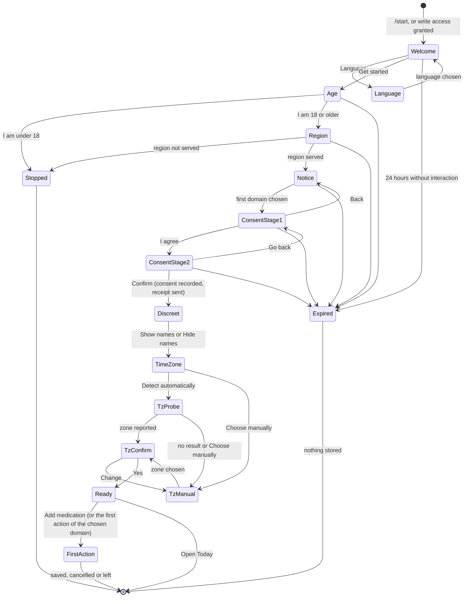
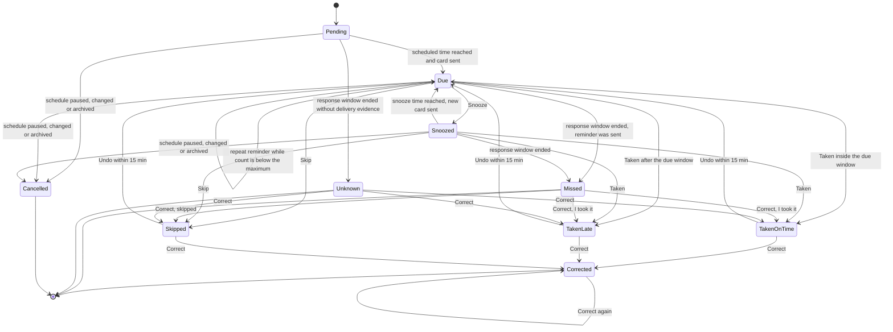

# Dosegram bot UX specification

Status: proposed specification for owner review. It defines the target chat experience; it does not claim that anything is implemented and it does not change any roadmap status.
Date: 2026-11-12.
Scope: every interaction that happens inside the private Telegram chat between one user and the Dosegram bot. The Mini App screens are specified in `MINI_APP.md`. Rendered images are specified in `VISUALS_AND_ANALYTICS.md`. Domain rules are specified in `PRODUCT_SPEC.md`. Transport, storage and security are specified in `ARCHITECTURE.md`. Delivery order is specified in `ROADMAP.md`.

## 0. How to read this document

### 0.1 Evidence labels

Every statement about Telegram behaviour carries one of two labels.

| Label | Meaning |
|---|---|
| `V[02 §n]` | VERIFIED. The statement was read in a primary Telegram source by research brief `research/02-telegram-platform.md`, section `n`, on 2026-11-12. This document did not fetch the sources again. |
| `A` | ASSUMPTION. Not confirmed in a primary source. A design that depends on it names a fallback, and section 24 lists the spike that settles it. |

Primary sources behind the `V` labels, all checked on 2026-11-12 by research brief 02:

| Source | URL |
|---|---|
| Bot API reference, version 10.4 of 2026-11-09 | https://core.telegram.org/bots/api |
| Bot API changelog | https://core.telegram.org/bots/api-changelog |
| Bot features guide | https://core.telegram.org/bots/features |
| Bots FAQ (rate limits) | https://core.telegram.org/bots/faq |
| Mini Apps guide | https://core.telegram.org/bots/webapps |
| Formatting options (`date_time` entity) | https://core.telegram.org/bots/api/formatting |
| Deep links | https://core.telegram.org/api/links |
| Bot Platform Developer Terms | https://telegram.org/tos/bot-developers |

Statements about law and regulation come from `research/03-health-app-teardown.md` section 8 and `research/06-privacy-security-compliance.md` section 14. They are research, not legal advice.

### 0.2 Requirement identifiers

Requirements are numbered `BUX-<area>-<nn>`. Each one is written so that a test on the fake Telegram wire, a transcript test or a measurement can pass or fail it. "Must" is binding. "Should" is the default that may be overruled with a recorded reason. Values marked PROPOSED are initial settings held in configuration, not constants.

### 0.3 Terms

| Term | Meaning |
|---|---|
| Card | One bot message that represents one record or one view and is edited in place as its state changes. |
| Reminder card | The card of one scheduled dose occurrence, or of several occurrences due at the same instant (a slot card). |
| Today card | The single per-day status card (section 8). |
| Navigation card | The single message that shows menus, lists and settings (section 8.4). |
| Toast | The short text passed to `answerCallbackQuery`; shown briefly over the chat and not kept in history. |
| Alert | The same call with `show_alert`; shown as a modal that the user dismisses; not kept in history. |
| Account zone | The IANA time zone stored for the account. |
| Local day | The calendar date in the account zone. |
| Domain | One of medication (`MED`), water (`WATER`), food (`FOOD`), mood (`MOOD`), sleep (`SLEEP`). If a sibling document uses different module identifiers, the sibling's identifiers win and this table is updated. |
| Discreet mode | Account setting that keeps medication names and notes out of everything the bot sends unprompted. |
| Proactive message | A message the bot sends without a user action in the preceding 60 seconds. |

## 1. Summary

### 1.1 Decisions

| # | Decision | Rationale | Rejected alternative |
|---|---|---|---|
| D1 | The chat is the surface for the daily loop: reminders, one-tap logging, quick capture, the Today card, short text statistics, essential settings. The Mini App is the surface for anything that needs a form with more than three fields, a list longer than two pages, a chart to explore, or a file. | Inline buttons answer a prompt in place with one tap. Forms and browsing in a chat cost one message per step. | Chat-only product (the previous principle "all configuration from the bot"); Mini-App-first product with the bot as a notifier only. |
| D2 | No persistent reply keyboard. The home surface is a pinned Today card with an inline keyboard, plus the menu button that opens the Mini App. | Section 7. | A persistent 2 by 3 reply keyboard of quick actions. |
| D3 | One live card per record. State changes edit the card. A new message is sent only when the user must be notified, when the user asked for a new record, or when the old card cannot be edited. | Keeps the chat short; an edit does not notify `A`, a new message does. | A new message for every state change. |
| D4 | Doses due at the same instant are shown on one slot card. | One message per reminder protects the per-chat and global send limits `V[02 §5]` and reduces noise. | One message per dose occurrence. |
| D5 | Reminder cards are always text. Images are never attached to a reminder. | A photo plus a follow-up halves broadcast capacity (research 02 section 5); a reminder must be readable in a notification preview and by a screen reader. | Illustrated reminder cards. |
| D6 | Unambiguous quick-capture input (a button, or text that matches exactly one deterministic grammar) is recorded at once and echoed with Undo. Ambiguous input is never recorded without a tap. Medication doses are never recorded from free text without a tap. | Undo is cheaper than confirm for low-stakes records; medication history must be truthful. | Confirm every parsed message; language-model parsing. |
| D7 | Time zone is captured by a one-tap Mini App probe with a chat-only fallback (current-local-time grid, then region). | Telegram supplies no time zone `V[02 §19.2]`. | Asking for the device location (more data than needed; research 06 section 7.1 forbids requesting location). |
| D8 | Consent is explicit, two-step and per domain. Onboarding asks for the first domain only; every other domain asks on first use. | GDPR Article 9 reading in research 06 section 14.3; speed of onboarding. | One "accept all" button. |
| D9 | Non-medication proactive messages share a daily budget (PROPOSED 4), are silent by default and are never sent in quiet hours. Medication reminders are outside the budget and bounded per occurrence. | A muted bot silences medication reminders too (research 03 section 6.2 item 10). | Per-domain reminder schedules without a common budget. |
| D10 | Reactions and voice notes are not inputs at launch. | Delivery of reaction updates in a private chat is unverified `A`; a double tap sets a quick reaction by accident `A`; speech recognition needs a model, and third-party AI processing is excluded at launch (research 06 open question Q9). | Reaction as "Taken"; voice transcription. |
| D11 | The bot works in private chats only. Inline mode is off. | Every record is health data (research 02 sections 10 and 18). | Family or caregiver groups; inline sharing. |
| D12 | Mood check-in in chat uses five valence steps on one keyboard row, with optional energy, tags and note as later taps. | One tap, one row, no scrolling (research 03 section 3.4). | The previous 1 to 10 picker (two rows, weaker anchors). See open question OQ-3 for the storage mapping. |

### 1.2 Where the owner's wishes meet a verified constraint

| Wish | Constraint | What this specification does instead |
|---|---|---|
| Derive sleep from the user's Telegram "last seen". | The Bot API exposes no presence `V[02 §19.2]`; Telegram's FAQ says bots cannot see last seen (research 05 section 3.1). | "Going to sleep" and "I'm up" check-ins as the primary input; an opt-in estimate from the user's own interactions with this bot, shown as "at most N hours" and never stored without a tap (section 11.5). |
| Reminders that reliably reach the user. | A bot message is an ordinary message; there is no alarm-grade delivery and the bot cannot see mute or Do Not Disturb `A`, verified by absence `V[02 §15]`. | Best-effort wording at onboarding, a test reminder, repeat reminders, a truthful "no response" state, and a chat that stays useful when muted (pinned Today card). |
| The bot "should do everything". | 4096 characters per message, 1024 per caption, 64 bytes per button payload, about one message per second per chat `V[02 §5, §6, §7]`. | The chat does the daily loop. Complex schedules, history browsing, dashboards, imports and exports open the Mini App from a button in the relevant card. |
| A daily dose checklist. | Native checklists need a Telegram Business connection `V[02 §6.5]`. | The slot card and the Today card, built from inline keyboards. |
| Backend-generated images in chat. | Photos are stored in Telegram's cloud and on each device; they cannot be recalled after 48 hours `V[02 §16]`; a photo doubles send cost. | Images are sent for mood, reports and on request; never on reminders; always with a text equivalent; personal images need a one-time consent to delivery in chat (section 13). |
| First medication in under a minute. | Explicit consent needs two taps and a notice that must be read (research 06 section 14.3). | The 60 second budget is measured from "Add medication" to "Medication saved". The whole path from `/start` has a separate target of 120 seconds (section 5.8). |

### 1.3 Hard limits this specification designs inside

| Limit | Value | Label |
|---|---|---|
| Message text | 1 to 4096 characters after entity parsing | `V[02 §6.1]` |
| Photo caption | 0 to 1024 characters | `V[02 §6.3]` |
| `callback_data` | 1 to 64 bytes, untrusted | `V[02 §7.1]` |
| `answerCallbackQuery` text | 0 to 200 characters; must be called for every callback | `V[02 §7.1]` |
| `/start` payload | at most 64 characters of `A-Z a-z 0-9 _ -` | `V[02 §9]` |
| Per chat | avoid more than one message per second | `V[02 §5]` |
| Per bot | about 30 messages per second | `V[02 §5]` |
| Delete | only messages younger than 48 hours; in a private chat the bot may delete its own and the user's messages | `V[02 §16]` |
| Editable messages | only messages without markup or with an inline keyboard | `V[02 §16]` |
| Bot cannot start a conversation | the user must press Start or grant write access | `V[02 §15]` |
| No time zone, no presence, no read receipts | absent from every user object and update | `V[02 §19.2]` (by absence) |
| Command names | 1 to 32 characters, lowercase Latin letters, digits, underscore; description 1 to 256 characters; at most 100 commands | `V[02 §8]` |
| Inline keyboard size | undocumented; commonly reported as 100 buttons and 8 per row | `A` |
| Callback answer deadline | undocumented | `A` |
| Age of an editable own message | no limit stated | `A` |

## 2. What was carried over and what was dropped

Sources: `docs/MEDICATION_REMINDER_UX.md` (MRU) and `docs/BOT_UX_PLAN.md` (BUP).

### 2.1 Carried over unchanged

| # | Rule | Source |
|---|---|---|
| C1 | The bot is a conversational interface, not the source of truth. The backend owns schedules, occurrences, transitions, statistics and audit history. | MRU Product Principles |
| C2 | Every scheduled dose has its own lifecycle and timestamps. `scheduled_for` and `taken_at` are separate. | MRU Core Concepts |
| C3 | The bot never gives clinical dosing advice. After a missed or late dose it points to the clinician's or pharmacist's instructions. | MRU Product Principles, Safety Copy |
| C4 | Dose lifecycle: pending, due, snoozed, taken, skipped, missed, unknown, cancelled; missed requires evidence that the reminder was sent; unknown is used for outages and is excluded from adherence. | MRU Dose Lifecycle |
| C5 | Adherence categories: taken on time, taken late, skipped, missed, unknown. Skipped is separate from failure. | MRU |
| C6 | Taken is direct only inside the persisted late-log window. A too-old or skipped record opens Correct without mutation. A cancelled record refuses. A second tap on a recorded dose returns the existing outcome. | MRU Background Worker |
| C7 | Undo within 15 minutes restores `due`, extends deadlines and clears action fields (ADR-012). | MRU |
| C8 | Snooze options are filtered to those that are valid for the occurrence. An explicit snooze bypasses quiet deferral but returns silently inside quiet hours. `max_reminders` includes the first reminder. | MRU |
| C9 | Corrections carry an explicit effective time and are excluded from delay samples. | MRU |
| C10 | Taken, Skip, each offered Snooze, and Undo take one tap on the visible reminder. Correct with "Now" or "At scheduled time" takes two. Logging an as-needed dose takes at most two taps. | MRU, BUP section 3 |
| C11 | Routine fixed prompts fit two short paragraphs and 160 characters of fixed copy. Outcomes fit 80 characters. User data has validated limits and a Details route; it is never truncated silently. | MRU, BUP section 3 |
| C12 | Navigation edits one navigation card. Setup edits one setup card. Reminders keep their own cards; navigation never replaces a reminder. | MRU, BUP section 3 |
| C13 | Every nested view has Back (to its saved parent, with filters kept) and Menu. One reserved navigation row. | BUP section 3 |
| C14 | Every visible action carries a record-scoped target. Destructive actions live on a detail card that names the record. | BUP section 3 |
| C15 | Unavailable branches are hidden at the source. A feature flag is enabled only when every emitted route has a handler. | BUP section 3 |
| C16 | No latest-record guessing: an ambiguous `/taken` or `/skip` shows a picker. | BUP section 3 |
| C17 | Drafts: navigation suspends a draft and does not discard it; the root offers "Continue setup"; starting another flow asks "Discard draft" or "Continue setup"; only Cancel, discard or expiry deletes; 30 minutes idle plus 30 minutes grace; a stale submit cannot recreate a deleted draft. | MRU Bot State Machine |
| C18 | "Saved" means the core confirmed persistence. A failed reply is not a failed commit. On an uncertain commit the bot says "Checking whether this was recorded" and reconciles before any retry. "Nothing was recorded" is said only after confirmed non-commit. | MRU, BUP section 4 |
| C19 | A missing edit target produces one useful replacement with a recorded handle, not duplicate success messages. | MRU |
| C20 | One displayed manual-log intent for a medication dose commits at most once, even on rapid distinct taps. "Log another" allocates a fresh intent. | MRU, BUP section 4 |
| C21 | Catch-up after downtime sends one digest per accepted bucket that links to the original records. No replay storm. | MRU, BUP section 5 |
| C22 | Summaries are silent and opt-out-aware. Operations alerts never reach users. | MRU |
| C23 | Discreet mode covers names in labels, previews, text, file names and alt text. A spoiler is a preview control, not protection. | MRU, BUP section 5 |
| C24 | Text statistics ship before images. Adherence is taken divided by taken plus skipped plus missed over eligible resolved rows. A zero denominator is "No data", not 0 percent. Unknown is never converted to missed. Mood gaps are gaps. No composite health score, no causal claims, no shaming streaks. | MRU Adherence Statistics |
| C25 | Text, alt text and image are produced from the same immutable snapshot. A render failure keeps a truthful text answer and never blocks intake or reminders. | MRU, BUP section 6 |
| C26 | Safety copy: "Recorded.", "Marked skipped.", "I marked this missed because there was no response." Forbidden: "You failed", "You should take it now", "Double your next dose". | MRU Safety Copy |
| C27 | Archive and Delete confirmations name their targets. Pause is a tracking and notification suspension, never a recommendation to stop treatment. | MRU, BUP section 4 |
| C28 | The add-medication flow ends in a review that equals the persisted fields. Invalid input preserves answers and writes nothing. No times means as-needed; as-needed creates no automatic reminder. | MRU Nested Bot Menu |
| C29 | An existing account that sends `/start` is routed to the root, not shown a second-create error. | BUP section 4 |
| C30 | Wrong-account, tampered or invalid controls reveal no names and mutate nothing. | MRU, BUP section 4 |

### 2.2 Carried over with a change

| # | Previous rule | Change | Reason |
|---|---|---|---|
| M1 | "The user can do all configuration from the bot through nested menus." | The chat covers the daily loop, simple medication set-up and essential settings. Complex schedules and bulk edits open the Mini App (section 3.2). Data-rights and safety functions stay reachable without the Mini App (section 19). | The owner requires a Mini App for registry and schedules; forms in chat cost one message per field. |
| M2 | Six root categories: Today, Medications, Habits, Reminders, Stats, Account. | Root is the Today card. The menu lists Today, Medications, Track, Stats, Settings, App. Habits and generic reminders stay hidden until their slices exist. | New domains; the Today card replaces the root menu as the first view. |
| M3 | Mood is a 1 to 10 picker. | Five valence steps in chat, optional energy step (section 11.4). | D12. |
| M4 | Interaction acknowledgement p95 below 1.5 seconds measured from interaction creation. | Same target, measured from receipt of the update, because a callback query carries no creation time (research 05 section 3.1, verified). ADR-013 names 2 seconds for Telegram; `ARCHITECTURE.md` owns the final number. | Platform difference. |
| M5 | "Reminders stay DM-only; non-DM invocations receive only a redirect." | Private chat only; in any other chat the bot sends one notice without health data and leaves (section 16). | Same intent, Telegram mechanics. |
| M6 | Add medication is a three-step wizard that starts with a modal text form. | Step 1 is one typed message in a fixed grammar, or the Mini App form. Steps 2 and 3 (cadence, review) are kept. | Telegram has no modal form. |
| M7 | One reminder card per occurrence. | One card per slot; a slot with one occurrence looks exactly like the previous card (D4). | Send limits and noise. |
| M8 | Missed-dose card offers "I took it", "Skip", "Keep missed". | Kept. "I took it" asks for the time with three choices (section 9.6). | Corrected time must be explicit (C9). |

### 2.3 Dropped

| # | Dropped | Reason |
|---|---|---|
| X1 | Slash-command typed options and autocomplete over medication names. | Telegram commands carry no typed options (research 01 section 4 item 6, `A`). Replaced by pickers and by the text after a command. |
| X2 | Ephemeral visibility, deferred replies, "modal opening cannot defer", modal deadlines, FormRunner as a modal fallback. | Discord interaction lifecycle. Telegram has one acknowledgement call. Ephemeral messages exist since Bot API 10.2 but delivery is "not guaranteed" `V[02 §6.10]`; they are not used. |
| X3 | Limits of 5 rows, 5 buttons per row, 25 components, 2000-character chunks, 100-character custom ids. | Discord limits. Section 4.2 sets Telegram limits. |
| X4 | USER_INSTALL and BOT_DM registration, the DM-only ephemeral redirect, the typed-option hover leak. | Discord installation model. |
| X5 | Send nonce (`enforce_nonce`) as the duplicate guard. | Telegram has no server-side idempotency key `A` (research 01 section 5). The outbox rule and the card model replace it; `ARCHITECTURE.md` owns the mechanism. |
| X6 | Numbered-reaction multi-select on the Telegram profile. | Not native. Replaced by a toggle keyboard that edits its own markup (section 4.2). |
| X7 | "Use text hierarchy before decorative embeds", Discord spoilers and timestamps. | Discord formatting. Replaced by Telegram HTML entities (section 4.1). |
| X8 | Attachment descriptions up to 1024 characters as alt text, fresh `FileUpload` per attempt. | Discord and JDA specifics. The caption is the text equivalent (section 13). |
| X9 | Passwords, recovery codes and cross-vendor linking prompts. | Telegram is the only identity (research 06 section 4.7). No credential is ever asked for in chat. |
| X10 | The agent operating model, packet table and verification commands of BUP sections 7 to 10. | Process content; owned by `ROADMAP.md` and `docs/AGENTIC_DEVELOPMENT.md`. |

## 3. Interaction principles

### 3.1 Principles

| ID | Principle | Test |
|---|---|---|
| BUX-PRIN-01 | Answer in place. Every prompt the bot sends can be answered with one tap on the same message. | For every proactive message kind, the transcript shows at least one inline button that completes the primary action. |
| BUX-PRIN-02 | One live card per record (D3). | After any sequence of actions on one occurrence, at most one message in the chat carries a keyboard for it. |
| BUX-PRIN-03 | Tell the truth about state. The card shows what the backend stored, including "checking", "no response" and "could not be delivered". | C18 tests; no success copy before the commit is confirmed. |
| BUX-PRIN-04 | Every recorded action can be undone or corrected from the message that confirms it (section 18). | Every outcome template has an Undo or Correct control, or names where to correct. |
| BUX-PRIN-05 | Every flow works without images and without the Mini App for the functions listed in section 19. | Text-only transcript suite passes with images off and `web_app` buttons ignored. |
| BUX-PRIN-06 | Record, remind, show, count, compare with the user's own past, export. Never diagnose, advise, score or judge (research 03 section 8.3). | The forbidden-phrase gate (existing `ForbiddenPhrases`) covers the whole copy deck of section 22, including the new domains. |
| BUX-PRIN-07 | No message without a reason. A proactive message is sent only for a schedule the user set, a budgeted touchpoint the user can turn off, or a service notice. | Section 14 budget tests. |
| BUX-PRIN-08 | Nothing sensitive in transit fields. `callback_data`, deep-link payloads, file names and Mini App routes carry opaque tokens only. | Payload fixtures contain no name, note, dose or account identifier in clear. |
| BUX-PRIN-09 | Respond to everything. Every private message gets a reply and every callback query gets `answerCallbackQuery`, including on error paths. BotFather alerts on unanswered traffic `V[02 §5]`. | Fake-wire suite asserts one answer per callback and one reply or card edit per message. |
| BUX-PRIN-10 | One question per message; one primary action per card. | Review of the copy deck; each prompt key has one question mark at most. |

### 3.2 Division of labour between the chat and the Mini App

| Task | Chat | Mini App | Entry from chat |
|---|---|---|---|
| Answer a reminder (Taken, Skip, Snooze, Undo) | Yes, one tap | Also possible | none needed |
| Correct a dose: now, at scheduled time | Yes, two taps | Yes | none needed |
| Correct a dose: custom time | Yes, typed `HH:MM` | Yes, time picker | "Other time" |
| Log an as-needed dose | Yes, two taps | Yes | `/take` |
| Add a medication with daily times, weekdays or as-needed | Yes (section 10.1) | Yes | "Add medication" |
| Add or edit interval, cycle or taper schedules; edit dose and instructions | No | Yes | "Edit in app" on the medication card |
| Pause, resume, archive a medication | Yes | Yes | medication card |
| Reminder policy per schedule (offset, snooze options, response window) | No | Yes | "Reminder settings" on the medication card |
| Water, mood, sleep, meal logging | Yes, one tap or one message | Yes | Today card |
| Meal photo | Yes | Yes | send a photo |
| Edit or delete an entry older than 15 minutes | Last 7 days by `/history` | Any date | "Open history" |
| Today view | Yes (Today card) | Yes | pinned card, `/today` |
| Statistics for 7 and 30 days | Yes, text; image on request | Full dashboards | `/stats` |
| Weekly report | Yes, image plus text | Archive of reports | proactive |
| Language, time zone, units, quiet hours, check-in times, discreet mode, images on or off | Yes | Yes | `/settings` |
| Per-domain goals and presets | Water goal and one preset in chat | All | `/settings` |
| Consent: grant, withdraw | Yes | Yes | `/privacy` |
| Export | Request in chat; download in the Mini App by default; file in chat only as a warned opt-in | Yes | `/privacy` |
| Delete account or one domain's data | Yes, with step-up confirmation in chat | Yes, confirmed in chat | `/privacy` |
| Import files | No | Yes | "Import in app" |
| Caregiver link (later stage) | Invite and accept in chat | Manage grants | `/privacy` |

| ID | Requirement |
|---|---|
| BUX-DIV-01 | Every row marked "No" in the Chat column must have a button in the named chat entry that opens the Mini App on the exact screen, using an inline `web_app` button (private chat only `V[02 §7.1]`). |
| BUX-DIV-02 | A `web_app` button label must start with a verb and name the destination ("Edit in app", "Open history"). It must never be the only way to reach a function listed in section 19. |
| BUX-DIV-03 | A change made in the Mini App that affects a live card (a dose marked taken, a medication archived, a setting changed) must edit that card within 5 seconds of the commit, or the card must correct itself on the next tap (section 4.5). |
| BUX-DIV-04 | Step-up actions started in the Mini App (export, account deletion, consent change, caregiver grant) must be confirmed by a button in the chat (research 06 section 4.5). The chat message names the action and its consequence. |

## 4. Message and keyboard conventions

### 4.1 Text

| ID | Requirement |
|---|---|
| BUX-MSG-01 | All messages use parse mode HTML `V[02 §6.1]`. Every user-supplied string is HTML-escaped before interpolation. A test sends names that contain `<`, `&`, `"` and a 4-byte character. |
| BUX-MSG-02 | Allowed entities: bold for the record name or heading, italic for user-supplied instructions, `code` for a typed example, `text_link` for the privacy notice and terms. No underline, no strikethrough, no block quote, no spoiler for sensitive content (C23). |
| BUX-MSG-03 | Fixed copy per routine prompt is at most 160 characters and two paragraphs; an outcome is at most 80 characters (C11). Onboarding cards, consent notices, help, statistics and digests are exempt and are limited to 900 characters each. No bot message exceeds 3500 characters; longer content is paged. |
| BUX-MSG-04 | Times are shown in the account zone, in the 12 or 24 hour form of the account locale, with no seconds. A date is added when the instant is not on the current local day. The zone name is shown on set-up, review and settings cards and whenever the account zone changed in the last 24 hours. |
| BUX-MSG-05 | After spike SP-2 confirms client behaviour, an instant may additionally be wrapped in a `date_time` entity with an empty format, whose visible text is the account-zone time `V[02 §6.2]` for the syntax, `A` for rendering. The plain text must be correct without the entity. |
| BUX-MSG-06 | Numbers use the account locale for decimal separators. Volumes are shown in the account unit (millilitres and litres, or fluid ounces). Durations are shown as "7 h 10 min". Percentages are whole numbers. |
| BUX-MSG-07 | No decorative emoji in message text. No character art, block-drawing progress bars or tables made of spaces; they are unreadable with a screen reader and break in proportional fonts. Progress is written as "1.25 of 2.0 l (62%)". |
| BUX-MSG-08 | The first line of every proactive message must make sense alone, because it is what a notification preview shows. In discreet mode the first line contains no medication name, dose, note or domain value. |
| BUX-MSG-09 | Messages that are direct responses to a user action in the last 60 seconds are sent with `disable_notification = true` `V[02 §6.1]`. |

### 4.2 Inline keyboards

| ID | Requirement |
|---|---|
| BUX-KB-01 | Self-imposed layout limits, because the platform limits are undocumented `A`: at most 8 rows per keyboard; at most 3 buttons per row for word labels and 5 per row for labels of at most 3 characters; label at most 24 characters. A label built from user data is truncated to 20 characters plus an ellipsis, and the full value is in the message text. |
| BUX-KB-02 | Every label starts with a verb or is a value ("Taken", "Snooze 10 min", "+250 ml", "4"). No "OK", "Yes" or "No" on destructive confirmations: labels name the action ("Delete account", "Keep account"). |
| BUX-KB-03 | The last row of a navigation card is the navigation row: "Back" and "Menu" (C13). Reminder cards and the Today card have no navigation row. |
| BUX-KB-04 | Button `style` (`primary`, `success`, `danger`) `V[02 §7.1]` may mark the primary action and a destructive confirmation. Meaning must never depend on colour: the label alone is sufficient. Custom emoji icons are not used (they need a Premium owner or a Fragment username `V[02 §6.1]`). |
| BUX-KB-05 | Options that are not valid are omitted, not shown disabled (C8, C15). |
| BUX-KB-06 | Multi-select (weekdays, tags) is a toggle keyboard: each tap edits the markup of the same message to show the selected state in the label ("Mon selected"), and a "Done" button commits. The selected state is in the label text, not only in a symbol. |
| BUX-KB-07 | Lists longer than 6 records are paged with "Previous" and "Next" in one row above the navigation row; the heading shows "Page 2 of 4". Every record on every page stays actionable (BUP section 3). |
| BUX-KB-08 | A prompt that expects typed input carries a "Cancel" button, and its text says "Send the value as a message". Routing of the typed answer never depends on a reply link: the active input field of the session receives the next non-command text message (section 11.1). `force_reply = true` on the inline keyboard `V[02 §7.1]` is set only when the prompt is a newly sent message, because its value "can't be changed when the inline keyboard is edited" (VERIFIED, https://core.telegram.org/bots/api#inlinekeyboardmarkup, checked 2026-11-12 by the review of this document set). Almost every typed prompt of this specification is reached by editing an existing card in place (the single onboarding card, the correction prompt, settings, the water card), so those prompts have no forced reply and rely on the active-field routing alone. Where the reply interface is wanted for one prompt, that prompt is sent as a new message and the previous card is finalised; this specification does so for no prompt at launch. Behaviour of `force_reply` on older clients and on an edited keyboard is `A` (spike SP-4). |
| BUX-KB-09 | `web_app` buttons are used only in private-chat messages and never as the first button of a reminder card. |

### 4.3 Callback data

The existing codec (`core/chat/CallbackCodec.scala`) signs a 34-byte token and writes it as the prefix `dc:` plus 46 base64url characters, 49 bytes on the wire (research 01 section 5). That fits the 64-byte limit `V[02 §7.1]` with 15 bytes to spare. This specification keeps the codec and states what the token must carry. The byte layout below is PROPOSED and is consistent with the 34-byte budget; the codec source was not read line by line in this run, and `ARCHITECTURE.md` owns the final layout.

| Field | Bytes | Content |
|---|---|---|
| Version and key id | 1 | 4 bits codec version, 4 bits signing key id (two keys active during rotation) |
| Action id | 2 | Index into the closed action registry (for example `dose.take`, `dose.skip`, `dose.snooze`, `slot.take_all`, `water.add`, `mood.set`, `nav.open`) |
| Subject id | 16 | UUID of the subject: occurrence, slot, entry, intent, session or account-scoped view |
| Value | 3 | Action argument: snooze minutes, item index, mood step, volume in millilitres, page number |
| Issue epoch | 4 | Minutes since a fixed epoch, for expiry of navigation tokens and for key retirement |
| MAC | 8 | HMAC-SHA-256 over the preceding 26 bytes, truncated |

| ID | Requirement |
|---|---|
| BUX-CB-01 | Encoded `callback_data` must be at most 64 bytes for every action and every value. A property test generates all actions with extreme values and asserts the length. |
| BUX-CB-02 | The token carries no name, note, dose text, Telegram user id or sequential identifier (BUX-PRIN-08). |
| BUX-CB-03 | A quantity shown on a button label is carried in the value field, not looked up from a preset at press time. A "+250 ml" button on an old card must always add 250 ml, even after the user edits presets. |
| BUX-CB-04 | On every press the backend verifies the MAC, resolves the subject, checks that `callback_query.from.id` owns it, and checks the subject's current state. `callback_data` is untrusted `V[02 §7.1]`. Any failure answers with the generic toast `err.control.invalid`, reveals nothing and mutates nothing (C30). |
| BUX-CB-05 | Every action is idempotent on (subject, action, value) for state transitions and on the update id for repeated deliveries of the same callback. A repeated delivery returns the first outcome. |
| BUX-CB-06 | Dose-action tokens do not expire while the occurrence exists. Navigation and wizard tokens expire with their session. Tokens signed with a retired key are treated as stale (section 4.5). |
| BUX-CB-07 | `answerCallbackQuery` is called exactly once per callback query, with p95 below 1.5 seconds from receipt of the update, before rendering or uploads (M4). An acknowledgement watchdog answers with an empty toast if the handler has not answered by the deadline. |

### 4.4 Toasts and alerts

| Use | Mechanism | Rule |
|---|---|---|
| Confirmation of an action whose result is visible in the edited card | Empty answer, or a toast of at most 60 characters | No duplicate of the card text. |
| Result that is not visible in a card (for example "+250 ml" pressed on the Today card) | Toast, at most 80 characters | Contains the new total. |
| Refusal or stale control | Toast | Section 4.5. |
| Revealing names in discreet mode | Alert (`show_alert`), at most 200 characters `V[02 §7.1]` | Nothing is written to the chat. If the content exceeds 200 characters the alert shows the first items and "Open the app to see all". |
| Anything the user must be able to find again | Never a toast or alert | It goes into a card. |

### 4.5 Stale buttons

A button is stale when its card no longer shows the subject's current state. The bot cannot remove keyboards from all old messages cheaply, so staleness is resolved at press time.

| Case | Behaviour | Copy key |
|---|---|---|
| Dose already recorded (any channel) and the same action is pressed | Toast with the stored outcome; card is re-rendered to the current state | `toast.dose.already` |
| Dose already recorded and a different action is pressed (for example Skip after Taken) | No mutation; card re-rendered with Undo (if inside 15 minutes) or Correct | `toast.dose.use_correct` |
| Taken pressed after the late-log window | No mutation; card re-rendered as the correction prompt (C6) | `rem.correct.prompt` |
| Occurrence cancelled (schedule paused, changed or archived) | No mutation; card re-rendered as cancelled without keyboard | `rem.cancelled` |
| Undo pressed after 15 minutes | No mutation; card re-rendered with Correct only | `toast.undo.expired` |
| Navigation or wizard token of an expired or replaced session | The current view of that flow is rendered in the navigation card; one notice | `toast.nav.refreshed` |
| Wizard step that is no longer the current step | Answers kept; current step re-rendered; one notice (C17) | `toast.wizard.stale` |
| Token signed with a retired key, bad MAC, foreign subject | Generic toast; if the message is the user's own reminder card, the card is re-rendered with fresh tokens | `err.control.invalid` |
| The message is no longer accessible to the bot (`MaybeInaccessibleMessage` `V[02 §7.1]`) or the edit target is missing | The action is still applied if valid; one replacement card is sent and its handle recorded (C19) | card of the new state |
| Yesterday's Today card | Quick-add buttons are removed at day rollover (section 8.2); a press that still arrives logs nothing and re-renders the card as closed | `toast.today.closed` |

| ID | Requirement |
|---|---|
| BUX-STALE-01 | No stale press may create, change or delete a record, except the "still valid" case in which the same action is applied to a subject that is still open. |
| BUX-STALE-02 | A stale press always results in the pressed message showing the current state within 2 seconds (p95, PRODUCT_SPEC X-LAT-2), or in one replacement card. |
| BUX-STALE-03 | An edit that changes nothing ("message is not modified") is treated as success and is not shown to the user. The exact error text is `A`. |

### 4.6 When to edit and when to send

| Situation | Action |
|---|---|
| State change caused by the user's tap on the card | Edit the card. |
| State change caused elsewhere (Mini App, another card, timer) with no need to notify | Edit the card silently. |
| The user must be notified again (repeat reminder, snooze elapsed) | Send a new card; delete the previous card for the same subject if it is younger than 48 hours `V[02 §16]`, otherwise edit it to one line without a keyboard. |
| The user asked for a view by command | Send a new navigation card at the bottom; remove the keyboard from the previous navigation card or delete it. |
| The card is the only message since the user's last message, or the user is answering in place | Edit. |
| The edit target is missing or not editable | Send one replacement. |

## 5. Onboarding

### 5.1 Entry paths

| Path | What the bot receives | First bot action |
|---|---|---|
| User opens the bot and presses Start | `/start` | Welcome (5.3 step W) |
| Deep link `https://t.me/<bot>?start=<payload>` | `/start <payload>` `V[02 §9]` | Welcome; the payload is parsed by 5.2 and kept for the end of onboarding |
| User opens the Mini App from a link before ever pressing Start | Nothing, until the Mini App obtains write access; then the service message `write_access_allowed` `V[02 §11.7]` | Welcome, sent as the first message. `MINI_APP.md` owns the `requestWriteAccess` call. |
| Existing account sends `/start` | `/start` | Today card (C29). A route payload is honoured; other payload kinds are processed by their own rules. |
| User unblocks the bot after blocking it | `my_chat_member` `V[02 §4.1]`, then usually `/start` | Welcome-back card (section 15.4) |

The bot cannot message a user who has not pressed Start or granted write access `V[02 §15]`. No flow in this document assumes otherwise.

### 5.2 Deep-link payloads

The payload is attacker-controllable text `V[02 §9]`. It selects a screen or carries an opaque single-use token. It never carries an identifier that grants access by itself.

```
payload = route / invite / grant
route   = "r_" screen
screen  = "today" / "addmed" / "take" / "water" / "mood" / "sleep" / "food"
        / "stats" / "settings" / "privacy" / "tz"
invite  = "i_" token        ; closed-beta invitation, single use
grant   = "c_" token        ; caregiver invitation, later stage
token   = 22 characters of A-Z a-z 0-9 _ -   ; 128 random bits, base64url
```

| ID | Requirement |
|---|---|
| BUX-DL-01 | A `start` payload is at most 24 characters and matches the grammar above. Anything else is ignored and `/start` behaves as if it had no payload. The payload is never echoed to the chat and never logged. |
| BUX-DL-02 | A route is honoured only after onboarding is complete and only if the domain is enabled; otherwise the user lands on the Today card. During onboarding the route is remembered and applied at step R. |
| BUX-DL-03 | An invite or grant token is looked up by hash, is single use and expires (PROPOSED: invite 14 days, grant 24 hours per research 06 section 5.2). A used, expired or unknown token yields `onb.invite.invalid` and stores nothing. |
| BUX-DL-04 | When the service runs in invite mode (configuration `ONBOARDING_MODE = invite`), `/start` without a valid invite yields `onb.closed` and stores nothing. In open mode the invite kind is ignored. See open question OQ-8. |
| BUX-DL-05 | The Mini App `startapp` parameter has its own grammar, owned by MINI_APP section 3.4: route names without the `r_` prefix, optionally followed by `_` and an identifier, up to the platform limit of 64 characters `V[02 §9]` (for example `schednew_<22-character id>`, 31 characters). The two grammars are validated separately; the 24-character limit of BUX-DL-01 applies to `start` only. |

### 5.3 Steps



| Step | Card (copy key) | Buttons | Stored when the step completes |
|---|---|---|---|
| W Welcome | `onb.welcome` | Get started; Privacy notice (link); Language | Nothing durable. A set-up session keyed by the Telegram user id holds step, language and region only, and is deleted after 24 hours without interaction (PRODUCT_SPEC R-IDC-3 and AC-IDC-1). This is longer than the 30 minutes idle plus 30 minutes grace of wizard sessions (C17), which applies to every other wizard, so that a person who starts in the evening can finish the next day. |
| L Language | `onb.language` | One button per shipped locale | Session only |
| A Age | `onb.age` | I am 18 or older; I am under 18 | Session only; no date of birth is ever asked (research 06 section 14.10) |
| G Region | `onb.region` | EU or EEA; Ukraine; Other | Session only |
| N Notice | `onb.notice` | Medication; Water; Mood; Sleep; Meals; Full privacy notice (link) | Session only |
| C1 Consent stage 1 | `consent.<domain>.stage1` | I agree; Back | Session only |
| C2 Consent stage 2 | `consent.<domain>.stage2` | Confirm; Go back | Account created; consent ledger row with both tap times, notice version and locale; receipt message `consent.receipt` sent |
| D Discreet | `onb.discreet` | Show names; Hide names (no default, no preselection) | Account setting |
| Z Time zone | `onb.tz` and section 5.7 | Detect automatically; Choose manually | Account zone |
| R Ready | `onb.ready` | Add medication (or the chosen domain's first action); Open Today | Menu button switched to the Mini App for this chat (section 6.3) |
| F First medication | section 10.1 | | Medication and schedule |
| T Reliability note | `onb.reliability`, sent once after the first schedule with a reminder is saved | Send a test reminder; OK | Flag "note shown" |

| ID | Requirement |
|---|---|
| BUX-ONB-01 | The whole of onboarding is one set-up card edited in place from step W to step R. The consent receipt is a separate message that is never edited, so the user can find it again. |
| BUX-ONB-02 | Before step C2 completes, no account row and no health record exists. A test abandons onboarding at each earlier step and asserts that nothing durable remains after expiry. |
| BUX-ONB-03 | No tracking command works before step C2. A command sent during onboarding re-renders the current step with the notice `onb.finish_first`. `/help`, `/privacy`, `/terms` and `/cancel` work at every step. |
| BUX-ONB-04 | "I am under 18" and a region that is not served end the flow with a message that says nothing was stored. The set-up session is deleted at once. |
| BUX-ONB-05 | Steps A, G, D and both consent stages have no preselected or highlighted option. Button `style` is not used on them. |
| BUX-ONB-06 | Every step has a way back except W, and `/cancel` ends onboarding at any step with `onb.cancelled`. |
| BUX-ONB-07 | If the session expires, the next `/start` begins at W. A tap on the expired card yields `toast.wizard.expired` and renders W. |

### 5.4 Language

| ID | Requirement |
|---|---|
| BUX-LANG-01 | The initial language is the shipped locale that matches `language_code` of the first update; the field is optional and can be stale `V[02 §19.1]`. With no match the language is English. |
| BUX-LANG-02 | The Welcome card always offers "Language". The language can be changed later with `/language` and in `/settings`. The choice is stored and wins over `language_code` from then on. |
| BUX-LANG-03 | First shipped locales are English and Ukrainian (research 04 open question Q10). Every key of the copy deck exists in every shipped locale; a build check fails on a missing key. |
| BUX-LANG-04 | Command descriptions, the bot name, description and short description are registered per shipped language (section 6). |

### 5.5 Consent

The basis is explicit consent per domain, captured by two taps, with a versioned record (research 06 section 14.3).

| ID | Requirement |
|---|---|
| BUX-CONS-01 | The notice card `onb.notice` states, in plain words: what is stored; that it is health data; that Telegram can read bot messages and images because bot chats are not end-to-end encrypted; who can access the records; how to export, delete and withdraw; that reminders are best effort; that the product gives no medical advice. It links to the full privacy notice. |
| BUX-CONS-02 | Stage 1 shows the full consent statement in the message text. The button reads "I agree". Stage 2 repeats the statement and the button reads "Confirm". Consent is recorded only on the stage 2 tap. Research 06 proposes that the button label itself is the statement; a label of that length is likely to be truncated on a phone `A`, so the statement is in the message and repeated at stage 2. Counsel should confirm this form (open question OQ-9). |
| BUX-CONS-03 | Onboarding asks consent for exactly one domain: the one the user chose on the notice card. No "accept all" control exists. |
| BUX-CONS-04 | The first use of any other domain (command, button, quick-capture text or photo) shows that domain's two-stage consent in the navigation card before anything is recorded. The input that triggered it is kept in the session and applied after stage 2, so the user does not repeat it. |
| BUX-CONS-05 | Separate two-stage consents, each asked at first use and never bundled. The purpose identifiers are those of PRODUCT_SPEC R-IDC-6 and no others: delivery of personal report images into the chat (`images_in_chat`); storage of meal photos (`photo_storage`); sleep estimate from bot activity (`sleep_passive_estimate`); comparisons across domains (`cross_domain_patterns`); caregiver sharing with a named person (`caregiver_sharing`, per grant); delivery of an export file into the chat (`export_to_chat`, per export); an import (`import`, per source). |
| BUX-CONS-06 | `/privacy` lists every consent with its date and a "Withdraw" button. Withdrawal takes effect at once: the domain's prompts stop, its commands return to the consent prompt, and the card offers "Delete this data" and "Keep the data". Deleting follows section 20.3. |
| BUX-CONS-07 | A material change of the notice, or a new purpose, re-prompts with the same two stages. Silence is never treated as consent; features that depend on the new consent stay off until it is given. |
| BUX-CONS-08 | Declining a consent always leaves a working product for the domains already agreed. The decline message names what stays off and how to turn it on later. |

### 5.6 Discreet mode choice

| ID | Requirement |
|---|---|
| BUX-DISC-01 | Step D is a forced choice with two equal buttons (research 06 section 7.3). If configuration requires a default, the default is "Hide names". |
| BUX-DISC-02 | With "Hide names", no proactive message, button label, caption, image or file name contains a medication name, dose, instructions or note. A reminder reads "Time for your 09:00 item." Rows are labelled "Item 1", "Item 2" or with a neutral label the user set in the Mini App. |
| BUX-DISC-03 | In discreet mode every card that hides names has a "Show details" button. It answers with an alert (section 4.4) that lists the names; nothing is written to the chat. |
| BUX-DISC-04 | The setting can be changed in `/settings`. A change applies to messages sent after it; messages already in the chat are not rewritten, and the confirmation says so. |

### 5.7 Time zone capture

Telegram gives the bot no time zone and no location `V[02 §19.2]`. Reminders cannot be scheduled without one, so this step cannot be skipped.

Primary path, the probe:

1. The card `onb.tz` has an inline `web_app` button "Detect automatically". It opens the Mini App on a minimal screen that reads `Intl.DateTimeFormat().resolvedOptions().timeZone`, sends the zone id to the backend with the validated launch data, and closes itself. That this value is correct in every Telegram WebView is `A` (spike SP-6).
2. The backend validates that the value is a known IANA zone id and edits the set-up card to `onb.tz.confirm`, which shows the zone and the resulting local time.
3. "Yes" stores the zone. "Change" opens the manual path.

Manual path, used when the probe returns nothing within 60 seconds, when the user prefers it, or when the client cannot open the Mini App:

1. If the declared region has exactly one zone (for example Ukraine), go straight to `onb.tz.confirm`.
2. Otherwise `onb.tz.search` asks the user to type a country or the nearest large city. The text is matched, case-insensitively and without diacritics, against the names in the time zone database (zone identifiers and country names in the shipped locales). Up to 6 matches are shown as buttons, each with its current local time ("Berlin, now 08:41").
3. With no match, or on "Pick by current time", `onb.tz.grid` shows a grid of the current local time in each UTC offset used in the declared region (at most 12 buttons, 3 per row, plus "Other"). After a tap, the zones that have that offset now are listed by country, paged.
4. Every path ends in `onb.tz.confirm`.

| ID | Requirement |
|---|---|
| BUX-TZ-01 | A stored account zone is always a valid IANA zone id, never a bare offset. |
| BUX-TZ-02 | The confirmation card shows the zone id and the local time computed from it at render time. The zone is stored only after "Yes". |
| BUX-TZ-03 | The bot never asks for the device location and never uses `request_location` (research 06 section 7.1). |
| BUX-TZ-04 | The probe stores nothing but the zone id. The typed search text is discarded after matching. |
| BUX-TZ-05 | `/timezone` and `/settings` reopen this flow at any time. On a change, the bot sends the review message `tz.changed` required by PRODUCT_SPEC R-SCH-15 item 5: the doses of the next 24 hours with their new local times, and the buttons "Looks right" and "Keep home time". "Keep home time" sets the affected schedules to a fixed zone (R-SCH-16), so their reminders arrive at the same absolute instants as before and show both times. The review stays answerable for 24 hours; the first draft offered only an Undo button valid for 15 minutes. |
| BUX-TZ-06 | When the Mini App reports a device zone that differs from the account zone (owned by `MINI_APP.md`), the bot sends one silent card `tz.mismatch` with "Switch to <zone>" and "Keep <zone>", at most once per 24 hours and once per distinct device zone until answered. |
| BUX-TZ-07 | All schedule cards show the zone id (BUX-MSG-04), so a wrong zone is visible at the moment a medication is created. |

### 5.8 Time and tap budgets

| Budget | Target | How it is measured |
|---|---|---|
| Taps from `/start` to "Account ready" (probe path) | at most 9: Get started, 18 or older, region, domain, I agree, Confirm, discreet choice, Detect automatically, Yes | Counted on the transcript of section 21.1. The probe counts as one tap. |
| Time from "Add medication" to "Medication saved" | under 60 seconds, median, for a medication with one daily time | Usability measurement with the owner; scripted transcript proves 2 taps and 1 typed message |
| Time from `/start` to the first saved medication | under 120 seconds, median | Same |
| Typed messages in onboarding | 0 on the probe path; 1 on the manual time zone path | Transcript |

The owner's "first medication in under a minute" is met from "Add medication", not from `/start`, because the notice and the two consent taps cannot be removed (section 1.2).

## 6. Commands, menu button and bot profile

### 6.1 Command list

Commands are plain text; Telegram attaches no typed options. Text after the command is the argument. Updates may contain commands that do not exist `V[02 §8]`, so every command is validated.

This table is the single command registry of the document set (ROADMAP conflict X-31). PRODUCT_SPEC "Capture surfaces" lines and VISUALS_AND_ANALYTICS use these names and no others. "Listed" commands are registered with `setMyCommands` for scope `all_private_chats`, once without a language and once per shipped language `V[02 §8]`; "hidden" commands are accepted but not registered. The wave says when the command starts to work; before its wave a command is unknown (BUX-CMD-02), and `/help` and `getMyCommands` list exactly the listed commands whose wave has shipped.

| Command | Listed or hidden | Wave | Description (English) | Argument | Behaviour |
|---|---|---|---|---|---|
| `/today` | Listed | MVP | Today: what is due and what is logged | none | Sends a fresh Today card (section 8) |
| `/take` | Listed | MVP | Log a dose now | none | As-needed and unscheduled dose picker (section 10.4) |
| `/water` | Listed | MVP | Log water | optional amount, for example `/water 300` | Records the amount, or shows the water card (section 11.2) |
| `/mood` | Listed | MVP | Log mood | optional step 1 to 5 | Records the step, or shows the mood prompt (section 11.4) |
| `/sleep` | Listed | V1 | Log sleep | optional times, for example `/sleep 23:30 7:10` | Records, or shows the sleep card (section 11.5) |
| `/food` | Listed | V1 | Log a meal | optional text, for example `/food lunch: pasta` | Records, or shows the meal prompt (section 11.3) |
| `/meds` | Listed | MVP | Medications | none | Medication list in the navigation card (section 10.2) |
| `/stats` | Listed | MVP | Statistics and reports | none | Text statistics (section 12.5) |
| `/history` | Listed | MVP | The last 7 days | none | Paged history, newest first |
| `/undo` | Listed | MVP | Undo the last entry | none | Section 18.2 |
| `/settings` | Listed | MVP | Settings | none | Section 17 |
| `/privacy` | Listed | MVP | Consent, export, delete | none | Section 20 |
| `/help` | Listed | MVP | Help | none | Short help with the command list and links |
| `/start` | Hidden | MVP | | optional payload | Section 5.1 |
| `/menu` | Hidden | MVP | | none | Menu in the navigation card (section 8.4) |
| `/app` | Hidden | MVP | | none | A card with a `web_app` button that opens the Mini App home |
| `/cancel` | Hidden | MVP | | none | Cancels the active typed-input prompt or wizard after naming it; with nothing active, says so |
| `/taken`, `/skip`, `/snooze [minutes]` | Hidden | MVP | | optional minutes | Act on the open reminder if exactly one dose is open; otherwise show a picker (C16) |
| `/add` | Hidden | MVP | | optional entry line | Starts the add-medication flow of section 10.1; the same as "Add medication" in `/meds` |
| `/log` | Hidden | MVP | | none | Alias of `/take` (kept from the previous command set) |
| `/meal` | Hidden | V1 | | optional text | Alias of `/food` |
| `/timezone` | Hidden | MVP | | none | Section 5.7 |
| `/language` | Hidden | MVP | | none | Language picker |
| `/quiet` | Hidden | MVP | | none | Quiet hours and "Pause prompts" (section 14.4) |
| `/export` | Hidden | MVP | | none | Opens the export step of `/privacy` (section 20.2) |
| `/terms` | Hidden | MVP | | none | Links to the terms and the privacy notice |
| `/support` | Hidden | Gate E1 | | none | Issues a short-lived support code the user can read to the operator (PRODUCT_SPEC R-OPS-2); also a button in `/help` and in settings |
| `/status` | Hidden | Gate E1 | | none | Service state in one line and the link to the public status and notice page (PRODUCT_SPEC section 8.3) |
| `/pause` | Hidden | V1 | | optional date | "Pause everything until <date>" and "Resume now" (PRODUCT_SPEC R-SCH-19); also a button in settings |
| `/week` | Hidden | V1 | | none | The weekly report on demand; the same as the "This week" button of `/stats` |
| `/measure` | Hidden | V2 | | optional value | Measurement entry; its flow is specified at ROADMAP checkpoint CP9-d (PRODUCT_SPEC section 8.15) |
| `/share` | Hidden | V2 | | none | Caregiver sharing (PRODUCT_SPEC section 8.16) |
| `/paysupport` | Hidden | never, unless payments are added | | none | Registered only if payments are ever added; mandatory then `V[02 §8]` |

Naming decisions: `/take` is the listed name and `/log` its alias; `/food` is the listed name and `/meal` its alias. The record summary document has no command of its own: it is requested from the Mini App or from the "Record summary" button of `/export` (VISUALS_AND_ANALYTICS section 6.20 first named a `/report` command, which does not exist).

| ID | Requirement |
|---|---|
| BUX-CMD-01 | A command with a `@<botusername>` suffix is accepted when the username is this bot's. Command matching is case-insensitive. |
| BUX-CMD-02 | An unknown command replies with `cmd.unknown` and the "Menu" button. It never records anything. |
| BUX-CMD-03 | A command of a domain without consent opens that domain's consent (BUX-CONS-04). |
| BUX-CMD-04 | A command argument is parsed by the same grammar as free text of that domain (section 11). An invalid argument replies with the grammar example for that command and records nothing. |
| BUX-CMD-05 | Scope `default` registers only `/start` and `/help`. Scope `all_group_chats` registers an empty list. |
| BUX-CMD-06 | The listed set has at most 13 commands and is the same for every user. Decision: no per-user command lists (`BotCommandScopeChat`). Rationale: a per-user list is extra state that can drift from the consent state, and a listed command of a domain that is off is a discovery path that leads to the consent prompt. Rejected alternative: showing `/water` only after water tracking is enabled. |
| BUX-CMD-07 | Sending a command while a typed-input prompt is active cancels that prompt silently, except inside a set-up wizard, where the draft is suspended (C17). |
| BUX-CMD-08 | No command of a domain exists in the registry, in `/help` or in `getMyCommands` before that domain has a consent purpose and its capture slice has shipped. In particular the inherited `/mood` command is removed from the registry until the mood slice ships (ROADMAP G0.6 and G6.1). |

### 6.2 Help

`/help` replies with one message of at most 900 characters: what the bot does in one sentence, the listed commands, three quick-capture examples ("250 ml", "lunch: pasta", "slept 23:30 7:10"), the sentence that reminders are best effort and that the product gives no medical advice, and links to the privacy notice and terms. Buttons: "Menu", "Open app".

### 6.3 Menu button

| ID | Requirement |
|---|---|
| BUX-MENU-01 | The default menu button for all chats is the command list (`MenuButtonCommands`). |
| BUX-MENU-02 | When onboarding reaches step R, the bot calls `setChatMenuButton` for that chat with `MenuButtonWebApp` (text "App") `V[02 §8]`, so the button next to the input field opens the Mini App. If the call fails, the default stays and nothing is shown to the user. The state is recorded per account (`accounts.menu_button_version`, ARCHITECTURE section 7.9). When the label or the Mini App URL changes, a reconciliation job re-sends the call for each account at the lowest send priority; `BotConfigSync` drift detection covers the default button only, because `getChatMenuButton` without a chat id returns only the default (VERIFIED for the method shape, https://core.telegram.org/bots/api#setchatmenubutton, checked 2026-11-12 by the review of this document set). |
| BUX-MENU-03 | On account deletion the per-chat menu button is reset to the default. |
| BUX-MENU-04 | With the Mini App on the menu button, commands stay reachable by typing `/`. That every client still shows the command suggestions in this configuration is `A` (spike SP-9). If it fails on a major client, the fallback is to keep the command menu and rely on the Main Mini App button of the bot profile and on inline `web_app` buttons. |

Rationale for BUX-MENU-01 and 02: before consent the Mini App has nothing to show, and a new user needs the command list more than the app. This is the single menu-button model of the document set (ROADMAP conflict X-28); MINI_APP section 3.1 and ARCHITECTURE section 7.9 follow it, and the one label is "App". Rejected alternative: a default-level `MenuButtonWebApp` for every private chat from the first second. It needs one call instead of one per account and is fully covered by drift detection, but it makes the Mini App gate screen the first thing a new user can open. The owner may reverse this (open question OQ-16).

### 6.4 Bot profile texts

Registered per shipped language with `setMyName`, `setMyDescription` (at most 512 characters, shown in the empty chat) and `setMyShortDescription` (at most 120 characters) `V[02 §8]`. Profile text counts as a product claim (research 03 section 8.3), so it uses "reminds" and "records" only.

| Field | English text |
|---|---|
| Name | Dosegram |
| Short description | Medication reminders and a private log for water, meals, mood and sleep. Not medical advice. |
| Description | Dosegram reminds you about medication at the times you set and records what you log: doses, water, meals, mood and sleep. It shows your own records as summaries and images. It gives no medical advice and it is not an alarm: reminders are ordinary Telegram messages. For adults. |

## 7. Reply keyboard

Decision: Dosegram shows no persistent reply keyboard.

Rationale:

1. A reply-keyboard button sends its label as a message from the user. Every quick action would add a user message to the chat, and the bot's answer would add a second one. Inline buttons add none.
2. A message with a reply keyboard cannot be edited `V[02 §16]`, and a reply keyboard cannot show state. A "+250 ml" inline button on the Today card sits next to the current total.
3. A reply keyboard covers a large part of a phone screen whenever the chat is open, and its labels ("Mood", "Medication") are visible to anyone who can see the screen. That conflicts with discreet mode.
4. Reply-keyboard launches of the Mini App carry empty launch data `V[02 §11.1]`, so the keyboard could not open the authenticated app.
5. The pinned Today card, the menu button and the command list already give one-step access.

Rejected alternative: a persistent 2 by 3 reply keyboard (Today, Water, Mood, Meal, Sleep, App). It gives one-tap access from any scroll position, at the costs listed above.

Rejected alternative: the "bedtime-mode keyboard" proposed in research 05. The same two actions are inline buttons on the evening card and on the sleep card (section 11.5).

| ID | Requirement |
|---|---|
| BUX-RK-01 | No message sent by the bot carries `ReplyKeyboardMarkup`. The first draft allowed one exception, a one-time keyboard for the `request_users` picker of the caregiver flow. That exception is withdrawn: the picker cannot deliver an invitation, and the caregiver is always reached by an invite deep link that the owner sends (PRODUCT_SPEC R-SHR-1). |
| BUX-RK-02 | If a client shows a leftover reply keyboard from an earlier bot version, the first message after `/start` removes it. |

An optional "quick keys" keyboard as a user setting is recorded as open question OQ-2 with the recommendation not to build it before usage data exists.

## 8. Today card and navigation

### 8.1 Purpose

The Today card is the home of the chat. It is one message per local day. It answers "what is due and what did I log today" and offers the most frequent captures. It replaces the previous root menu as the first view (M2).

### 8.2 Lifecycle

| Event | Behaviour |
|---|---|
| Morning time (account setting, PROPOSED default 08:00) | The card for the new local day is sent silently and pinned. Pinning in a private chat does not notify `V[02 §6.12]`. This is the morning touchpoint (section 12.1) and counts as one budgeted message. |
| First user interaction of a local day before the morning time | The card is created then, as a direct response. The morning send is skipped for that day. |
| Morning card turned off in settings | The card is created on the first interaction of the day or by `/today`. |
| Any record of the day changes (from any surface) | The card is edited. Edits are coalesced to at most one per second per chat (PRODUCT_SPEC R-DAY-1), in the sender's `refresh` class so that they never delay a reminder (ARCHITECTURE TG-27). |
| `/today`, or "Today" in the menu | The current card is deleted (it is always younger than 48 hours `V[02 §16]`) and a fresh one is sent at the bottom of the chat and pinned. If the delete fails, the old card is edited to `today.moved` without a keyboard. |
| Local midnight | No message is sent. The old card is edited to its closed form: final values, no quick-add buttons, one button "Open history". It is unpinned with `unpinChatMessage` and its stored `message_id`. The method works in private chats ("In private chats ... all messages can be unpinned"), and `pinChatMessage` adds a message to the list of pinned messages, so pins accumulate unless each old card is unpinned explicitly (VERIFIED, https://core.telegram.org/bots/api#unpinchatmessage and #pinchatmessage, checked 2026-11-12 by the review of this document set). Rule: before a new Today card is pinned, the bot unpins the previous card by its stored `message_id`; the same happens on a `/today` re-send and on account deletion. Pinning itself is not part of the MVP (ROADMAP conflict X-20: optional pinning is Could, V1); until then the card is neither pinned nor unpinned. |
| Bot blocked | Nothing is sent; see section 15.4. |

### 8.3 Content

Only enabled domains appear. Lines appear in this order: doses, water, meals, mood, sleep.

```
Today · Thu 12 Nov

Doses: 2 of 4 recorded · next 21:00
Water: 1.25 of 2.0 l (62%)
Meals: 2 logged
Mood: not logged yet
Sleep: 7 h 10 min (your check-ins)

[ Doses ]      [ + 250 ml ]
[ Mood ]  [ Meal ]  [ Sleep ]
[ Stats ]      [ Open app ]
```

| ID | Requirement |
|---|---|
| BUX-TODAY-01 | At most one Today card per account has a keyboard with capture buttons at any time. |
| BUX-TODAY-02 | The doses line counts recorded (taken or skipped) of scheduled occurrences of the local day, and shows the next scheduled time. It shows "1 without response" when a dose is missed and "1 not delivered" when one is unknown; it never shows a percentage. In discreet mode it is unchanged, because it contains no names. |
| BUX-TODAY-03 | A domain with no entry shows "not logged yet". A domain with no goal shows the value without "of". A value is never shown as zero when nothing was logged (C24: gaps are gaps). |
| BUX-TODAY-04 | The water button carries the user's first preset (BUX-CB-03). A press records one entry per distinct callback query, answers with a toast that contains the new total and an undo hint (`toast.water.added`), and edits the card. |
| BUX-TODAY-05 | "Doses" opens the dose list of the day in the navigation card: open records first, sorted by scheduled time, then completed records collapsed behind "Show completed". Each open record has its actions; a press there also updates the record's reminder card. |
| BUX-TODAY-06 | "Mood", "Meal" and "Sleep" open the same prompts as the commands, in the navigation card. |
| BUX-TODAY-07 | The card contains no advice, no comparison with other people and no judgement words. |
| BUX-TODAY-08 | Pinning can be turned off in settings ("Pin the Today card"). |
| BUX-TODAY-09 | Pinning must not add lasting clutter. If a pin by the bot leaves a service message in the chat that the bot cannot delete (spike SP-10), the pin setting defaults to off and the card is reached by `/today` and the menu. |

### 8.4 Navigation card

```
Menu

[ Today ]      [ Medications ]
[ Track ]      [ Stats ]
[ Settings ]   [ Open app ]
[ Continue setup ]            only while a draft exists
```

"Track" lists the enabled capture domains and "Turn on more" for the others.

| ID | Requirement |
|---|---|
| BUX-NAV-01 | There is at most one navigation card with a keyboard per chat. A command that opens a view sends a new navigation card and removes the keyboard from the previous one (or deletes it when younger than 48 hours). Button presses inside the card edit it in place (C12). |
| BUX-NAV-02 | Every destination is at most three transitions from the menu, not counting record selection and paging (BUP section 3). A generated shortest-path test over the navigation graph asserts this. |
| BUX-NAV-03 | Back returns to the saved parent with its page and filter; Menu returns to the menu (C13). |
| BUX-NAV-04 | Branches without a shipped handler are not rendered (C15). A test renders the menu under every feature-flag combination and asserts that every emitted button has a registered action. |
| BUX-NAV-05 | Read-only views (history, statistics, lists) create no records (MRU). |

## 9. Medication reminders

### 9.1 Policy values

The reminder policy is persisted per schedule (ADR-012) and edited in the Mini App. The chat follows the stored policy and never applies a heuristic of its own. PROPOSED defaults for a new schedule, to be confirmed by `PRODUCT_SPEC.md`:

| Value | Default | Source of the idea |
|---|---|---|
| First reminder | at the scheduled time | |
| Repeat interval | 30 minutes | research 03 section 4.2 |
| Maximum reminders per occurrence, including the first | 3 | C8 |
| Response window (after it the dose is "no response") | 120 minutes after the scheduled time | proposed |
| Snooze options | 10, 30 and 60 minutes, filtered by validity | C8 |
| Undo window | 15 minutes | C7 |
| Sound | on for the first reminder and for repeats, outside quiet hours | section 14 |

### 9.2 Anatomy of a single-dose card

```
Time for Vitamin D, 1000 IU.              line 1: preview line
With breakfast.                            line 2: only user-supplied instructions
Scheduled 09:00 · reminder 2 of 3          line 3: only on repeats or when sent late

[ Taken ]  [ Snooze 10 min ]  [ Skip ]
[ Snooze 30 min ]  [ Snooze 1 h ]
```

| ID | Requirement |
|---|---|
| BUX-REM-01 | Line 1 is `rem.due` or, in discreet mode, `rem.due.discreet`. It contains the name and the dose text exactly as the user entered them, and no other claim. |
| BUX-REM-02 | Line 2 appears only when the user stored instructions, and shows them unchanged (italic). In discreet mode it is omitted. |
| BUX-REM-03 | Line 3 appears on a repeat ("reminder 2 of 3") and whenever the card is sent more than 5 minutes after the scheduled time. A card therefore never suggests that a late delivery is the scheduled time. |
| BUX-REM-04 | Row 1 is Taken, the shortest valid snooze, Skip. Row 2 holds the other valid snoozes and is omitted when there are none. "Taken" may use style `primary`. |
| BUX-REM-05 | A reminder card is text only (D5). It carries no `web_app` button, no image and no link. |
| BUX-REM-06 | The final reminder of an occurrence adds the sentence `rem.last` ("This is the last reminder for this dose."). |
| BUX-REM-07 | Reminder cards are sent with `protect_content` off, because they contain nothing beyond what the user typed and the user may want to forward them; in discreet mode they contain no names at all. |

### 9.3 Slot card

Occurrences of one account that share the same scheduled minute and the same sound policy form a slot and are shown on one card (D4).

```
Time for 3 doses · 08:00
1. Vitamin D, 1000 IU. With breakfast.
2. Magnesium, 200 mg
3. Omega-3, 1 capsule

[ Taken: Vitamin D ]
[ Taken: Magnesium ]
[ Taken: Omega-3 ]
[ Taken all 3 ]   [ Skip... ]
[ Snooze 10 min ] [ 30 min ] [ 1 h ]
```

| ID | Requirement |
|---|---|
| BUX-SLOT-01 | A slot with one occurrence renders exactly as section 9.2. |
| BUX-SLOT-02 | A slot card shows at most 4 item rows. A larger slot shows the first 4 open items and a "Show 3 more" button that pages the item rows in place. "Taken all N" always applies to every open item of the slot, and its label states N. |
| BUX-SLOT-03 | Each press records one occurrence (or all open ones) and edits the card: a recorded item moves from the keyboard into the text with its outcome ("1. Vitamin D: recorded 08:02"). |
| BUX-SLOT-04 | "Skip..." switches the keyboard to skip mode: one "Skip: <name>" row per open item, "Skip all open", "Back". Skip is two taps on a slot card and one tap on a single-dose card. |
| BUX-SLOT-05 | Snooze on a slot card applies to all open items of the slot and says so in the outcome ("Snoozed 2 open doses until 08:40."). Per-item snooze is available from "Doses" on the Today card. |
| BUX-SLOT-06 | In discreet mode the text lists "Item 1" to "Item N" and the buttons read "Taken: item 1". "Show details" is added as the last row (BUX-DISC-03). |
| BUX-SLOT-07 | The card stays live until every occurrence in it is resolved. Its final form lists each item with its outcome and offers "Undo" for the most recent action (inside 15 minutes) and "Correct", which opens an item picker. |
| BUX-SLOT-08 | Each occurrence keeps its own lifecycle, timestamps and action log (C2). The slot is a view; it has no adherence meaning of its own. |

### 9.4 State machine



"Corrected" is not a new lifecycle status. It stands for any resolved status whose effective time or outcome was set by an explicit correction; the stored status stays one of taken, skipped or missed (C4, C9).

### 9.5 State machine as message operations

"Send" is `sendMessage`. "Edit" is `editMessageText` with a new inline keyboard. "Delete" is `deleteMessage`, allowed because repeats and snoozes happen within hours `V[02 §16]`; if a delete fails, the old card is edited to `rem.superseded` without a keyboard. Every button press is also answered with `answerCallbackQuery`.

| # | From | Trigger | To | Telegram calls | Notifies | Card text | Keyboard after |
|---|---|---|---|---|---|---|---|
| 1 | Pending | Scheduled time reached | Due | Send | Yes, per sound policy | `rem.due` | Taken, valid snoozes, Skip |
| 2 | Due | Repeat interval elapsed, count below maximum | Due | Delete old card, send new | Yes | `rem.due` with line 3; `rem.last` on the final one | same |
| 3 | Due | Snooze N | Snoozed | Edit | No | `rem.snoozed` | Taken, Skip |
| 4 | Snoozed | Snooze time reached | Due | Delete old card, send new | Yes; silent inside quiet hours (C8) | `rem.due` with line 3 | Taken, valid snoozes, Skip |
| 5 | Due or Snoozed | Taken, effective time inside the due window | Taken on time | Edit | No | `rem.taken` | Undo, Correct |
| 6 | Due or Snoozed | Taken, effective time after the due window | Taken late | Edit | No | `rem.taken.late` | Undo, Correct |
| 7 | Due or Snoozed | Skip | Skipped | Edit | No | `rem.skipped` | Undo, Correct |
| 8 | Due or Snoozed | Response window ended, sent evidence exists | Missed | Edit | No | `rem.missed` | I took it, Skip, Keep missed |
| 9 | Pending or Due | Response window ended, no delivery evidence | Unknown | Edit if a card exists; otherwise listed in the catch-up digest (section 15.3) | No | `rem.unknown` | I took it, Skip, Leave as is |
| 10 | Any open state | Schedule paused, changed or archived | Cancelled | Edit | No | `rem.cancelled` | none |
| 11 | Taken, Skipped | Undo within 15 minutes | Due | Edit | No | `rem.due` with `rem.undone` as line 3 | Taken, valid snoozes, Skip |
| 12 | Taken, Skipped | Undo pressed after 15 minutes | unchanged | Edit | No | unchanged | Correct |
| 13 | Missed, Unknown | I took it | correction prompt | Edit | No | `rem.correct.prompt` | At scheduled time, Just now, Other time, Back |
| 14 | Correction prompt | A time is chosen | Taken on time or late, by effective time | Edit | No | `rem.corrected.taken` | Correct |
| 15 | Missed | Keep missed | Missed | Edit | No | `rem.missed.kept` | Correct |
| 16 | Any resolved state | Correct | correction prompt | Edit | No | `rem.correct.prompt` | the outcomes other than the current one, Back |
| 17 | Any state | The record is changed in the Mini App or from another card | the new state | Edit | No | the template of the new state | the keyboard of the new state |

| ID | Requirement |
|---|---|
| BUX-FSM-01 | For every row, a fake-wire test asserts the exact sequence of Telegram calls, the copy key and the keyboard. |
| BUX-FSM-02 | Transitions 5 to 7 complete with one tap and one edit. The card shows the stored time, not the time of rendering. |
| BUX-FSM-03 | After any sequence of transitions, exactly one message carries a keyboard for the occurrence or slot (BUX-PRIN-02). |
| BUX-FSM-04 | Transition 8 never sends a new message and never plays a sound. A missed dose is reported in the evening wrap-up as a count (section 12.3). |
| BUX-FSM-05 | The copy for "taken late" states the recorded time and the scheduled time and contains no word that judges ("late", "overdue", "failed", "forgot"). |
| BUX-FSM-06 | A callback that is processed more than 2 minutes after the update was received, or whose receipt time falls in a recorded service outage, does not record "now" as the intake time. The card shows the correction prompt `rem.correct.prompt.delayed` so the user states the time. A callback carries no press time (research 05 section 3.1, verified), so the server time is the only clock. |

### 9.6 Correction after the fact

```
What should the record for the 09:00 dose of Vitamin D say?

[ Taken at 09:00 ]   [ Taken just now ]
[ Taken at another time ]
[ Skipped ]          [ Back ]
```

| ID | Requirement |
|---|---|
| BUX-COR-01 | The prompt lists only outcomes that differ from the stored one. No option mutates until it is tapped; "Back" restores the previous card unchanged. |
| BUX-COR-02 | "Taken at another time" asks for a typed time (`rem.correct.time`, example "09:15"). The time is read as the clock time nearest to the scheduled time that is not in the future. An unparseable or future time replies with `err.time.invalid`, keeps the prompt open and records nothing. |
| BUX-COR-03 | A corrected card states the outcome and that it was corrected, for example "Taken at 09:15. Corrected at 12:40." The correction is an appended action; the earlier action stays in the history. |
| BUX-COR-04 | Corrections of records older than 7 days, and corrections that need a date picker, open the Mini App history at that record. |
| BUX-COR-05 | The safety sentence `safety.missed` ("If you are unsure what to do about a late or missed dose, follow your clinician's or pharmacist's instructions.") appears on the missed card and on the correction prompt of a missed dose. No other guidance about late or missed doses exists anywhere in the product (C3). |

### 9.7 Escalation

| Step | When (defaults) | What |
|---|---|---|
| 1 | scheduled time | First reminder |
| 2 | plus 30 minutes, no response | Repeat, "reminder 2 of 3" |
| 3 | plus 60 minutes, no response | Final repeat with `rem.last` |
| 4 | plus 120 minutes, no response | Card becomes "no response" silently |
| 5 | same moment, later stage, only with a caregiver grant accepted by both people | The caregiver receives `cg.alert` in their own chat with the bot: "A scheduled 09:00 dose was not confirmed." No medication name unless the owner enabled names for that grant (research 03 open question Q9). |
| 6 | evening wrap-up | The count of doses without response, with "Review" |

| ID | Requirement |
|---|---|
| BUX-ESC-01 | No escalation step exists beyond the stored maximum of reminders. The bot never calls, never sends a second channel and never claims to be an alarm. |
| BUX-ESC-02 | If every scheduled occurrence of one medication had no response for 7 consecutive days (PROPOSED), the bot sends one silent card `rem.still_tracking` with "Keep reminding" and "Pause reminders". It is sent at most once per 30 days per medication and counts against the daily budget. It states that pausing changes reminders only. Without an answer, reminders continue unchanged. |
| BUX-ESC-03 | Caregiver alerts are rate-limited per grant and never contain notes (research 06 section 5.2). The caregiver flow is a later stage and its screens are specified when `ROADMAP.md` schedules it. |

## 10. Medication management in chat

### 10.1 Add a medication

Step 1, one message. The prompt `med.add.prompt` asks for the name and the times in one line and offers "Use the app form". The grammar is deterministic:

```
entry  = name [ dose ] [ times ] [ days ]
name   = 1 to 80 characters; everything before the first dose or time token
dose   = number unit                      ; parsed into a decimal amount and a unit
unit   = mg / mcg / g / ml / IU / drop(s) / tablet(s) / capsule(s) / puff(s) / unit(s)
         / application(s) / sachet(s)     ; the unit list of PRODUCT_SPEC R-REG-3
         and the equivalents of each shipped locale;
         any other word of at most 16 characters is kept as a custom unit
times  = time *( separator time )         ; 1 to 6 times in chat
time   = H:MM / HH:MM / H.MM / H am / H pm / H:MM am / H:MM pm
days   = "daily" / "every day" / "weekdays" / "weekends" / day *( "," day )
day    = mon / tue / wed / thu / fri / sat / sun    and locale equivalents
```

| Input | Parsed as |
|---|---|
| `Vitamin D 1000 IU 9:00` | name "Vitamin D", dose "1000 IU", every day at 09:00 |
| `Metformin 500 mg 8:00, 20:00` | two daily times |
| `Vitamin B12 9:00` | name "Vitamin B12" (a number without a unit belongs to the name) |
| `Iron 9:00 mon, wed, fri` | selected weekdays |
| `Ibuprofen 400 mg` | as-needed, no reminder (C28) |

Step 2, cadence, only when times were given and no days: the review card already assumes "Every day"; "Change days" opens the weekday toggle keyboard (BUX-KB-06).

Step 3, review and create:

```
Vitamin D · 1000 IU
Every day · 09:00 · Europe/Kyiv

[ Create ]  [ Change days ]
[ Edit in app ]  [ Cancel ]
```

| ID | Requirement |
|---|---|
| BUX-MED-01 | The review card shows exactly the fields that will be persisted, including the zone (C28). "Create" persists them; the outcome `med.saved` states the first reminder time. |
| BUX-MED-02 | A message that does not parse replies with `med.add.invalid`, which quotes the example and keeps the prompt open. Nothing is written. |
| BUX-MED-03 | The dose is stored as the fields of PRODUCT_SPEC R-REG-3, the same as the Mini App form: an optional positive decimal amount with at most 3 fraction digits and an optional unit from the R-REG-3 list, or a custom unit of at most 16 characters. Inventory deduction (R-REG-11, R-REG-12) needs the amount as a number, so free text is kept only as the custom unit. The dose is shown as the user typed it. The bot never converts between units, never validates against a reference and never comments on a dose. Free-text names only; no drug catalogue (research 06 section 14.9). The chat accepts at most 6 times per day; this is a chat-only limit below the model limit of 12 slots per day, and more are added in the Mini App. The fields on the review card equal the persisted fields on both surfaces (C28, PRODUCT_SPEC AC-REG-2). |
| BUX-MED-04 | If a time falls inside quiet hours, the review card adds `med.add.quiet` with three choices: "Remind with sound", "Remind silently", "Move to <end of quiet hours>". The choice is the user's own configuration; the bot recommends none of them. |
| BUX-MED-05 | A second medication with the same normalised name is refused as a duplicate (PRODUCT_SPEC R-REG-1, AC-REG-1; the unique index on `name_hmac`). The card offers "Open <name>" and "Add a second schedule to <name>". There is no "Create a separate medication" choice; a user who wants two entries gives the second one a different name. |
| BUX-MED-06 | "Edit in app" opens the Mini App form pre-filled with the draft. The draft is suspended, not discarded (C17). |
| BUX-MED-07 | From "Add medication" to `med.saved` the flow needs 2 taps and 1 typed message when the default cadence is accepted. |
| BUX-MED-08 | Interval, cycle and taper schedules are not offered in chat. The prompt mentions "For other schedules, use the app form." |

### 10.2 Medication list and card

`/meds` shows active medications (paged), then "Paused" and "Archived" as filters, and "Add medication". Selecting one opens its card:

```
Vitamin D · 1000 IU
Every day · 09:00 · Europe/Kyiv
With breakfast.

[ Log dose ]   [ History ]
[ Pause ]      [ Archive ]
[ Reminder settings ]  [ Edit in app ]
[ Back ]       [ Menu ]
```

| ID | Requirement |
|---|---|
| BUX-MED-10 | Pause, Resume and Archive exist only on this card (C14). |
| BUX-MED-11 | "Pause" asks for confirmation with `med.pause.confirm`, which states that reminders stop, the history stays, and that this is a reminder setting, not advice about treatment (C27). Buttons: "Pause reminders", "Keep reminding". |
| BUX-MED-12 | "Archive" confirms with `med.archive.confirm`, which names the medication and states that the schedule stops and the history stays. Buttons: "Archive <name>", "Keep <name>". The outcome offers Undo for 15 minutes. |
| BUX-MED-13 | A medication with several schedules shows them as a list and asks which one before any schedule-level action. |
| BUX-MED-14 | "Reminder settings" and "Edit in app" are `web_app` buttons that open the Mini App at that medication. |
| BUX-MED-15 | In discreet mode the list and the card are unchanged, because the user asked for them. They are sent as direct responses and are not proactive messages. |

### 10.3 Scheduled dose detail

Reached from "Doses" on the Today card or from history. It names the medication and the scheduled time and carries the same actions as the reminder card for that state. Actions here and on the reminder card are the same idempotent actions (BUX-CB-05).

### 10.4 Log a dose without a reminder

`/take` lists as-needed medications first, then scheduled ones ("extra dose"), paged.

| ID | Requirement |
|---|---|
| BUX-TAKE-01 | Picker tap, then outcome: at most 2 taps from `/take` (C10). The outcome `take.logged` shows the name, dose text and time, with "Undo", "Change time" and "Log another". |
| BUX-TAKE-02 | One displayed picker is one intent and commits at most once (C20). A second tap on the same picker shows `toast.take.already`. "Log another" renders a fresh picker with a fresh intent. |
| BUX-TAKE-03 | Free text such as "took ibuprofen" never records a dose. It opens the picker filtered to the best name match and waits for a tap (D6). |
| BUX-TAKE-04 | The bot shows no count of as-needed doses per day beside the picker and makes no comment on frequency. |

### 10.5 Refill reminder (later stage)

When the user entered a remaining count and a threshold in the Mini App, the bot sends one silent card `refill.low` when the count reaches the threshold: "About 5 doses of <name> left by your count." Buttons: "Refilled", "Remind me in 3 days", "Stop refill reminders". It is a counted, budgeted message; it contains no advice and, in discreet mode, no name.

## 11. Quick capture

### 11.1 Inbound router

Every update from a private chat is routed in this order. The first rule that matches handles it.

| Order | Input | Handling |
|---|---|---|
| 1 | Callback query | Section 4.3 |
| 2 | Service message (`write_access_allowed`, pin notices) | Section 5.1; pin notices are ignored |
| 3 | Command | Section 6 |
| 4 | Text while a typed-input prompt is active | Given to that field. The prompt stays active for 10 minutes; then it closes with `in.prompt.expired` on the next message. |
| 5 | Photo | Meal photo flow (section 11.3). A document whose MIME type is an image is not a meal photo: it falls to rule 7 (PRODUCT_SPEC R-NUT-7 accepts images sent as photos only) |
| 6 | Voice, video note, audio | `in.voice.unsupported` (section 11.6) |
| 7 | Other document | `in.file.import`, with an "Import in app" button; the file is not downloaded |
| 8 | Sticker, animation, video, location, contact, poll, dice, game | `in.unsupported`; nothing is stored |
| 9 | Text that matches exactly one capture grammar (water, sleep, mood, meal) | Recorded at once, echoed with Undo (D6) |
| 10 | Text that matches several grammars, or a grammar with a missing part | One disambiguation card with a button per reading; nothing is recorded until a tap |
| 11 | Text that names a dose ("took ...", "taken") | Dose picker (BUX-TAKE-03) or the open reminder; never recorded without a tap |
| 12 | Any other text | `in.unknown` with "Save as meal note", "Save as mood note", "Menu" |

| ID | Requirement |
|---|---|
| BUX-IN-01 | Parsing is deterministic: fixed grammars and word lists per shipped locale. No language model and no third-party service processes user messages (research 06 open question Q9). |
| BUX-IN-02 | Every inbound message gets exactly one reply or one card edit (BUX-PRIN-09). |
| BUX-IN-03 | An echo names the domain, the value and the new daily total where one exists, and carries Undo. Example: `water.added`. |
| BUX-IN-04 | Free text is limited to 500 characters (research 06 section 12.3). Longer text replies with `err.too_long` and records nothing. |
| BUX-IN-05 | An `edited_message` update never changes a record. The bot replies once, silently, with `in.edit_ignored` and an "Edit entry" button for the entry that the original message created. |
| BUX-IN-06 | A forwarded message is treated as the user's own text or photo; its origin is not stored. |
| BUX-IN-07 | A user who sends more than 30 updates per minute (research 06 section 12.3) gets one notice `err.throttled` per 10 minutes; further updates in the window are acknowledged to Telegram and dropped. |
| BUX-IN-08 | Message bodies, captions, names and notes are never written to logs (AGENTS.md). Router tests assert on log output with canary strings. |

### 11.2 Water

One tap: the "+ <preset>" button on the Today card, or the water card opened by `/water`:

```
Water today: 1.25 of 2.0 l (62%)

[ + 250 ml ]  [ + 500 ml ]  [ Other amount ]
[ Undo last ] [ Goal and presets ]
[ Back ]      [ Menu ]
```

Free text:

```
water     = [ "water" / "drank" / "+" ] amount  /  amount [ "water" ]
amount    = number unit  /  [ count ] container
unit      = ml / l / litre(s) / liter(s) / oz / "fl oz"      and locale equivalents
container = glass(es) / cup(s) / bottle(s)                    ; size from the user's presets
number    = digits [ ( "." / "," ) digits ]
```

| Input | Result |
|---|---|
| `250 ml`, `+250 ml`, `water 0.5 l`, `drank 300ml`, `/water 300` | Recorded |
| `2 glasses` | Recorded as twice the glass preset; the echo shows the millilitres |
| `250` with no unit, no prompt active | Not matched; rule 12 |
| `250` as the answer to "Other amount" | Recorded in the account unit |
| `8000 ml` | Refused with `water.too_much` ("One entry can be at most 5000 ml. Send a smaller amount."); the bound is an input-error guard, not guidance |

| ID | Requirement |
|---|---|
| BUX-WATER-01 | An entry has a volume, a time and a source (button, text, Mini App). Each distinct button press is one entry (BUX-TODAY-04). |
| BUX-WATER-02 | There is no default goal. Turning water on asks `water.goal.ask` with three example amounts, "Other amount" and "No goal", and the sentence "Pick any amount that suits you. Dosegram does not recommend an amount." |
| BUX-WATER-03 | When the day's total first reaches the goal, the echo adds "Daily goal reached." once. No message is sent for it on its own, and nothing is said on days when the goal is not reached. |
| BUX-WATER-04 | Water nudges follow the plan of PRODUCT_SPEC R-HYD-10, which owns the values: nudges are off until the user makes a forced choice (off, every 2 hours, every 3 hours, custom) inside a daily window (default 09:00 to 21:00). A nudge is silent, is sent only if no entry was recorded since the previous nudge time and the goal is not reached, stops for the day once the goal is reached, and is subject to quiet hours, the daily budget and adaptive quieting (PRODUCT_SPEC section 3.2). Each nudge carries the preset buttons and "Not now". |
| BUX-WATER-05 | Drink types and per-drink factors are a later stage and are edited in the Mini App. Until then every entry is water. |
| BUX-WATER-06 | "Show as image" on the water card sends the hydration vessel card (IMG-08; section 13). Hydration is drawn as a vessel, not a ring, on every surface (ROADMAP conflict X-12). |
| BUX-WATER-07 | Presets, entry bounds and goal bounds are those of PRODUCT_SPEC R-HYD-1 to R-HYD-3: up to four presets, defaults 200, 300 and 500 ml (or 8, 12 and 16 fl oz), entries of 1 to 5000 ml, a goal of 100 to 10,000 ml. The cards in this document that show "+ 250 ml" and "+ 500 ml" illustrate presets a user has edited. |

### 11.3 Meals

The food domain is a journal: meal type, time, optional words, optional photo. It is not a calorie counter (research 03 open question Q3).

One tap: "Meal" on the Today card or `/food` shows `food.which` with "Breakfast", "Lunch", "Dinner", "Snack". A tap records the meal at the current time and the outcome offers "Add a note", "Change time", "Undo". Sending a photo or text as the next message attaches it to that entry.

Free text:

```
meal     = mealtype ":" [ text ]
mealtype = breakfast / lunch / dinner / snack     and locale equivalents
```

`lunch: pasta with salad` records a lunch with the note "pasta with salad". The colon is required (PRODUCT_SPEC R-NUT-4, AC-NUT-2), so that an ordinary sentence that begins with a meal word ("lunch was late today") is not recorded as a meal. A message that begins with a meal type but has no colon, and text that starts with "ate" or "food" but has no meal type, yield the disambiguation card with the four meal buttons; nothing is recorded until a tap.

Photo:

1. The user sends a photo (optionally with a caption).
2. The bot replies to that photo with `food.photo.ask` and the buttons "Breakfast", "Lunch", "Dinner", "Snack", "Not a meal". The meal that fits the local time of day may carry style `primary`.
3. On a meal tap the backend downloads the photo, stores it, records the entry with the caption as its note, and edits the card to `food.saved` with "Add a note", "Change time", "Undo".
4. On "Not a meal", or with no tap for 10 minutes (PRODUCT_SPEC R-NUT-7), the card is edited to `food.photo.dropped` and the photo is never downloaded.

| ID | Requirement |
|---|---|
| BUX-FOOD-01 | The first photo ever asks the `photo_storage` consent (BUX-CONS-05) before step 2. Declining keeps text meals working and replies `food.photo.declined`. |
| BUX-FOOD-02 | `getFile` is called only after the meal tap. The Telegram file URL contains the bot token and never leaves the backend `V[02 §17]`. Photos larger than 5 MB (PROPOSED quota, research 06 section 12.3) are refused with `food.photo.too_large`. |
| BUX-FOOD-03 | One photo per entry (PRODUCT_SPEC R-NUT-7; the data model has one photo per meal). Photos that arrive as one album (same `media_group_id`) within 2 seconds produce one card `food.photo.one_only`, which asks the user to send the one photo to keep; nothing is downloaded. |
| BUX-FOOD-04 | No message of the food domain contains an energy estimate, a judgement word about food, a target, or a comparison. Manual energy and macro entry is a later stage in the Mini App. |
| BUX-FOOD-05 | Until the photo stage is released (`ROADMAP.md` decides; research 06 open question Q12 recommends text first), a photo replies `food.photo.later` and is not downloaded. |
| BUX-FOOD-06 | Undo of a photo meal deletes the stored photo with the entry. |

### 11.4 Mood

Prompt, from `/mood`, the Today card, or the evening wrap-up:

```
How are you feeling right now?
1 very unpleasant · 3 neutral · 5 very pleasant

[ 1 ] [ 2 ] [ 3 ] [ 4 ] [ 5 ]
```

After the tap the same message becomes the confirmation. With images on, the message is changed into the mood image with `editMessageMedia`, which can turn a text message into a media message `V[02 §6.3]`:

```
(mood image for step 4, default energy)
Pleasant · 21:04

[ Add energy ] [ Add a note ]
[ Undo ]
```

Free text: `mood 4`, `/mood 4`, `mood 2 tired after work` (step, then an optional note).

| ID | Requirement |
|---|---|
| BUX-MOOD-01 | The mandatory part of a check-in is one tap. Energy, tags and note are optional and never required for any report or count (research 03 section 6.1). |
| BUX-MOOD-02 | "Add energy" shows `mood.energy.ask` ("1 very low · 5 very high") with five buttons. The tap edits the image to the matching state and the caption to "Pleasant. Energy: low. · 21:04". Labels are the catalogue keys `mood.valence.1` to `mood.valence.5` and `mood.energy.1` to `mood.energy.5` of PRODUCT_SPEC R-MOO-1 and R-MOO-2; the buttons, the image, the caption and the Mini App use the same keys, and a caption never uses a number such as "4 of 5". |
| BUX-MOOD-03 | The mood image is one of the pre-rendered global states (research 04 section 9), sent by cached `file_id`; the first use of each state per bot is an upload, because a `file_id` exists only after a send (VISUALS VA-BL-11). If the image is unavailable, images are off, or the edit fails, the confirmation is the text alone and the check-in is still recorded (C25). |
| BUX-MOOD-04 | The caption is the complete text equivalent (valence label, energy label if given, time). The image adds no information that the caption lacks. |
| BUX-MOOD-05 | Several check-ins per day are allowed. The Today card shows the latest check-in, labelled as the latest, and the count. Every day value in a calendar or a period figure is the mean of the day's valences (PRODUCT_SPEC R-MOO-5). Tags, when offered from V1, are at most 5 per check-in from the user's editable list (R-MOO-3). |
| BUX-MOOD-06 | No message interprets a mood value, names a condition, shows a trend judgement or suggests an action. Scored questionnaires do not exist (research 03 section 10.2). |
| BUX-MOOD-07 | Notes are stored as written and never analysed. The bot does not detect or respond to crisis language, because it cannot do so reliably and must not appear to. The static sentence `safety.urgent` ("Dosegram cannot respond to emergencies. If you need urgent help, contact your local emergency number.") is part of `/help` and of the mood consent text. See open question OQ-6. |
| BUX-MOOD-09 | Undo of a check-in whose confirmation is an image deletes that message (it is younger than 15 minutes) and sends `mood.undone` as text. A media message is not edited back into a text message; whether that is possible is `A`. |
| BUX-MOOD-08 | The mapping of the five chat steps to stored values and to the image states is owned by `PRODUCT_SPEC.md` and `VISUALS_AND_ANALYTICS.md` (open question OQ-3). |

### 11.5 Sleep

Sleep cannot be read from Telegram presence (section 1.2). Input is by check-in, by typed times, or by confirming an estimate.

Check-ins:

| Step | Trigger | Card |
|---|---|---|
| Night | "Going to sleep" on the evening card, or `/sleep` then "Going to sleep" | `sleep.night`: "Sleep check-in started at 23:32." Buttons: "I'm up", "Undo" |
| Morning | "I'm up" on that card or on the Today card | `sleep.morning`: "Slept 23:32 to 07:10, 7 h 38 min (your check-ins)." then `sleep.quality.ask` with buttons 1 to 5 ("1 very poorly · 5 very well"), "Adjust times", "Undo" |
| No night check-in | "Sleep" on the Today card | `sleep.ask`: "When did you sleep? Send bedtime and wake time, for example 23:30 7:10." |

Free text:

```
sleep    = ( "slept" / "sleep" ) time separator time        ; bedtime, then wake time
         / ( "slept" / "sleep" ) duration                   ; wake time missing
nap      = "nap" duration  /  "nap" time separator time
duration = number "h" [ number ( "m" / "min" ) ]  /  number "min"
```

`slept 23:30 7:10` is recorded. `slept 7h` lacks an edge, so the bot asks `sleep.until.ask` with "Until now" and "Enter wake time" (D6). `nap 20 min` records a nap that ended at the message time.

Estimate from activity (later stage, off by default, consent `sleep_passive_estimate`):

```
No activity here from 00:40 to 07:10, at most 6 h 30 min.
Is that about when you slept?

[ Yes ]  [ Adjust ]
[ Not sleep ]  [ Stop asking ]
```

| ID | Requirement |
|---|---|
| BUX-SLEEP-01 | Between "Going to sleep" and "I'm up" (bedtime mode), and for at most 12 hours, all budgeted non-medication messages are held. Medication reminders follow their own policy. |
| BUX-SLEEP-02 | Every sleep line states its source in words: "your check-ins", "estimated from activity here, confirmed by you", or the device name for imported data (research 05 section 8). |
| BUX-SLEEP-03 | The estimate is a question, never a record. It uses the words "at most". It is stored only after "Yes" or "Adjust". It is shown only when the confidence defined in research 05 section 7.4 is at least 0.25, at most once per sleep day, never in quiet hours. It is evaluated only when a wake edge exists, and no earlier than 60 minutes after the first interaction of the morning or at the next interaction after those 60 minutes (PRODUCT_SPEC R-SLP-13); it is therefore never part of a Today card that is created before the user has interacted, and it is added to the existing Today card as an extra line and button row by an edit once it is available. Expected coverage is low: a user who only answers one evening and one morning reminder never sees the question, and the check-ins are the sleep feature. The consent purpose is `sleep_passive_estimate`. |
| BUX-SLEEP-04 | "Adjust" shows both edges with "15 min earlier" and "15 min later" for each, "Type times", "Save" and "Cancel". Nothing is stored until "Save". |
| BUX-SLEEP-05 | "Stop asking" turns the prompt off and says where to turn it on again. Three unanswered estimate prompts in a row pause the prompt for 7 days (research 05 section 7.5). |
| BUX-SLEEP-06 | The consent text for the estimate states what is used ("the times you tap or message this bot") and what is not ("your Telegram last seen, your other chats"). |
| BUX-SLEEP-07 | No sleep score, stage, efficiency, or comparison with a population norm appears in chat. Duration is compared only with the user's own goal, if one is set. No diagnostic word appears. |
| BUX-SLEEP-08 | A passive daytime gap is never proposed as a nap (research 05 section 7.8). |

### 11.6 Voice notes

Decision: not adopted at launch. A voice or video note replies with `in.voice.unsupported` ("Voice notes are not supported. Send text or use the buttons.") and nothing is downloaded or stored. Rationale: turning speech into a record needs a speech model; a third-party model is excluded at launch (research 06 open question Q9) and an in-process model is outside the first stages. Rejected alternative: storing the audio as an attachment without transcription, which keeps a large, sensitive recording for no analytic use. Revisit under open question OQ-5.

### 11.7 Reactions

Decision: a user's reaction is not an input, and `message_reaction` is not requested in `allowed_updates` at launch. Rationale: delivery of reaction updates for a private chat with a bot is unverified `A` (research 02 section 6.6); a double tap on a message sets a quick reaction in the official clients `A`, so a reaction used as "Taken" would create false dose records. Rejected alternative: thumbs-up on a reminder as "Taken".

The bot may set its own reaction on a user message `V[02 §6.6]` as an extra acknowledgement of a note, in addition to the card edit that carries the real confirmation. This is an enhancement after spike SP-1; no flow depends on it.

## 12. Daily rhythm

Non-medication prompts are grouped into at most three scheduled touchpoints per day (research 03 section 4.2). Each can be turned off and moved in `/settings`.

### 12.1 Morning

The morning touchpoint is the Today card (section 8.2), sent silently at the morning time.

| ID | Requirement |
|---|---|
| BUX-MORN-01 | The morning message is the Today card and nothing else. Sleep prompts ("I'm up", "Log last night", or the estimate question) are an extra row of that card, not separate messages. |
| BUX-MORN-02 | If a medication reminder is due within 2 minutes of the morning time, the reminder is sent first and the Today card follows at least 60 seconds later. |
| BUX-MORN-03 | If the user already interacted that local day, no morning message is sent (section 8.2). |

### 12.2 Midday

There is no fixed midday message. The midday touchpoint is used only by prompts the user turned on: water nudges (BUX-WATER-04) and an optional mood check-in time.

### 12.3 Evening wrap-up

Sent at the evening time (PROPOSED default 21:00, always at least 30 minutes before quiet hours begin), silently.

```
Evening wrap-up · Thu 12 Nov
Doses: 3 of 4 recorded · 1 without response
Water: 1.5 of 2.0 l
Mood: not logged yet

How are you feeling right now?
1 very unpleasant · 3 neutral · 5 very pleasant

[ 1 ] [ 2 ] [ 3 ] [ 4 ] [ 5 ]
[ Review doses ]   [ + 250 ml ]
[ Going to sleep ] [ Not today ]
```

| ID | Requirement |
|---|---|
| BUX-EVE-01 | The card contains only lines and controls for enabled domains, and asks only for what is not yet logged. If nothing is open (all doses resolved, mood logged, sleep domain off), no evening message is sent. |
| BUX-EVE-02 | A mood tap records the check-in, removes the mood rows from this card, and sends the mood confirmation of section 11.4 as a silent direct response. |
| BUX-EVE-03 | "Review doses" opens the day's dose list filtered to unresolved records. The line never names the medications and never uses judgement words. |
| BUX-EVE-04 | "Not today" edits the card to a one-line summary without a keyboard. It does not change any setting. |
| BUX-EVE-05 | After three consecutive evening cards with no interaction, the evening card pauses for 7 days and the bot says so once with `quiet.adaptive` and the button "Keep sending". This rule never applies to medication reminders (research 03 section 6.1). |
| BUX-EVE-06 | The evening card is edited to a closed one-line form at local midnight. |

### 12.4 Weekly report

| ID | Requirement |
|---|---|
| BUX-WEEK-01 | Once a week, at the default of PRODUCT_SPEC R-INS-4 (the first day of the locale's week at 09:00, covering the previous complete week) or at the time the user chose, the bot sends one silent report. The weekly report is off until the user answers one question at the first eligible week; nothing is sent before the answer (ROADMAP conflict X-19). The report is: the weekly card image with a caption, or text only when images are off or the `images_in_chat` consent is missing. |
| BUX-WEEK-02 | The report is sent only if at least one record exists in the period. Otherwise the bot sends `week.empty` once and then stays silent until a record exists again (research 03 section 6.1). |
| BUX-WEEK-03 | Buttons: "Text view", "Open stats" (`web_app`), "Turn off weekly report". |
| BUX-WEEK-04 | The report states counts and the user's own previous period. It shows days-in-window counts ("5 of 7 days"), never a streak that can be lost, and never a reward for taking medication (research 03 section 6.2). |
| BUX-WEEK-05 | Monthly reports and correlation cards are later stages and follow the same rules, with the minimum-data gates of `VISUALS_AND_ANALYTICS.md`. |

### 12.5 Statistics in chat

`/stats` shows text first (C24):

```
Last 7 days · Europe/Kyiv
Doses: taken 12 of 14 resolved · skipped 1 · no response 1
2 records not delivered, not counted
Water: goal reached on 4 of 7 days
Mood: 6 check-ins
Sleep: 5 nights logged, average 7 h 05 min (your check-ins)

[ 7 days ] [ 30 days ] [ By medication ]
[ Show as image ] [ Open stats ]
[ Back ] [ Menu ]
```

| ID | Requirement |
|---|---|
| BUX-STAT-01 | Text, caption and image come from one snapshot (C25). Switching the period edits the same navigation card with one tap. |
| BUX-STAT-02 | A zero denominator is shown as "No data" (C24). Lines of domains without data are omitted, and an empty period explains the absence and links to the Today card. |
| BUX-STAT-03 | "Show as image" appears only when the image path is released and qualified (`ROADMAP.md`). |

## 13. Image or text

Images are generated by the backend (`VISUALS_AND_ANALYTICS.md`). In chat they are an addition to text, never a replacement.

| Message | Form | Reason |
|---|---|---|
| Medication reminder, repeat, snooze return | Text only | D5 |
| Dose outcome, correction, undo | Text only | An edit of the same card |
| Consent, settings, errors, help | Text only | Must be searchable and readable by assistive technology |
| Today card, evening wrap-up | Text only | Edited many times a day; an image would need a new upload per change |
| Mood confirmation | Image plus caption, from a cached global asset | The owner's requested status image; no render on the interactive path |
| Water card | Text; vessel image only on "Show as image" | Frequent |
| Meal saved | Text; the user's own photo is already in the chat | |
| Sleep confirmation | Text; sleep timeline only on request | |
| Weekly and monthly report | Image plus caption, with "Text view" | The main image product |
| `/stats` | Text; image on request | C24 |
| Record summary | PDF document, on request only. Its only name is "Record summary" (PRODUCT_SPEC R-IMX-6); it is never called a clinician, clinical or medical report | V2, deferred in ROADMAP section 9.1; `sendDocument` delivers original bytes `V[02 §6.3]` |
| Export | Download in the Mini App; file in chat only after the warned opt-in | Research 06 section 9.2 |

| ID | Requirement |
|---|---|
| BUX-IMG-01 | No image is ever the only carrier of information. The caption contains the complete text equivalent when it fits in 1024 characters `V[02 §6.3]`; otherwise the caption is a one-line summary and the full text follows as the next message. |
| BUX-IMG-02 | The text equivalent is content ("Water: 1.8 of 2.5 l, 72%"), not a description of the picture. |
| BUX-IMG-03 | Unprompted personal images are limited to the weekly report, later the monthly report, and, only when the user turned it on, the daily summary image that is sent as the evening wrap-up (VISUALS_AND_ANALYTICS section 10.1). At most one unprompted personal image is sent per local day (PRODUCT_SPEC section 3.2). The refill notice is text (section 10.5); its card is sent only when the user taps "Show card". Every other image is the direct result of a user action. |
| BUX-IMG-04 | The first personal image asks the `images_in_chat` consent, which explains that images stay in Telegram's cloud and in the chat on every device, and cannot be recalled by Dosegram later (research 06 hard constraint H10). Without the consent, the text is sent. |
| BUX-IMG-05 | Personal images are sent with `protect_content` by default and, in discreet mode, with `has_spoiler` and without names `V[02 §6.1, §6.3]`. Both are account settings. A spoiler is not protection (C23). |
| BUX-IMG-06 | While an image is rendered, the bot sends `sendChatAction` with `upload_photo` `V[02 §6.3]` if rendering takes longer than 1 second. If the image is not ready within 5 seconds (PRODUCT_SPEC X-LAT-4, VISUALS VA-FB-01), or the per-account quota (PROPOSED 20 renders per day) is used up, the text is sent with `img.fallback` and no error tone. |
| BUX-IMG-07 | Setting "Images in chat: off" makes every flow text only. A test runs the full transcript suite in this mode. |
| BUX-IMG-08 | Animated stickers are off by default. A sticker has no caption (verified in research 04 section 3.1), so an animated mood reply is always followed by the text. Animation is a later stage. |
| BUX-IMG-09 | Message widgets and rich messages (Bot API 10.1 and 10.4) are not used at launch. They are candidates after a client-coverage spike, each with the image or text as fallback (research 02 section 12). |

## 14. Notification budget and quiet hours

### 14.1 Message classes

PRODUCT_SPEC section 3.2 owns the notification policy: the class list, which classes count toward the daily budget, the handling in quiet hours, the send priority, the jitter and the minimum spacing. This section maps the message kinds of this document to those classes and states no value of its own (ROADMAP conflict X-06). The codes N0 to N5 are local shorthand that the rest of this document uses.

| Code | Kinds in this document | Class of PRODUCT_SPEC section 3.2 |
|---|---|---|
| N0 Direct response | Reply or edit within 60 seconds of a user action | Outcome |
| N1 Medication reminder | Due, repeat, snooze return; the catch-up digest after an outage or an unblock | Reminder |
| N2 Optional reminder set by the user | Water nudge, mood check-in time, meal nudge, bedtime nudge, refill notice | Nudge |
| N3 Daily rhythm | Morning touchpoint (the Today card of the day), midday touchpoint, evening wrap-up | Nudge (each touchpoint is one unit) |
| N4 Periodic report | Weekly and monthly report | Report |
| N5 Service notice | Time zone mismatch, consent re-prompt, notice of a change in terms, "still tracking" | Service notice |

Consequences of the mapping, which differ from the first draft of this section: a nudge that falls inside quiet hours is dropped (it ends as `suppressed`) and is not moved to the end of quiet hours; a report is held to the end of quiet hours; service notices and the catch-up digest do not count toward the daily budget; the budget range is 0 to 12.

### 14.2 Budget

| ID | Requirement |
|---|---|
| BUX-NOTIF-01 | Classes N2, N3 and N4 (Nudge and Report) together are limited to the daily budget of PRODUCT_SPEC R-SCH-22 (default 4, user range 0 to 12). A report due that day reserves its unit first. When the budget is used up, further nudges of that local day are dropped, lowest priority first: water nudge, optional check-in, daily rhythm. N5 service notices and the catch-up digest are not counted and are never dropped. |
| BUX-NOTIF-02 | With every optional feature at its default, a user receives at most 2 budgeted messages per day (morning card, evening card) plus 1 on the report day. |
| BUX-NOTIF-03 | Classes N2 to N5 are always sent with `disable_notification = true` unless the user turned sound on for that kind in settings. |
| BUX-NOTIF-04 | No two budgeted messages are sent to one chat within 20 minutes of each other (the minimum spacing of PRODUCT_SPEC section 3.2), and none within 2 minutes after a medication reminder. A held message is sent later only if it is still relevant; a stale nudge is dropped. |
| BUX-NOTIF-05 | A budgeted prompt kind that got no interaction three times in a row pauses for 7 days, once announced with `quiet.adaptive` (adaptive quieting). Medication reminders are never paused by the system (BUX-ESC-02 only asks). |
| BUX-NOTIF-06 | Medication reminders per occurrence never exceed the stored maximum (default 3, C8). Same-minute doses share one card (D4). |
| BUX-NOTIF-07 | `/quiet` offers "Pause prompts until tomorrow", which holds classes N2 to N5 until the next morning time, and states that medication reminders are not affected. |
| BUX-NOTIF-08 | Every proactive message kind names, in its card or in `/settings`, the one tap that turns it off. Turning a kind off never needs the Mini App. |
| BUX-NOTIF-09 | A simulation over 30 days with every default asserts the counts of BUX-NOTIF-01 and 02 for each local day. |

### 14.3 Quiet hours

Quiet hours are an account setting (PROPOSED default 22:00 to 07:00 in the account zone), shown in `/settings` and `/quiet`.

| ID | Requirement |
|---|---|
| BUX-QUIET-01 | Classes N2 to N5 are never sent inside quiet hours. A nudge (N2, N3) that falls there is dropped; a report (N4) and a service notice (N5) are held to the end of quiet hours (PRODUCT_SPEC section 3.2). |
| BUX-QUIET-02 | A medication reminder whose time falls inside quiet hours follows the mode stored for its schedule: deliver with sound, deliver silently, or defer to the end of quiet hours (ADR-012 semantics). The mode is chosen by the user when the schedule is created (BUX-MED-04) and can be changed in the Mini App. A deferred reminder shifts its window and never becomes "not delivered" (MRU). |
| BUX-QUIET-03 | A snooze that the user set returns at its time even inside quiet hours, silently (C8). |
| BUX-QUIET-04 | Changing quiet hours shows which existing schedule times fall inside the new window and what each will do, before the change is saved. |
| BUX-QUIET-05 | Bedtime mode (BUX-SLEEP-01) acts as additional quiet time for classes N2 to N5 only. |

### 14.4 Pacing under platform limits

| ID | Requirement |
|---|---|
| BUX-PACE-01 | Outbound messages to one chat are spaced at least 1 second apart `V[02 §5]`. Global sending stays below the platform rate; the queue gives medication reminders priority over every other class (research 02 section 23 item 6). |
| BUX-PACE-02 | A scheduled report is sent at its time plus a deterministic per-account offset of 0 to 600 seconds (PRODUCT_SPEC section 3.2, ARCHITECTURE TG-31). Nudges and medication reminders are not delayed on purpose. |
| BUX-PACE-03 | When the queue delays a medication reminder by more than 5 minutes, the card carries the scheduled time (BUX-REM-03). The capacity figure is the one of ARCHITECTURE section 7.6: about 500 reminders that fall due in the same minute can be accepted within that minute, because an answered reminder costs about three message-changing calls (`A` until ROADMAP spike G1.1). The product never promises delivery at the exact minute. |
| BUX-PACE-04 | After downtime, due and overdue reminders are not replayed one by one. Section 15.3 applies. |

## 15. Errors, outages and limits

### 15.1 Principles

An error message says what is known, what was or was not recorded, and the one next step (BUP section 4). It never blames the user and never claims a failure that is only a failed reply (C18).

### 15.2 Error catalogue

| Situation | Behaviour | Copy key |
|---|---|---|
| Commit failed, non-commit confirmed | Card keeps its previous state; toast and "Try again" | `err.save.failed` |
| Commit outcome uncertain | Card shows the checking state; the backend reconciles; the card then shows the real outcome | `err.save.checking` |
| Reply or edit could not be sent after a successful commit | Nothing is said about failure; the card is corrected on the next opportunity, or one replacement is sent | none |
| Stale or invalid control | Section 4.5 | `err.control.invalid` and others |
| Typed input does not parse | Prompt stays open; example shown; nothing recorded | `err.time.invalid`, `med.add.invalid`, `err.amount.invalid` |
| Input too long | Nothing recorded | `err.too_long` |
| Unknown command | | `cmd.unknown` |
| Unsupported message kind | Nothing stored | `in.unsupported`, `in.voice.unsupported` |
| Domain without consent | Consent prompt | `consent.<domain>.stage1` |
| No time zone yet | Time zone flow | `onb.tz` |
| User throttled | One notice per 10 minutes | `err.throttled` |
| Image not available or quota used | Text sent | `img.fallback` |
| Mini App cannot be reached or the client cannot open it | The chat alternative of section 19 is named | `err.app.unavailable` |
| Export limit reached (3 per 24 hours, research 06 section 12.3) | Refused with the next allowed time | `privacy.export.limit` |
| Backend overloaded | Callback answered with a toast; no card change | `err.busy` |
| Internal error | Callback answered; one neutral line; an operator alert that contains no user content | `err.generic` |

### 15.3 After an outage

Telegram keeps undelivered updates for at most 24 hours `V[02 §4.1]`. That is an upper bound. With webhook delivery, which production uses, the retry horizon is undocumented and may be much shorter: the `setWebhook` reference says Telegram gives up "after a reasonable amount of attempts" (VERIFIED, https://core.telegram.org/bots/api#setwebhook, checked 2026-11-12 by the review of this document set). That taps made during an outage arrive afterwards is therefore `A` until ROADMAP spike G1.1 has measured it. Reminders that were due during an outage were not sent.

| ID | Requirement |
|---|---|
| BUX-OUT-01 | When the service recovers, each account with reminders that were not sent gets one silent digest `outage.digest` per accepted bucket (C21). It states the period, the number of reminders that were not sent, and lists them with one "Open" button each (up to 6, then "Show all"). No per-dose reminder is replayed for a dose whose response window has ended. |
| BUX-OUT-02 | Doses in the digest are "not delivered" (unknown). They are never shown or counted as "no response" (C4). |
| BUX-OUT-03 | A reminder whose response window is still open after recovery is sent normally, with the scheduled time on the card. |
| BUX-OUT-04 | User actions that waited in Telegram's queue during the outage, if Telegram redelivers them (`A`), are processed in order of `update_id`. BUX-FSM-06 applies to their timestamps. A callback query that is older than the answer age limit is applied but not answered, because a late `answerCallbackQuery` is rejected (ARCHITECTURE TG-11). |
| BUX-OUT-05 | Updates may be lost at the platform during an outage of any length, and are certainly lost after 24 hours. Until spike G1.1 has measured the redelivery horizon, the digest adds the sentence `outage.lost` ("Taps or messages you sent during this time may not have arrived. Check today's records.") after every recorded outage, not only after 24 hours. Once the horizon is measured, the sentence is shown for outages longer than the measured value. |

### 15.4 Blocked and unblocked

| ID | Requirement |
|---|---|
| BUX-BLOCK-01 | On `my_chat_member` reporting that the user blocked the bot `V[02 §4.1]`, or on the first permanent send failure for the chat (the exact error is `A`), all scheduling of sends for that account stops at once and the account is marked unreachable. Occurrences that come due while unreachable are "not delivered". |
| BUX-BLOCK-02 | When the user returns (`/start` or unblock), reminders resume at once and the bot sends exactly one catch-up digest `block.welcome_back`: the date reminders stopped, the count of doses with no record since, the statement that reminders are on again, and the button "Pause reminders". Resumption does not wait for a tap (PRODUCT_SPEC R-IDC-18, ARCHITECTURE TG-43; ROADMAP conflict X-29). Rationale: after an accidental block, a paused state the user did not choose would lose reminders silently. Rejected alternative, from the first draft: "Resume reminders" and "Keep paused" with nothing resuming until a tap. Occurrences that passed while the account was unreachable resolve as `unknown` with the reason `undelivered`. |
| BUX-BLOCK-03 | The retention consequence of staying unreachable (deletion 90 days after the bot is blocked, PRODUCT_SPEC R-IDC-21) is stated in the privacy notice, in the onboarding notice and in the `/stop` and deletion help text, because no message can be delivered once the bot is blocked and no later announcement is possible. |

### 15.5 Reliability wording

| ID | Requirement |
|---|---|
| BUX-REL-01 | The notice card, the profile description, `/help` and `onb.reliability` each state that reminders are ordinary Telegram messages and can be late or silent. No copy uses "alarm", "guarantee", "never miss" or "always". |
| BUX-REL-02 | `onb.reliability` offers "Send a test reminder". The card then says "Leave this chat or lock your phone now. A test reminder arrives in 60 seconds." The test is a sample reminder card, clearly labelled as a test, sent 60 seconds later with the sound setting of real reminders. A user who stays inside the open chat sees the message appear in place and gets no system notification whether the chat is muted or not (`A`, client behaviour, spike SP-16), which is why the user is asked to leave. The test card asks "Did your phone alert you?" with "Yes" and "No"; "No" shows the Telegram and device notification settings to check. The copy states that the test shows one device at one moment only and is not a guarantee for later reminders. It creates no record. |

## 16. Groups, channels, inline mode and other surfaces

| ID | Requirement |
|---|---|
| BUX-GRP-01 | Dosegram works only in the private chat. Group joining is disabled in BotFather (that the setting exists is `A`, research 02 section 18) and privacy mode stays on. |
| BUX-GRP-02 | If the bot is nevertheless added to a group or channel, it sends one message `grp.private_only` with a link button to the private chat and leaves the chat. The message contains no health data and no user name. Updates from non-private chats are otherwise ignored and never create records. |
| BUX-GRP-03 | Inline mode stays disabled (research 02 section 10). Sharing a report with another person is a later stage and uses a user-initiated share of one prepared message from the Mini App. |
| BUX-GRP-04 | Business connections, guest mode, managed bots, bot-to-bot messaging and paid broadcasts are not used. Their update types are excluded through `allowed_updates`. Topics in private chats stay off (research 02 open question 4). |
| BUX-GRP-05 | `allowed_updates` for the chat UX is `message`, `edited_message`, `callback_query`, `my_chat_member` `V[02 §4.1]`. |

## 17. Settings in chat

`/settings` opens the settings in the navigation card. Every value is shown beside its label, so the card doubles as a status view.

```
Settings

Language: English
Time zone: Europe/Kyiv (now 21:14)
Quiet hours: 22:00 to 07:00
Morning card: 08:00 · Evening wrap-up: 21:00
Medication names in chat: hidden
Images in chat: on

[ Notifications ]  [ Privacy ]
[ Tracking ]       [ Language and region ]
[ Open all settings ]
[ Back ]           [ Menu ]
```

| Section | Editable in chat | Only in the Mini App |
|---|---|---|
| Notifications | Quiet hours; morning and evening time; each prompt kind on or off; sound per kind; daily budget (0 to 12, default 4); "Pause everything until" (V1); weekly report on or off; pause until tomorrow | Per-schedule reminder policy |
| Privacy | Medication names shown or hidden; images in chat on or off; protect images; consents; export; delete data; clear recent bot messages | Access history; caregiver grants |
| Tracking | Turn a domain on or off; water goal and first preset; sleep estimate on or off | All presets, goals, tags, drink types |
| Language and region | Language; time zone; units; 12 or 24 hour clock; first day of week | none |
| General | Pin the Today card | Image theme |

| ID | Requirement |
|---|---|
| BUX-SET-01 | Each setting is changed in at most 3 taps from the settings card (typed values such as a time count as one step). |
| BUX-SET-02 | A change is applied when tapped, confirmed in the card with the old and the new value, and offers Undo for 15 minutes (section 18). |
| BUX-SET-03 | Times are typed as `HH:MM` or chosen from a short list of common values; both are accepted. |
| BUX-SET-04 | Turning a domain off stops its prompts and hides its lines and buttons. It does not delete data and does not withdraw consent; the card says so and links to `/privacy` for both. |
| BUX-SET-05 | "Open all settings" opens the Mini App settings. No setting in the "Editable in chat" column requires it. |

## 18. Undo and correction

### 18.1 Rules

| ID | Requirement |
|---|---|
| BUX-UNDO-01 | Every message that confirms a recorded action carries "Undo" for 15 minutes after the action (C7). This covers dose actions, as-needed doses, water, meals, mood, sleep, notes, settings changes, pause, archive and time zone changes. |
| BUX-UNDO-02 | Undo of a dose action restores the occurrence to due and extends its deadlines (ADR-012). Undo of a capture entry removes the entry. Undo of a setting restores the previous value. Each undo is itself recorded in the action log. |
| BUX-UNDO-03 | After Undo the card states what was undone ("Undone. Nothing is recorded for this dose.") and shows the keyboard of the restored state. |
| BUX-UNDO-04 | After 15 minutes the Undo button is not removed by a timer. A late press changes nothing, shows `toast.undo.expired` and re-renders the card with "Correct" or "Edit entry" (section 4.5). |
| BUX-UNDO-05 | Actions without undo are stated as such before they run: account deletion (unless the user chose the 7-day delay, research 06 section 9.3), deletion of a domain's data, and withdrawal of consent with deletion. Their confirmation buttons name the action. |
| BUX-UNDO-06 | Entries older than 15 minutes are changed with "Edit entry" from `/history` (last 7 days) or in the Mini App (any date). Edits are appended as new revisions. |

### 18.2 The `/undo` command

`/undo` finds the user's most recent undoable action inside the 15-minute window and asks before acting, because the command has no visible referent (C16):

```
Undo this?
Water +250 ml at 14:02

[ Undo ]  [ Keep ]
```

With nothing inside the window it replies `undo.none` and offers "Open history".

## 19. Accessibility and use without images or the Mini App

| ID | Requirement |
|---|---|
| BUX-A11Y-01 | Every flow in this document completes with text and inline buttons alone. With "Images in chat: off" no image is sent. |
| BUX-A11Y-02 | The following work without the Mini App: onboarding (manual time zone path), every reminder action, correction with a typed time, as-needed logging, all four capture domains by button and by text, adding a simple medication, pause, resume, archive, the Today card, 7 and 30 day text statistics, 7-day history, quiet hours, prompt switches, language, time zone, discreet mode, consent grant and withdrawal, an export request with delivery in chat (after its warning), and deletion of data or of the account. |
| BUX-A11Y-03 | Every button has a text label that names its action without relying on position, colour, symbol or an adjacent button. A screen-reader pass over each transcript of section 21 reads every control as a meaningful phrase. |
| BUX-A11Y-04 | State is never encoded by colour or symbol alone. A selected toggle says "selected" (BUX-KB-06). Scales state their end points in words in the message. |
| BUX-A11Y-05 | No character art, emoji used as words, or columns aligned with spaces (BUX-MSG-07). Lists are numbered lines. |
| BUX-A11Y-06 | Every image has a text equivalent in the caption or in the next message (BUX-IMG-01), and "Text view" is offered beside every "Show as image". |
| BUX-A11Y-07 | No flow has a time limit shorter than 10 minutes for a typed answer or 30 minutes for a wizard step, and an expired step keeps the answers already given (C17). |
| BUX-A11Y-08 | One question per message, one primary action per card, the same verb for the same action everywhere (section 22.1). Copy is written at a plain reading level: sentences of at most 20 words. |
| BUX-A11Y-09 | Animation is off by default (BUX-IMG-08). No message uses a message effect. |
| BUX-A11Y-10 | Locale rules: plural forms, 12 or 24 hour time, decimal separator, first day of week and units follow the account settings. Layouts tolerate labels 40 percent longer than English within the 24-character label limit; a build check measures every label in every shipped locale. |

## 20. Privacy functions in chat

### 20.1 The privacy card

```
Privacy

Consents:
1. Medication records · since 12 Nov 2026
2. Water records · since 13 Nov 2026
3. Images in chat · since 14 Nov 2026

[ Withdraw a consent ]
[ Export my data ]  [ Delete data ]
[ Clear recent bot messages ]
[ Privacy notice ]  [ Open privacy in app ]
[ Back ]            [ Menu ]
```

### 20.2 Export

| ID | Requirement |
|---|---|
| BUX-EXP-01 | "Export my data" asks for confirmation in chat (step-up, BUX-DIV-04) and then offers "Download in the app" as the default delivery. |
| BUX-EXP-02 | "Send the file to this chat" is offered below it and first shows `privacy.export.chat_warning`, which states that the file will contain all records and will be stored in Telegram's cloud. It needs the two-stage consent `export_to_chat` of BUX-CONS-05 each time it is used. File in chat is V1 (ROADMAP G10.4); the MVP offers the Mini App download only (ROADMAP conflict X-14). |
| BUX-EXP-03 | When the export is ready, the bot sends one silent message with the download button; the download ticket expires 15 minutes after ready and follows the ticket rules of ARCHITECTURE section 9.7 (research 06 section 9.2). |

### 20.3 Deletion

| ID | Requirement |
|---|---|
| BUX-DEL-01 | "Delete data" offers one button per domain and "Delete my account". Each confirmation names what is deleted, states that it cannot be undone, and states what deletion cannot do: remove messages and images already delivered to Telegram and to the user's devices (research 06 hard constraint H10). |
| BUX-DEL-02 | Account deletion asks one more choice: "Delete now" or "Delete in 7 days (can be cancelled)". Reminders stop at once in both cases. |
| BUX-DEL-03 | The confirmation buttons are "Delete my account" and "Keep my account". The destructive button may use style `danger`; it is never the first button. |
| BUX-DEL-04 | After deletion the bot sends `privacy.deleted` as its last message, resets the menu button (BUX-MENU-03), and sends nothing further. A later `/start` begins onboarding from step W. |

### 20.4 Clearing the chat

| ID | Requirement |
|---|---|
| BUX-CLR-01 | "Clear recent bot messages" deletes the bot's messages younger than 48 hours `V[02 §16]`, except the consent receipts, and then states how many were removed and that older messages can only be deleted by the user in Telegram ("Clear history"). |
| BUX-CLR-02 | The helper never deletes the user's own messages unless the user chooses the separate button "Also remove my messages" on the confirmation. Deleting the user's messages in a private chat is possible for the bot within 48 hours `V[02 §16]`. |

## 21. Transcripts of the twelve most important flows

Conventions: `U` is a user action, `B` is the bot. `[ Label ]` is an inline button; one line of buttons is one keyboard row. "(edit)" means the previous bot message is edited in place; "(send)" means a new message; "(toast)" and "(alert)" are callback answers. Names and values are synthetic. Each transcript is the basis of one fake-wire test.

### 21.1 Onboarding to the first medication (probe path)

```
U: opens the bot, presses Start                         -> /start
B: (send) Dosegram reminds you about medication at the times you set and
   records what you log: doses, water, meals, mood and sleep.
   It gives no medical advice. Nothing is stored until you agree.
   [ Get started ]
   [ Privacy notice ]  [ Language ]

U: taps Get started
B: (edit) Dosegram is for adults. Are you 18 or older?
   [ I am 18 or older ]
   [ I am under 18 ]

U: taps I am 18 or older
B: (edit) Where do you live? This selects the privacy notice that applies to you.
   [ EU or EEA ]  [ Ukraine ]
   [ Other ]

U: taps Ukraine
B: (edit) Before you start:
   1. Dosegram stores what you log. This is health data.
   2. Telegram can read bot messages and images. Bot chats are not
      end-to-end encrypted.
   3. Only you can see your records. You can export or delete them at
      any time with /privacy.
   4. Reminders are ordinary Telegram messages. They can be late or
      silent. Dosegram is not an alarm.
   5. Dosegram gives no medical advice.
   What do you want to track first?
   [ Medication ]  [ Water ]
   [ Mood ]  [ Sleep ]  [ Meals ]
   [ Full privacy notice ]

U: taps Medication
B: (edit) I agree that Dosegram stores and processes my medication
   records: names, doses, schedules and what I record about each dose.
   [ I agree ]
   [ Back ]

U: taps I agree
B: (edit) Please confirm: Dosegram may store and process your medication
   records. You can withdraw at any time with /privacy.
   [ Confirm ]
   [ Go back ]

U: taps Confirm
B: (send, never edited) Consent recorded on 12 Nov 2026: medication records.
   Privacy notice version 1. Withdraw at any time with /privacy.
B: (edit of the set-up card) Should reminder messages show medication names?
   Messages can appear on your lock screen.
   [ Show names ]  [ Hide names ]

U: taps Show names
B: (edit) Dosegram needs your time zone to remind you at the right time.
   Telegram does not share it.
   [ Detect automatically ]
   [ Choose manually ]

U: taps Detect automatically      (the Mini App opens, reads the zone, closes)
B: (edit) Time zone: Europe/Kyiv. Your local time is 09:41. Is that right?
   [ Yes ]  [ Change ]

U: taps Yes
B: (edit) Account ready.
   [ Add medication ]  [ Open Today ]

U: taps Add medication
B: (edit) Send the name and time in one message, for example:
   Vitamin D 1000 IU 9:00
   Leave out the time for a medication you take only when needed.
   For other schedules, use the app form.
   [ Use the app form ]  [ Cancel ]

U: types  Vitamin D 1000 IU 21:00
B: (send) Vitamin D · 1000 IU
   Every day · 21:00 · Europe/Kyiv
   [ Create ]  [ Change days ]
   [ Edit in app ]  [ Cancel ]

U: taps Create
B: (edit) Medication saved. First reminder: today at 21:00.
   [ Open medication ]  [ Today ]
B: (send) Reminders arrive as ordinary Telegram messages. If this chat is
   muted or your phone is silent, you may not notice them.
   [ Send a test reminder ]  [ OK ]
```

Taps: 9 to "Account ready", then 2 taps and 1 typed message to "Medication saved".

### 21.2 Time zone, manual path

```
B: Dosegram needs your time zone to remind you at the right time.
   Telegram does not share it.
   [ Detect automatically ]
   [ Choose manually ]

U: taps Choose manually            (region declared earlier: EU or EEA)
B: (edit) Type your country or the nearest large city.
   [ Pick by current time ]  [ Cancel ]

U: types  lisbon
B: (send) Which one?
   [ Lisbon, now 07:41 ]
   [ Search again ]  [ Pick by current time ]

U: taps Lisbon, now 07:41
B: (edit) Time zone: Europe/Lisbon. Your local time is 07:41. Is that right?
   [ Yes ]  [ Change ]

U: taps Yes
B: (edit) Account ready.
   [ Add medication ]  [ Open Today ]
```

Variant, no match: the user types `xyz`; the bot replies "No place found for that. Try another name or pick by current time." with the same two buttons. Variant, "Pick by current time": the bot shows "What time is it for you now?" with one button per offset used in the region ("06:41", "07:41", "08:41", "09:41", "Other"), then the zones with that offset, then the same confirmation.

### 21.3 Reminder: Taken, Undo, Taken

```
B: (send, with sound) Time for Vitamin D, 1000 IU.
   With breakfast.
   [ Taken ]  [ Snooze 10 min ]  [ Skip ]
   [ Snooze 30 min ]  [ Snooze 1 h ]

U: taps Taken at 09:03
B: (toast) Recorded.
B: (edit) Recorded at 09:03. Vitamin D, 1000 IU.
   [ Undo ]  [ Correct ]

U: taps Undo at 09:05
B: (edit) Time for Vitamin D, 1000 IU.
   With breakfast.
   Undone. Nothing is recorded for this dose.
   [ Taken ]  [ Snooze 10 min ]  [ Skip ]
   [ Snooze 30 min ]  [ Snooze 1 h ]

U: taps Taken at 09:20
B: (edit) Recorded at 09:20. Vitamin D, 1000 IU.
   [ Undo ]  [ Correct ]

U: taps Taken again on the same card     (not possible: the button is gone)
U: taps Undo at 09:50                    (30 minutes later)
B: (toast) The undo time has passed. Use Correct.
B: (edit) Recorded at 09:20. Vitamin D, 1000 IU.
   [ Correct ]
```

### 21.4 Snooze, return, and a dose recorded after its window

```
B: (send, with sound) Time for Vitamin D, 1000 IU.
   [ Taken ]  [ Snooze 10 min ]  [ Skip ]
   [ Snooze 30 min ]  [ Snooze 1 h ]

U: taps Snooze 30 min at 09:01
B: (edit) Snoozed until 09:31. Vitamin D, 1000 IU.
   [ Taken ]  [ Skip ]

   at 09:31 the snoozed card is deleted and a new one is sent:
B: (send, with sound) Time for Vitamin D, 1000 IU.
   Scheduled 09:00 · reminder 2 of 3
   [ Taken ]  [ Snooze 10 min ]  [ Skip ]
   [ Snooze 30 min ]

U: taps Taken at 10:42                   (the due window ended at 10:00)
B: (edit) Recorded at 10:42. Scheduled 09:00. Vitamin D, 1000 IU.
   [ Undo ]  [ Correct ]
```

"Snooze 1 h" is absent on the second card because it would pass the response window (C8).

### 21.5 No response, then a correction

```
09:00  B: (send, with sound) Time for Vitamin D, 1000 IU.
          [ Taken ]  [ Snooze 10 min ]  [ Skip ]
          [ Snooze 30 min ]  [ Snooze 1 h ]

09:30  the first card is deleted
       B: (send, with sound) Time for Vitamin D, 1000 IU.
          Scheduled 09:00 · reminder 2 of 3
          [ Taken ]  [ Snooze 10 min ]  [ Skip ]
          [ Snooze 30 min ]  [ Snooze 1 h ]

10:00  the second card is deleted
       B: (send, with sound) Time for Vitamin D, 1000 IU.
          Scheduled 09:00 · reminder 3 of 3
          This is the last reminder for this dose.
          [ Taken ]  [ Snooze 10 min ]  [ Skip ]
          [ Snooze 30 min ]  [ Snooze 1 h ]

11:00  B: (edit, silent) No response recorded for the 09:00 dose of Vitamin D.
          If you are unsure what to do about a late or missed dose, follow
          your clinician's or pharmacist's instructions.
          [ I took it ]  [ Skip ]
          [ Keep missed ]

12:40  U: taps I took it
       B: (edit) What should the record for the 09:00 dose of Vitamin D say?
          [ Taken at 09:00 ]  [ Taken just now ]
          [ Taken at another time ]
          [ Back ]

       U: taps Taken at another time
       B: (edit) Send the time you took it, for example 09:15.
          [ Cancel ]

       U: types  9.15
       B: (edit of the card) Taken at 09:15. Corrected at 12:40. Vitamin D, 1000 IU.
          [ Correct ]
```

Variant, invalid time: the user types `25:00`; the bot replies "That is not a time I can read. Send it like 09:15." and the prompt stays open; nothing is recorded.

### 21.6 Slot card with three doses

```
B: (send, with sound) Time for 3 doses · 08:00
   1. Vitamin D, 1000 IU. With breakfast.
   2. Magnesium, 200 mg
   3. Omega-3, 1 capsule
   [ Taken: Vitamin D ]
   [ Taken: Magnesium ]
   [ Taken: Omega-3 ]
   [ Taken all 3 ]  [ Skip... ]
   [ Snooze 10 min ]  [ 30 min ]  [ 1 h ]

U: taps Taken: Magnesium at 08:02
B: (edit) Time for 2 doses · 08:00
   1. Vitamin D, 1000 IU. With breakfast.
   2. Magnesium: recorded 08:02
   3. Omega-3, 1 capsule
   [ Taken: Vitamin D ]
   [ Taken: Omega-3 ]
   [ Taken all 2 ]  [ Skip... ]
   [ Snooze 10 min ]  [ 30 min ]  [ 1 h ]
   [ Undo: Magnesium ]

U: taps Skip...
B: (edit, keyboard only)
   [ Skip: Vitamin D ]
   [ Skip: Omega-3 ]
   [ Skip all open ]  [ Back ]

U: taps Skip: Omega-3, then Back, then Taken: Vitamin D at 08:04
B: (edit) 08:00 · all 3 doses recorded
   1. Vitamin D: recorded 08:04
   2. Magnesium: recorded 08:02
   3. Omega-3: skipped
   [ Undo: Vitamin D ]  [ Correct ]
```

Discreet mode, the same slot:

```
B: (send, with sound) Time for your 08:00 items (3).
   [ Taken: item 1 ]
   [ Taken: item 2 ]
   [ Taken: item 3 ]
   [ Taken all 3 ]  [ Skip... ]
   [ Snooze 10 min ]  [ 30 min ]  [ 1 h ]
   [ Show details ]

U: taps Show details
B: (alert) 1. Vitamin D, 1000 IU. 2. Magnesium, 200 mg. 3. Omega-3, 1 capsule.
```

### 21.7 Water: first use by text, button, goal, undo

```
U: types  250 ml                          (water is not turned on yet)
B: (send) I agree that Dosegram stores and processes my water intake records.
   [ I agree ]
   [ Not now ]

U: taps I agree
B: (edit) Please confirm: Dosegram may store and process your water intake
   records. You can withdraw at any time with /privacy.
   [ Confirm ]
   [ Go back ]

U: taps Confirm
B: (send, never edited) Consent recorded on 13 Nov 2026: water records.
   Privacy notice version 1. Withdraw at any time with /privacy.
B: (edit) Set a daily amount to count towards? Pick any amount that suits
   you. Dosegram does not recommend an amount.
   [ 1.5 l ]  [ 2.0 l ]  [ 2.5 l ]
   [ Other amount ]  [ No goal ]

U: taps 2.0 l
B: (edit) Water +250 ml. Today: 0.25 of 2.0 l (12%).
   [ Undo ]  [ + 250 ml ]  [ + 500 ml ]

U: later taps + 250 ml on the Today card
B: (toast) Water +250 ml. Today 0.5 of 2.0 l. Undo with /undo.
B: (edit of the Today card) ... Water: 0.5 of 2.0 l (25%) ...

U: types  2 glasses                       (total is 1.5 l before this)
B: (send) Water +500 ml. Today: 2.0 of 2.0 l (100%). Daily goal reached.
   [ Undo ]

U: taps Undo
B: (edit) Undone. Water today: 1.5 of 2.0 l (75%).
```

### 21.8 Mood check-in with image, energy and note

```
U: sends /mood
B: (send) How are you feeling right now?
   1 very unpleasant · 3 neutral · 5 very pleasant
   [ 1 ]  [ 2 ]  [ 3 ]  [ 4 ]  [ 5 ]

U: taps 4 at 21:04
B: (edit: the message becomes the mood image for step 4)
   caption: Mood 4 of 5 · 21:04
   [ Add energy ]  [ Add a note ]
   [ Undo ]

U: taps Add energy
B: (edit, caption and keyboard) How much energy do you have?
   1 very low · 5 very high
   [ 1 ]  [ 2 ]  [ 3 ]  [ 4 ]  [ 5 ]
   [ Back ]

U: taps 2
B: (edit: image for step 4, energy 2)
   caption: Mood 4 of 5 · energy 2 of 5 · 21:04
   [ Add a note ]  [ Undo ]

U: taps Add a note
B: (send) Send a few words for this check-in (up to 500 characters).
   [ Cancel ]

U: types  long day, good dinner with friends
B: (edit of the prompt) Note saved.
   [ Undo ]
```

Text-only variant (images off, or the image is unavailable): the confirmation is "Mood 4 of 5 · 21:04" as text with the same buttons.

### 21.9 Sleep: check-ins, quality, and typed entry

```
U: taps Going to sleep on the evening card at 23:32
B: (send) Sleep check-in started at 23:32. Prompts are on hold until you are up.
   Medication reminders are not affected.
   [ I'm up ]  [ Undo ]

U: taps I'm up at 07:10
B: (edit) Slept 23:32 to 07:10, 7 h 38 min (your check-ins).
   How did you sleep? 1 very poorly · 5 very well
   [ 1 ]  [ 2 ]  [ 3 ]  [ 4 ]  [ 5 ]
   [ Adjust times ]  [ Undo ]

U: taps 4
B: (edit) Slept 23:32 to 07:10, 7 h 38 min (your check-ins). Your rating: 4 of 5.
   [ Adjust times ]  [ Undo ]
```

Typed entry on a day without a night check-in:

```
U: types  slept 7h
B: (send) Until when did you sleep?
   [ Until now ]  [ Enter wake time ]
   [ Cancel ]

U: taps Enter wake time, types  7:10
B: (edit) Slept 00:10 to 07:10, 7 h (your entry).
   How did you sleep? 1 very poorly · 5 very well
   [ 1 ]  [ 2 ]  [ 3 ]  [ 4 ]  [ 5 ]
   [ Adjust times ]  [ Undo ]
```

### 21.10 Meal photo

```
U: sends a photo with the caption  pasta with salad   at 13:05
B: (send, as a reply to the photo) Save this photo as a meal?
   [ Breakfast ]  [ Lunch ]
   [ Dinner ]  [ Snack ]
   [ Not a meal ]

U: taps Lunch
B: (edit) Lunch saved at 13:05, with your photo and note.
   [ Add a note ]  [ Change time ]
   [ Undo ]
```

Variants: "Not a meal" edits the card to "Photo not saved." with no keyboard. No tap for 30 minutes gives the same result. Before the photo stage is released the reply is "Photos cannot be saved yet. Send the meal as text, for example: lunch pasta."

### 21.11 Morning Today card and evening wrap-up

```
08:00  B: (send, silent, pinned) Today · Thu 12 Nov
          Doses: 0 of 4 recorded · next 09:00
          Water: 0 of 2.0 l
          Mood: not logged yet
          Sleep: check-in started 23:32
          [ I'm up ]
          [ Doses ]  [ + 250 ml ]
          [ Mood ]  [ Meal ]  [ Sleep ]
          [ Stats ]  [ Open app ]

       (through the day the card is edited as records change)

21:00  B: (send, silent) Evening wrap-up · Thu 12 Nov
          Doses: 3 of 4 recorded · 1 without response
          Water: 1.5 of 2.0 l
          Mood: not logged yet
          How are you feeling right now?
          1 very unpleasant · 3 neutral · 5 very pleasant
          [ 1 ]  [ 2 ]  [ 3 ]  [ 4 ]  [ 5 ]
          [ Review doses ]  [ + 250 ml ]
          [ Going to sleep ]  [ Not today ]

       U: taps 3
       B: (edit) Evening wrap-up · Thu 12 Nov
          Doses: 3 of 4 recorded · 1 without response
          Water: 1.5 of 2.0 l
          Mood: 3 of 5
          [ Review doses ]  [ + 250 ml ]
          [ Going to sleep ]  [ Not today ]
       B: (send, silent) mood confirmation as in 21.8

       U: taps Review doses
       B: (navigation card) Doses without a record · Thu 12 Nov
          1. Vitamin D, 1000 IU · 09:00 · no response
          [ I took it: Vitamin D ]
          [ Skip: Vitamin D ]
          [ Back ]  [ Menu ]
```

### 21.12 Failure paths

Uncertain commit:

```
U: taps Taken
B: (toast) Checking whether this was recorded...
B: (edit) Checking whether this was recorded...
           (no keyboard while the backend reconciles)
B: (edit, when resolved as committed) Recorded at 09:03. Vitamin D, 1000 IU.
   [ Undo ]  [ Correct ]
   or (edit, when resolved as not committed)
   Could not save. Nothing was recorded.
   [ Try again ]  [ Skip ]
```

Stale button:

```
U: records the 09:00 dose in the Mini App at 09:05; the edit of the
   reminder card has not arrived; the user taps Taken on that card
B: (toast) Already recorded at 09:05.
B: (edit) Recorded at 09:05. Vitamin D, 1000 IU.
   [ Undo ]  [ Correct ]
```

Variant, a card that still shows Taken after the late-log window (its edit to "no response" failed three days ago):

```
U: taps Taken
B: (toast) This dose is too old to record directly. Choose what the record should say.
B: (edit) What should the record for the 09:00 dose of Vitamin D on 9 Nov say?
   [ Taken at 09:00 ]  [ Taken at another time ]
   [ Skipped ]  [ Back ]
```

After an outage:

```
B: (send, silent) Dosegram was unavailable from 02:10 to 06:40.
   2 reminders were not sent. They are marked "not delivered", not "no response".
   1. Vitamin D, 1000 IU · 06:00
   2. Magnesium, 200 mg · 06:00
   [ Open: Vitamin D ]
   [ Open: Magnesium ]
```

## 22. Copy deck and tone

### 22.1 Tone rules

| # | Rule | Example |
|---|---|---|
| T1 | State what was recorded, in the past tense, with the time. | "Recorded at 09:03." |
| T2 | Neutral about every outcome. No praise for taking, no blame for skipping or not answering. | "Marked skipped." not "You skipped again." |
| T3 | Never advise. No "should", "must", "need to", "recommended", "try to" about health behaviour. | "Pick any amount that suits you." |
| T4 | Never use clinical or judging words: diagnose, treat, prevent, detect, monitor, risk, normal, abnormal, healthy, unhealthy, good, bad, late (as a verdict), failed, forgot, overdue, streak lost. | "No response recorded." not "You missed it." |
| T5 | Never name a disease or condition in product copy. User-entered names are shown only as the user typed them. | |
| T6 | Say "reminds" and "records". Never "improves adherence", "helps you manage", "alarm", "guarantee", "never miss". | |
| T7 | One fixed verb per action: Taken, Skip, Snooze, Undo, Correct, Edit entry, Log, Pause, Resume, Archive, Delete, Export, Withdraw. | |
| T8 | Fixed nouns: dose (a scheduled or logged intake), item (a dose in discreet mode), reminder, entry (a water, meal, mood or sleep record), check-in, record. "No response" is the user-facing word for the status missed. "Not delivered" is the user-facing word for the status unknown. | |
| T9 | Sentence case. No exclamation marks. No emoji in sentences. Numbers as digits. | |
| T10 | Errors: what happened, what was or was not recorded, one next step. No apology formulas, no technical codes. | "Could not save. Nothing was recorded." |
| T11 | Estimates are labelled as estimates and worded as bounds or questions. | "at most 6 h 30 min" |
| T12 | The bot does not speak in the first person about feelings and has no persona or mascot. "I" is used only in consent statements, where it is the user speaking. | |
| T13 | Buttons name the action; destructive buttons name the object. | "Delete my account" |

The existing forbidden-phrase gate (13 clinical and 11 shaming phrases, research 01 section 11) is extended with the words of T4 and T6 and runs over every key below in every shipped locale.

Localisation notes: every string is a full sentence with named placeholders; no sentence is assembled from fragments. Plural forms use the locale's rules (Ukrainian needs three forms). Button labels are checked against the 24-character limit per locale. Times, dates and decimal separators are formatted by locale, not inside the string.

### 22.2 Strings

Placeholders are in braces. "Fixed" length excludes placeholder content.

| Key | English | Notes |
|---|---|---|
| `onb.welcome` | Dosegram reminds you about medication at the times you set and records what you log: doses, water, meals, mood and sleep. It gives no medical advice. Nothing is stored until you agree. | |
| `onb.language` | Choose your language. | |
| `onb.age` | Dosegram is for adults. Are you 18 or older? | |
| `onb.stopped.age` | Dosegram is only for people aged 18 or older. Nothing was stored. | |
| `onb.region` | Where do you live? This selects the privacy notice that applies to you. | |
| `onb.stopped.region` | Dosegram is not available where you live yet. Nothing was stored. | |
| `onb.notice` | Before you start: 1. Dosegram stores what you log. This is health data. 2. Telegram can read bot messages and images. Bot chats are not end-to-end encrypted. 3. Only you can see your records. You can export or delete them at any time with /privacy. 4. Reminders are ordinary Telegram messages. They can be late or silent. Dosegram is not an alarm. 5. Dosegram gives no medical advice. What do you want to track first? | Numbered lines; legal text reviewed with the privacy notice |
| `consent.med.stage1` | I agree that Dosegram stores and processes my medication records: names, doses, schedules and what I record about each dose. | One per domain and per separate consent |
| `consent.med.stage2` | Please confirm: Dosegram may store and process your medication records. You can withdraw at any time with /privacy. | |
| `consent.water.stage1` | I agree that Dosegram stores and processes my water intake records. | |
| `consent.food.stage1` | I agree that Dosegram stores and processes my meal records: meal type, time and my notes. | |
| `consent.mood.stage1` | I agree that Dosegram stores and processes my mood check-ins and the notes I add to them. Dosegram cannot respond to emergencies. | |
| `consent.sleep.stage1` | I agree that Dosegram stores and processes my sleep records: the times and ratings I enter. | |
| `consent.images_in_chat.stage1` | I agree that Dosegram sends images of my records into this chat. Images stay in Telegram's cloud and in this chat on all my devices. Dosegram cannot remove them later. | |
| `consent.photo_storage.stage1` | I agree that Dosegram stores the meal photos I send. | |
| `consent.sleep_passive_estimate.stage1` | I agree that Dosegram uses the times I tap or message this bot to suggest when I may have slept. It does not use my Telegram last seen or my other chats. | |
| `consent.receipt` | Consent recorded on {date}: {purpose}. Privacy notice version {version}. Withdraw at any time with /privacy. | Never edited or deleted by the bot |
| `consent.declined` | Not turned on. {feature} stays off. You can turn it on later in /settings. | |
| `onb.discreet` | Should reminder messages show medication names? Messages can appear on your lock screen. | |
| `onb.tz` | Dosegram needs your time zone to remind you at the right time. Telegram does not share it. | |
| `onb.tz.search` | Type your country or the nearest large city. | |
| `onb.tz.nomatch` | No place found for that. Try another name or pick by current time. | |
| `onb.tz.grid` | What time is it for you now? | |
| `onb.tz.confirm` | Time zone: {zone}. Your local time is {time}. Is that right? | |
| `onb.ready` | Account ready. | Carried over |
| `onb.reliability` | Reminders arrive as ordinary Telegram messages. If this chat is muted or your phone is silent, you may not notice them. | |
| `onb.test.card` | Test reminder. This is how a reminder looks and sounds. Nothing is recorded. | |
| `onb.finish_first` | Finish set-up first. | Toast |
| `onb.cancelled` | Set-up cancelled. Nothing was stored. Send /start to begin again. | |
| `onb.closed` | Dosegram is open by invitation only at the moment. Nothing was stored. | |
| `onb.invite.invalid` | This invitation link is no longer valid. Nothing was stored. | |
| `tz.changed` | Time zone changed from {old} to {new}. Doses in the next 24 hours: {list}. Follow your prescriber or the leaflet for timing. | "Looks right", "Keep home time" |
| `tz.mismatch` | Your device is on {device_zone} time. Reminders use {account_zone} time. | Buttons: Switch to {device_zone}; Keep {account_zone} |
| `cmd.unknown` | That command does not exist. Open the menu to see what is available. | |
| `help.body` | Dosegram reminds you about medication and records doses, water, meals, mood and sleep. You can also type, for example: 250 ml, lunch pasta, slept 23:30 7:10. Reminders are ordinary Telegram messages and can be late or silent. Dosegram gives no medical advice and cannot respond to emergencies. If you need urgent help, contact your local emergency number. | Followed by the command list |
| `safety.missed` | If you are unsure what to do about a late or missed dose, follow your clinician's or pharmacist's instructions. | Carried over; the only guidance text |
| `safety.urgent` | Dosegram cannot respond to emergencies. If you need urgent help, contact your local emergency number. | |
| `rem.due` | Time for {name}, {dose}. | Carried over |
| `rem.due.nodose` | Time for {name}. | |
| `rem.due.discreet` | Time for your {time} item. | |
| `rem.slot.due` | Time for {n} doses · {time} | |
| `rem.slot.due.discreet` | Time for your {time} items ({n}). | |
| `rem.line.repeat` | Scheduled {time} · reminder {i} of {max} | |
| `rem.line.sent_late` | Scheduled {time} | |
| `rem.last` | This is the last reminder for this dose. | |
| `rem.snoozed` | Snoozed until {time}. {name}, {dose}. | |
| `rem.slot.snoozed` | Snoozed {n} open doses until {time}. | |
| `rem.taken` | Recorded at {time}. {name}, {dose}. | Carried over |
| `rem.taken.late` | Recorded at {time}. Scheduled {scheduled}. {name}, {dose}. | No judgement word |
| `rem.skipped` | Marked skipped. {name}, {scheduled}. | Carried over |
| `rem.missed` | No response recorded for the {scheduled} dose of {name}. | Followed by `safety.missed` |
| `rem.missed.kept` | Kept as no response. {name}, {scheduled}. | |
| `rem.unknown` | The {scheduled} reminder for {name} could not be delivered. It is not counted as no response. | |
| `rem.cancelled` | This reminder was cancelled because its schedule was paused or changed. | |
| `rem.superseded` | A newer reminder for this dose is below. | Used only when a delete fails |
| `rem.undone` | Undone. Nothing is recorded for this dose. | |
| `rem.correct.prompt` | What should the record for the {scheduled} dose of {name} say? | |
| `rem.correct.prompt.delayed` | Your tap arrived with a delay. When did you take the {scheduled} dose of {name}? | |
| `rem.correct.time` | Send the time you took it, for example 09:15. | |
| `rem.corrected.taken` | Taken at {time}. Corrected at {corrected_at}. {name}, {dose}. | |
| `rem.corrected.skipped` | Marked skipped. Corrected at {corrected_at}. {name}, {scheduled}. | |
| `rem.slot.done` | {time} · all {n} doses recorded | |
| `rem.still_tracking` | There was no response to {name} reminders for 7 days. Keep reminding? Pausing changes reminders only. | |
| `toast.recorded` | Recorded. | Carried over |
| `toast.dose.already` | Already recorded at {time}. | |
| `toast.dose.use_correct` | This dose already has a record. Use Correct to change it. | |
| `toast.dose.too_old` | This dose is too old to record directly. Choose what the record should say. | |
| `toast.undo.expired` | The undo time has passed. Use Correct. | |
| `toast.nav.refreshed` | That view was out of date. Here is the current one. | |
| `toast.wizard.stale` | That step was already answered. Here is the current step. | |
| `toast.wizard.expired` | Set-up timed out. Starting again. | |
| `toast.today.closed` | That day is closed. Opening today. | |
| `today.moved` | Today is shown below. | |
| `err.control.invalid` | This button no longer works. | Generic; reveals nothing |
| `med.add.prompt` | Send the name and time in one message, for example: Vitamin D 1000 IU 9:00. Leave out the time for a medication you take only when needed. For other schedules, use the app form. | |
| `med.add.invalid` | That could not be read. Send it like: Vitamin D 1000 IU 9:00. | |
| `med.add.quiet` | {time} is inside your quiet hours ({from} to {to}). How should this reminder behave? | Buttons: Remind with sound; Remind silently; Move to {to} |
| `med.saved` | Medication saved. First reminder: {when}. | |
| `med.saved.asneeded` | Medication saved. No reminders. Log a dose with /take. | |
| `med.pause.confirm` | Pause reminders for {name}? Reminders stop and the history stays. This is a reminder setting, not advice about your treatment. | |
| `med.paused` | Reminders for {name} are paused. | Undo button |
| `med.archive.confirm` | Archive {name}? Its schedule stops and its history stays. | |
| `med.archived` | {name} archived. | Undo button |
| `take.logged` | Logged {name}, {dose} at {time}. | |
| `toast.take.already` | Already logged at {time}. Use Log another for a second dose. | |
| `refill.low` | About {n} doses of {name} left by your count. | |
| `in.unknown` | That is not something Dosegram can read. Save it as a note, or open the menu. | |
| `in.unsupported` | Dosegram cannot use this kind of message. Nothing was stored. | |
| `in.voice.unsupported` | Voice notes are not supported. Send text or use the buttons. | |
| `in.file.import` | Files are imported in the app. This file was not opened. | |
| `in.edit_ignored` | Editing a message does not change the entry. Use Edit entry. | |
| `in.prompt.expired` | That question timed out. Nothing was changed. | |
| `err.too_long` | That is longer than 500 characters. Send a shorter text. | |
| `err.time.invalid` | That is not a time Dosegram can read. Send it like 09:15. | |
| `err.amount.invalid` | That is not an amount Dosegram can read. Send it like 250 ml. | |
| `err.throttled` | Too many messages at once. Wait a minute and try again. | |
| `err.save.failed` | Could not save. Nothing was recorded. | Only after confirmed non-commit |
| `err.save.checking` | Checking whether this was recorded... | |
| `err.app.unavailable` | The app could not be opened. You can do this in chat: {alternative}. | |
| `err.busy` | Dosegram is busy. Try again in a moment. | Toast |
| `err.generic` | Something went wrong on our side. Nothing was changed. | |
| `water.added` | Water +{amount}. Today: {total} of {goal} ({pct}%). | Variant without goal: "Today: {total}." |
| `water.goal_reached` | Daily goal reached. | Appended once per day |
| `toast.water.added` | Water +{amount}. Today {total} of {goal}. Undo with /undo. | |
| `water.undone` | Undone. Water today: {total} of {goal} ({pct}%). | |
| `water.too_much` | One entry can be at most 5000 ml. Send a smaller amount. | |
| `water.goal.ask` | Set a daily amount to count towards? Pick any amount that suits you. Dosegram does not recommend an amount. | |
| `water.nudge` | Water so far today: {total} of {goal}. | Buttons: presets; Not now |
| `food.which` | Which meal? | |
| `food.saved` | {meal} saved at {time}. | Variant: "with your photo and note" |
| `food.photo.ask` | Save this photo as a meal? | |
| `food.photo.dropped` | Photo not saved. | |
| `food.photo.declined` | Photos are not stored. You can still log meals as text. | |
| `food.photo.too_large` | This photo is too large to store. Send a smaller one. | |
| `food.photo.later` | Photos cannot be saved yet. Send the meal as text, for example: lunch pasta. | |
| `mood.ask` | How are you feeling right now? 1 very unpleasant · 3 neutral · 5 very pleasant | |
| `mood.recorded` | Mood {step} of 5 · {time} | Caption |
| `mood.recorded.energy` | Mood {step} of 5 · energy {energy} of 5 · {time} | Caption |
| `mood.energy.ask` | How much energy do you have? 1 very low · 5 very high | The end labels are `mood.energy.1` and `mood.energy.5` of PRODUCT_SPEC R-MOO-2 |
| `mood.note.ask` | Send a few words for this check-in (up to 500 characters). | |
| `note.saved` | Note saved. | |
| `mood.undone` | Undone. No mood is recorded for {time}. | |
| `sleep.night` | Sleep check-in started at {time}. Prompts are on hold until you are up. Medication reminders are not affected. | |
| `sleep.morning` | Slept {from} to {to}, {duration} ({source}). | Source: your check-ins; your entry; estimated from activity here, confirmed by you |
| `sleep.quality.ask` | How did you sleep? 1 very poorly · 5 very well | |
| `sleep.rated` | Your rating: {n} of 5. | Appended |
| `sleep.ask` | When did you sleep? Send bedtime and wake time, for example 23:30 7:10. | |
| `sleep.until.ask` | Until when did you sleep? | |
| `sleep.estimate` | No activity here from {from} to {to}, at most {duration}. Is that about when you slept? | |
| `sleep.estimate.off` | Sleep suggestions are off. Turn them on again in /settings. | |
| `eve.title` | Evening wrap-up · {date} | |
| `eve.dismissed` | Evening wrap-up closed for {date}. | |
| `quiet.adaptive` | The {kind} was not used three times in a row, so it is paused for 7 days. | Button: Keep sending |
| `quiet.paused` | Prompts are paused until {time}. Medication reminders are not affected. | |
| `week.caption` | Week {from} to {to}. Doses: taken {taken} of {resolved} resolved. Water: goal reached on {w} of 7 days. Mood: {m} check-ins. Sleep: {s} nights logged. | Complete text equivalent |
| `week.empty` | Nothing was logged last week, so there is no report. Reports resume when there are records. | |
| `img.fallback` | The image is not available right now. Here is the same information as text. | |
| `outage.digest` | Dosegram was unavailable from {from} to {to}. {n} reminders were not sent. They are marked "not delivered", not "no response". | |
| `outage.lost` | Taps or messages you sent during this time may not have arrived. Check today's records. | |
| `block.welcome_back` | Reminders were paused on {date} because this chat was blocked. {n} reminders were not delivered since then. Resume reminders? | |
| `grp.private_only` | Dosegram works only in a private chat. | Link button to the bot |
| `undo.ask` | Undo this? {entry} | |
| `undo.done` | Undone. | |
| `undo.none` | Nothing from the last 15 minutes can be undone. | |
| `set.changed` | {setting} changed from {old} to {new}. | Undo button |
| `set.domain.off` | {domain} is off. Your records are kept. To delete them or withdraw consent, open /privacy. | |
| `privacy.export.confirm` | Export all your records? The file will contain everything you logged. | |
| `privacy.export.ready` | Your export is ready. The link works once and expires in 15 minutes. | |
| `privacy.export.chat_warning` | Sending the file to this chat stores all your records in Telegram's cloud and on your devices. Dosegram cannot remove it later. | |
| `privacy.export.limit` | You can export 3 times in 24 hours. The next export is possible at {time}. | |
| `privacy.delete.confirm` | Delete your account and all records? This cannot be undone. Messages and images already in this chat stay until you delete them in Telegram. | |
| `privacy.delete.domain.confirm` | Delete all {domain} records? This cannot be undone. | |
| `privacy.deleted` | Your account and records are deleted. Dosegram will not message you again. Send /start if you want to begin again. | Last message |
| `privacy.cleared` | {n} bot messages were removed. Older messages can only be removed by you: use "Clear history" in Telegram. | |
| `cg.alert` | A scheduled {time} dose was not confirmed. | Later stage; no names by default |

### 22.3 Button labels

| Group | Labels |
|---|---|
| Dose | Taken; Skip; Snooze 10 min; Snooze 30 min; Snooze 1 h; Undo; Correct; I took it; Keep missed; Leave as is; Taken at {time}; Taken just now; Taken at another time; Skipped; Taken: {name}; Skip: {name}; Taken all {n}; Skip all open; Skip...; Show details; Log another; Change time |
| Navigation | Back; Menu; Previous; Next; Today; Medications; Track; Stats; Settings; Open app; Continue setup; Discard draft; Cancel; Done |
| Medication | Add medication; Create; Change days; Edit in app; Use the app form; Log dose; History; Pause; Resume; Archive; Reminder settings; Pause reminders; Keep reminding; Archive {name}; Keep {name}; Remind with sound; Remind silently; Move to {time} |
| Capture | + {amount}; Other amount; Undo last; Goal and presets; Not now; Breakfast; Lunch; Dinner; Snack; Not a meal; Add a note; Add energy; Going to sleep; I'm up; Adjust times; Until now; Enter wake time; 15 min earlier; 15 min later; Type times; Save; Yes; Adjust; Not sleep; Stop asking; Edit entry |
| Reports | 7 days; 30 days; By medication; Show as image; Text view; Open stats; Open history; Turn off weekly report; Review doses; Not today |
| Onboarding and consent | Get started; Privacy notice; Full privacy notice; Language; I am 18 or older; I am under 18; EU or EEA; Ukraine; Other; I agree; Confirm; Go back; Not now; Show names; Hide names; Detect automatically; Choose manually; Pick by current time; Search again; Change; Send a test reminder; OK |
| Privacy | Withdraw a consent; Withdraw; Export my data; Download in the app; Send the file to this chat; Delete data; Delete my account; Keep my account; Delete now; Delete in 7 days; Clear recent bot messages; Delete this data; Keep the data |
| Recovery | Try again; Keep sending; Pause reminders; Looks right; Keep home time; Switch to {zone}; Keep {zone}; Import in app |

"Yes" and "OK" appear only where they answer a factual question or acknowledge a note; they never confirm a destructive action (BUX-KB-02).

### 22.4 User-facing status vocabulary

One word per state, on every surface. This table is the reference for MINI_APP section 5.4 and for VISUALS_AND_ANALYTICS sections 3.9, 6.5, 6.7 and 6.20; those documents define no status words of their own. The first drafts of the four documents used different words for the same state ("No response", "Not answered", "without an answer", "not confirmed"; "not delivered", "No record", "not known").

| Occurrence state | Word shown to the user | Words not used for this state |
|---|---|---|
| `pending`, `due` | Due | |
| `taken`, on time | Taken | |
| `taken`, after the on-time grace | Taken late | |
| `skipped` | Skipped | Missed |
| `snoozed` | Snoozed until {time} | |
| `missed` | Not confirmed | Missed, No response, Not answered, Ignored, Without an answer |
| `unknown` | No record, with the reason in brackets where it is known: "(reminder not delivered)" or "(service outage)" | Not delivered on its own, Not known, Missed |
| `cancelled` | Not scheduled, with the reason in brackets | |

Further fixed names:

| Thing | Name |
|---|---|
| Rows of a discreet message, image or screen | "Item 1", "Item 2", and so on in schedule order, or the user's own neutral label |
| The one message per local day | Today card |
| The evening touchpoint message | Evening wrap-up |
| The image of one day (IMG-03) | Daily summary |
| The export document (DOC-01) | Record summary |

The strings of section 22.2, the button labels of section 22.3 and the transcripts of section 21 were written before this table. Where one of them uses another word for a state, this table wins and the string is corrected in ROADMAP slice G0.1; the copy lint then rejects the words of the third column in the status namespace.

## 23. Verification summary

Each requirement above is testable on its own. The suites below group them; names are proposals, and `ROADMAP.md` assigns them to slices.

| Suite | Covers | Pass condition |
|---|---|---|
| Transcript suite on the fake Telegram wire | Sections 5, 9, 10, 11, 12, 15, 21 | For each transcript: exact sequence of Bot API calls, copy keys, keyboards and stored records |
| Reminder state suite | BUX-FSM, BUX-SLOT, BUX-COR, BUX-STALE | Every row of section 9.5 and 4.5; one live keyboard per subject after any action sequence |
| Callback codec properties | BUX-CB | Length at most 64 bytes for all actions and values; tamper, foreign owner and retired key rejected without mutation |
| Navigation graph | BUX-NAV, C13, C15 | Every emitted control has a handler; every view has an escape; shortest paths within budget; all feature-flag combinations |
| Router and grammar suite | BUX-IN, BUX-WATER, BUX-FOOD, BUX-MOOD, BUX-SLEEP, BUX-MED-01 to 08 | Table-driven inputs per locale, including every example in this document; nothing recorded for ambiguous input |
| Notification simulation, 30 days | BUX-NOTIF, BUX-QUIET, BUX-PACE, BUX-EVE-05 | Daily counts within budget; nothing budgeted inside quiet hours; adaptive quieting triggers |
| Text-only and no-Mini-App suite | BUX-A11Y-01, 02, BUX-IMG-07 | All transcripts pass with images off and `web_app` buttons unused |
| Discreet-mode canary suite | BUX-DISC, BUX-PRIN-08, C23 | With "Hide names", no outbound payload (text, label, caption, file name, callback data) contains a canary medication name, except alerts requested by "Show details" |
| Log hygiene canary suite | BUX-IN-08 | No canary name, note or message body at any log level |
| Copy lint | BUX-MSG-03, 07, BUX-KB-01, 02, BUX-LANG-03, section 22.1 | Lengths, forbidden phrases, missing keys, label widths, one question per prompt |
| Latency measurement | BUX-CB-07, BUX-STALE-02, BUX-DIV-03 | Acknowledgement p95 below 1.5 s; visible result p95 below 2 s; cross-surface card update within 5 s |
| Usability measurement with the owner | Section 5.8 | Median times within budget; this cannot be proved by automation and is reported as measured or not measured |

## 24. Assumptions and spikes

Each item is an assumption this document depends on. Until its spike passes, the named fallback is the specified behaviour.

| ID | Assumption | Spike | Fallback |
|---|---|---|---|
| SP-1 | `message_reaction` updates are delivered for a private chat with a bot | Subscribe and react from each client | Reactions stay unused (section 11.7) |
| SP-2 | Clients render a `date_time` entity in the device zone and locale | Send one entity to devices in two zones | Plain account-zone text only (BUX-MSG-05) |
| SP-3 | An edit does not notify; deleting a message withdraws its notification | Edit and delete on iOS, Android, Desktop | If an edit notifies, silent state changes are batched into the Today card only |
| SP-4 | Keyboards of 8 rows and labels of 24 characters display without truncation at phone width; `style` and inline `force_reply` degrade safely on older clients; what a client does when a keyboard with `force_reply` is set by an edit, where the reference says the value cannot be changed (BUX-KB-08) | Send test keyboards to each client, including a 320 px wide phone; edit a card into a typed prompt on each client | Lower the limits of BUX-KB-01; drop `style`; rely on session routing for typed input |
| SP-5 | A bot can edit its own message of any age | Edit messages 3, 8 and 30 days old | Corrections on old cards send one replacement card (C19) |
| SP-6 | `Intl` returns the device zone in every Telegram WebView, and a `web_app` button can open, post and close within a few seconds | Probe screen on each client | Manual path is the default (section 5.7) |
| SP-7 | A callback can be answered up to several seconds after the press | Delay `answerCallbackQuery` in steps | Keep the 1.5 s watchdog |
| SP-8 | Error texts: blocked user (403), "message is not modified", "message to edit not found", "message can't be deleted" | Provoke each on a test bot | Map unknown errors to one replacement card or to "unreachable" after repeated permanent failures |
| SP-9 | With a Mini App menu button, typing `/` still shows the command list | Check on each client | Keep the command menu button (BUX-MENU-04) |
| SP-10 | Pinning by the bot in a private chat adds no lasting clutter: whether a bot pin leaves a service message, and whether the bot learns that message's id so that it can delete it. That `unpinChatMessage` works in private chats and that pins accumulate without it is verified (section 8.2) and is no longer part of this spike | Pin and unpin on each client | "Pin the Today card" defaults to off |
| SP-11 | `editMessageMedia` turns a text message with a keyboard into a photo with a caption and a new keyboard on all clients | Run the mood flow on each client | Send the mood image as a new message and delete the prompt |
| SP-12 | A notification preview shows the first line of the message | Observe previews on lock screens | None needed; BUX-MSG-08 holds either way |
| SP-13 | BotFather can prevent the bot from being added to groups, and a bot can leave a chat | Configure and test | Ignore all non-private updates silently |
| SP-14 | A double tap sets a quick reaction in official clients | Observe | No design depends on it |
| SP-16 | A message that arrives while the user is inside the open chat raises no system notification, muted or not, so a test reminder must be received with the chat closed or the phone locked (BUX-REL-02) | Send the test with the chat open, closed and with the phone locked, on each client | Keep the 60-second delay and the instruction to leave the chat |
| SP-15 | Telegram has no server-side idempotency key for sends, so a retried send can duplicate a card | Read the reference again at build time | Outbox rule from `ARCHITECTURE.md`; a duplicate card resolves itself on the first tap (section 4.5) |

## 25. Open questions

Each entry needs the owner's decision. The recommendation is what this document assumes.

| ID | Question | Recommendation |
|---|---|---|
| OQ-1 | Is the division of labour of section 3.2 accepted, in particular that interval, cycle and taper schedules and per-schedule reminder policy are edited only in the Mini App? | Yes. It replaces the earlier "everything from the bot" principle; all safety and data-rights functions stay in chat. |
| OQ-2 | Should an optional "quick keys" reply keyboard exist as a user setting? | Not at launch. Decide after usage shows whether the pinned Today card is used. |
| OQ-3 | Mood scale: the chat uses 5 steps, the existing schema stores 1 to 10, and the image design quantises to 7 valence levels. Which is canonical? | Settled by the review (ROADMAP conflict X-01): 5 steps are captured and stored; the image draws them in columns 1, 2, 4, 6 and 7 of its seven-column geometry; labels are those of PRODUCT_SPEC R-MOO-1. |
| OQ-4 | Slot cards: is "Taken all N" acceptable, and is two-tap Skip on a multi-dose card acceptable? | Yes to both. "Taken all" is the user's own statement; each occurrence is still recorded separately. |
| OQ-5 | Voice notes. | Not at launch. Reconsider only together with the decision on any AI processing (research 06 open question Q9). |
| OQ-6 | Crisis language in mood notes: the specification stores notes without analysis and shows a static sentence about emergencies. Is that the intended position? | Yes, subject to counsel. Detection would be unreliable and would move the product toward assessment (research 06 section 14.9). |
| OQ-7 | Default values: daily budget 4, quiet hours 22:00 to 07:00, morning card 08:00, evening wrap-up 21:00, repeat every 30 minutes, 3 reminders, response window 120 minutes, "still tracking" after 7 days. | Accept as starting values; all are settings or configuration. |
| OQ-8 | Launch gate: invitation-only, adults, regions EU or EEA and Ukraine (research 06 open question Q2). | Accept for the first external users; the owner's own use needs no invite. |
| OQ-9 | Consent form: full statement in the message with an "I agree" button and a confirming second tap, instead of the statement as the button label. | Accept, and have counsel confirm before public beta. |
| OQ-10 | Is the Today card pinned by default? | Not pinned in the MVP; optional pinning is Could, V1 in PRODUCT_SPEC (ROADMAP conflict X-20). Revisit after spike SP-10. |
| OQ-11 | Meals: text and one-tap first, photos in a later stage (research 06), or photos from the first food release (research 03)? | Text and one-tap first; photos next, behind the `photo_storage` consent. The photo flow is fully specified here so either order is buildable. |
| OQ-12 | Keep the callback prefix `dc:` after the rename? | Keep (research 01 open question 1). No user sees it. |
| OQ-13 | Word labels only, or one leading symbol on capture buttons? | Word labels only at launch (accessibility and discreet mode). Revisit with a screen-reader review. |
| OQ-14 | Should the weekly report be on by default? | No. One question at the first eligible week; nothing is sent before the answer (ROADMAP conflict X-19). |
| OQ-15 | Retention of raw interaction timestamps for the sleep estimate: research 05 proposes 35 days, research 06 proposes 48 hours. | Settled by PRODUCT_SPEC R-SLP-16 (ROADMAP conflict X-08): 48 hours of instants and a 14-day hourly profile. |
| OQ-16 | Menu button: the per-chat Mini App button after onboarding (section 6.3), or one default-level Mini App button for every chat? | Per chat, as specified. The default-level variant is cheaper to operate (one call, full drift detection) but shows the Mini App gate screen to people who have not finished onboarding (ROADMAP conflict X-28). |
| OQ-17 | After an unblock, do reminders resume automatically with one digest (BUX-BLOCK-02), or only after a tap? | Automatically (PRODUCT_SPEC Q-29; ROADMAP conflict X-29). |

## 26. Suggested grouping for the roadmap

This is input for `ROADMAP.md`, not a delivery decision. Each group is usable on its own.

| Group | Chat UX content | Depends on |
|---|---|---|
| A. Core loop | Onboarding with medication consent and time zone; add medication; single-dose reminder card with the full state machine; correction; `/take`; `/meds`; undo; error catalogue; `/privacy` with consent, export request and deletion; blocked and unblocked handling | Telegram adapter; running reminder engine (research 01 section 1 item 5) |
| B. Home and control | Slot cards; Today card; navigation card; `/settings`; quiet hours; notification budget; outage digest; text statistics; `/history` | A |
| C. Water and mood | Water capture, goal and nudges; mood check-in in text; evening wrap-up; just-in-time consent | B |
| D. Sleep and meals | Sleep check-ins and typed entry; meals by tap and text; weekly report as text | C |
| E. Images in chat | Mood image; weekly card; "Show as image"; `images_in_chat` consent | D; image pipeline of `VISUALS_AND_ANALYTICS.md` |
| F. Later | Meal photos; sleep estimate; refill; caregiver alerts; monthly report; animation; widgets | E; separate decisions |

## 27. Not checked in this run

1. No Telegram source was fetched again for this document. Every `V` label relies on research brief 02 of the same date.
2. Nothing was sent to a Telegram client. All statements about how clients display keyboards, previews, pins, edits and media changes are assumptions listed in section 24.
3. Research briefs 01, 04 and 06 were read in the sections relevant to chat UX (repository findings and adapter ideas; Telegram media limits, card catalogue, accessibility and privacy rules; trust facts, consent, minimisation, retention, rate limits, medical-device boundary, open questions), not line by line. Briefs 02, 03 and 05 and both existing UX documents were read in full.
4. The existing `CallbackCodec`, `Renderer`, `WizardEngine` and ADR-012 were not read; the byte layout in section 4.3 and the policy defaults in section 9.1 are proposals to reconcile with them.
5. The sibling documents were being written in parallel and were not read. Domain identifiers, the mood scale, default values and Mini App routes must be reconciled when all documents exist.
6. Copy was written in English only. Ukrainian strings, plural forms and label widths are not drafted.
7. Legal statements (consent form, age gate, region list, crisis wording) are research positions and need counsel before public use.
8. After the cross-document review of 2026-11-12 this document was amended in place (REVIEW.md lists every change): one command registry (section 6.1), notification classes mapped to PRODUCT_SPEC section 3.2 (section 14.1), automatic resume after an unblock, the typed-input rule without `force_reply` on edited cards, the meal grammar with a required colon, one photo per meal, the consent purpose identifiers of PRODUCT_SPEC R-IDC-6, and the status vocabulary of section 22.4. The transcripts of section 21 and the strings of section 22.2 were not rewritten; where they differ from an amended requirement, the requirement wins and ROADMAP slice G0.1 corrects the example.
